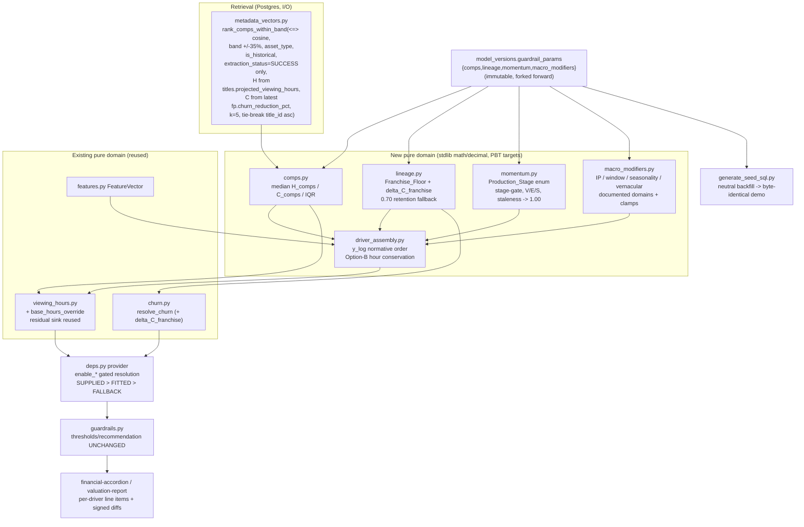

# Design Document

## Overview

The Advanced_Content_Eval_Drivers feature upgrades the Layer-A engagement/viewership modeling of CineROI AI with four industry drivers -- Comps_Engine (A), Lineage_Decay (B), Momentum_Telemetry (C), and Macro_Modifiers (D) -- that feed the existing `ValuationInputs` through the same pure-domain discipline already established by `app.domain.churn`, `app.domain.viewing_hours`, and `app.domain.engagement`. Driver A replaces the blunt platform-wide viewing-hours intercept (`exp(8) - 1 ~= 2980` base hours) with an empirical Bayesian prior anchored to the median of a title's five nearest historical comps; Driver B adds a franchise floor and churn retention credit from parent-title performance; Driver C adds stage-gated trailer/social/search momentum that degrades to neutral on stale or dead telemetry; Driver D adds four multiplicative market modifiers for source-IP provenance, theatrical-to-streaming windowing halo, calendar seasonality, and vernacular reach.

The design preserves every existing guarantee. The four guardrail thresholds (CPVH ceiling, LTV-to-Cost floor, the 1.5 churn hurdle, payback target), the recommendation logic, the non-correctable churn classification, the governance sign-off gates, and the seeded demo verdicts are untouched. The drivers write only engine *inputs* (projected viewing hours, churn-mitigation percentage) through the `ValuationInputProvider` boundary and never re-define a threshold. Every new coefficient ships as a `DETERMINISTIC_FALLBACK` Illustrative_Coefficient under the existing immutable `model_versions.guardrail_params` JSONB (carried forward unchanged on calibration forks); the `SUPPLIED > FITTED > DETERMINISTIC_FALLBACK` precedence holds for every input; and four per-driver kill-switches (`enable_comps`, `enable_lineage`, `enable_momentum`, `enable_macro_modifiers`) default **false**, so the five seeded demo titles (Aurora Protocol, Monsoon Lanes, The Ledger, Vintage Reruns Vol. 7, Echoes of 2019) and all existing tests stay byte-identical until a driver is explicitly enabled.

All four drivers conserve the established Option-B hour-space breakdown attribution. The multiplicative hour-deltas do not commute in `Decimal`, so the application/attribution order is **normative**: Comps anchor -> additive betas -> release-window halo -> source-IP provenance -> vernacular TAM -> calendar seasonality. The rounding/clamp residual is carried by the **existing** `rounding_or_bounds_adjustment` line item in `viewing_hours.py` (never dumped into the Comps anchor), so the Comps anchor contribution shown on the breakdown strictly equals `H_comps`, the empirical median of the five comps, and stays 100% auditable.

The scope of this document is **design only**: no implementation, no applied migrations, no executed tests. It produces exactly this `design.md`.

### Grounding summary (verified against the current codebase)

- `app/domain/deal_stage.py`: `DealStage` is the **human acquisition pipeline** (SCREENING, EVALUATED, IN_NEGOTIATION, APPROVED, CLOSED_WON, CLOSED_LOST, PASSED) with `INITIAL_STAGE`, `ALLOWED_TRANSITIONS`, `validate_transition`, `STAGE_LABELS`. `titles.deal_stage` (migration `0004_deal_stage`, server default `SCREENING`, CHECK over the seven stages) and `app/models/title.py` `DEAL_STAGES` enforce the same set. It is **not** a production-readiness lifecycle. Driver C's `Production_Stage` is a **new sibling enum**; `deal_stage.py` is reused **read-only / untouched**.
- `app/domain/windowing.py`: `WindowType` is **licensing-window exclusivity** (EXCLUSIVE, NON_EXCLUSIVE) with `validate_windowing` / `compute_payback_horizon` / `project_window_value` / `partition_windows`. It is a payback/licensing module, not a theatrical-release-window module. Driver D's `Release_Window_Halo` is a **new concept**; `windowing.py` is reused **untouched** (not extended, not re-defined).
- `app/domain/viewing_hours.py`: the log-space model `y_log = intercept + sum_i(beta_i * x_i)`, `H_hat = exp(y_log) - 1`, Option-B hour allocation `H0 = exp(intercept) - 1`, `hours_i = (beta_i * x_i / L) * dH`, a single trailing `ViewingHoursContribution(key="rounding_or_bounds_adjustment", label="Rounding or Bounds Adjustment")` absorbing the floor-clamp delta + whole-hour quantization residual so `sum(breakdown.hours) == viewing_hours` exactly. `VIEWING_HOURS_FLOOR = Decimal("1")`, `VIEWING_HOURS_QUANTUM = Decimal("1")`, fixed `Context(prec=50, rounding=ROUND_HALF_UP)`. `DEFAULT_VIEWING_HOURS_PARAMS.intercept = Decimal("8.0")`. `resolve_viewing_hours` is SUPPLIED-wins; `parse_params` full-fallback. This is the module the Comps anchor extends and the residual sink reuses.
- `app/domain/features.py`: the shared frozen `FeatureVector` carries `franchise_flag` (0/1, `FRANCHISE_NEUTRAL = Decimal("0")`), `asset_type`, `genre`, `content_format`, `runtime_minutes`, `is_exclusive`, `production_scale`, `talent_pedigree`, `normalized_rating`, `log_vote_count`, `award_signal`, and split-only `release_year`. `PREDICTIVE_FEATURES` is authoritative. `normalize_label` / `normalize_genre` / `normalize_asset_type` are reused.
- `app/domain/churn.py`: additive model; `CHURN_MITIGATION_THRESHOLD = Decimal("1.5")`, `MIN_CHURN = Decimal("0.10")`, `MAX_CHURN = Decimal("5.00")`, `BORDERLINE_BAND = Decimal("0.05")`, single `bounds_adjustment` conservation entry, `resolve_churn(supplied, features, params, params_source)` SUPPLIED-wins, `ChurnResult` carrying `assumed_features`. Churn mitigation is additive in pct points; a 1.5 breach is non-correctable and forces PASS. Driver B's churn credit is additive into this value.
- `app/models/metadata_vector.py`: `metadata_vectors.narrative_dna` is `Vector(1536)` (`NARRATIVE_DNA_DIMENSIONS = 1536`); `talent_pedigree_score` / `production_scale_metric` are `Numeric(4,2)` in [0,10]; `extraction_status` is `Text` **nullable** with a CHECK over `{SUCCESS, FAILED}` (a NULL is representable); FK to `titles` (CASCADE) and `title_versions`. `app/engines/feature_extraction.py` writes a **FAILED marker row whose `narrative_dna` is a zero vector (`[0.0] * 1536`)** when extraction fails, and `app/engines/guardrails.py` deliberately selects only `extraction_status == "SUCCESS"` rows to avoid those markers. Driver A's comps query **must** reuse that SUCCESS-only discipline: a FAILED (zero-vector) **or NULL** `extraction_status` row is an ineligible comp (see Driver A SQL).
- `app/repositories/metadata_vectors.py`: `MetadataVectorRepository.rank_similar_titles(title_vector, exclude_title_id, limit=3)` already does title-to-title cosine similarity via `MetadataVector.narrative_dna.cosine_distance(title_vector)`, returns `SimilarTitle(title_id, title_name, genre_tag, recommendation_status, cosine_similarity)`, dedups multiple vectors per title to the closest row, and **orders by the derived `1 - distance` expression** (not the bare `<=>`) to force an exact sequential scan at demo data volumes where IVFFlat returns zero candidates. Driver A adds a **new** budget-band + asset-type + historical-only retrieval method alongside this (the `limit=3` display default is the comps *display* surface, not the `k=5` anchor). The method reuses this module's two established patterns: the SUCCESS-only / dedup-to-closest-row-per-title discipline and the correlated newest-row `financial_projections` subquery (`latest_recommendation` orders by `FinancialProjection.created_at.desc()`).
- `app/models/financial_projection.py`: each `financial_projections` row carries `churn_reduction_pct` `Numeric(6,2)` (nullable), `recommendation_status`, `explanation` JSONB, and `created_at`; the newest row per title is the title's current churn-mitigation percentage. **There is no churn column on `titles`**, so a comp's churn-mitigation percentage feeding `C_comps` must come from its latest `financial_projections.churn_reduction_pct`.
- `app/models/market_telemetry_cache.py`: keyed uniquely by `(genre_tag, territory)`; `social_sentiment_index` / `chart_velocity_score` `Numeric(6,2)`; `licensing_inflation_multiplier` `Numeric(6,3)`; `source_available` boolean (`server_default="true"`; `False` = retained-but-stale); `last_updated_at` timestamp (the staleness clock). `MarketTelemetryResponse` exposes `source_available` and `found`.
- `app/models/title.py`: `titles` carries `asset_type` (ORIGINAL_SERIES, ORIGINAL_FILM, LICENSED_LIBRARY, CO_PRODUCTION), `acquisition_cost_or_budget` `Numeric(14,2)`, `native_currency`, `target_territories` JSONB, `genre_tag`, `deal_stage`, `projected_viewing_hours` `Numeric(16,2)`, `is_historical`. Normalized-USD cost comes from the currency/FX path (`app/domain/currency.py`); the Budget_Band is computed in normalized USD.
- `app/schemas/api.py`: `ValuationScorecardResponse.explanation: dict[str, Any]` is the pass-through structured explanation; `MetadataBreakdown` summarizes the vector by `narrative_dna_dimensions`; `TitleCompOut` / `ComparableTitlesResponse` already serve `GET /valuation/{title_id}/comps`. Decimal fields serialize as JSON strings; the frontend coerces with `num()` / `toNumber()`.
- `app/core/config.py`: `Settings` (pydantic-settings, `env_prefix="CINEROI_"`, `.env`, `extra="ignore"`); `get_settings()` is the `lru_cache` accessor. No `enable_*` flags exist yet.
- `database/migrations/` (Alembic, lineage `0001`..`0004_deal_stage`, each revision pinning the prior `down_revision`); `database/seed/generate_seed_sql.py` (stdlib-only, `--check` idempotent, imports the real domain defaults and self-asserts no drift, builds the `guardrail_params` JSONB carrying `churn_model` + `content_eval` sub-objects, each title snapshot, and the stored `financial_projections` with embedded explanations). The five canonical demo titles: Aurora Protocol, Monsoon Lanes, Echoes of 2019 GREENLIGHT; The Ledger NEGOTIATE_HARD; Vintage Reruns Vol. 7 PASS.
- `model_versions.guardrail_params` is JSONB; `calibration.py` forks a new immutable version copying it forward, so new driver sub-objects ride along unchanged. Rows are immutable.
- Tests: backend pytest + Hypothesis over pure `app/domain/*`; frontend Vitest + Testing Library. `CineROI_AI_Calculations_Reference.md` and `CineROI_AI_Architecture_And_Data_Flow.md` at repo root document formula/threshold conventions and worked examples.

## Module map: reused vs. new

### Reused untouched (no edit)

| Module | How it is reused |
| --- | --- |
| `app/domain/deal_stage.py` | Left exactly as-is. `Production_Stage` is a **separate** enum; the acquisition lifecycle, `titles.deal_stage`, and its CHECK are untouched (R3.1). |
| `app/domain/windowing.py` | Left exactly as-is. `WindowType` (licensing exclusivity) is never re-defined; `Release_Window_Halo` is a new concept in a new module (R4.2). |
| `app/domain/features.py` | `FeatureVector`, `PREDICTIVE_FEATURES`, `franchise_flag`, `normalize_*` consumed as-is for the additive beta terms and label normalization. |

### Reused extended (additive edits only)

| Module | Edit |
| --- | --- |
| `app/domain/viewing_hours.py` | Gains an optional `base_hours_override: Decimal \| None` path so `H0` derives from `H_comps` instead of `exp(intercept) - 1` when Driver A is active. The **existing** `rounding_or_bounds_adjustment` contribution stays the sole residual sink (R1.6, R5.2, R5.3). No other structural change. |
| `app/domain/churn.py` | Gains an optional `base_churn_override: Decimal \| None` parameter on `calculate_churn_mitigation` (churn analogue of `base_hours_override`): when set, seeds a `comps_anchor` churn line equal to `C_comps` in place of the `base_platform_rate` intercept line. The **existing** single `bounds_adjustment` entry stays the sole churn residual sink. Driver B's `delta_C_franchise` is added as a `franchise_loyalty_credit` line before the `[0.10,5.00]` clamp and the 1.5 hurdle classification. Thresholds and the non-correctable rule are untouched (R2.4, R5.2, R5.3). |
| `app/core/config.py` | Four boolean flags added to `Settings` (default false). |
| `app/schemas/api.py` | Additive per-driver provenance block inside the existing `explanation` dict; `TitleCompOut` extended with the anchor fields; no field removed. |
| `app/repositories/metadata_vectors.py` | New method `rank_comps_within_band(...)` alongside `rank_similar_titles` (budget-band + asset-type + historical-only + `k=5` + deterministic tie-break). |
| `app/engines/guardrails.py` / `app/api/deps.py` | Provider resolves the four drivers behind their flags and threads a `driver_explanations` block, mirroring the content-eval passthrough. Thresholds/recommendation untouched. |
| `database/seed/generate_seed_sql.py` | Emits `comps` / `lineage` / `momentum` / `macro_modifiers` sub-objects under `guardrail_params`; backfills the new columns with neutral defaults. Inert while flags are false. |

### New pure domain modules

| New module | Responsibility |
| --- | --- |
| `app/domain/comps.py` | Driver A pure math: median / IQR / band membership / deterministic tie-break over an **in-memory** comp set; produces `H_comps`, `C_comps`, `Comps_Dispersion`, realized `k`, Source_Tier. The pgvector retrieval lives in the repository, not here. |
| `app/domain/lineage.py` | Driver B pure math: `Franchise_Floor`, the 0.70-retention fallback, and `delta_C_franchise`. |
| `app/domain/momentum.py` | Driver C pure math: `Production_Stage` enum, stage-gating, `V_trailer` / `E_ratio` / `S_velocity` composition, `S_velocity` clamp [0.50, 2.00], staleness/availability degradation, STAGE_EXCLUDED. |
| `app/domain/macro_modifiers.py` | Driver D pure math: the four multipliers with documented domains and clamps. |
| `app/domain/driver_assembly.py` | The combined log-space assembler enforcing the normative Attribution_Order and the Option-B hour-space conservation across all drivers (the single place `y_log` is composed and the breakdown is attributed). |

All new modules are pure: no I/O, no async, no DB, stdlib `math`/`decimal` only, importable without the framework (R5.6). Each mirrors the `churn.py` / `viewing_hours.py` shape: frozen `*_Params` parsed with full fallback, frozen `*_Features`, a `calculate_*` returning a conserving/clamped result, and a `resolve_*` implementing SUPPLIED-wins.

## Architecture



### Design principles

1. **One driver, one pure module, one shared assembler.** Each driver is an independent Hypothesis target; `driver_assembly.py` is the only place the log-space sum is composed and the hour-space breakdown is attributed, so the normative order lives in exactly one place (R5.4).
2. **Decision core untouched.** Drivers write only projected viewing hours and churn pct via the provider; thresholds, recommendation, governance, and the churn non-correctable rule are never touched (R5 intro, Out of Scope).
3. **Residual isolation.** The Comps anchor line always equals `H_comps`; only `rounding_or_bounds_adjustment` ever carries a residual (R5.2, R5.3).
4. **Deterministic, dependency-free math.** All driver math uses stdlib `math`/`decimal` under the existing `Context(prec=50, ROUND_HALF_UP)`; pgvector runs in Postgres and the retrieval is the only I/O (R5.6).
5. **Flags off == inert.** A false flag makes a driver contribute nothing to `ValuationInputs`, the breakdown, the explanation, or the verdict (R7.2).

## The combined log-space model

Let `H_comps` be the Comps anchor (median of the comp set, Driver A), `beta_i * x_i` the additive log-space feature terms from `viewing_hours.py`, and `M_window`, `M_ip`, `M_vernacular`, `M_calendar` the Driver-D multipliers (the Driver-C `Momentum_Multiplier`, when active, enters as an additional `ln(M_momentum)` term after the betas and before the macro multipliers). The log-space prediction is:

```
y_log = ln(1 + H_comps)
      + sum_i(beta_i * x_i)          # additive engagement features
      + ln(M_momentum)               # Driver C (1.00 when excluded/stale/flag-off)
      + ln(M_window)                 # Driver D release-window halo
      + ln(M_ip)                     # Driver D source-IP provenance
      + ln(M_vernacular)             # Driver D vernacular TAM
      + ln(M_calendar)               # Driver D calendar seasonality

H_hat = exp(y_log) - 1
```

> **Aligned with R5.1 / R5.2 / R5.4 and the Attribution_Order glossary, as amended by the R5 erratum.** The requirements erratum in Requirement 5 amends R5.1's `y_log`, R5.2's conservation identity, R5.4's Attribution_Order, and the glossary Attribution_Order to include the Driver-C `ln(M_momentum)` term as **Stage 2** (between the additive betas and `ln(M_window)`) and the Driver-B `Franchise_Floor` as the **Stage 7** hour-space `max` clamp, with matching `Hours_momentum` and `Hours_franchise_floor` lines in the conservation identity. This design and the requirements therefore state the **same** normative seven-term order; neither document supersedes the other. The momentum term is neutral (`M_momentum = 1.00`, 0-hour line) whenever Driver C is flag-off, STAGE_EXCLUDED, stale, or unavailable, so the flag-off path remains byte-identical to the momentum-free identity.

Base hours derive from `H_comps` (Driver A replaces the generic intercept, R1.6): `H0 = H_comps`. When Driver A is off or the comp set is empty, `H0 = exp(intercept) - 1` exactly as today, so the flag-off path is byte-identical.

### Normative application / attribution order (does not commute in Decimal)

The multiplicative hour-deltas are attributed by **sequential re-exponentiation** in this fixed order (R5.4). Stages 0-6 are log-space; Stage 7 is a hour-space floor applied after re-exponentiation. Each multiplicative stage's hour-delta is the difference of the running `exp(partial_y) - 1`:

```
Stage 0  anchor      : H0  = H_comps
Stage 1  additive bi : H1  = exp(ln(1+H0) + L) - 1,   L = sum_i(beta_i*x_i)
                       per-feature hours_i = (beta_i*x_i / L) * (H1 - H0)   # Option B, L>0
Stage 2  M_momentum  : H2  = exp(... + ln(M_momentum)) - 1 ; d_mom = H2 - H1
Stage 3  M_window    : H3  = exp(... + ln(M_window)) - 1   ; d_win = H3 - H2
Stage 4  M_ip        : H4  = exp(... + ln(M_ip)) - 1       ; d_ip  = H4 - H3
Stage 5  M_vernacular: H5  = exp(... + ln(M_vern)) - 1     ; d_vern= H5 - H4
Stage 6  M_calendar  : H6  = exp(... + ln(M_cal)) - 1      ; d_cal = H6 - H5
Stage 7  franchise   : H7  = max(H6, Franchise_Floor)      ; d_floor = H7 - H6 >= 0   # Driver B, hour-space
```

`H7 == H_hat` by construction (the final prediction is **post-floor**). Stages 0-6 fix a reproducible multiplicative order because, in `Decimal`, `exp(a)*exp(b)` quantized line-by-line is not bitwise equal under reordering; Stage 7 is a one-sided hour-space clamp (`max`) that can only raise the prediction (`d_floor >= 0`), applied last so the floor is enforced against the fully-assembled hours. When Driver B is off, not a franchise entry, or `Franchise_Floor <= H6`, `d_floor = 0` and `H7 = H6`.

### Option-B conservation and the residual sink

Each stage hour-delta (including Stage 7's `d_floor`) is quantized to whole hours (`VIEWING_HOURS_QUANTUM`) and emitted as its own breakdown line. The conservation identity is:

```
Hours_comps + sum_i(Hours_i)
            + Hours_momentum + Hours_window + Hours_ip + Hours_vernacular + Hours_calendar
            + Hours_franchise_floor
            + rounding_or_bounds_adjustment  ==  H_hat
```

`Hours_franchise_floor` is Stage 7's `d_floor` as its own attributed line -- the franchise lift is a **structural offset** and therefore is **never** routed through the residual sink. `rounding_or_bounds_adjustment` is the **existing** `viewing_hours.py` line item (R1.6, R5.2); it carries **only** the sum of per-line whole-hour quantization residuals -- never a structural offset, and never the franchise floor lift -- so it stays bounded to a few whole hours. `Hours_comps` strictly equals `H_comps` and the Comps anchor is 100% auditable (R5.3). The residual is computed last as `H_hat_quantized - sum(all prior quantized lines, Hours_franchise_floor included)`.

### Churn-space conservation (mirrors the hour-space discipline)

The churn side conserves exactly the same way the hours side does, so the "100% auditable, conserves exactly" guarantee holds on both inputs. `app/domain/churn.py`'s `calculate_churn_mitigation` gains a new optional parameter **`base_churn_override: Decimal | None`** (the churn analogue of the hours-side `base_hours_override`). When Driver A is enabled and the comp set is non-empty, the provider passes `base_churn_override = C_comps`; `calculate_churn_mitigation` then seeds the churn base from `C_comps` instead of from its own `intercept` line, emitting a dedicated `comps_anchor` contribution whose points **strictly equal `C_comps`** (it never carries any residual, exactly as `Hours_comps == H_comps` on the hours side). When Driver A is off or the comp set is empty, `base_churn_override = None` and the existing `base_platform_rate` intercept line is used unchanged, keeping the flag-off path byte-identical.

The existing **single `bounds_adjustment` entry remains the sole residual sink** on the churn side (`churn.py` already reconciles via exactly one `bounds_adjustment` line). Driver B's `delta_C_franchise` is summed on top as its own additive `franchise_loyalty_credit` contribution. The churn conservation identity, reconciled at 2 dp (`_Q = Decimal("0.01")`, `ROUND_HALF_UP`), is:

```
C_comps_anchor + sum_j(feature_points_j) + delta_C_franchise + bounds_adjustment  ==  final_churn
```

where `C_comps_anchor` replaces the `base_platform_rate` line when Driver A is active (otherwise the identity is the current churn identity plus the `delta_C_franchise` term). **The churn model is purely additive, so the summation of its line items commutes** -- the order in which `C_comps_anchor`, the per-feature points, and `franchise_loyalty_credit` are listed or summed carries **no** numeric significance, exactly as in today's `churn.py`. Each line (`comps_anchor`, every `feature_points_j`, `franchise_loyalty_credit`) is quantized to 2 dp (`_Q = Decimal("0.01")`, `ROUND_HALF_UP`) the same way the existing contributions are, and the single `bounds_adjustment` entry is the only reconciliation residual. **The only normative ordering on the churn side is a reduction step, not a term order:** `delta_C_franchise` must be summed into the **unclamped** total **before** the `[MIN_CHURN, MAX_CHURN] = [0.10, 5.00]` clamp **and before** the 1.5% hurdle / `BORDERLINE_BAND` classification, so the loyalty credit can legitimately lift a title across the hurdle and the clamp still bounds the final value. `bounds_adjustment` then absorbs only the clamp delta plus the 2 dp quantization residual -- never a structural offset and never the `C_comps` anchor value. The non-correctable rule (a 1.5 breach forces PASS) and the threshold itself are untouched; Driver B only changes the resolved churn *value* feeding that unchanged rule.

## Full end-to-end worked numeric example

Concrete title: **Aurora Protocol** (ORIGINAL_SERIES), all four drivers enabled. All arithmetic under `Context(prec=50, ROUND_HALF_UP)`, quantized to whole hours. This is a design worked example (illustrative inputs), not the seeded flag-off value.

### Driver A -- comp set and anchor

Five nearest eligible historical comps (within the +/-35% normalized-USD budget band and matching `asset_type = ORIGINAL_SERIES`), their projected viewing hours sorted ascending:

```
2600, 2900, 3100, 3400, 4200
```

- `H_comps` = median of 5 = the 3rd value = **3100** (exact, no residual folded in).
- The same five comps' churn-mitigation percentages (each the comp's latest `financial_projections.churn_reduction_pct`), aligned to the hours sort order above: `1.60, 1.80, 1.90, 2.10, 2.30`. Sorted ascending they are `1.60, 1.80, 1.90, 2.10, 2.30`, so `C_comps` = median of 5 = the 3rd value = **1.90** (percentage points; surfaced for the churn anchor; not shown in the hour breakdown). This is the `c_comps = "1.90"` value in the explanation JSON below.
- `Comps_Dispersion` (IQR) = Q3 - Q1 = ((3400 + 4200)/2) - ((2600 + 2900)/2) = 3800 - 2750 = **1050** hours.
- realized `k = 5`, Source_Tier = `DETERMINISTIC_FALLBACK` (the illustrative coefficients tier; the anchor value itself is empirical).

### Additive engagement features (log space)

Three active numeric features (from `FeatureVector`, illustrative betas):

| Feature | x_i | beta_i | beta_i * x_i |
| --- | --- | --- | --- |
| normalized_rating | 0.80 | 0.12 | 0.0960 |
| franchise_flag | 1 | 0.08 | 0.0800 |
| award_signal | 0.30 | 0.10 | 0.0300 |

`L = sum(beta_i * x_i) = 0.2060`. `ln(1 + H_comps) = ln(3101) = 8.0394799191...`.

### Driver D multipliers (documented domains)

- `M_window` = **1.25** (THEATRICAL_30D release-window halo)
- `M_ip` = **1.20** (BESTSELLER_BOOK source-IP provenance)
- `M_vernacular` = **1.00** (primary-language-only; neutral)
- `M_calendar` = **1.15** (festive window, inside the [0.80, 1.35] clamp)

(`M_momentum` = 1.00 for this example -- treated as ACQUISITION_READY with neutral telemetry -- so it emits a 0-hour line, shown explicitly in the table below. Aurora Protocol is **not** a franchise entry (`is_franchise = false`), so the Stage 7 `Franchise_Floor` is inactive, `d_floor = 0`, and `H7 = H6`.)

### Log-space assembly

```
y_log = 8.0394799191... + 0.2060 + ln(1.25) + ln(1.20) + ln(1.00) + ln(1.15)
      = 8.7907069695...
H_hat = exp(y_log) - 1 = 6571.87735764... -> quantized 6572
```

### Hour-space breakdown (normative order, every line shown)

| Line item | Hours |
| --- | ---: |
| comps_anchor (= H_comps, exact median) | 3100 |
| normalized_rating | 331 |
| franchise_flag | 275 |
| award_signal | 103 |
| momentum (M_momentum, neutral) | 0 |
| release_window_halo (M_window) | 953 |
| source_ip_provenance (M_ip) | 953 |
| vernacular_tam (M_vernacular, neutral) | 0 |
| calendar_seasonality (M_calendar) | 857 |
| franchise_floor (Stage 7, inactive) | 0 |
| rounding_or_bounds_adjustment (residual sink) | 0 |

Intermediate running hours: `H1 (after betas) = 3809.36...`, `H2 (after momentum, neutral) = 3809.36...`, `H3 (after window) = 4761.95...`, `H4 (after IP) = 5714.55...`, `H5 (after vernacular) = 5714.55...`, `H6 (after calendar) = 6571.88... -> 6572`, `H7 (after franchise floor, inactive) = 6571.88... -> 6572`.

### Conservation identity (to the exact Decimal)

```
3100 + 331 + 275 + 103 + 0 + 953 + 953 + 0 + 857 + 0 + 0  ==  6572  ==  H_hat (quantized, post-floor H7)
```

The term list matches the normative identity one-for-one: comps_anchor, three feature lines, `Hours_momentum` (0), window, IP, vernacular (0), calendar, `Hours_franchise_floor` (0), and `rounding_or_bounds_adjustment` (0). The residual is exactly **0** here; across arbitrary inputs it is bounded to a few whole hours of quantization residual only (never the franchise lift, which has its own `franchise_floor` line) and is the only line that ever carries a non-anchor, non-feature, non-structural value (verified programmatically under the fixed Decimal context). The Comps anchor line is exactly `H_comps = 3100`, never adjusted; the final prediction is the post-floor `H7`.

### Churn-space worked example (same title, same comp set)

Using the same comp set, `C_comps = 1.90` (the median of the five comps' churn percentages `1.60, 1.80, 1.90, 2.10, 2.30`, derived above). Driver A seeds the churn base from `C_comps` via `base_churn_override`, replacing the `base_platform_rate` line. Illustrative additive feature points on top (from `churn.py`'s existing additive model, 2 dp): asset_cadence `+0.35`, genre_affinity `+0.15`, exclusivity_lift `+0.00` (non-exclusive). Suppose Aurora Protocol were a 2nd franchise entry (`franchise_order = 2`): `delta_C_franchise = clamp(0.15 + 0.05*min(2-1, 6), 0.15, 0.45) = clamp(0.20, ...) = +0.20` (see Driver B).

```
unclamped = C_comps(1.90) + 0.35 + 0.15 + 0.00 + delta_C_franchise(0.20) = 2.60
clamped   = clamp(2.60, 0.10, 5.00) = 2.60        # within [MIN_CHURN, MAX_CHURN]
final     = 2.60   (2 dp)
bounds_adjustment = final - (1.90 + 0.35 + 0.15 + 0.00 + 0.20) = 2.60 - 2.60 = 0.00
```

Churn conservation identity (to the exact Decimal, 2 dp):

```
C_comps_anchor(1.90) + 0.35 + 0.15 + 0.00 + delta_C_franchise(0.20) + bounds_adjustment(0.00)  ==  2.60  ==  final_churn
```

The `comps_anchor` churn line is exactly `C_comps = 1.90` (never carries residual), `delta_C_franchise` was applied before the clamp and the 1.5 hurdle classification (here `2.60 > 1.5`, so the title clears the hurdle), and the single `bounds_adjustment` line carries only the (here zero) residual. Had Driver B been inactive (non-franchise), the `delta_C_franchise` term is `0.00` and the identity reduces to the current churn identity with the `C_comps` anchor swapped in.

## Driver A -- Comps_Engine (`app/domain/comps.py` + repository method)

**pgvector retrieval (Postgres, I/O).** A new `MetadataVectorRepository.rank_comps_within_band(...)` sits alongside `rank_similar_titles`. It reuses that method's SUCCESS-only / dedup / correlated-newest-row patterns. Concrete SQL shape (named columns, no placeholders):

```sql
SELECT
    t.title_id,
    t.title_name,
    t.genre_tag,
    t.projected_viewing_hours          AS comp_viewing_hours,   -- H_comps source
    (                                                           -- C_comps source:
        SELECT fp.churn_reduction_pct                           --   newest financial_projections
        FROM financial_projections fp                           --   row per comp title
        WHERE fp.title_id = t.title_id
        ORDER BY fp.created_at DESC
        LIMIT 1
    )                                   AS comp_churn_pct,
    (mv.narrative_dna <=> :query_vec)   AS cos_dist              -- pgvector cosine distance
FROM metadata_vectors mv
JOIN titles t ON t.title_id = mv.title_id
WHERE t.is_historical = TRUE
  AND t.title_id <> :query_title_id
  AND t.asset_type = :query_asset_type
  AND mv.extraction_status = 'SUCCESS'          -- exclude FAILED (zero-vector) and NULL markers
  AND :cost_usd_low  <= :comp_cost_usd           -- normalized-USD band, resolved in the seam
  AND :comp_cost_usd <= :cost_usd_high
ORDER BY cos_dist ASC, t.title_id ASC            -- deterministic tie-break
LIMIT :widened;                                  -- widened; dedup to closest SUCCESS row per title in Python
```

- **SUCCESS-only (Finding 1, R1.6).** `mv.extraction_status = 'SUCCESS'` is mandatory: `feature_extraction.py` writes a FAILED marker row whose `narrative_dna` is `[0.0] * 1536`, so without this filter a zero-vector row with a meaningless cosine distance could enter the `k = 5` set and silently corrupt the empirical anchor. Because the column is nullable, `= 'SUCCESS'` also excludes NULL (the desired behaviour — NULL is ineligible, same as FAILED). This mirrors the SUCCESS-only selection `guardrails.py` already uses for the feature path. The **realized `k` counts only SUCCESS rows**, so both the `<k` shrink and the zero-comp intercept fallback key off the SUCCESS-filtered, deduped count.
- **`H_comps` source (Finding 2).** Each comp's viewing hours = `titles.projected_viewing_hours` (`Numeric(16,2)`). A NULL / non-finite value is excluded from the median and recorded as skipped (the skip rule below).
- **`C_comps` source (Finding 2).** Each comp's churn-mitigation percentage = the comp's **latest** `financial_projections.churn_reduction_pct`, resolved by a correlated newest-row scalar subquery (`ORDER BY fp.created_at DESC LIMIT 1`, correlated on `fp.title_id = t.title_id`) — the same shape as `rank_similar_titles`' `latest_recommendation`. A comp with no projection yet yields NULL churn and is handled by the skip rule (excluded from the `C_comps` median), not dropped from the comp set. There is no churn column on `titles`; this subquery is the only resolvable source.
- **Budget_Band:** `[0.65 * cost, 1.35 * cost]` in normalized USD via the existing currency/FX path (R1.2). The normalization is resolved in the repository/engine seam before the query (FX is async I/O) and passed in as the bound `:cost_usd_low` / `:cost_usd_high` (and `:comp_cost_usd` for each candidate's normalized cost).
- **Deterministic tie-break:** `ORDER BY cos_dist ASC, title_id ASC` so equal-distance comps resolve reproducibly (R1.4). As with `rank_similar_titles`, the DB `LIMIT` is widened (`:widened`) and multiple SUCCESS vectors per title dedup to the single closest row in Python before truncating to `k = 5`.
- **`k = 5`** is the post-dedup truncation count over SUCCESS rows only.

**Pure math (`comps.py`).** Receives the retrieved comps' viewing-hours list (from `titles.projected_viewing_hours`) and churn-pct list (from each comp's latest `financial_projections.churn_reduction_pct`) as in-memory `Decimal`s, with NULL/non-finite entries already resolved to a skip marker, and computes:

- `H_comps` = median of the non-skipped viewing-hours values (for an even realized `k`, the mean of the two central values, all in `Decimal`); `C_comps` = median of the non-skipped churn-pct values. A comp whose `projected_viewing_hours` is NULL/non-finite is skipped for `H_comps`; a comp whose latest `churn_reduction_pct` is NULL is skipped for `C_comps` (the two medians can have different effective counts, each recorded).
- `Comps_Dispersion` = IQR of the viewing-hours list (Q1/Q3 by the averaged-halves method shown in the worked example), a pure `Decimal` computation surfaced for the UI (R1.7, R10.1).
- Band membership, tie-break ordering of an in-memory candidate list (so the math is exercisable with in-memory vectors, R1.8, R5.6).

**`<k` fallback (chosen: shrink k; justification).** If fewer than 5 eligible comps exist, shrink `k` to the eligible count and compute the medians over that smaller honestly-labeled set (R1.5). Shrinking is chosen over **widening the band** because widening silently changes the comparability contract the buyer is shown, whereas a smaller set keeps every comp inside the stated +/-35% band and asset type; the realized `k` and `Comps_Dispersion` are surfaced so a small/wide set reads as lower confidence (R10.1). If **zero** eligible comps exist, fall back to the DETERMINISTIC_FALLBACK constant intercept of `viewing_hours.py` (`H0 = exp(intercept) - 1`) and record the comps Source_Tier as `DETERMINISTIC_FALLBACK`.

**Anchor wiring.** `viewing_hours.py` gains an optional `base_hours_override`. When Driver A is enabled and the comp set is non-empty, the provider passes `base_hours_override = H_comps`; `calculate_viewing_hours` then sets `H0 = H_comps` (instead of `exp(intercept) - 1`), leaving the additive-lift allocation and the residual sink untouched (R1.6). On the churn side, `C_comps` is passed as `base_churn_override` to `calculate_churn_mitigation` (the churn analogue of `base_hours_override`), seeding a `comps_anchor` churn line whose points strictly equal `C_comps`; the existing single `bounds_adjustment` entry remains the sole churn residual sink (see "Churn-space conservation" above).

**Edge cases / validation.** Query title with no stored embedding -> no comps (`found = false`, fall back to intercept). Non-finite or absent comp viewing-hours are excluded from the median (recorded as skipped). The query vector must be length 1536; a mismatch is a retrieval error (recoverable: fall back to intercept, log at WARNING).

## Driver B -- Lineage_Decay (`app/domain/lineage.py`)

**Inputs (frozen `LineageFeatures`):** `is_franchise: bool`, `franchise_order: int` (1 = original), `parent_title_viewing_hours: Decimal | None` (90-day), `parent_completion_rate: Decimal | None` in [0.00, 1.00] (R2.1).

**Franchise_Floor (R2.2):**

```
Franchise_Floor = parent_title_viewing_hours * (alpha_base_decay + beta_comp * parent_completion_rate)
```

Illustrative coefficients: `alpha_base_decay = 0.55`, `beta_comp = 0.35` (both `DETERMINISTIC_FALLBACK`, non-negative). The driver raises projected viewing hours to at least `Franchise_Floor`. This is **Stage 7** of the normative Attribution_Order (a one-sided hour-space clamp applied after the fully-assembled hours `H6`): `H7 = max(H6, Franchise_Floor)`, `d_floor = H7 - H6 >= 0`. The lift is attributed to its **own** `franchise_floor` breakdown line (`Hours_franchise_floor = d_floor`) and is a structural offset -- it is therefore **never** routed through `rounding_or_bounds_adjustment`, which stays reserved for the whole-hour quantization residual only. The final prediction `H_hat` is the post-floor `H7`.

**0.70-retention fallback (R2.3):** when `is_franchise = true` and `franchise_order > 1` but `parent_title_viewing_hours` or `parent_completion_rate` is absent/non-finite, use the title's genre baseline viewing hours with an **assumed** `parent_completion_rate = 0.70`, recorded in `assumed_features`.

**Churn credit (R2.4):**

```
delta_C_franchise = clamp(gamma_base + delta_order * loyalty_signal, 0.15, 0.45)   # percentage points
```

with the following fully-defined `DETERMINISTIC_FALLBACK` Illustrative_Coefficients and input:

- `gamma_base = Decimal("0.15")` -- the floor of the band (the minimum built-in-loyalty credit any franchise entry earns).
- `delta_order = Decimal("0.05")` -- additional credit per franchise position above the original.
- `loyalty_signal = min(franchise_order - 1, 6)` -- an integer input derived from `franchise_order` (1 = original -> 0), capped at 6 so the credit saturates.

So `delta_C_franchise = clamp(0.15 + 0.05 * min(franchise_order - 1, 6), 0.15, 0.45)`: it is **non-decreasing in `franchise_order`** (the 2nd entry earns +0.20, the 3rd +0.25, ...) and **saturates at the +0.45% band ceiling by the 7th entry** (`franchise_order >= 7`). `delta_C_franchise` is clamped to the inclusive **[+0.15%, +0.45%]** band and **added** to the churn value as the `franchise_loyalty_credit` contribution (additive in pct points, consistent with `churn.py`), applied **before** the `[0.10, 5.00]` clamp and the 1.5 hurdle classification (see "Churn-space conservation"); it never re-defines the 1.5 hurdle or the non-correctable rule.

**Non-franchise (R2.5):** `is_franchise = false` or `franchise_order = 1` -> no floor, zero churn credit, base prediction unchanged.

**Purity (R2.6):** pure `Decimal` function; inputs left unmodified; floor and credit computed with no I/O.

## Driver C -- Momentum_Telemetry (`app/domain/momentum.py`)

**`Production_Stage` enum (new, R3.1):** members `CONCEPT_SCRIPT`, `IN_PRODUCTION`, `FESTIVAL_PREVIEW`, `ACQUISITION_READY`, distinct from `DealStage`. Declared in `momentum.py` with a `coerce_stage` + `STAGE_LABELS` mirroring `deal_stage.py`'s shape; `deal_stage.py` and `titles.deal_stage` are untouched.

**Stage gating (R3.3):**
- `CONCEPT_SCRIPT` or `IN_PRODUCTION` -> `Momentum_Multiplier = 1.00`, set `STAGE_EXCLUDED` flag; never penalizes an unproduced pitch.
- `FESTIVAL_PREVIEW` or `ACQUISITION_READY` -> compute the multiplier from the signals.

**Signals (R3.2):**
- `V_trailer` = first-72h organic views / trailer marketing budget (Trailer Velocity Index).
- `E_ratio` = `(Likes + 2 * Comments) / Views` (Organic Engagement Ratio).
- `S_velocity` = search-intent velocity vs. genre baseline, **clamped to [0.50, 2.00]** (R3.2).

Composition (illustrative, `DETERMINISTIC_FALLBACK`). Every symbol below is a named, bounded `DETERMINISTIC_FALLBACK` coefficient or a normalized input with a defined range, so the composition has no free symbol and the clamp is not trivially saturated:

```
norm(V_trailer) = clamp(V_trailer / baseline_V, 0, cap_V)      # in [0.00, cap_V]
E_norm          = clamp(E_ratio, 0, cap_E)                     # in [0.00, cap_E]
raw = 1 + w_v * norm(V_trailer) + w_e * E_norm + w_s * (S_velocity - 1)
Momentum_Multiplier = clamp(raw, 1.00, momentum_multiplier_max)   # bounded at or above 1.00 when active
```

with the following fully-defined `DETERMINISTIC_FALLBACK` Illustrative_Coefficients (stored in the `momentum` sub-object of `guardrail_params`):

- `w_v = Decimal("0.15")`, `w_e = Decimal("0.20")`, `w_s = Decimal("0.25")` -- the three non-negative composition weights.
- `baseline_V = Decimal("1.0")` -- the Trailer Velocity Index reference (first-72h organic views per unit trailer marketing budget) at which `norm(V_trailer) = 1.00`; `cap_V = Decimal("2.00")` caps the normalized trailer signal so a single viral trailer cannot dominate. `norm(V_trailer)` is therefore in `[0.00, 2.00]`.
- `cap_E = Decimal("1.00")` -- the Organic Engagement Ratio cap (an `E_ratio` is already a bounded-ish `(Likes + 2*Comments)/Views`); `E_norm` is in `[0.00, 1.00]`.
- `S_velocity` is clamped to `[0.50, 2.00]` upstream (R3.2), so `(S_velocity - 1)` is in `[-0.50, 1.00]`.
- `momentum_multiplier_max = Decimal("1.50")` -- the named upper clamp coefficient. **Rationale:** at the saturating positive inputs (`norm(V_trailer) = 2.00`, `E_norm = 1.00`, `S_velocity = 2.00`) the unclamped `raw = 1 + 0.15*2.00 + 0.20*1.00 + 0.25*1.00 = 1.75`, so `1.50` is a deliberate, non-trivially-saturated ceiling (it binds only on near-maximal buzz) that caps a momentum-only lift at +50% and keeps Driver C from overwhelming the empirical comps anchor. The floor is `1.00` so a weak-but-positive signal never drops below the non-momentum baseline.

The multiplier is clamped to the inclusive **[1.00, momentum_multiplier_max] = [1.00, 1.50]** band so momentum never reduces the prediction below the non-momentum baseline (R3.5). The formula, this clamp, Hypothesis Property 3, and the explanation `bounds` string (`"[1.00,1.50]"`) all cite the same `momentum_multiplier_max` coefficient and agree.

**Staleness / availability degradation (R3.4, R10.2-R10.5):** the governing `market_telemetry_cache` reading's `last_updated_at` and `source_available` are passed in as inputs (the pure function never queries). `Telemetry_Staleness_Window = 14 days` (stored with the momentum coefficients, R10.2). **Precondition on the retrieval seam (stated, out of scope to implement here):** `market_telemetry_cache.last_updated_at` is defined via `created_at_column()` -- a creation default with **no `onupdate` trigger**. Since the table is keyed `(genre_tag, territory)` for in-place upserts, the staleness clock is only valid if the telemetry upsert / cache-writer path **re-stamps `last_updated_at` on every poll**; the pure staleness decision is correct given a correctly-stamped value, but the cache writer must set it explicitly on each update for the 14-day window to mean "age since last refresh."
- reading age > 14 days -> `Momentum_Multiplier = 1.00`, reason `STALE` (R10.3).
- `source_available = false` -> `Momentum_Multiplier = 1.00`, reason `UNAVAILABLE` (distinct from stale, R10.4).
- The staleness/availability basis (reading age, `source_available`) is recorded in the explanation so the neutral multiplier is auditable (R10.5).

**Purity (R3.6):** pure `Decimal`; the staleness decision is computed from inputs, not queried inside the function.

## Driver D -- Macro_Modifiers (`app/domain/macro_modifiers.py`)

Four multiplicative modifiers, each with a documented domain and clamp; an absent/unrecognized descriptor resolves to the neutral 1.00 and is recorded as assumed (R4.1).

> The four modifiers are **listed below for reference only**. They are *applied and attributed* in the normative Attribution_Order defined above — `M_window` (release-window halo) -> `M_ip` (source-IP provenance) -> `M_vernacular` (vernacular TAM) -> `M_calendar` (calendar seasonality) — not in the order of this list. The multiplicative Decimal hour-deltas do not commute, so only that order is normative (R5.4).

- **Source_IP_Provenance (R4.1):** ORIGINAL_SCREENPLAY 1.00, BESTSELLER_BOOK 1.20, TRUE_CRIME_IP 1.25, WEBTOON_MANGA 1.15, PUBLIC_DOMAIN 0.95. Domain lookup; unknown -> 1.00 assumed. `PUBLIC_DOMAIN = 0.95` is the **single intentional sub-neutral IP multiplier** (a discount reflecting the lack of exclusive source IP, not a premium); the "never reduces the prediction below its pre-modifier value" monotonicity guarantee applies to **premium (>= 1.00) modifiers only**, and Hypothesis Property 3 asserts IP boundedness over `[0.95, 1.25]` rather than `>= 1.00`.
- **Release_Window_Halo (R4.2):** DIRECT_TO_STREAMING 1.00, DAY_AND_DATE 1.10, THEATRICAL_30D 1.25, THEATRICAL_60D_PLUS 1.40. A **new** concept; `windowing.WindowType` is not re-defined.
- **Calendar_Seasonality (R4.3):** festive window 1.15-1.30 (Diwali / Christmas / Eid / summer), off-peak 0.85-0.90, **clamped to [0.80, 1.35]** inclusive.
- **Vernacular_TAM_Factor (R4.4):** 1.00 (primary-language-only) up to **2.20** (four-plus vernacular audio tracks), derived from target-territory census splits, clamped to its documented inclusive bound.

Each multiplier is applied within its clamp and, for a positive/premium modifier, never reduces the prediction below its pre-modifier value (monotone and bounded per modifier, R4.5). The driver is a pure `Decimal` function leaving inputs unmodified (R4.6).

## Data model changes

Every new column carries an **explicit neutral server-side default** chosen so that, with all flags false, the drivers are inert and the five demo titles recompute byte-identically (R8.1). Columns live on `titles` for the demo's single-version-per-title shape (Assumptions); a child table is an equivalent option but is not needed at demo volumes.

### New columns on `titles`

| Column | Type | Neutral default | Driver |
| --- | --- | --- | --- |
| `is_franchise` | boolean | `false` | B |
| `franchise_order` | integer | `1` | B |
| `parent_title_viewing_hours` | `Numeric(16,2)` | NULL | B |
| `parent_completion_rate` | `Numeric(3,2)` | NULL | B |
| `production_stage` | text | `CONCEPT_SCRIPT` | C |
| `source_ip_provenance` | text | `ORIGINAL_SCREENPLAY` | D |
| `release_window` | text | `DIRECT_TO_STREAMING` | D |
| `release_month` | integer | `NULL` via explicit `server_default=sa.text("NULL")` (NULL is the explicit neutral sentinel; the resolver maps NULL -> 1.00 seasonality) | D |
| `vernacular_track_count` | integer | `1` (primary-language -> 1.00) | D |

`production_stage` gets a CHECK over `{CONCEPT_SCRIPT, IN_PRODUCTION, FESTIVAL_PREVIEW, ACQUISITION_READY}` (separate from `deal_stage`, R8.3). Every column -- including `release_month`, whose explicit `server_default=sa.text("NULL")` makes NULL the **stated** neutral sentinel the resolver maps to a 1.00 seasonality multiplier -- carries an explicit neutral server-side default, satisfying R8.1 / R8.4. The neutral defaults map to: no franchise floor / zero credit (B), STAGE_EXCLUDED -> momentum 1.00 (C), and all Driver-D multipliers = 1.00 (D). Momentum telemetry reuses the existing `market_telemetry_cache` (no new telemetry columns).

### Coefficients (no new table)

The drivers' Illustrative_Coefficients are stored as plain JSON sub-objects under the existing `model_versions.guardrail_params` JSONB with keys `comps`, `lineage`, `momentum`, `macro_modifiers` (R8.5). `calibration.py`'s `dict(active.guardrail_params)` fork carries them forward unchanged; no coefficient table is added (R9.2).

### Alembic migration outline

A single new revision `0005_advanced_content_eval_drivers` (`down_revision = "0004_deal_stage"`):

```python
def upgrade():
    op.add_column("titles", sa.Column("is_franchise", sa.Boolean(), nullable=False, server_default="false"))
    op.add_column("titles", sa.Column("franchise_order", sa.Integer(), nullable=False, server_default="1"))
    op.add_column("titles", sa.Column("parent_title_viewing_hours", sa.Numeric(16, 2), nullable=True))
    op.add_column("titles", sa.Column("parent_completion_rate", sa.Numeric(3, 2), nullable=True))
    op.add_column("titles", sa.Column("production_stage", sa.Text(), nullable=False, server_default="CONCEPT_SCRIPT"))
    op.add_column("titles", sa.Column("source_ip_provenance", sa.Text(), nullable=False, server_default="ORIGINAL_SCREENPLAY"))
    op.add_column("titles", sa.Column("release_window", sa.Text(), nullable=False, server_default="DIRECT_TO_STREAMING"))
    op.add_column("titles", sa.Column("release_month", sa.Integer(), nullable=True, server_default=sa.text("NULL")))  # NULL is the explicit neutral sentinel; resolver maps NULL -> 1.00
    op.add_column("titles", sa.Column("vernacular_track_count", sa.Integer(), nullable=False, server_default="1"))
    op.create_check_constraint("ck_titles_production_stage", "titles",
        "production_stage IN ('CONCEPT_SCRIPT','IN_PRODUCTION','FESTIVAL_PREVIEW','ACQUISITION_READY')")
def downgrade():  # drop the CHECK then the nine columns in reverse
```

No coefficient migration (JSONB sub-objects only). The migration follows the existing lineage/style of `0004_deal_stage` (R8.1).

### Seed backfill plan (byte-identity proof)

`generate_seed_sql.py` is extended to: (1) emit the `comps` / `lineage` / `momentum` / `macro_modifiers` sub-objects under `MODEL_VERSION["guardrail_params"]` (imported from the domain defaults with a self-check asserting no drift, exactly as the existing `churn_model` / `content_eval` blocks do); and (2) backfill the nine new `titles` columns for the five demo titles with their **neutral defaults** (`is_franchise=false`, `franchise_order=1`, parents NULL, `production_stage=CONCEPT_SCRIPT`, `source_ip_provenance=ORIGINAL_SCREENPLAY`, `release_window=DIRECT_TO_STREAMING`, `release_month=NULL`, `vernacular_track_count=1`).

Because all four flags default false and every new column is neutral, each driver's contribution is identically zero/1.00, so `H0 = exp(intercept) - 1` (not the comps anchor), no franchise floor/credit, momentum 1.00 (STAGE_EXCLUDED), and all Driver-D multipliers 1.00. A live recompute therefore reproduces each seeded `financial_projections` row exactly, and `generate_seed_sql.py --check` reports the committed SQL as in sync (R8.6).

## Explanation / schema extensions (`app/schemas/api.py`) and UI

**Per-driver provenance (R6.1).** The persisted `financial_projections.explanation` (passed through `ValuationScorecardResponse.explanation`) gains an additive `advanced_drivers` block, keyed by driver, each carrying:

```json
{
  "comps": {
    "source_tier": "DETERMINISTIC_FALLBACK",
    "value": "3100",
    "bounds": null,
    "inputs_used": {"k": 5, "comp_title_ids": ["...","..."],
                    "h_comps": "3100", "c_comps": "1.90", "dispersion_iqr": "1050"}
  },
  "lineage":  {"source_tier": "...", "value": "...", "bounds": "[0.15,0.45]", "inputs_used": {...}},
  "momentum": {"source_tier": "...", "value": "1.00", "bounds": "[1.00,1.50]",
               "inputs_used": {"production_stage": "ACQUISITION_READY",
                               "stage_excluded": false, "staleness": "FRESH",
                               "source_available": true, "reading_age_days": 3}},
  "macro_modifiers": {"source_tier": "...", "value": "1.725",
                      "bounds": "{window:[1.00,1.40], ip:[0.95,1.25], seasonality:[0.80,1.35], vernacular:[1.00,2.20]}",
                      "inputs_used": {...}}
}
```

`source_tier` is one of `SUPPLIED` / `FITTED` / `DETERMINISTIC_FALLBACK` (R6.1, all drivers ship DETERMINISTIC_FALLBACK, R9.1). The Comps block extends the existing comps surface rather than replacing it: `TitleCompOut` gains optional `h_comps`, `c_comps`, `dispersion_iqr`, `realized_k`, and `comp_title_ids`, and `ComparableTitlesResponse` carries them so `GET /valuation/{title_id}/comps` surfaces the anchor (R6.2, R10.1).

**Breakdown line items (R6.3).** The viewing-hours breakdown adds one line per active driver (`comps_anchor`, `franchise_floor`, `momentum`, `release_window_halo`, `source_ip_provenance`, `vernacular_tam`, `calendar_seasonality`) while preserving the single `rounding_or_bounds_adjustment` sink so the breakdown still conserves.

**Frontend rendering.** `financial-accordion.tsx` and the studio `valuation-report.tsx` render each new line item in the existing "viewing hours" / driver-breakdown card, reusing the churn-breakdown disclosure pattern (native `<details>`/`<summary>`, keyboard operable, ASCII-only). A **changed/diffed** line item (R6.4) renders as a signed hour delta -- value before, value after, and the difference -- using the existing defensive `toNumber()` / `num()` coercion for string-encoded Decimals; a value that fails coercion renders a placeholder while the other lines still render. Comps confidence shows `realized_k` and `Comps_Dispersion` (a small `k` or wide IQR reads as lower confidence). Stored valuations produced before this feature lack the `advanced_drivers` block and render with those fields treated as absent (backward-compatible, additive-only, R6.5).

## Settings additions (`app/core/config.py`)

Four booleans on `Settings`, all default **false** (R7.1):

```python
enable_comps: bool = Field(default=False)
enable_lineage: bool = Field(default=False)
enable_momentum: bool = Field(default=False)
enable_macro_modifiers: bool = Field(default=False)
```

Read via `get_settings()`; `env_prefix="CINEROI_"` makes them `CINEROI_ENABLE_COMPS` etc. The flags are independent (enabling one does not require or enable another, R7.4). While a flag is false the driver is fully inert -- no change to `ValuationInputs`, breakdown, explanation, or verdict (R7.2) -- and with all four false the five demo titles and the existing suites are byte-identical (R7.3). `SUPPLIED > FITTED > DETERMINISTIC_FALLBACK` holds regardless of flag state: a valid supplied value always overrides any enabled driver (R7.5, R9.1).

## Precedence contract

`SUPPLIED > FITTED > DETERMINISTIC_FALLBACK`, strict. Every driver ships its coefficients as `DETERMINISTIC_FALLBACK` Illustrative_Coefficients (fixed, domain-grounded, labeled as such wherever surfaced) and is **not** fitted to real outcome data in this feature (R9.1). The drivers are not entangled with `app/engines/calibration.py` or its constrained-optimization path; calibration keeps forking a model version copying `guardrail_params` (including the new sub-objects) forward unchanged (R9.2). When a driver's `guardrail_params` sub-object is absent or structurally invalid, the driver falls back to its built-in defaults and records the params source as `DETERMINISTIC_FALLBACK`, mirroring the full-fallback `parse_params` contract of `churn.py` / `viewing_hours.py` (R9.3).

> **Non-normative future-work note (R9.4):** making the additive `beta_i` `FITTED` under the `beta_i >= 0` non-negativity constraint (via the deterministic NNLS core the content-eval spec describes) is a deferred follow-up requirement, out of scope here. The `FITTED` tier is reserved in the precedence contract but no coefficient uses it in this feature.

## Error handling (per operation)

- **Comps retrieval (I/O).** Query title has no embedding: not fatal; `found = false`, fall back to the constant intercept, Source_Tier `DETERMINISTIC_FALLBACK`, logged at WARNING. Vector dimension mismatch or DB error: not fatal to the valuation; fall back to the intercept, log at WARNING; the caller still receives a scorecard. FX normalization unavailable for the band: fall back to the intercept (band cannot be computed), log at WARNING.
- **Comps math (pure).** Fewer than 5 eligible comps: recoverable, shrink `k` (R1.5); zero comps: recoverable, intercept fallback. Non-finite comp hours: excluded from the median, recorded; never raises.
- **Lineage (pure).** Missing parent data on a sequel: recoverable, 0.70-retention fallback, recorded assumed (R2.3). Non-finite inputs: treated as missing. `parent_completion_rate` out of [0,1]: clamped. Never raises.
- **Momentum (pure).** Stale reading (age > 14d): recoverable, multiplier 1.00, reason STALE. `source_available = false`: recoverable, multiplier 1.00, reason UNAVAILABLE. `S_velocity` out of [0.50, 2.00]: clamped. Missing signals on an eligible stage: neutral (1.00 contribution), recorded. Never raises.
- **Macro (pure).** Unknown IP / window descriptor: recoverable, neutral 1.00, recorded assumed (R4.1). Seasonality/vernacular out of domain: clamped to the stated bounds. Never raises.
- **Params parse.** Absent/invalid sub-object: full fallback to built-in defaults, params source `DETERMINISTIC_FALLBACK` (R9.3). Never raises.
- **Assembly.** Franchise floor (Driver B, Stage 7): the `d_floor` lift is attributed to its own `franchise_floor` line (never the residual sink). Whole-hour quantization: the per-line residual flows into `rounding_or_bounds_adjustment` only. On the churn side the clamp/quantization residual flows into `bounds_adjustment` only. Conservation always holds on both sides. No caller-visible failure.

All driver errors are non-fatal to the valuation (the engine always returns a scorecard); the only logged conditions are the I/O fallbacks (WARNING) in the retrieval seam. No driver error ever changes a threshold, the recommendation, or the churn non-correctable classification.

## Input validation (per external input)

| Input | Required? | Type | Limits / default | On failure |
| --- | --- | --- | --- | --- |
| `is_franchise` | optional | bool | default false | coerce via `features._coerce_bool`; invalid -> false assumed |
| `franchise_order` | optional | int | >= 1; default 1 | invalid -> 1 |
| `parent_title_viewing_hours` | optional | Decimal | >= 0; NULL default | non-finite/absent -> 0.70-retention fallback (R2.3) |
| `parent_completion_rate` | optional | Decimal | clamp [0.00, 1.00] | out of range -> clamp; absent -> fallback |
| `production_stage` | optional | enum text | CHECK set; default CONCEPT_SCRIPT | unknown -> CONCEPT_SCRIPT (STAGE_EXCLUDED) |
| `source_ip_provenance` | optional | enum text | domain set; default ORIGINAL_SCREENPLAY | unknown -> 1.00 assumed (R4.1) |
| `release_window` | optional | enum text | domain set; default DIRECT_TO_STREAMING | unknown -> 1.00 assumed |
| `release_month` | optional | int | 1-12; explicit `server_default NULL` sentinel -> 1.00 | invalid/NULL -> 1.00 |
| `vernacular_track_count` | optional | int | >= 1; default 1 | invalid -> 1 (1.00) |
| telemetry `last_updated_at` / `source_available` | from cache | datetime / bool | 14-day window | stale/false -> 1.00 (R3.4) |
| comp vectors | from pgvector | 1536-float | dim == 1536 | mismatch -> intercept fallback |

## Invariant ownership (which layer enforces each)

- **Budget-band + asset-type + historical-only membership** -> the repository SQL `WHERE`/`ORDER BY`/`LIMIT` owns it, because it is a set-selection over DB rows and the deterministic tie-break must be a stable SQL order (R1.2, R1.4). The pure `comps.py` re-checks band membership on an in-memory list for testability.
- **Normative Attribution_Order + Option-B conservation** -> `driver_assembly.py` owns it (single composition point), because the order only has meaning where all driver log-terms are summed and the hour-deltas attributed (R5.2, R5.4).
- **Residual isolation (hours anchor == H_comps; churn anchor == C_comps)** -> `viewing_hours.py` owns the hours side via its existing single `rounding_or_bounds_adjustment` sink and `churn.py` owns the churn side via its existing single `bounds_adjustment` sink; the assembler never writes a residual into any other line, and the Stage 7 franchise lift is attributed to its own `franchise_floor` line, never the sink (R5.2, R5.3).
- **Monotonicity (beta_i >= 0) + per-multiplier clamp** -> the pure driver modules own their own clamps; `parse_params` rejects a negative beta to defaults (reused from `viewing_hours.py`). Boundedness is a per-module invariant (R5.5).
- **Flag inertness** -> the provider (`deps.py`) owns it: a false flag short-circuits the driver before it can touch `ValuationInputs` (R7.2).
- **Thresholds / recommendation / churn non-correctable** -> `guardrails.py` owns them, unchanged.

## Testing strategy

Pure-domain Hypothesis property tests (mirroring the churn / viewing-hours suites), plus example/edge tests for the retrieval seam, and a demo-invariance regression. Each property maps to a single Hypothesis test tagged `Feature: advanced-content-eval-drivers, Property N: ...`.

**Hypothesis properties (R5.7):**
1. **Conservation to exact Decimal (hours and churn)** -- (a) Hours: for any comp set, feature vector, in-bounds multipliers, and franchise floor, `Hours_comps + sum(Hours_i) + Hours_momentum + Hours_window + Hours_ip + Hours_vernacular + Hours_calendar + Hours_franchise_floor + rounding_or_bounds_adjustment == H_hat` exactly at whole-hour quantization, the `comps_anchor` line equals `H_comps` exactly, and `rounding_or_bounds_adjustment` carries only quantization residual (the floor lift is isolated in `franchise_floor`, never the sink). (b) Churn: `C_comps_anchor + sum_j(feature_points_j) + delta_C_franchise + bounds_adjustment == final_churn` exactly at 2 dp, the `comps_anchor` churn line equals `C_comps` exactly (never carries residual), and `delta_C_franchise` is applied before the `[0.10, 5.00]` clamp and the 1.5 hurdle classification. **Validates R5.2, R5.3.**
2. **Monotonicity (beta_i >= 0)** -- increasing any additive feature whose beta is non-negative never decreases `H_hat`; a negative beta in params is rejected to defaults. **Validates R5.5.**
3. **Multiplier boundedness** -- every Driver-C/D multiplier stays within its stated clamp (momentum [1.00,1.50]; window within its domain; **IP boundedness [0.95, 1.25]** -- `>=1.00` does *not* hold because `PUBLIC_DOMAIN = 0.95` is an intentional sub-neutral discount; seasonality [0.80,1.35]; `S_velocity` [0.50,2.00]; vernacular up to 2.20). The "never reduces below the pre-modifier value" monotonicity assertion is restricted to premium (`>= 1.00`) modifiers. **Validates R3.5, R4.3, R4.4, R4.5, R5.5.**
4. **Determinism + equal-distance tie-break** -- a fixed comp candidate list yields a reproducible comp set ordered by (cosine, title_id asc); repeated assembly over a fixed input yields identical breakdowns. **Validates R1.4.**
5. **STAGE_EXCLUDED neutrality** -- a `CONCEPT_SCRIPT` / `IN_PRODUCTION` title yields `Momentum_Multiplier == 1.00` (0-hour momentum line) that leaves the prediction unchanged. **Validates R3.3, R5.7.**

**Comps math unit tests:** median/IQR with in-memory vectors (even and odd realized `k`), `<k` shrink path, zero-comps intercept fallback, band-membership checks (R1.8, R5.6).

**Retrieval seam (example tests, in-memory/fake repo):** budget-band + asset-type + historical-only filter, deterministic `ORDER BY cos_dist, title_id`, `LIMIT 5`, dedup of multiple vectors per title, normalized-USD band from the FX seam.

**Demo-invariance regression (R7.3, R8.6):** with all four flags false and neutral column defaults, the five seeded demo titles produce **byte-identical** verdicts and explanations to the pre-feature baseline (3 GREENLIGHT / 1 NEGOTIATE_HARD / 1 PASS), `generate_seed_sql.py --check` is in sync, and the existing 563+ backend/frontend tests pass unchanged.

**Frontend (Vitest + Testing Library):** per-driver line items render; a changed line renders a signed before/after/delta; a non-coercible value renders a placeholder while others render; comps confidence shows `realized_k` and IQR; a pre-feature stored explanation (no `advanced_drivers`) renders without error.

**Testability note:** every driver is a pure `Decimal` function unit-testable with in-memory inputs (zero external math deps, R5.6). The only integration surface is the pgvector retrieval, covered by the example tests above (pure-Python vector math is acceptable in the unit tests; pgvector `<=>` runs only in Postgres). The design is testable without a live DB for all math; the retrieval is the single component needing a DB (or a fake repo) -- a clean unit/integration split.

## Zero external runtime dependencies

All driver math uses only the Python standard library `math`/`decimal` under the existing fixed `Context(prec=50, ROUND_HALF_UP)` (no numpy/scipy/scikit-learn, byte-identical across platforms, R5.6). Vector similarity runs in Postgres via pgvector's `<=>`; in unit tests a pure-Python cosine over in-memory vectors is acceptable for the comps math. The container stays slim and the drivers remain importable without the application framework.

## Review resolution log

The per-finding resolution history for prior design-review iterations lives in a separate, dated decision log so this design document states only the resulting decisions and does not embed transient review counts: see `.design-decision-log.md` in this spec folder.
