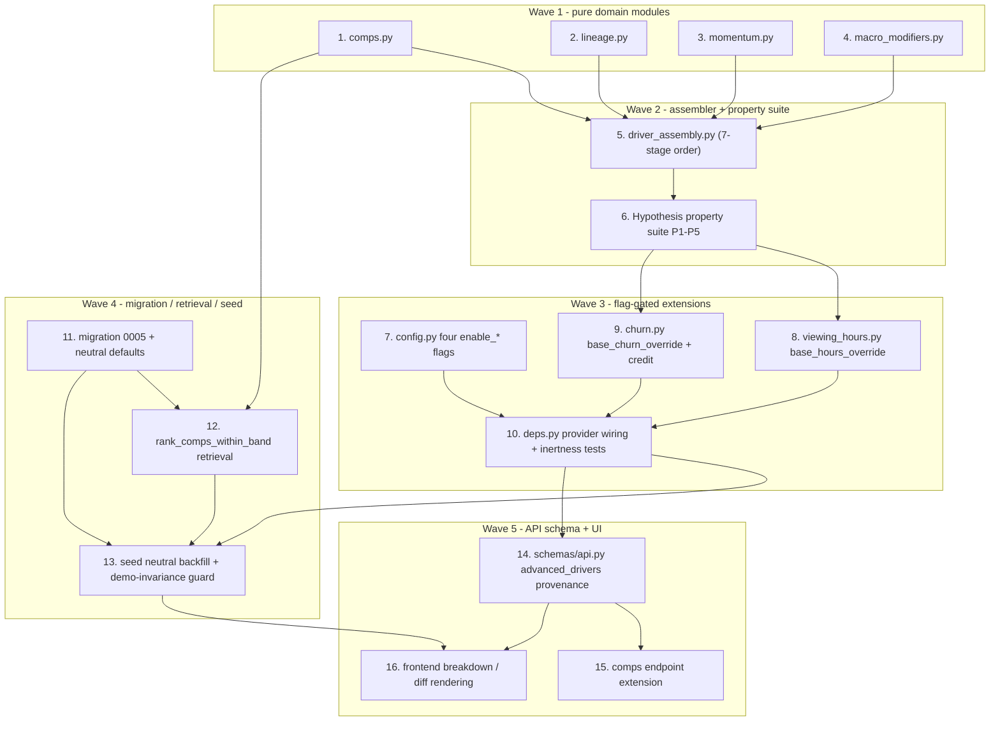

# Implementation Plan

## Overview

This plan builds the Advanced_Content_Eval_Drivers feature from the design. Work
flows from the pure domain modules (fastest feedback, independent Hypothesis
targets) outward to the shared assembler and its property suite, then the
flag-gated extensions to the existing engine seams, then the migration /
repository / seed, and finally the API schema and UI. Each task cites the
requirements and correctness properties it satisfies and is independently
buildable with no new runtime dependency (standard library `math`/`decimal`
only for all driver math; pgvector runs in Postgres).

"Build/verify" means run the backend suite from `backend/` with
`python -m pytest -q -p no:cacheprovider` and the frontend checks from
`frontend/` with `npm run typecheck`, `npx next lint --dir app --dir components`,
and `npx vitest run`, as relevant.

Hard invariants every task must preserve: the four guardrail thresholds, the
recommendation logic, governance gates, and the churn non-correctable rule are
untouched; the strict precedence `SUPPLIED > FITTED > DETERMINISTIC_FALLBACK`
holds per input regardless of flag state; all four Driver_Flags (`enable_comps`,
`enable_lineage`, `enable_momentum`, `enable_macro_modifiers`) default **false**;
and with all four flags false and the new columns at their neutral defaults the
five seeded demo titles (Aurora Protocol / Monsoon Lanes / Echoes of 2019
GREENLIGHT, The Ledger NEGOTIATE_HARD, Vintage Reruns Vol. 7 PASS) produce
**byte-identical** verdicts and explanations and the existing 563+ backend and
frontend tests pass unchanged. Each driver is its own vertical slice behind its
own flag, and the conservation property test gates each slice.

## Task Dependency Graph



```json
{
  "waves": [
    { "wave": 1, "tasks": ["1", "2", "3", "4"] },
    { "wave": 2, "tasks": ["5", "6"] },
    { "wave": 3, "tasks": ["7", "8", "9", "10"] },
    { "wave": 4, "tasks": ["11", "12", "13"] },
    { "wave": 5, "tasks": ["14", "15", "16"] }
  ],
  "dependencies": {
    "1": [], "2": [], "3": [], "4": [],
    "5": ["1", "2", "3", "4"], "6": ["5"],
    "7": [], "8": ["6"], "9": ["6"], "10": ["7", "8", "9"],
    "11": [], "12": ["1", "11"], "13": ["10", "11", "12"],
    "14": ["10"], "15": ["14"], "16": ["13", "14"]
  }
}
```

## Tasks

### Wave 1 - pure domain modules (stdlib math/decimal only, no I/O)

- [ ] 1. Create the Comps_Engine pure math module (Driver A)
  - Add `backend/app/domain/comps.py` mirroring the `churn.py` / `viewing_hours.py` shape: frozen `CompsParams` parsed with full fallback (`parse_params` never raises; invalid/absent sub-object -> built-in `DEFAULT_COMPS_PARAMS`, source `DETERMINISTIC_FALLBACK`), a frozen `CompSet` / `CompsResult`, and `calculate_comps(viewing_hours_list, churn_pct_list, k=5)` returning `H_comps`, `C_comps`, `Comps_Dispersion`, realized `k`, and `Source_Tier`, all in Decimal under the fixed `Context(prec=50, ROUND_HALF_UP)`.
  - Implement the pure set math over an in-memory comp set (the pgvector retrieval lives in the repository, task 12): median of the non-skipped viewing-hours values (even `k` -> mean of the two central values), median of the non-skipped churn-pct values (a NULL/non-finite entry is skipped per-metric and recorded), IQR via the averaged-halves method, in-memory band-membership and `(cosine, title_id asc)` tie-break ordering so the math is exercisable with in-memory vectors.
  - Implement the `<k` fallback (shrink `k` to the eligible count; zero eligible comps -> record `Source_Tier = DETERMINISTIC_FALLBACK` and signal the caller to use the viewing-hours constant intercept). Never widen the band. Leave inputs unmodified.
  - _Requirements: 1.3, 1.4, 1.5, 1.7, 1.8, 5.6, 9.3, 10.1; Properties 1, 4_

- [ ] 2. Create the Lineage_Decay pure math module (Driver B)
  - Add `backend/app/domain/lineage.py` with a frozen `LineageFeatures` (`is_franchise: bool`, `franchise_order: int`, `parent_title_viewing_hours: Decimal | None`, `parent_completion_rate: Decimal | None`), frozen `LineageParams` (`alpha_base_decay = 0.55`, `beta_comp = 0.35`, `gamma_base = 0.15`, `delta_order = 0.05`, loyalty cap 6) with `DEFAULT_LINEAGE_PARAMS` and churn-style `parse_params` full fallback.
  - Implement `Franchise_Floor = parent_title_viewing_hours * (alpha_base_decay + beta_comp * parent_completion_rate)` (returned as a one-sided hour-space value for the Stage 7 `max`, not applied here), `delta_C_franchise = clamp(gamma_base + delta_order * min(franchise_order - 1, 6), 0.15, 0.45)` percentage points, the sequel-with-missing-parent 0.70-retention fallback (recorded in `assumed_features`), and the non-franchise zero-floor / zero-credit path. Pure Decimal; inputs unmodified.
  - _Requirements: 2.1, 2.2, 2.3, 2.4, 2.5, 2.6, 9.3; Properties 1, 2_

- [ ] 3. Create the Momentum_Telemetry pure math module (Driver C)
  - Add `backend/app/domain/momentum.py` with a new `Production_Stage` enum (CONCEPT_SCRIPT, IN_PRODUCTION, FESTIVAL_PREVIEW, ACQUISITION_READY) distinct from `DealStage`, a `coerce_stage` + `STAGE_LABELS` mirroring `deal_stage.py`, frozen `MomentumFeatures` / `MomentumParams` with the named DETERMINISTIC_FALLBACK coefficients (`w_v = 0.15`, `w_e = 0.20`, `w_s = 0.25`, `baseline_V = 1.0`, `cap_V = 2.00`, `cap_E = 1.00`, `momentum_multiplier_max = 1.50`, `Telemetry_Staleness_Window = 14 days`), `DEFAULT_MOMENTUM_PARAMS`, and churn-style `parse_params`.
  - Implement stage gating (CONCEPT_SCRIPT / IN_PRODUCTION -> `Momentum_Multiplier = 1.00`, `STAGE_EXCLUDED` flag), the composition `norm(V_trailer) = clamp(V_trailer/baseline_V, 0, cap_V)`, `E_norm = clamp(E_ratio, 0, cap_E)`, `S_velocity` clamp [0.50, 2.00], `raw = 1 + w_v*norm(V_trailer) + w_e*E_norm + w_s*(S_velocity-1)`, `Momentum_Multiplier = clamp(raw, 1.00, momentum_multiplier_max)`, and the staleness/availability degradation to 1.00 (age > 14 days -> reason `STALE`; `source_available = false` -> reason `UNAVAILABLE`) computed from `last_updated_at` / `source_available` passed in as inputs. Pure Decimal; never queries.
  - _Requirements: 3.1, 3.2, 3.3, 3.4, 3.5, 3.6, 10.2, 10.3, 10.4, 10.5, 9.3; Properties 3, 5_

- [ ] 4. Create the Macro_Modifiers pure math module (Driver D)
  - Add `backend/app/domain/macro_modifiers.py` with frozen `MacroFeatures` / `MacroParams` and `DEFAULT_MACRO_PARAMS` carrying the four documented-domain tables and clamps: Source_IP_Provenance (ORIGINAL_SCREENPLAY 1.00, BESTSELLER_BOOK 1.20, TRUE_CRIME_IP 1.25, WEBTOON_MANGA 1.15, PUBLIC_DOMAIN 0.95; bound [0.95, 1.25]); Release_Window_Halo (DIRECT_TO_STREAMING 1.00, DAY_AND_DATE 1.10, THEATRICAL_30D 1.25, THEATRICAL_60D_PLUS 1.40); Calendar_Seasonality clamped [0.80, 1.35]; Vernacular_TAM_Factor 1.00..2.20.
  - Implement each multiplier as a domain lookup / clamp that resolves an absent or unrecognized descriptor to the neutral 1.00 (recorded as assumed), leaving `app.domain.windowing.WindowType` and `deal_stage.py` untouched. `PUBLIC_DOMAIN = 0.95` is the single intentional sub-neutral IP multiplier; the "never reduces below pre-modifier value" guarantee applies to premium (`>= 1.00`) modifiers only. Pure Decimal; inputs unmodified. Churn-style `parse_params` full fallback.
  - _Requirements: 4.1, 4.2, 4.3, 4.4, 4.5, 4.6, 9.3; Properties 3_

### Wave 2 - combined assembler + Hypothesis property suite

- [ ] 5. Create the combined log-space assembler (`driver_assembly.py`)
  - Add `backend/app/domain/driver_assembly.py` as the single composition point for the normative seven-stage Attribution_Order (as amended by the R5 erratum): Stage 0 anchor `H0 = H_comps`; Stage 1 additive `beta_i` (Option-B per-feature allocation `hours_i = (beta_i*x_i / L) * (H1 - H0)` when `L > 0`); Stage 2 `ln(M_momentum)`; Stage 3 `ln(M_window)`; Stage 4 `ln(M_ip)`; Stage 5 `ln(M_vernacular)`; Stage 6 `ln(M_calendar)`; Stage 7 hour-space franchise floor `H7 = max(H6, Franchise_Floor)`, `d_floor >= 0`.
  - Attribute each multiplicative stage's hour-delta by sequential re-exponentiation (`exp(partial_y) - 1`), quantize each to whole hours, and emit each as its own breakdown line (`comps_anchor`, per-feature, `momentum`, `release_window_halo`, `source_ip_provenance`, `vernacular_tam`, `calendar_seasonality`, `franchise_floor`). Compute `rounding_or_bounds_adjustment` last as `H_hat_quantized - sum(all prior quantized lines)` so it carries only the whole-hour quantization residual; the `comps_anchor` line strictly equals `H_comps` and the Stage 7 floor lift is isolated in `franchise_floor`, never the sink. `H7 == H_hat`.
  - _Requirements: 5.1, 5.2, 5.3, 5.4, 1.6; Properties 1, 4_

- [ ] 6. Property-test the drivers and the assembler (gating suite)
  - Add `backend/tests/domain/test_advanced_drivers_properties.py` (Hypothesis, `# Feature: advanced-content-eval-drivers, Property N: ...`): Property 1 conservation to exact Decimal on **both** sides -- hours (`Hours_comps + sum(Hours_i) + Hours_momentum + Hours_window + Hours_ip + Hours_vernacular + Hours_calendar + Hours_franchise_floor + rounding_or_bounds_adjustment == H_hat`, `comps_anchor == H_comps`, residual is quantization-only) and churn (`C_comps_anchor + sum(feature_points) + delta_C_franchise + bounds_adjustment == final_churn` at 2 dp, `delta_C_franchise` applied before the [0.10,5.00] clamp and the 1.5 hurdle); Property 2 monotonicity (`beta_i >= 0`; a negative beta is rejected to defaults); Property 3 multiplier boundedness (momentum [1.00, 1.50] via `momentum_multiplier_max`; IP [0.95, 1.25]; seasonality [0.80, 1.35]; `S_velocity` [0.50, 2.00]; vernacular up to 2.20); Property 4 determinism + equal-distance tie-break; Property 5 STAGE_EXCLUDED neutrality (CONCEPT_SCRIPT / IN_PRODUCTION -> `Momentum_Multiplier == 1.00`, 0-hour line, prediction unchanged).
  - Add `backend/tests/domain/test_comps_math.py` comps unit tests: median/IQR with in-memory vectors (even and odd realized `k`), the `<k` shrink path, the zero-comps intercept-fallback signal, and band-membership checks. Build/verify the whole suite passes before any wiring.
  - _Requirements: 5.7, 1.4, 1.5, 1.8, 3.3, 3.5, 4.3, 4.4, 4.5; Properties 1, 2, 3, 4, 5_

### Wave 3 - flag-gated extensions to existing seams

- [ ] 7. Add the four per-driver kill-switches to settings
  - In `backend/app/core/config.py` add `enable_comps`, `enable_lineage`, `enable_momentum`, `enable_macro_modifiers` to `Settings`, each `bool = Field(default=False)` (env prefix `CINEROI_` -> `CINEROI_ENABLE_COMPS` etc.), read via `get_settings()`. The flags are independent (enabling one neither requires nor enables another).
  - Add a config test asserting all four default false and are independently togglable. Build/verify the existing suite is unchanged.
  - _Requirements: 7.1, 7.4_

- [ ] 8. Extend viewing_hours.py with the comps base-hours override (Driver A anchor)
  - In `backend/app/domain/viewing_hours.py` add an optional `base_hours_override: Decimal | None = None` to `calculate_viewing_hours`: when set, `H0 = base_hours_override` (= `H_comps`) instead of `exp(intercept) - 1`, leaving the Option-B additive-lift allocation and the single `rounding_or_bounds_adjustment` residual sink structurally unchanged. When `None`, behavior is byte-identical to today.
  - Add a unit test asserting `None` reproduces the current breakdown exactly and a supplied override seeds `H0` with the anchor while the residual sink still conserves and the `comps_anchor`-equivalent base line equals the override.
  - _Requirements: 1.6, 5.2, 5.3; Properties 1_

- [ ] 9. Extend churn.py with the comps churn override and the franchise loyalty credit (Drivers A + B)
  - In `backend/app/domain/churn.py` add an optional `base_churn_override: Decimal | None = None` to `calculate_churn_mitigation`: when set, seed a `comps_anchor` churn contribution strictly equal to `C_comps` in place of the `base_platform_rate` intercept line (never carries residual); when `None`, the existing intercept line is used unchanged. Add Driver B's `delta_C_franchise` as an additive `franchise_loyalty_credit` contribution summed into the unclamped total **before** the `[0.10, 5.00]` clamp and the 1.5 hurdle / `BORDERLINE_BAND` classification. The additive terms commute; each line is quantized to 2 dp (`_Q`, `ROUND_HALF_UP`) and the single `bounds_adjustment` entry stays the sole residual sink. Thresholds and the non-correctable rule untouched.
  - Add a unit test asserting conservation at 2 dp with the anchor and credit, that `None`/zero-credit reproduces today's identity, and that the credit can lift a title across the 1.5 hurdle while the clamp still bounds the final value.
  - _Requirements: 2.4, 5.2, 5.3; Properties 1_

- [ ] 10. Wire the flag-gated provider and prove inertness (`deps.py`)
  - In `backend/app/api/deps.py` extend the valuation-input provider so each driver resolves only when its flag is true, threading a `driver_explanations` / `advanced_drivers` block, and passing `base_hours_override = H_comps` / `base_churn_override = C_comps` when Driver A is on and the comp set is non-empty. A false flag short-circuits the driver before it can touch `ValuationInputs`, the breakdown, the explanation, or the verdict. Honor `SUPPLIED > FITTED > DETERMINISTIC_FALLBACK` regardless of flag state. Thresholds / recommendation untouched.
  - Add `backend/tests/engines/test_advanced_drivers_resolution.py`: with all four flags false the inputs/verdict/explanation are byte-identical to the pre-feature baseline (inertness, R7.2/R7.3); each flag toggled on independently flows its driver through and reacts; a valid supplied value overrides any enabled driver (precedence). Build/verify the full backend suite passes.
  - _Requirements: 7.2, 7.4, 7.5, 9.1, 9.3; Properties 1, 5_

### Wave 4 - Alembic migration, pgvector retrieval, seed backfill

- [ ] 11. Add Alembic migration 0005 with explicit neutral server defaults
  - Add `database/migrations/0005_advanced_content_eval_drivers.py` (`down_revision = "0004_deal_stage"`), following the `0004_deal_stage` style, adding the nine `titles` columns each with an explicit neutral server-side default: `is_franchise` (bool, `false`), `franchise_order` (int, `1`), `parent_title_viewing_hours` (`Numeric(16,2)`, NULL), `parent_completion_rate` (`Numeric(3,2)`, NULL), `production_stage` (text, `CONCEPT_SCRIPT`) with a CHECK over the four production stages (separate from `deal_stage`), `source_ip_provenance` (text, `ORIGINAL_SCREENPLAY`), `release_window` (text, `DIRECT_TO_STREAMING`), `release_month` (int, explicit `server_default=sa.text("NULL")` neutral sentinel -> 1.00), `vernacular_track_count` (int, `1`). `downgrade` drops the CHECK then the nine columns in reverse. Do NOT apply the migration in this step.
  - _Requirements: 8.1, 8.2, 8.3, 8.4_

- [ ] 12. Add the budget-band comps retrieval method (pgvector, I/O)
  - In `backend/app/repositories/metadata_vectors.py` add `rank_comps_within_band(...)` alongside `rank_similar_titles`, reusing its SUCCESS-only / dedup-to-closest-row-per-title / correlated-newest-row patterns: rank by `narrative_dna.cosine_distance(query_vec)` ascending over `titles.is_historical = TRUE`, `asset_type = query asset type`, `extraction_status = 'SUCCESS'` (excludes FAILED zero-vector and NULL markers), and the normalized-USD Budget_Band `[0.65*cost, 1.35*cost]` resolved in the seam before the query; `ORDER BY cos_dist ASC, title_id ASC` for the deterministic tie-break; widened `LIMIT` then dedup and truncate to `k = 5` in Python. `comp_viewing_hours` from `titles.projected_viewing_hours`, `comp_churn_pct` from the correlated newest `financial_projections.churn_reduction_pct`. The realized `k` counts SUCCESS rows only; feed the result into `comps.py` (task 1).
  - Add an example test with an in-memory / fake repo: band + asset-type + historical-only filter, SUCCESS-only exclusion, deterministic order, `LIMIT 5`, dedup, and the normalized-USD band from the FX seam. Fall back to the intercept on no-embedding / dimension-mismatch / FX-unavailable (logged WARNING, non-fatal).
  - _Requirements: 1.1, 1.2, 1.3, 1.4, 1.5, 1.6_

- [ ] 13. Backfill the seed with neutral defaults and add the demo-invariance guard
  - In `database/seed/generate_seed_sql.py` emit the `comps` / `lineage` / `momentum` / `macro_modifiers` sub-objects under `MODEL_VERSION["guardrail_params"]` (imported from the domain defaults with a self-check asserting no drift, exactly as the existing `churn_model` / `content_eval` blocks do) and backfill the nine new `titles` columns for the five demo titles with their neutral defaults (`is_franchise=false`, `franchise_order=1`, parents NULL, `production_stage=CONCEPT_SCRIPT`, `source_ip_provenance=ORIGINAL_SCREENPLAY`, `release_window=DIRECT_TO_STREAMING`, `release_month=NULL`, `vernacular_track_count=1`). Regenerate `02_seed_data.sql`; `python database/seed/generate_seed_sql.py --check` must report in sync.
  - Add `backend/tests/domain/test_demo_invariance.py` (or extend the existing seed-regression test): with all four flags false and neutral column defaults, the five seeded demo titles recompute **byte-identical** verdicts and explanations (3 GREENLIGHT / 1 NEGOTIATE_HARD / 1 PASS), and the existing 563+ backend/frontend tests pass unchanged.
  - _Requirements: 7.3, 8.5, 8.6, 9.2; Properties 1_

### Wave 5 - explanation schema extension, comps endpoint, UI

- [ ] 14. Extend the explanation schema with per-driver provenance (`schemas/api.py`)
  - In `backend/app/schemas/api.py` add an additive `advanced_drivers` block inside the existing `explanation` dict, keyed by driver, each carrying `{source_tier, value, bounds, inputs_used}` where `source_tier` is one of SUPPLIED / FITTED / DETERMINISTIC_FALLBACK (all drivers ship DETERMINISTIC_FALLBACK). Momentum `bounds` serializes as `"[1.00,1.50]"` (the `momentum_multiplier_max` clamp). Add one viewing-hours breakdown line per active driver (`comps_anchor`, `franchise_floor`, `momentum`, `release_window_halo`, `source_ip_provenance`, `vernacular_tam`, `calendar_seasonality`) while preserving the single `rounding_or_bounds_adjustment` sink. Decimals serialize as JSON strings.
  - Add a test asserting the block is additive (a pre-feature stored explanation with no `advanced_drivers` still serializes, treated as absent) and that an identical explanation is produced when all flags are off.
  - _Requirements: 6.1, 6.3, 6.5, 9.1_

- [ ] 15. Extend the comps endpoint with the anchor fields
  - Extend `TitleCompOut` with optional `h_comps`, `c_comps`, `dispersion_iqr`, `realized_k`, and `comp_title_ids`, and carry them on `ComparableTitlesResponse` so `GET /valuation/{title_id}/comps` surfaces the Comps anchor (extending the existing surface, not replacing it). Fields are absent when Driver A is off.
  - Add an API test asserting the anchor fields appear when `enable_comps` is on and are absent / backward-compatible when off.
  - _Requirements: 6.2, 10.1_

- [ ] 16. Render the per-driver breakdown and signed diffs in the frontend
  - In `frontend/app/titles/[id]/_components/financial-accordion.tsx` and `studio/_components/valuation-report.tsx` render each new line item (`comps_anchor`, `franchise_floor`, `momentum`, `release_window_halo`, `source_ip_provenance`, `vernacular_tam`, `calendar_seasonality`) in the existing viewing-hours / driver-breakdown card, reusing the churn-breakdown disclosure pattern (native `<details>`/`<summary>`, keyboard operable, ASCII-only). A changed line renders a signed hour delta (value before, value after, difference) using the existing defensive `toNumber()` / `num()` coercion; a non-coercible value renders a placeholder while the other lines still render. Show comps confidence (`realized_k` and `Comps_Dispersion`). A pre-feature stored explanation (no `advanced_drivers`) renders without error.
  - Add Vitest + Testing Library coverage for the line items, the signed diff, the placeholder path, the comps-confidence display, and the backward-compatible render. Run the frontend checks.
  - _Requirements: 6.1, 6.2, 6.3, 6.4, 6.5, 10.1_

## Notes

- Order rationale: the pure domain modules (tasks 1-4) are verified in isolation first, then `driver_assembly.py` (5) composes the single normative seven-stage order and the Hypothesis suite (6) pins conservation / monotonicity / boundedness / determinism / STAGE_EXCLUDED down before any wiring. The flag-gated extensions (7-10) land the engine seams and prove inertness. The migration / retrieval / seed (11-13) make demo byte-identity a property of the data and the deterministic retrieval. The API schema (14), comps endpoint (15), and UI (16) are the additive surfaces and depend only on the explanation shape and the seed.
- Each driver is its own vertical slice behind its own flag; the conservation property test (task 6, re-exercised through the provider in task 10 and the demo-invariance guard in task 13) gates each slice. A slice is not "done" until the conservation identity holds exactly on both the hours and churn sides and the flag-off path is byte-identical.
- Hard invariants for every task: no new runtime dependency (standard library `math`/`decimal` only for all driver math; pgvector runs in Postgres); the four thresholds, recommendation logic, governance gates, and the churn non-correctable rule are untouched; `SUPPLIED > FITTED > DETERMINISTIC_FALLBACK` holds per input regardless of flag state; and with all four flags false and neutral column defaults the five demo verdicts, explanations, and the 563+ existing tests are byte-identical / green.
- Calibration tier: every driver ships its coefficients as DETERMINISTIC_FALLBACK Illustrative_Coefficients and is not entangled with `calibration.py`, which keeps forking a model version copying `guardrail_params` (including the new `comps` / `lineage` / `momentum` / `macro_modifiers` sub-objects) forward unchanged. Making the additive `beta_i` FITTED under the `beta_i >= 0` non-negativity constraint is a deferred follow-up requirement (R9.4), explicitly out of scope here -- no task implements it.
