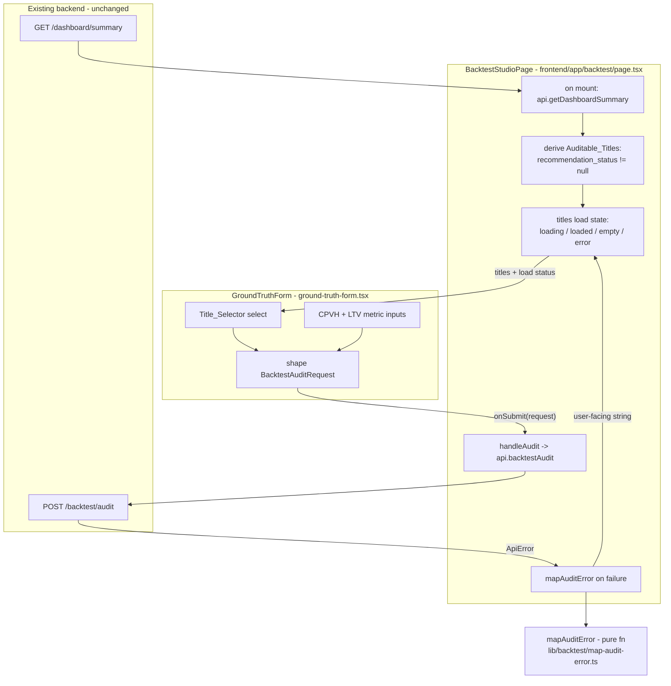

# Design Document

## Overview

This feature makes the Backtesting & Calibration Studio (`/backtest`) understandable
and resilient for a demo user through two frontend-only changes:

1. **Replace free-text title entry with a Title_Selector.** The studio page fetches
   the title list from the existing `GET /dashboard/summary` endpoint on mount,
   filters it to Auditable_Titles (titles with a non-null `recommendation_status`),
   and passes that list to the Ground_Truth_Form. The form renders a `<select>` of
   title names (value = `title_id`) in place of the current free-text input, so the
   user never types an internal UUID and only submits audits that can succeed.

2. **Translate backend rejections into actionable messages.** A small pure
   `mapAuditError` function maps an error (HTTP status + `error_code` +
   envelope `message`) to a readable, ASCII-only, user-facing string. The page's
   audit error path routes `ApiError` instances through this mapper instead of
   surfacing the raw envelope message.

The scope is strictly a demo-support UX fix. No backend endpoint is added or changed
(Requirement 5.1 is satisfied by reusing `GET /dashboard/summary`). The audit
computation, the ground-truth validation rules, the calibration flow, and the
sign-off flow are untouched. The existing dark AppShell theme styling is preserved.

### Research / grounding notes

Grounded against the current codebase (no invented APIs):

- `GET /dashboard/summary` returns `DashboardSummary = { kpis, titles: TitleSummary[] }`.
  Each `TitleSummary` already carries `title_id`, `title_name`, `asset_type`,
  `recommendation_status` (`RecommendationStatus | null`), and `ltv_to_cost_multiple`.
  A title is auditable when `recommendation_status` is non-null. The typed client
  already exposes `api.getDashboardSummary()` (verified in `frontend/lib/api-client.ts`
  and `frontend/lib/types.ts`). **No new backend endpoint is needed.**
- `frontend/app/backtest/page.tsx` (`BacktestStudioPage`) owns the request lifecycle,
  holds `messageFor(err)` which currently reads `err.envelope?.message ?? err.message`,
  and renders the audit error in a `role="alert"` paragraph.
- `frontend/components/backtest/ground-truth-form.tsx` currently has a free-text
  `Historical title ID` input plus two numeric metric fields (CPVH, LTV-to-cost). It
  shapes a `BacktestAuditRequest` and calls `onSubmit`.
- `ApiError` (in `frontend/lib/api-client.ts`) carries `.status` and
  `.envelope?.{ error_code, message, details }`, and exposes an `errorCode` getter.
- Backend error codes to map: `VALIDATION_FAILED` (422), `TITLE_NOT_FOUND` (404),
  `GROUND_TRUTH_MISSING` (404), `GROUND_TRUTH_INVALID` (422), plus a fallback.
- Frontend tests use vitest + Testing Library. The existing form tests live in
  `frontend/components/backtest/ground-truth-form.test.tsx`. The full suite is
  currently 98 tests and must stay green.
- UI strings must be ASCII only (the codebase has a history of cp1252 corruption -
  note the mojibake already present in `api-client.ts` comments).

## Architecture

The change lives entirely in the frontend presentation layer. Data flows one way:
the page fetches, derives the auditable list, and passes it down; the form reports a
shaped request up; the page maps errors on the way back out.



### Ownership of states

- **Title list lifecycle is owned by the page (`BacktestStudioPage`).** The page
  performs the fetch, derives the auditable subset, and holds the load status. This
  keeps the form presentational and keeps all backend access in the page, matching
  the existing pattern where the page owns the audit/calibration/finalization
  lifecycles.
- **Form-local input state stays in the form.** Selected `title_id` and the metric
  text values remain local component state, as they are today.
- **The empty-auditable-titles message is rendered by the form** (Requirement 2.4:
  "THE Ground_Truth_Form SHALL display a message"), driven by the props the page
  passes down.
- **The titles-load-failure message is rendered by the page** (Requirement 2.5:
  "THE Backtest_Studio SHALL display a readable message"), near where the page
  already renders errors.

### Title load states

The page resolves the title fetch into a small discriminated status that it threads
to the form:

| Status      | Meaning                                             | Form behavior                                              |
| ----------- | --------------------------------------------------- | ---------------------------------------------------------- |
| `loading`   | fetch in flight                                     | selector disabled, placeholder option "Loading titles..."  |
| `loaded`    | fetch returned, >= 1 auditable title                | selector enabled, options listed, submit gated on selection |
| `empty`     | fetch returned, 0 auditable titles                  | selector disabled, inline "no auditable titles" message, submit disabled |
| `error`     | fetch failed                                        | selector disabled; page shows load-failure message; submit disabled |

## Components and Interfaces

### `mapAuditError` (new pure function)

- **Location:** `frontend/lib/backtest/map-audit-error.ts`
- **Why its own module:** it must be unit-testable in isolation and reused by the
  page without pulling React in. Keeping it a pure function (no DOM, no fetch) makes
  it directly property-testable.
- **Signature:**

  ```ts
  /**
   * Map an audit request failure to a readable, ASCII-only user-facing message.
   *
   * Branches on the backend error_code (and HTTP status for the 404 pair). Unknown
   * codes fall back to the envelope message when present, else a generic message.
   */
  export function mapAuditError(err: unknown): string;
  ```

- **Behavior:**
  - `err instanceof ApiError` -> branch on `err.errorCode` / `err.status`:
    - `VALIDATION_FAILED` -> "The selected title identifier is invalid or missing. Please select an auditable title."
    - `status === 404 && TITLE_NOT_FOUND` -> "The selected title no longer exists in the system."
    - `status === 404 && GROUND_TRUTH_MISSING` -> "The selected title has no stored prediction to audit against."
    - `GROUND_TRUTH_INVALID` -> "The entered actual values are invalid. Enter numeric values only."
    - unmapped code -> `err.envelope?.message` when non-empty, else the generic message.
  - non-`ApiError` -> the generic message: "Something went wrong. Please try again."
  - Every returned string is composed of ASCII characters only (Requirement 3.6).

The page's existing `messageFor` audit path is replaced by a call to `mapAuditError`.
(The calibration and finalization error paths keep their current `messageFor`
behavior to avoid scope creep; only the audit path is remapped.)

### `GroundTruthForm` (modified)

Prop interface change - the form gains the auditable-title inputs it needs and keeps
its existing `onSubmit`/`submitting` contract:

```ts
/** One selectable auditable title passed from the page. */
export interface AuditableTitleOption {
  title_id: string;
  title_name: string;
}

export type TitlesLoadStatus = "loading" | "loaded" | "empty" | "error";

export interface GroundTruthFormProps {
  /** Auditable titles to list in the selector (recommendation_status != null). */
  titles: AuditableTitleOption[];
  /** Load lifecycle for the title list; drives selector enable + placeholder. */
  titlesStatus: TitlesLoadStatus;
  /** Submit the shaped ground-truth request; resolves when the audit returns. */
  onSubmit: (request: BacktestAuditRequest) => void | Promise<void>;
  /** True while an audit request is in flight; disables the controls. */
  submitting?: boolean;
  className?: string;
}
```

Internal changes:

- Replace the free-text `#gt-title-id` text input with a `<select id="gt-title-id">`
  labeled "Historical title" whose options are `titles` (option text = `title_name`,
  option value = `title_id`), plus a disabled placeholder option.
- Local state changes from `titleId` free text to `selectedTitleId: string` set from
  the selected option value (Requirement 1.3).
- The metric collection (`AUDITED_METRICS`, `buildMetrics`, blank-field omission)
  and the `onSubmit({ title_id, metrics })` contract are unchanged (Requirements
  1.5, 4.3).
- Submit button is disabled when: `submitting`, OR no title is selected, OR
  `titlesStatus !== "loaded"` (Requirements 1.4, 2.4, 2.5). Note: the "at least one
  metric" rule is still enforced on submit via the existing `buildMetrics` guard,
  which keeps that inline validation message; the button-disabled gate specifically
  covers the title-selection and load-state preconditions.
- When `titlesStatus === "empty"`, render an inline ASCII message: "No titles with a
  stored prediction are available to audit." (Requirement 2.4).
- All new markup uses the existing theme utility classes already in the form
  (`inputClass`, `border-border`, `bg-background`, etc.) so the dark AppShell styling
  is preserved (Requirement 4.4).

### `BacktestStudioPage` (modified)

- Add title-list state: `titles: AuditableTitleOption[]`, `titlesStatus:
  TitlesLoadStatus`, `titlesError: string | null`.
- Add a `useEffect` on mount that calls `api.getDashboardSummary()`, filters
  `summary.titles` to `recommendation_status != null`, maps each to
  `{ title_id, title_name }`, and sets status to `loaded` or `empty`. On failure,
  set status `error` and a readable load-failure message (Requirement 2.5).
- Pass `titles` and `titlesStatus` to `GroundTruthForm`.
- Replace the audit-path error assignment `setAuditError(messageFor(err))` with
  `setAuditError(mapAuditError(err))` (Requirement 3).
- Render the titles-load-failure message near the existing audit error alert when
  `titlesStatus === "error"`.
- The success path (variance scorecard, MAPE, calibration enablement, sign-off) is
  unchanged (Requirements 4.1, 4.2, 4.5).

## Data Models

No backend schema changes. The frontend reuses existing types from
`frontend/lib/types.ts`:

- `DashboardSummary`, `TitleSummary` - source of the title list; `recommendation_status`
  is the auditability discriminator.
- `BacktestAuditRequest`, `GroundTruthMetricInput` - the shaped request, unchanged.
- `ApiErrorEnvelope` and `ApiError` - the inputs to `mapAuditError`.

New frontend-only view types (declared with the form component):

- `AuditableTitleOption = { title_id: string; title_name: string }` - the minimal
  projection of a `TitleSummary` the selector needs.
- `TitlesLoadStatus = "loading" | "loaded" | "empty" | "error"` - the load lifecycle
  discriminant.

Derivation rule (Requirement 2.2):

```
auditableTitles = summary.titles
  .filter(t => t.recommendation_status !== null)
  .map(t => ({ title_id: t.title_id, title_name: t.title_name }))
```

## Correctness Properties

*A property is a characteristic or behavior that should hold true across all valid
executions of a system-essentially, a formal statement about what the system should
do. Properties serve as the bridge between human-readable specifications and
machine-verifiable correctness guarantees.*

The pure, input-varying logic in this feature is the auditable-title filter and the
`mapAuditError` function. These are expressed as property-based tests. The UI
rendering, selection wiring, and no-change/regression criteria are covered by
example-based tests in the Testing Strategy and are not property targets.

### Property 1: Auditable filter selects exactly the titles with a stored prediction

*For any* list of `TitleSummary` values, the derived auditable list contains exactly
those titles whose `recommendation_status` is non-null (same identity, same count),
and excludes every title whose `recommendation_status` is null.

**Validates: Requirements 2.2**

### Property 2: Known error codes map to their specific actionable message

*For any* `ApiError` whose `error_code` is one of the mapped codes, `mapAuditError`
returns that code's specific actionable message, honoring the HTTP-status
distinction for the 404 pair: `VALIDATION_FAILED` -> the invalid/missing-title
message; `(404, TITLE_NOT_FOUND)` -> the "no longer exists" message;
`(404, GROUND_TRUTH_MISSING)` -> the "no stored prediction" message;
`GROUND_TRUTH_INVALID` -> the numeric-values message.

**Validates: Requirements 3.1, 3.2, 3.3, 3.4**

### Property 3: Unmapped codes fall back to the envelope message, else the generic message

*For any* `ApiError` whose `error_code` is not one of the mapped codes,
`mapAuditError` returns the envelope `message` when that message is a non-empty
string, and otherwise returns the generic failure message.

**Validates: Requirements 3.5**

### Property 4: Mapper output is ASCII-only

*For all* inputs (any `ApiError` with any status, code, and message, and any
non-`ApiError` value), every character of the string returned by `mapAuditError`
has a code point below 128.

**Validates: Requirements 3.6**

## Error Handling

Two distinct error surfaces, both rendered by the page:

1. **Title-list load failure (Requirement 2.5).** The mount-time
   `api.getDashboardSummary()` call is wrapped in try/catch. On failure the page sets
   `titlesStatus = "error"` and a fixed ASCII message ("Could not load auditable
   titles. Please retry."), renders it near the existing audit alert, and the form's
   submit stays disabled because `titlesStatus !== "loaded"`. The failure is
   contained - the rest of the studio still renders.

2. **Audit request rejection (Requirement 3).** `handleAudit` catches the rejection
   and routes it through `mapAuditError(err)` to produce the user-facing string shown
   in the existing audit `role="alert"` paragraph. `mapAuditError` is total: it always
   returns a readable ASCII string, including for non-`ApiError` values and for
   `ApiError`s with an unknown or missing `error_code`.

Form-local validation (missing selection, no metric entered, non-numeric metric)
keeps its current inline `role="alert"` behavior inside the form and is unchanged
except that the missing-title case is now primarily prevented by the disabled submit
gate.

The calibration and finalization error paths are intentionally left on the existing
`messageFor` helper; remapping them is out of scope for this demo fix.

## Testing Strategy

All tests run under the existing vitest + Testing Library setup in `frontend`. The
full suite is currently 98 tests and MUST stay green after this change.

### Dual approach

- **Property-based tests** cover the pure, input-varying logic (the auditable filter
  and `mapAuditError`).
- **Example-based / interaction tests** cover component rendering, selection wiring,
  load/empty/error states, and preserved behavior.

### Property-based tests

Use `fast-check` (the standard property library for the TypeScript/vitest ecosystem)
with a minimum of 100 iterations per property. Do not hand-roll property testing.
Each property test is tagged with a comment of the form
`Feature: backtest-studio-demo-friendly, Property N: <property text>`.

- **Property 1** (auditable filter): generate arrays of `TitleSummary`-shaped records
  with `recommendation_status` drawn from `{null, "GREENLIGHT", "NEGOTIATE_HARD",
  "PASS"}`; assert the filtered list equals exactly the non-null entries (identity and
  count). Target: the extracted pure helper (e.g. `selectAuditableTitles`).
- **Property 2** (known-code mapping): generate `ApiError`s over the mapped-code set
  (with the 404 status distinction) and arbitrary envelope messages; assert the exact
  message per code. Target: `mapAuditError`.
- **Property 3** (unmapped fallback): generate `ApiError`s with codes outside the
  mapped set and optional/empty messages; assert envelope-message-else-generic.
  Target: `mapAuditError`.
- **Property 4** (ASCII-only invariant): generate arbitrary inputs (varied
  `ApiError`s including non-ASCII envelope messages, plus non-`ApiError` values);
  assert every output character has code point < 128. Target: `mapAuditError`.

### Example / interaction unit tests

`frontend/components/backtest/ground-truth-form.test.tsx` (CHANGED - the form now
requires a `titles` prop and a `titlesStatus` prop, and the title control is a
`<select>` not a text input):

- Update existing tests to pass `titles` + `titlesStatus="loaded"` and select a title
  via the combobox instead of typing an id. The "submits a shaped request", "omits
  blank metric fields", "blocks when no actuals", and "disables controls while
  submitting" tests are adapted to the selector.
- Replace the "trims whitespace from the title identifier" and free-text
  "missing title identifier" tests with selector-based equivalents:
  - renders a Title_Selector listing each `title_name` as an option (R1.1, R1.2)
  - selecting an option sets the submitted `title_id` (R1.3)
  - submit stays disabled until a title is selected (R1.4)
  - `titlesStatus="empty"` renders the ASCII no-auditable-titles message and keeps
    submit disabled (R2.4)

`frontend/lib/backtest/map-audit-error.test.ts` (NEW): the four property tests above
plus a couple of concrete examples per branch for readability.

`frontend/app/backtest/page.test.tsx` (NEW or extended, matching existing page-test
conventions):

- on mount the page calls `api.getDashboardSummary` and passes only auditable titles
  to the form (R2.1, R2.3)
- a failed summary fetch renders the load-failure message and keeps submit disabled
  (R2.5)
- an audit rejection renders the `mapAuditError` output in the alert (R3, spot-check
  one mapped code end-to-end)
- the success path still renders the variance scorecard/MAPE and enables calibration
  (R4.1, R4.2 regression)

### Regression

The existing variance-chart, calibration-controller, and sign-off tests must remain
unchanged and green (Requirements 4.1, 4.2, 4.5). No backend, audit-compute, or auth
modules are modified.

## Notes

- Frontend-only change; no backend endpoint added (Requirement 5.1, 5.2, 5.3).
- All user-facing strings are ASCII only, matching the codebase's cp1252-safety
  convention.
- Dark AppShell theme preserved by reusing existing theme utility classes.
