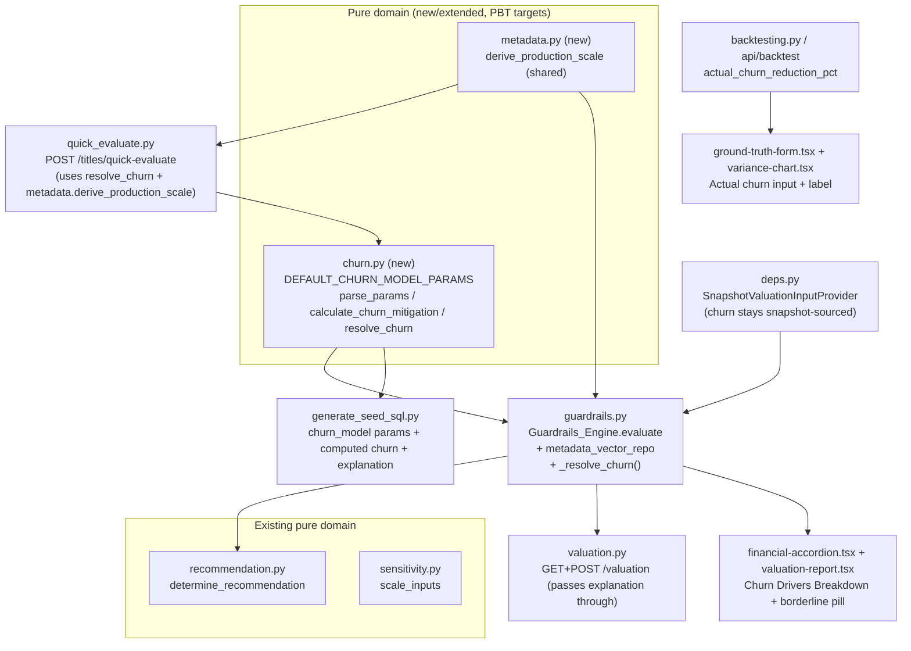

# Design Document

## Overview

The Churn_Mitigation_Model replaces the hard-coded churn-reduction percentage (today a seed literal, a snapshot value, or the Asset Studio placeholder `1.0 + (pedigree / 10) * 2.0`) with a transparent, deterministic, additive, versioned model. The number fed to the existing churn guardrail (cineroi-ai R6, hurdle 1.5 percent, non-correctable) is now either an explicitly Supplied_Value or a value calculated from a title's observable features, with every point of a calculated result explained as a per-feature contribution.

The feature is additive to the system and changes no thresholds, no other guardrail math, and no recommendation logic. It introduces one new pure domain module, extends the Guardrails_Engine resolution path and persisted explanation, reuses the existing immutable model-version parameter store (JSONB, so no migration), regenerates the seed to compute churn by the model while holding the five demo verdicts, and adds presentational surfaces (a title-scorecard breakdown card, an Asset Studio breakdown, and a backtest churn input).

### Grounding summary (verified against the current codebase)

- `app/engines/guardrails.py`: `ValuationInputs` is a frozen dataclass with `churn_reduction_pct: Decimal` (always set); `_compute` builds the churn check via `_churn_check(inputs.churn_reduction_pct)`; `CHURN_MITIGATION_THRESHOLD = Decimal("1.5")`; a churn breach is non-correctable. `_jsonable_explanation` persists `checks`, `dominant_factor`, `unclassifiable`. The engine constructor has no metadata-vector repository. `evaluate_scenario` scales churn via `app/domain/sensitivity.py`.
- `app/api/deps.py`: `SnapshotValuationInputProvider.get_inputs` reads the active title-version snapshot; `churn_reduction_pct` defaults to 0 when absent.
- `app/api/quick_evaluate.py`: `_modeled_inputs` writes the placeholder churn plus `talent_pedigree_score` and `is_exclusive` into the snapshot and creates no metadata-vector or license rows; `_metadata_profile` derives `production_scale = min(10, (pedigree + min(10, len(synopsis) / 25)) / 2)` for the radar.
- Data per title: `titles.asset_type`; `metadata_vectors.talent_pedigree_score` / `production_scale_metric` (NUMERIC(4,2), 0-10, `extraction_status` SUCCESS/FAILED), repo `MetadataVectorRepository.list_for_title`; `license_terms.is_exclusive`, repo `LicenseTermRepository.list_for_title`; `market_telemetry_cache.social_sentiment_index` (NUMERIC(6,2), 0-1 seeded), repo `TelemetryRepository.get_for_genre_territory`.
- `model_versions.guardrail_params` is JSONB; `ModelVersioningEngine.read_active()` returns the active row. `calibration.py` forks with `guardrail_params=dict(active.guardrail_params)`, carrying `churn_model` forward unchanged. Rows are immutable.
- `database/seed/generate_seed_sql.py` (stdlib-only, `--check` mode) builds the model-version `guardrail_params`, each title snapshot, and the stored projection (including `churn_reduction_pct` and a full `_seed_explanation`). The churn literals live in the `TITLES` tuple.
- `backtesting.py`: `PREDICTED_METRIC_FIELDS["churn_reduction"] = "churn_reduction_pct"`; MAPE excludes zero actuals. `calibration.py` `_ScorecardView` exposes only `mape`.
- Frontend: `financial-accordion.tsx` ("Churn mitigation impact" section) + `format.ts`; `studio/_components/valuation-report.tsx` + `helpers.ts`; `backtest/ground-truth-form.tsx`, `variance-chart.tsx`, `app/backtest/page.tsx`; shared `lib/types.ts`. Decimals arrive as JSON strings; the UI coerces with `toNumber()` / `num()`.
- Tests: backend pytest + hypothesis under `backend/tests/{domain,engines,api}`; frontend vitest + Testing Library.

## Architecture



### Design principles

- All churn math lives in the pure `churn.py` so it is an independent Hypothesis target; the engine only resolves features and calls it.
- "Supplied wins" is encoded by making the carried churn value optional: a present Decimal means SUPPLIED; absent means resolve-and-compute. This keeps every existing fake (which passes a Decimal) working as SUPPLIED.
- Exact conservation at 2 dp: each breakdown entry is quantized, and a single `bounds_adjustment` entry absorbs the clamp delta and any rounding residual, so the entries sum exactly to the final value.

## Components and Interfaces

### 1. `backend/app/domain/churn.py` (new, pure)

Constants:

```python
CHURN_MITIGATION_THRESHOLD = Decimal("1.5")   # mirror of the engine hurdle (not re-defined there)
BORDERLINE_BAND = Decimal("0.05")             # inclusive [1.45, 1.55]
MIN_CHURN = Decimal("0.10")
MAX_CHURN = Decimal("5.00")
_Q = Decimal("0.01")                          # 2 dp, ROUND_HALF_UP

DEFAULT_CHURN_MODEL_PARAMS = ChurnModelParams(
    intercept=Decimal("0.15"),
    asset_offsets={
        "ORIGINAL_SERIES": Decimal("0.35"),
        "CO_PRODUCTION":   Decimal("0.45"),
        "ORIGINAL_FILM":   Decimal("0.20"),
        "LICENSED_LIBRARY":Decimal("0.00"),
    },
    pedigree_weight=Decimal("0.09"),
    scale_weight=Decimal("0.03"),
    exclusivity_lift=Decimal("0.25"),
    telemetry_weight=Decimal("0.005"),
    min_churn=MIN_CHURN,
    max_churn=MAX_CHURN,
)
```

These defaults are the authoritative, verified set (Open Question 1 resolved). Verification against the five seeded titles (Decimal, half-up to 2 dp):

| Title | Asset | Ped | Scale | Excl | Heat | raw | final | verdict |
| --- | --- | --- | --- | --- | --- | --- | --- | --- |
| Aurora Protocol | ORIGINAL_SERIES | 8.5 | 9.0 | yes | 65 | 2.110 | 2.11 | GREENLIGHT |
| Echoes of 2019 | ORIGINAL_SERIES | 7.8 | 7.0 | yes | 59 | 1.957 | 1.96 | GREENLIGHT |
| Monsoon Lanes | CO_PRODUCTION | 7.2 | 6.5 | no | 63 | 1.758 | 1.76 | GREENLIGHT |
| The Ledger | ORIGINAL_FILM | 6.0 | 5.5 | yes | 63 | 1.620 | 1.62 | NEGOTIATE_HARD |
| Vintage Reruns Vol. 7 | LICENSED_LIBRARY | 4.0 | 3.5 | no | 53.5 | 0.8825 | 0.88 | PASS |

All within R9.4 tolerances; all weights non-negative. The coefficients are Illustrative_Coefficients (R3.5).

Dataclasses (frozen):

```python
@dataclass(frozen=True)
class ChurnModelParams:
    intercept: Decimal
    asset_offsets: Mapping[str, Decimal]
    pedigree_weight: Decimal
    scale_weight: Decimal
    exclusivity_lift: Decimal
    telemetry_weight: Decimal
    min_churn: Decimal
    max_churn: Decimal

@dataclass(frozen=True)
class ChurnFeatures:
    asset_type: str | None
    pedigree: Decimal | None          # None/invalid -> missing
    production_scale: Decimal | None
    is_exclusive: bool                # unknown -> False
    telemetry_heat: Decimal | None    # 0-100 scale; None -> missing

@dataclass(frozen=True)
class ChurnContribution:
    key: str                          # see breakdown keys below
    label: str
    input: Decimal | None             # the feature value used (None when missing/NA)
    coefficient: Decimal | None       # per-unit weight (None for intercept/offset/adjustment)
    points: Decimal                   # quantized contribution in pct points

@dataclass(frozen=True)
class ChurnResult:
    churn_reduction_pct: Decimal
    method: str                       # "CALCULATED" | "SUPPLIED"
    is_borderline: bool
    breakdown: tuple[ChurnContribution, ...] | None   # None when SUPPLIED
    missing_features: tuple[str, ...]
    params_source: str                # "MODEL_VERSION" | "DEFAULTS"
    unclamped: Decimal | None         # pre-clamp calculated value (None when SUPPLIED)
```

Breakdown keys (ordered): `base_platform_rate`, `asset_cadence`, `talent_pedigree_contribution`, `production_scale_contribution`, `exclusivity_lift`, `market_telemetry_heat`, and `bounds_adjustment` (included only when nonzero). (Open Question 2 shape.)

Functions:

- `parse_params(raw: Mapping | None) -> tuple[ChurnModelParams, str]` — read a `churn_model` dict; return `(params, "MODEL_VERSION")` on a valid parse, else `(DEFAULT_CHURN_MODEL_PARAMS, "DEFAULTS")`. Validation: intercept and all weights parse to finite non-negative Decimals, the four asset offsets present and non-negative, bounds finite with `min <= max`. Any failure -> defaults (R3.2). Never raises.
- `is_borderline(value: Decimal) -> bool` — `abs(value - 1.5) <= 0.05` (R5).
- `calculate_churn_mitigation(features, params) -> ChurnResult` — the additive model (R1):
  1. Clamp each numeric feature to its domain: pedigree/scale to [0, 10], heat to [0, 100]; a `None` feature contributes 0 and is recorded in `missing_features`. Unknown asset type -> zero offset and `missing_features += ("asset_type",)`.
  2. Compute each contribution at full precision, then quantize each to 2 dp half-up.
  3. `unclamped = intercept + offset + pedigree*w + scale*w + excl + heat*w` (full precision).
  4. `clamped = min(max(unclamped, min_churn), max_churn)`; `final = clamped.quantize(_Q, HALF_UP)`.
  5. `bounds_adjustment = final - sum(quantized_feature_contributions)`. This single entry absorbs both the clamp delta and the quantization residual, so `sum(breakdown) == final` exactly (R1.8). Included only when nonzero.
  6. `method="CALCULATED"`, `is_borderline=is_borderline(final)`.
- `resolve_churn(supplied, features, params, params_source) -> ChurnResult` — supplied-wins (R4):
  - A finite numeric `supplied` (including 0): `method="SUPPLIED"`, `churn_reduction_pct=Decimal(supplied)` used exactly (no clamp, no re-round), `breakdown=None`, `missing_features=()`, `unclamped=None`, `is_borderline=is_borderline(value)`.
  - Else delegate to `calculate_churn_mitigation`.
  - A helper `coerce_supplied(raw) -> Decimal | None` treats blank/null/non-numeric/non-finite as not-supplied (R4.3), 0 as supplied (R4.4).

### 2. `backend/app/domain/metadata.py` (new, pure) — Open Question 5

```python
def derive_production_scale(pedigree: Decimal, synopsis: str) -> Decimal:
    """min(10, (pedigree + min(10, len(synopsis)/25)) / 2), quantized to 0.1."""
```

`quick_evaluate._metadata_profile` and the quick-evaluate churn feature both call this, so the radar's production scale equals the churn model input (R8.2). The engine path uses the persisted `production_scale_metric` directly (no synopsis), so this helper is Asset-Studio-only; it is extracted purely to remove duplication and guarantee radar/model agreement.

### 3. `ValuationInputs` + provider (Open Question 3)

`ValuationInputs.churn_reduction_pct: Decimal | None = None` (was `Decimal`, always set). Semantics: a Decimal means a Supplied_Value; `None` means "resolve and compute". `SnapshotValuationInputProvider` passes `coerce_supplied(snapshot.get("churn_reduction_pct"))` (so a seed/snapshot without churn yields `None` -> CALCULATED; a legacy snapshot with churn yields SUPPLIED, R4.6). `scale_inputs` in `sensitivity.py` must tolerate a `None` churn (treated as 0 for scaling in the what-if path; see below). Existing engine/what-if fakes pass a Decimal, so they remain SUPPLIED and keep passing.

### 4. `Guardrails_Engine` (`app/engines/guardrails.py`)

- Constructor gains `metadata_vector_repo: Any | None = None` (keyword, defaulting to `None`) so existing test wiring is unaffected (Open Question 3). `get_guardrails_engine` in `deps.py` injects `MetadataVectorRepository(session)`.
- New async `_resolve_churn(title, inputs) -> ChurnResult`:
  1. `active = await self._versioning.read_active()`; `params, source = parse_params((active.guardrail_params or {}).get("churn_model") if active else None)` using the active (not stamped) version, matching how feature extraction uses active weights.
  2. Resolve features (R6): pedigree/scale/exclusivity from the snapshot facts if the provider surfaced them, else the latest SUCCESS metadata vector (via `metadata_vector_repo.list_for_title`, newest SUCCESS) and license terms (`license_term_repository.list_for_title`); asset type from the title; `telemetry_heat` = mean over target territories with a reading of `social_sentiment_index * 100`, 2 dp half-up (R6.3-R6.5).
  3. `return resolve_churn(inputs.churn_reduction_pct, features, params, source)`.
  Because the engine needs the snapshot facts, the provider is extended to also surface the raw snapshot (or the engine reads the title's active version directly through the title repository). Design choice: the engine reads metadata/license/telemetry via its injected repos and uses `inputs` only for the supplied override, keeping the provider contract unchanged except for the optional churn.
- `_compute` is called with the resolved `ChurnResult`: the churn check uses `result.churn_reduction_pct`; threshold and non-correctable classification unchanged (R7.1). The engine threads `ChurnResult` into the explanation.
- `ValuationResult` gains `churn_detail: ChurnResult | None`. `_jsonable_explanation` emits a `churn_model` object (R7.2):

```json
{
  "churn_method": "CALCULATED",
  "is_borderline": false,
  "params_source": "MODEL_VERSION",
  "model_version_id": "…",
  "missing_features": [],
  "churn_breakdown": {
    "base_platform_rate": "0.15",
    "asset_cadence": "0.20",
    "talent_pedigree_contribution": "0.54",
    "production_scale_contribution": "0.17",
    "exclusivity_lift": "0.25",
    "market_telemetry_heat": "0.31",
    "bounds_adjustment": "0.00"
  }
}
```

When SUPPLIED, `churn_breakdown` is `null` and `missing_features` is `[]`. Decimals are strings. The audit "after" snapshot records `churn_method` (R7.4).

- What-if (`evaluate_scenario`): the scaled path omits `churn_breakdown` and recomputes `is_borderline` against the scaled churn value (R7.5, R7.6-new). Implementation: after scaling, attach a minimal `churn_model` object with `churn_method` carried from the base resolution, `churn_breakdown: null`, and `is_borderline` recomputed on the scaled value.

### 5. API responses

- `app/api/valuation.py`: `POST /valuation/calculate` and `GET /valuation/{title_id}` pass the stored/computed explanation through unchanged, so the `churn_model` object rides along (R7.3). `GET` reads the persisted explanation (no re-run), so it surfaces whatever was stored; a pre-feature row simply lacks `churn_model` (R7.6).
- `app/api/quick_evaluate.py`: add optional `churn_reduction_pct: Decimal | None = Field(default=None, ge=0, le=100)` to `QuickEvaluateRequest` (R4.5). `_modeled_inputs` stops writing the placeholder churn; instead the request's churn (if any) is placed in the snapshot only when supplied, so the engine resolves CALCULATED otherwise (R8.1). `ExplanationOut` passes through the `churn_model` object. The response's `explanation` carries the breakdown for CALCULATED (R8.3).

### 6. Seed generator (`database/seed/generate_seed_sql.py`)

- Add `MODEL_VERSION["guardrail_params"]["churn_model"]` with the authoritative constants.
- Import the model from `backend/app/domain/churn.py` by inserting the `backend` path on `sys.path` (the module is stdlib-only + Decimal, no framework imports), or inline a tiny self-contained replica guarded by a `--check` equality test against the domain defaults. Design choice: import the real module to guarantee the seed and the engine share one implementation; add a safety assertion that the imported `DEFAULT_CHURN_MODEL_PARAMS` matches the embedded JSON.
- Remove `churn_reduction_pct` from each title snapshot (R9.1) so seeded titles are CALCULATED.
- Compute each title's churn via `calculate_churn_mitigation` from the seeded features (pedigree/scale from the `scores` map, exclusivity from `LICENSE_TERMS`, asset type from `TITLES`, telemetry heat from `TELEMETRY` using the same mean-x100 rule), write that into the stored `financial_projections.churn_reduction_pct` (R9.5), and extend `_seed_explanation` to embed the `churn_model` object matching the engine's shape.
- Regenerate and confirm `--check` is in sync (R9.6).

### 7. Backtest (R11)

- `app/schemas/api.py` `BacktestAuditRequest`: add optional `actual_churn_reduction_pct: Decimal | None`. The audit handler appends a `{"metric_name": "churn_reduction", "actual_value": ...}` entry to the metrics list when present; require at least one metric from either source (R11.2). `PREDICTED_METRIC_FIELDS` already maps churn, so predicted/actual pairing and MAPE need no change (R11.5).
- Frontend: `ground-truth-form.tsx` gains an optional "Actual churn reduction (%)" input mapped to metric `churn_reduction`; `variance-chart.tsx` `METRIC_LABELS` gains `churn_reduction: "Churn reduction"` (R11.3-R11.4); `app/backtest/page.tsx` reads the churn row for the predicted/actual/variance readout.

### 8. Frontend scorecard (R10)

- `lib/types.ts`: add a `ChurnModel` interface (`churn_method`, `is_borderline`, `params_source?`, `model_version_id?`, `missing_features?: string[]`, `churn_breakdown?: Record<string, string> | null`) and attach `churn_model?: ChurnModel | null` to `Explanation`.
- New `financial-accordion`-local component `churn-breakdown.tsx` ("Why this churn number"): a native `<details>`/`<summary>` disclosure (keyboard operable, matching the existing accordion), rendering a semantic table of the six feature rows (label + signed points text), a `bounds_adjustment` row when present, and an "unavailable" tag for any feature in `missing_features`. SUPPLIED -> a short "Supplied directly (not calculated)" note instead of the table (R10.3). The amber borderline pill (R10.5) renders the fixed message with a decorative warning glyph (`aria-hidden`), text carrying the meaning (R10.6). Placed in the "Churn mitigation impact" section and mirrored in the studio `valuation-report.tsx`.

## Data Models

No schema change. The only persisted addition is the `churn_model` object inside the existing JSONB `financial_projections.explanation` and the `churn_model` key inside the existing JSONB `model_versions.guardrail_params` (R3.6, R9.2). Legacy rows without these keys render as "absent" (R7.6).

## Error Handling

- `parse_params` never raises; invalid/missing params fall back to defaults and set `params_source="DEFAULTS"` (R3.2).
- Missing/invalid features contribute 0 and are listed in `missing_features`; the method stays CALCULATED (R2).
- A non-numeric/blank supplied value is treated as not-supplied (R4.3); the engine then computes.
- Telemetry lookups that return no rows yield a missing `telemetry_heat` (R6.5); existing telemetry errors are already swallowed by the connector.

## Testing Strategy

- `backend/tests/domain/test_churn_properties.py` (Hypothesis, following the `# Feature: calculable-churn-model, Property N: ...` + `@settings(max_examples=...)` convention): monotonicity in pedigree/scale/heat (R13.1), boundedness in [0.10, 5.00] (R13.1), exact breakdown conservation `sum(breakdown) == final` with a 0.01 safety tolerance (R13.1), precedence (supplied finite value returned exactly, method SUPPLIED) (R13.1), determinism, borderline-iff-within-band, non-negative-weight validation rejecting negative params to defaults.
- `backend/tests/domain/test_metadata.py`: `derive_production_scale` matches the prior inline formula on representative inputs.
- `backend/tests/engines/test_churn_resolution.py` (in-memory fakes incl. a fake metadata-vector repo): supplied-wins, feature precedence (snapshot over DB), telemetry-heat mean, defaults fallback, explanation shape, audit records method, what-if omits breakdown and recomputes borderline.
- `backend/tests/*` seed regression: assert the five titles keep verdicts (3/1/1) and churn tolerances (R13.2) by recomputing from seeded features.
- Update existing engine/persistence/what-if/sensitivity tests for the optional churn field and the new explanation key.
- Frontend `churn-breakdown.test.tsx` (Vitest + Testing Library): renders the six rows, the bounds-adjustment row, the unavailable tag, the SUPPLIED note, and the borderline pill (R13.3). Update affected `financial-accordion`/`valuation-report` tests and types.

## Addendum A: Genre driver, neutral telemetry, viewing-hours units (R14-R16)

A UX review of a real title (crime-biopic, India, no seeded telemetry) exposed two model gaps: a missing-telemetry feature scored 0 (penalizing a data gap) and genre had no effect at all. This addendum adds a genre driver, makes missing telemetry neutral, and makes viewing-hours unit-aware. The 1.5 hurdle and non-correctable classification are unchanged.

### A.1 Genre driver (R14)

`ChurnModelParams` gains `genre_offsets: Mapping[str, Decimal]` (non-negative) and `genre_default: Decimal` (the neutral weight for an unknown/absent genre). `ChurnFeatures` gains `genre: str | None`. The additive sum gains `+ genre_weight`, where `genre_weight = genre_offsets.get(normalized_genre, genre_default)`. Genre keys are normalized (lowercased, spaces/underscores trimmed) before lookup. A new ordered breakdown entry `genre_affinity` ("Genre Affinity") is emitted. `parse_params` validates `genre_offsets` (a mapping of non-negative Decimals; empty/missing -> defaults) and `genre_default` (non-negative; missing -> a built-in neutral).

Canonical genre weights (retention propensity; serialized/returning formats retain more than one-and-done):

| Genre | weight | Genre | weight |
|---|---|---|---|
| crime | 0.18 | crime-biopic | 0.17 |
| drama | 0.15 | thriller | 0.15 |
| reality | 0.15 | mystery | 0.14 |
| sci-fi | 0.12 | fantasy | 0.12 |
| biopic | 0.11 | romance | 0.10 |
| action | 0.10 | adventure | 0.09 |
| historical | 0.09 | war | 0.09 |
| horror | 0.08 | sports | 0.08 |
| family | 0.07 | animation | 0.07 |
| anthology | 0.07 | comedy | 0.05 |
| documentary | 0.05 | kids | 0.05 |
| musical | 0.05 | western | 0.05 |

`genre_default = 0.10` (neutral mid). The frontend genre dropdown offers this canonical list (editable; a custom value falls back to `genre_default`).

### A.2 Re-tuned coefficients (verified)

Adding the genre term shifts all five seeded churns up, so the non-genre coefficients are re-tuned (only the intercept drops; the rest are unchanged). New `DEFAULT_CHURN_MODEL_PARAMS`:

- intercept 0.03 (was 0.15)
- asset_offsets ORIGINAL_SERIES 0.35, CO_PRODUCTION 0.45, ORIGINAL_FILM 0.15 (was 0.20), LICENSED_LIBRARY 0.00
- pedigree_weight 0.09, scale_weight 0.03, exclusivity_lift 0.25, telemetry_weight 0.005 (unchanged)
- genre_offsets as above; genre_default 0.10
- bounds [0.10, 5.00]

Verified seeded churn (with genre term): Aurora 2.11, Echoes 1.99, Monsoon 1.79, Ledger 1.60, Reruns 0.81 — all within the R9.4 tolerances; verdicts 3 GREENLIGHT / 1 NEGOTIATE_HARD / 1 PASS preserved. The Scam-1992-style title (pedigree 5, exclusive, crime-biopic, neutral telemetry 50) computes ~1.68 -> GREENLIGHT instead of the old 1.4 -> PASS.

### A.3 Neutral telemetry default (R15)

`ChurnModelParams` gains `telemetry_neutral: Decimal` (default 50, on the 0-100 scale). When `ChurnFeatures.telemetry_heat is None`, the model uses `telemetry_neutral` for the contribution instead of 0, and records `telemetry_heat` in an `assumed_features` set (distinct from `missing_features`). The breakdown's market-telemetry row carries the neutral input and a flag so the UI labels it "neutral (no market data)". `ChurnResult` gains `assumed_features: tuple[str, ...]`. The engine's telemetry resolver still returns `None` when no reading exists; the neutral substitution happens in the pure model so it is covered by property tests. Seeded titles have real readings, so their churn is unchanged (R15.3).

### A.4 Viewing-hours units (R16)

`QuickEvaluateRequest` gains `viewing_hours_unit: Literal["hours","minutes","seconds"] = "hours"`. The handler normalizes `projected_viewing_hours` to hours (minutes/60, seconds/3600) before building the title. Blank value -> existing estimate path. The frontend adds a unit `<select>` beside the viewing-hours input (mirroring the cost+currency pattern).

### A.5 Explanation / breakdown shape

The persisted `churn_model` object gains an `assumed_features` array and the breakdown gains a `genre_affinity` key. The `market_telemetry_heat` row, when neutral, carries its neutral input value (50) and is listed in `assumed_features` rather than `missing_features`. Backward compatible: older stored explanations without these keys still render.

### A.6 Seed, docs, tests

The seed generator imports the updated defaults (self-check still asserts no drift), recomputes the five churns (2.11/1.99/1.79/1.60/0.81), and embeds `genre_offsets`/`genre_default`/`telemetry_neutral` in the model-version params. Docs (Calculations Reference, Knowledge Base, guide) gain the genre driver, the neutral-telemetry rule, and the viewing-hours units, and update the five seeded numbers (Echoes 1.96->1.99, Ledger 1.62->1.60, Reruns 0.88->0.81; Aurora 2.11 and Monsoon ~1.76->1.79). Property tests gain: genre monotonic-ish (higher genre weight never decreases churn), neutral-telemetry (None heat -> telemetry_neutral contribution, listed assumed not missing), and the seed regression updates to the new tolerances. Frontend tests cover the genre dropdown, the viewing-hours unit normalization, and the "neutral (no market data)" / "Genre Affinity" breakdown rows.
## Addendum B: Content format driver (OTT formats) (R17)

A UX review of a live cricket title ("ACC Championship") scored it as LICENSED_LIBRARY with a 1.0% churn PASS. A live marquee event is one of the stickiest things an OTT platform can own, but the four asset types cannot express live-ness / appointment viewing. This addendum adds a content-format driver as an ADDITIVE LIFT so OTT-native formats (live sports, live events, reality) get credit the asset types miss, WITHOUT double-counting the formats the asset types already cover and WITHOUT moving the five seeded verdicts.

### B.1 Format lift (R17)

`ChurnModelParams` gains `format_offsets: Mapping[str, Decimal]` (non-negative) and `format_default: Decimal` (the neutral lift for an unknown/absent format; built-in default 0). `ChurnFeatures` gains `content_format: str | None`. The additive sum gains `+ format_lift`, where `format_lift = format_offsets.get(normalized_format, format_default)`. Format keys are normalized the same way as genre (lowercased, spaces/underscores -> hyphen). A new ordered breakdown entry `content_format` ("Content Format") is emitted. `parse_params` validates `format_offsets` (mapping of non-negative Decimals; empty/missing -> defaults) and `format_default` (non-negative; missing -> 0).

Canonical format lifts (0 for formats the asset-type offset already captures; positive only for OTT-native appointment formats):

| Content format | lift | Rationale |
|---|---|---|
| live-sports | 0.70 | subscribe-for-the-event; strongest retention while live |
| live-event | 0.50 | awards / concerts / reality finales; appointment viewing |
| reality-competition | 0.45 | weekly appointment over a season |
| scripted-series | 0.00 | already captured by the ORIGINAL_SERIES / CO_PRODUCTION asset offset |
| limited-series | 0.00 | captured by the series asset offset |
| original-film | 0.00 | captured by the ORIGINAL_FILM asset offset |
| licensed-film | 0.00 | captured by the film / library asset offset |
| documentary | 0.00 | one-and-done; no extra lift |
| kids-animation | 0.00 | long-tail; no extra lift |
| library | 0.00 | captured by the LICENSED_LIBRARY asset offset |

`format_default = 0.00` (unknown format adds nothing, preserving today's behavior). Because the lift is 0 for the demo titles' aligned formats, the five seeded churns are UNCHANGED (2.11 / 1.99 / 1.79 / 1.60 / 0.81) and no coefficient re-tune is needed (verified).

### B.2 Why additive-lift, not a replacement

Asset type stays the source of truth for CPVH ceilings and licensing economics (R17.5) and already encodes the scripted-vs-film-vs-library cadence. Content format is a separate, orthogonal signal for live-ness / appointment viewing. Making the lift 0 for the asset-aligned formats avoids double-counting the cadence while still letting a live match (LICENSED_LIBRARY asset + live-sports format) earn its retention credit. Verified: ACC-style title (LICENSED_LIBRARY, pedigree 5, not exclusive, sports genre, neutral telemetry 50, live-sports format) computes ~1.66 -> GREENLIGHT, vs ~0.96 -> PASS without the format term.

### B.3 Engine, quick-evaluate, seed, UI, docs

The engine resolves `content_format` from the title (a snapshot fact; the quick-evaluate path carries it, and a persisted title can carry it in its source snapshot) into `ChurnFeatures.content_format`. `_churn_model_json` emits the `content_format` breakdown row (it iterates all contributions, so this is automatic once the domain adds the row) and format assumed-ness folds into `assumed_features` when a non-zero default is configured. `QuickEvaluateRequest` gains an optional `content_format` field. The seed embeds `format_offsets`/`format_default` and gives each seeded title its aligned format (scripted-series / original-film / library) so the stored row and a live recompute agree and the breakdown shows a +0.00 Content Format row. The Asset Studio form adds a "Content Format" editable dropdown. The breakdown UI renders the "Content Format" row. Docs (Calculations Reference, Knowledge Base, guide) describe the format driver and the live-sports example.
## Correctness Properties

These invariants map to the Hypothesis and regression tests in the Testing Strategy and to the acceptance criteria.

### Property 1: Monotonicity

For fixed params and other features, increasing pedigree, production scale, or telemetry heat never decreases the calculated churn_reduction_pct. 

**Validates: Requirements 1.5**

### Property 2: Boundedness

A CALCULATED churn_reduction_pct always lies in the inclusive range [0.10, 5.00]. 

**Validates: Requirements 1.7**

### Property 3: Breakdown conservation

The sum of the quantized breakdown entries (including bounds_adjustment when present) equals churn_reduction_pct exactly at 2 decimal places. 

**Validates: Requirements 1.8**

### Property 4: Determinism

Identical features and params yield an identical ChurnResult. 

**Validates: Requirements 1.4**

### Property 5: Non-negative coefficients

parse_params accepts only non-negative weights/offsets and a valid bounds pair; any violation falls back to defaults with params_source DEFAULTS. 

**Validates: Requirements 1.3, 3.2**

### Property 6: Supplied precedence

A finite numeric supplied value (including 0) is returned exactly with method SUPPLIED, with no clamp, no re-round, and no breakdown. 

**Validates: Requirements 4.1, 4.4**

### Property 7: Not-supplied fallthrough

A blank, null, non-numeric, or non-finite supplied value yields method CALCULATED. 

**Validates: Requirements 4.3**

### Property 8: Borderline iff in band

is_borderline is true exactly when the resolved value lies in [1.45, 1.55], and it never changes the guardrail pass/breach, the dominant factor, or the recommendation. 

**Validates: Requirements 5.1, 5.2, 5.3**

### Property 9: Verdict stability

With the default params and the seeded features, the five titles produce 3 GREENLIGHT, 1 NEGOTIATE_HARD, 1 PASS, within the stated per-title tolerances. 

**Validates: Requirements 9.3, 9.4**

### Property 10: Stored equals recompute

Each seeded financial_projections.churn_reduction_pct equals a live recompute from the seeded features and params. 

**Validates: Requirements 9.5**

### Property 11: What-if borderline

Under a churn multiplier other than 1, the response omits churn_breakdown and sets is_borderline from the scaled value. 

**Validates: Requirements 7.5, 7.6**

### Property 12: Backward compatibility

A stored explanation lacking churn_model renders without error, and a fake supplying a Decimal churn resolves as SUPPLIED. 

**Validates: Requirements 7.7, 7.8**

## Open Questions resolved

1. Constants: the verified non-negative set above (Aurora 2.11, Echoes 1.96, Monsoon 1.76, Ledger 1.62, Reruns 0.88).
2. Explanation JSON: the flat `churn_model` object above; `churn_breakdown` null when SUPPLIED.
3. Signatures: engine gains an optional `metadata_vector_repo`; `ValuationInputs.churn_reduction_pct` becomes `Decimal | None` (Decimal = SUPPLIED, None = compute); existing fakes keep working.
4. Model-version catalog UI: churn params stay backend-only (present in the JSON, not shown in the `/backtest` catalog table).
5. Production-scale helper: extracted to `app/domain/metadata.py`, consumed by both the radar and quick-evaluate.