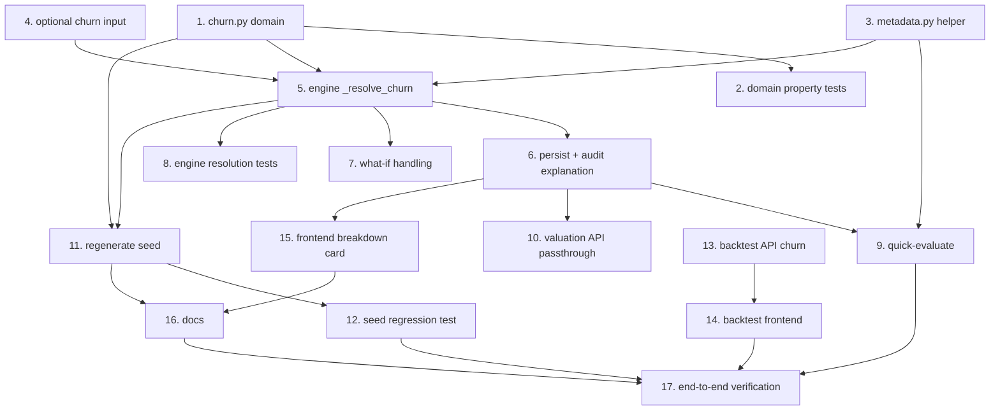

# Implementation Plan

## Overview

This plan replaces the hard-coded churn-mitigation input with the Churn_Mitigation_Model from the design. Work flows from the pure domain (fastest feedback, independent Hypothesis target) outward to engine wiring, API, seed, backtest, frontend, docs, and a final end-to-end check. Each task cites the requirements it satisfies and is independently buildable. "Build/verify" means run the backend suite from `backend/` with `python -m pytest -q -p no:cacheprovider` and the frontend checks from `frontend/` with `npm run typecheck`, `npm run lint`, and `npx vitest run`, as relevant.

## Task Dependency Graph



The waves below group tasks that can proceed in parallel once their dependencies are met.

```json
{
  "waves": [
    { "wave": 1, "tasks": ["1", "3", "4", "13"] },
    { "wave": 2, "tasks": ["2", "5", "14"] },
    { "wave": 3, "tasks": ["6", "7", "8", "11"] },
    { "wave": 4, "tasks": ["9", "10", "12", "15"] },
    { "wave": 5, "tasks": ["16"] },
    { "wave": 6, "tasks": ["17"] }
  ],
  "dependencies": {
    "1": [],
    "2": ["1"],
    "3": [],
    "4": [],
    "5": ["1", "3", "4"],
    "6": ["5"],
    "7": ["5"],
    "8": ["5"],
    "9": ["3", "6"],
    "10": ["6"],
    "11": ["1", "5"],
    "12": ["11"],
    "13": [],
    "14": ["13"],
    "15": ["6"],
    "16": ["11", "15"],
    "17": ["9", "10", "12", "14", "16"]
  }
}
```

## Tasks
- [x] 1. Create the pure churn domain module
  - Add `backend/app/domain/churn.py` with `ChurnModelParams`, `ChurnFeatures`, `ChurnContribution`, `ChurnResult` (frozen dataclasses), the constants (`CHURN_MITIGATION_THRESHOLD`, `BORDERLINE_BAND`, `MIN_CHURN`, `MAX_CHURN`, `_Q`), and `DEFAULT_CHURN_MODEL_PARAMS` with the verified non-negative values (intercept 0.15; asset offsets ORIGINAL_SERIES 0.35 / CO_PRODUCTION 0.45 / ORIGINAL_FILM 0.20 / LICENSED_LIBRARY 0.00; pedigree 0.09; scale 0.03; exclusivity 0.25; telemetry 0.005; bounds [0.10, 5.00]).
  - Implement `is_borderline`, `coerce_supplied`, `parse_params` (never raises; invalid/missing/negative -> defaults + source "DEFAULTS"), `calculate_churn_mitigation` (clamp feature domains, quantize each contribution 2 dp half-up, compute `unclamped`, clamp to bounds, `bounds_adjustment = final - sum(quantized_contributions)` included only when nonzero, record `missing_features`), and `resolve_churn` (finite supplied incl. 0 -> SUPPLIED exact, else calculate).
  - All arithmetic in Decimal; module imports only stdlib + `decimal`/`dataclasses`/`typing` so it is importable without the app framework.
  - _Requirements: 1.1, 1.2, 1.3, 1.4, 1.6, 1.7, 1.8, 1.9, 2.1, 2.2, 2.3, 2.4, 3.5, 4.1, 4.2, 4.3, 4.4, 5.1, 5.2, 5.4_

- [x] 2. Property-test the churn domain
  - Add `backend/tests/domain/test_churn_properties.py` (Hypothesis, `# Feature: calculable-churn-model, Property N: ...` convention, `@settings(max_examples=...)`): monotonicity (Property 1), boundedness (Property 2), exact breakdown conservation with a 0.01 safety tolerance (Property 3), determinism (Property 4), non-negative-coefficient rejection to defaults (Property 5), supplied precedence incl. 0 (Property 6), not-supplied fallthrough (Property 7), borderline-iff-in-band and no-verdict-effect (Property 8).
  - Build/verify this file passes before wiring the engine.
  - _Requirements: 13.1_

- [x] 3. Extract the shared production-scale helper
  - Add `backend/app/domain/metadata.py` with `derive_production_scale(pedigree, synopsis)` reproducing the current `_metadata_profile` formula (`min(10, (pedigree + min(10, len(synopsis)/25)) / 2)`, quantized to 0.1).
  - Refactor `app/api/quick_evaluate.py` `_metadata_profile` to call it. Add `backend/tests/domain/test_metadata.py` asserting parity with representative inputs.
  - _Requirements: 8.2_

- [x] 4. Make the carried churn value optional (backward compatible)
  - In `app/engines/guardrails.py` change `ValuationInputs.churn_reduction_pct` to `Decimal | None = None` (Decimal = SUPPLIED, None = compute). Update the dataclass docstring.
  - In `app/domain/sensitivity.py` `scale_inputs`, tolerate a `None` churn (do not multiply None); the what-if resolve-then-scale is handled in task 7.
  - In `app/api/deps.py` `SnapshotValuationInputProvider`, set churn via `coerce_supplied(snapshot.get("churn_reduction_pct"))` so a snapshot without churn yields None (CALCULATED) and a legacy snapshot with churn yields SUPPLIED.
  - Build/verify the existing engine/persistence/what-if/sensitivity tests still pass (fakes pass a Decimal -> SUPPLIED).
  - _Requirements: 4.6, 7.7, 7.8_

- [x] 5. Resolve churn inside the Guardrails_Engine
  - Add keyword `metadata_vector_repo: Any | None = None` to the engine constructor; inject `MetadataVectorRepository(session)` in `deps.py` `get_guardrails_engine`.
  - Implement async `_resolve_churn(title, inputs) -> ChurnResult`: read `guardrail_params["churn_model"]` from the active model version via `read_active()` and `parse_params`; resolve features (pedigree/scale/exclusivity from snapshot facts if present on inputs, else latest SUCCESS metadata vector and license terms; asset type from the title); compute telemetry heat as the mean over target territories with a reading of `social_sentiment_index * 100` (2 dp half-up) with an explicit empty-list guard that yields None; call `resolve_churn(inputs.churn_reduction_pct, features, params, source)`.
  - Thread the `ChurnResult` into `_compute` so the churn check uses `result.churn_reduction_pct`; leave the 1.5 hurdle and non-correctable classification unchanged. Add `churn_detail: ChurnResult | None` to `ValuationResult`.
  - _Requirements: 3.1, 3.2, 3.3, 6.1, 6.2, 6.3, 6.4, 6.5, 7.1_

- [x] 6. Persist and audit the churn explanation
  - Extend `_jsonable_explanation` to emit the flat `churn_model` object (`churn_method`, `is_borderline`, `params_source`, `model_version_id`, `missing_features`, `churn_breakdown` with the six feature keys + `bounds_adjustment`; `churn_breakdown` null and `missing_features` [] when SUPPLIED; Decimals as strings).
  - Record `churn_method` in the audit "after" snapshot. Extend the `Explanation` TypedDict in `app/domain/recommendation.py` with a `NotRequired` `churn_model`.
  - _Requirements: 3.3, 7.2, 7.4_

- [x] 7. What-if churn handling
  - In `evaluate_scenario`: resolve the base `ChurnResult` first (so a None base is computed, never multiplied), apply the churn multiplier to that resolved value, omit `churn_breakdown`, and recompute `is_borderline` from the scaled value. Attach a minimal `churn_model` object carrying the base method, null breakdown, and the recomputed flag.
  - Add an engine test asserting the scaled scenario omits the breakdown and flips `is_borderline` as the scaled value crosses [1.45, 1.55].
  - _Requirements: 7.5, 7.6_

- [x] 8. Engine resolution tests
  - Add `backend/tests/engines/test_churn_resolution.py` with in-memory fakes (incl. a fake metadata-vector repo and telemetry repo): supplied-wins over features; feature precedence (snapshot over DB); telemetry-heat mean and empty-list -> missing; defaults fallback when params absent/invalid; explanation shape; audit records method.
  - _Requirements: 2.1, 3.2, 4.1, 6.1, 6.3, 6.5, 7.2, 7.4_

- [x] 9. Quick-evaluate uses the model
  - Add optional `churn_reduction_pct: Decimal | None = Field(default=None, ge=0, le=100)` to `QuickEvaluateRequest`. Stop writing the placeholder churn in `_modeled_inputs`; place churn in the snapshot only when the request supplied it (so otherwise the engine computes CALCULATED).
  - Pass the `churn_model` object through `ExplanationOut`. Add an API test: no churn supplied -> CALCULATED with a breakdown; churn supplied -> SUPPLIED with no breakdown.
  - _Requirements: 4.5, 7.3, 8.1, 8.3_

- [x] 10. Valuation API passthrough
  - Confirm `POST /valuation/calculate` and `GET /valuation/{title_id}` carry the `churn_model` object (computed and persisted respectively) with no re-run on GET; add/extend a test that a persisted explanation without `churn_model` still serializes (treated as absent).
  - _Requirements: 7.3, 7.6_

- [x] 11. Regenerate the seed with model-computed churn
  - In `database/seed/generate_seed_sql.py`: resolve the backend path with `Path(__file__).resolve().parent.parent.parent / "backend"` inserted on `sys.path`, import `DEFAULT_CHURN_MODEL_PARAMS` and `calculate_churn_mitigation` from `app.domain.churn`; embed `guardrail_params["churn_model"]` from those defaults with a self-check assertion that the embedded JSON matches the imported defaults.
  - Remove `churn_reduction_pct` from every title snapshot. Compute each title's churn via `calculate_churn_mitigation` from the seeded features (pedigree/scale from `scores`, exclusivity from `LICENSE_TERMS`, asset type from `TITLES`, telemetry heat from `TELEMETRY` via the same mean-x100 rule), write it into the stored projection, and extend `_seed_explanation` to embed the matching `churn_model` object.
  - Regenerate `02_seed_data.sql`; run `python database/seed/generate_seed_sql.py --check` and confirm "up to date".
  - _Requirements: 3.4, 9.1, 9.2, 9.5, 9.6_

- [x] 12. Seed verdict-stability regression test
  - Add a backend test that recomputes churn for the five seeded titles from their features and asserts the tolerances (Aurora within 0.05 of 2.10; Echoes 2.00; Monsoon 1.80; Ledger in [1.60, 1.65]; Reruns in [0.80, 0.90]) and the resulting verdicts (3 GREENLIGHT, 1 NEGOTIATE_HARD, 1 PASS).
  - _Requirements: 9.3, 9.4, 13.2_

- [x] 13. Backtest churn ground truth
  - Add optional `actual_churn_reduction_pct: Decimal | None` to `BacktestAuditRequest`; in the audit handler append a `{"metric_name": "churn_reduction", "actual_value": ...}` metric when present, and require at least one metric from either source. Add an API test for the alias and the "at least one metric" rule.
  - _Requirements: 11.1, 11.2, 11.5_

- [~] 14. Backtest frontend churn support
  - `frontend/components/backtest/ground-truth-form.tsx`: add an optional "Actual churn reduction (%)" input mapped to metric `churn_reduction`. `variance-chart.tsx`: add `churn_reduction: "Churn reduction"` to `METRIC_LABELS`. `app/backtest/page.tsx`: surface churn predicted/actual/variance. Update the related vitest tests.
  - _Requirements: 11.3, 11.4, 11.5_

- [~] 15. Frontend types and Churn Drivers Breakdown
  - `lib/types.ts`: add a `ChurnModel` interface and attach `churn_model?: ChurnModel | null` to `Explanation`.
  - Add `frontend/app/titles/[id]/_components/churn-breakdown.tsx`: a native `<details>`/`<summary>` disclosure rendering a semantic table of the six feature rows (label + text points), a `bounds_adjustment` row when present, an "unavailable" tag for missing features, a "Supplied directly (not calculated)" note when SUPPLIED, and the amber borderline pill with the exact message and a decorative (`aria-hidden`) warning glyph. Place it in the "Churn mitigation impact" section of `financial-accordion.tsx` and mirror it in `studio/_components/valuation-report.tsx`.
  - Add `churn-breakdown.test.tsx` (renders rows, bounds-adjustment row, unavailable tag, SUPPLIED note, borderline pill). Update affected accordion/report tests.
  - _Requirements: 10.1, 10.2, 10.3, 10.4, 10.5, 10.6, 13.3_

- [~] 16. Documentation
  - Update the user guide (the "How Numbers Are Calculated" tab and the Guardrail 3 explainer), `CineROI_AI_Calculations_Reference.md`, and `CineROI_AI_Complete_Knowledge_Base.md` to describe the additive model, the supplied-value override, the borderline flag, the feature sources, and the parameter storage, with churn numbers consistent with the regenerated seed. Label the coefficients illustrative.
  - _Requirements: 3.5, 9.7, 12.1, 12.2, 12.3_

- [~] 17. End-to-end verification
  - Run the full backend suite and the frontend typecheck/lint/vitest. Rebuild the containers and run `scripts/demo-reset.ps1`. Recompute all five seeded titles via `POST /valuation/calculate` and confirm the churn values, `churn_model` objects, and verdicts match the stored seed; confirm `GET /valuation/{id}` returns `churn_model` and the title page loads. Clean up any temp files.
  - _Requirements: 9.3, 9.5, 13.2_

## Notes

- Order rationale: the pure domain (tasks 1-3) is verified in isolation before any orchestration, so the Hypothesis properties pin the math down early. Engine wiring (4-8) depends only on the domain. Seed (11-12), backtest (13-14), and frontend (15) are largely independent after the explanation shape lands in task 6. Docs (16) follow the regenerated seed numbers, and task 17 is the single end-to-end gate.
- Backward compatibility is load-bearing: task 4 makes `ValuationInputs.churn_reduction_pct` optional (`Decimal` = SUPPLIED, `None` = compute) so the existing fakes keep passing. Run the full backend suite at the end of task 4 before proceeding.
- Three edge cases to guard (from design review): the telemetry-heat mean must guard against an empty readings list (yield `None`, treated as a missing feature) in task 5; `evaluate_scenario` must resolve the base `ChurnResult` before scaling so a `None` base is never multiplied in task 7; the seed generator must resolve the backend path with `Path(__file__).resolve().parent.parent.parent / "backend"` in task 11.
- No database migration: the `churn_model` object lives inside the existing JSONB `financial_projections.explanation` and `model_versions.guardrail_params`.
- Hard constraint: the five seeded verdicts (3 GREENLIGHT, 1 NEGOTIATE_HARD, 1 PASS) and their churn tolerances must hold; tasks 12 and 17 verify this.