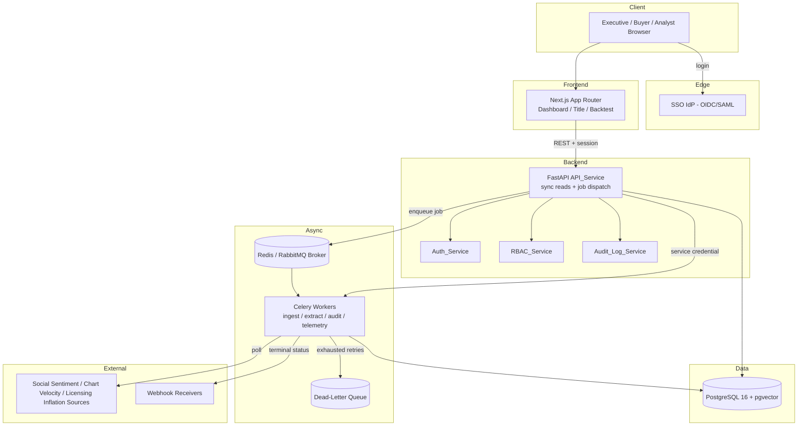
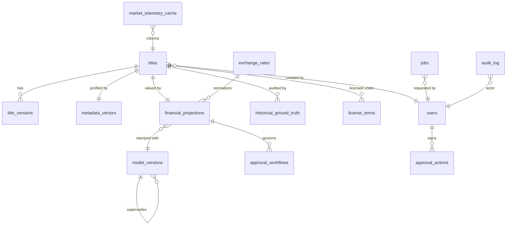

# Design Document: CineROI AI

## Overview

CineROI AI is an internal decision-support platform that ingests multi-format content manifests, extracts semantic metadata vectors, evaluates each title against quantitative financial guardrails, produces greenlight recommendations, and backtests predictions against historical ground truth to auto-calibrate the model. This design translates the approved requirements into an implementation-ready technical blueprint. Requirements 1-30 define the core platform; Requirements 31-37 add the post-launch decision-support and operational enhancements (comparable titles, the market-telemetry card, dashboard filtering with shareable view state, the deal-stage acquisition lifecycle, responsive tablet layout, demo/operational integrity, and the Asset Studio instant-evaluation and intake surface). The `Enhancements (R31-R37)` section near the end of this document details those additions; the three earlier enhancement waves (Deal Decision Support, What-If Sensitivity, demo-friendly Backtest Studio) live in their own sibling spec folders.

The platform is a Docker Compose monorepo with three deployable units — a Next.js (App Router) frontend, a FastAPI (async) backend, and a PostgreSQL 16+ database with the pgvector extension — plus a Celery worker fleet backed by a Redis/RabbitMQ broker. Heavy operations (batch ingestion, feature extraction, backtest audits, telemetry polling) run asynchronously; interactive reads and single-title valuations run synchronously.

### Design Principles

- **Deterministic financial math is the core asset.** The Guardrails_Engine, currency normalization, and MAPE computation are pure functions over typed inputs. They are the primary targets for property-based testing (Requirements 4–8, 11, 21).
- **Immutability for reproducibility and compliance.** Model versions (R26), audit entries (R25), and title versions (R24) are append-only. Calibration never mutates in place; it forks a new model version.
- **Separation of synchronous reads from asynchronous compute.** The API never performs long-running work inline (R23). It persists intent, enqueues a job, and returns a job identifier.
- **Base-currency canonicalization.** Every monetary comparison — guardrail ceilings, the high-budget approval threshold (R20) — happens in USD after dated normalization (R21), so multi-territory acquisitions are compared on one axis.

### Requirements-to-Component Map

| Capability | Requirements | Primary Component |
|---|---|---|
| Batch ingestion, idempotency, row limits | 1, 27 | Ingestion_Service |
| Feature extraction, embeddings, atomic persistence | 2 | Feature_Extraction_Engine |
| Similarity matching | 3 | Vector_Search_Engine |
| Financial guardrails + recommendation + explainability | 4, 5, 6, 7, 8, 30 | Guardrails_Engine |
| Backtest audit + MAPE | 11 | Backtesting_Module |
| Auto-calibration + model versioning | 12, 26 | Calibration_Controller |
| Market telemetry | 13 | Telemetry_Connector |
| Valuation endpoints | 9, 10 | API_Service |
| Frontend views | 14, 15, 16 | Dashboard/Title/Backtest UIs |
| Persistence + schema | 17, 24 | Database layer |
| Deployment | 18 | Docker Compose |
| Auth + sessions | 19 | Auth_Service |
| RBAC + approvals | 20, 28 | RBAC_Service / Approval_Workflow |
| Multi-currency | 21 | Currency normalization layer |
| Licensing/windowing | 22 | License terms model |
| Async jobs | 23, 29 | Task_Queue (Celery) |
| Audit + lineage | 25 | Audit_Log_Service |
| Concurrency/idempotency | 27 | API_Service / DB constraints |
| Comparable titles (Top 3 comps) | 31 | MetadataVectorRepository.rank_similar_titles / valuation router / `ComparableTitlesPanel` |
| Market telemetry card | 32 | API_Service (scorecard genre/territory) / `MarketTelemetryCard` |
| Dashboard filter/search/shareable state | 33 | `AssetDataGrid` (URL-synced view state) |
| Deal-stage lifecycle | 34 | `app/domain/deal_stage.py` / titles router / `DealStageControl` + grid column |
| Responsive tablet layout | 35 | Frontend layout (Tailwind breakpoints) |
| Demo/operational integrity | 36 | Seed generator / currency fallback / `BaseRepository.update_with_version` / `demo-reset` |

## Architecture

### Monorepo Layout

```
/
├── backend/                    # FastAPI service
│   ├── app/
│   │   ├── api/                # Routers (titles, valuation, backtest, market, jobs, auth, approvals, versions, audit, health)
│   │   ├── core/              # Config, security, logging, settings
│   │   ├── engines/           # ingestion, feature_extraction, vector_search, guardrails, backtesting, calibration, telemetry
│   │   ├── domain/            # Pure functions: cpvh, ltv, mape, currency, windowing (PBT targets)
│   │   ├── models/            # SQLAlchemy ORM models
│   │   ├── schemas/           # Pydantic request/response models
│   │   ├── tasks/             # Celery task definitions
│   │   ├── repositories/      # DB access layer
│   │   └── main.py            # ASGI app factory
│   ├── tests/                 # pytest + hypothesis
│   └── pyproject.toml
├── frontend/                   # Next.js App Router
│   ├── app/
│   │   ├── dashboard/
│   │   ├── titles/[id]/
│   │   └── backtest/
│   ├── components/            # Shadcn UI + Recharts components
│   ├── lib/                   # API client, auth, formatting
│   └── package.json
├── database/
│   ├── migrations/            # Alembic migrations
│   └── seed/                  # init scripts + mock seed data
├── docker-compose.yml
└── README.md
```

### Service Topology



### Request Flow: Synchronous vs Asynchronous

**Synchronous operations** (complete within the HTTP request):
- `GET` reads: valuation retrieval (R10), market telemetry (R13.3), job status (R23.4), audit lineage (R25.4), evaluation history (R24.5), health (R29.4).
- Single-title valuation `POST /api/v1/valuation/calculate` (R9): the Guardrails_Engine is pure in-memory math over already-persisted inputs and completes well within the 5-second persistence bound (R8.6). It runs inline but writes through the Audit_Log_Service and model-version stamp.

**Asynchronous operations** (dispatched to the Task_Queue, R23.1):
- Batch ingestion (R1) — up to 10,000 rows plus per-row feature extraction.
- Feature extraction / vector generation (R2) — NLP embedding is latency-heavy.
- Backtest audit (R11) — potentially many metrics across many titles.
- Telemetry polling (R13.1) — scheduled background work.

Async flow: API validates the request envelope synchronously (format, row-limit, idempotency key), persists a `jobs` row in `PENDING`, enqueues the Celery task with the job id, and returns `202 Accepted` with `{ job_id }` (R23.2). The worker transitions the job to `PROCESSING`, performs the work, writes results, transitions to `COMPLETED` or `FAILED` (R23.3, R23.5), and fires a webhook on terminal status (R23.6). Jobs exceeding the 15-minute SLA raise an alert (R29.2); jobs that exhaust retries route to the DLQ (R29.3) and can be re-dispatched (R29.5).

### Cross-Cutting Concern Reconciliation

Three dependencies are called out explicitly because they couple otherwise-separate components:

1. **Model versioning governs calibration (R26 ↔ R12).** Feature-extraction weights are never updated in place. The `model_versions` table holds immutable rows; the Calibration_Controller reads the active version, computes offsets, validates bounds, and *inserts a new row* with a new `model_version_id` carrying the adjusted weights. The new version becomes active. Any valuation produced thereafter is stamped with the new id (R26.2), while prior valuations keep their original stamp, preserving reproducibility (R26.3). This means R12.3 ("retain the updated weights") is implemented as "create and activate a new immutable version," satisfying R26.4.

2. **High-budget approval threshold is defined in base currency (R20 ↔ R21).** The 25,000,000 threshold in R20.3 is interpreted as 25,000,000 USD (Base_Currency). The Approval_Workflow compares a decision's *normalized* acquisition cost — the USD value produced by the currency layer during valuation (R21.2) — against the threshold, never the native-currency figure. A ₹2.4B INR acquisition and a €23M EUR acquisition are therefore judged on the same USD axis.

3. **Explainability consumes guardrail breach data (R30 ↔ R4–R8).** The Guardrails_Engine already computes, per check, the computed value, applicable threshold, and pass/breach status. The explanation payload (R30.1–R30.3) is a structured projection of that same breach data — no separate re-computation. The dominant contributing factor (R30.3) is the breach with the largest normalized shortfall magnitude. This explanation is embedded in the valuation response (R30.4) and surfaced in the Title_Evaluation_UI.

## Components and Interfaces

### Ingestion_Service

Accepts batch manifests (CSV/JSON/PDF), validates the envelope, and dispatches extraction. Enforces format allow-list (R1.4), the 10,000-row ceiling (R1.5), required-field and value-range validation per row (R1.7, R1.8), idempotency (R27.1), and batch summary invariants (R1.9, R1.10).

```python
class IngestionResult(TypedDict):
    job_id: UUID
    accepted_count: int
    rejected_count: int
    rejections: list[RejectionDetail]   # {row_index, field, reason}

class Ingestion_Service:
    def ingest(self, payload: bytes, content_type: Literal["csv","json","pdf"],
               idempotency_key: str, actor: UserContext) -> IngestionResult: ...
    # Per-row: validate_required_fields -> validate_ranges -> create title -> enqueue extraction (R1.6)
    # Replays return the stored IngestionResult unchanged (R27.1)
```

Validation rules enforced before any record is created:
- `title_name` and `acquisition_cost_or_budget` required (R1.7).
- `acquisition_cost_or_budget` within `[0.01, 999999999.99]` (R1.8).
- `asset_type` within the enum set (R1.8).
- CSV row count ≤ 10,000, else whole-batch rejection (R1.5).
- Unsupported content type → whole-request rejection with format error (R1.4).

Row-level failures reject the row only and continue (R1.7, R1.8); the summary guarantees `accepted_count + rejected_count == total_submitted` (R1.10).

### Feature_Extraction_Engine

Parses source documents and produces the metadata profile. Runs in a Celery worker.

```python
class ExtractionOutput(TypedDict):
    narrative_dna: list[float]          # len == 1536, each in [-1.0, 1.0]  (R2.1)
    affective_tone: AffectiveToneScore  # exactly 1 primary + 1 secondary trigger (R2.3)
    talent_pedigree_score: float        # [0.0, 10.0], 2 dp (R2.4)
    production_scale_metric: float      # [0.0, 10.0], 2 dp (R2.5)

class Feature_Extraction_Engine:
    def extract(self, title_id: UUID, sources: SourceBundle,
                model_version_id: UUID) -> ExtractionOutput: ...
    # No non-empty source -> extraction-failure status + error (R2.2)
    # Persist all four artifacts atomically in one transaction (R2.6)
    # On persist failure -> rollback partial writes, record failure, error (R2.7)
    # On parse failure -> record failure, leave prior data unchanged, error (R2.8)
```

Embedding generation uses a configurable embedding provider abstracted behind an `EmbeddingProvider` interface so the 1536-dim model can be swapped. The talent-pedigree and narrative-trope weights come from the active Model_Version (coupling to R12/R26).

### Vector_Search_Engine

```python
class SimilarityResult(TypedDict):
    cluster_id: UUID
    cosine_similarity: float
    status: Literal["OK", "NO_CLUSTERS"]

class Vector_Search_Engine:
    def match(self, title_id: UUID) -> list[SimilarityResult]: ...
    # pgvector cosine similarity (R3.1), descending rank (R3.2)
    # No clusters -> empty set + NO_CLUSTERS status (R3.3)
```

Uses pgvector's `<=>` cosine-distance operator; similarity = `1 - distance`, ordered ascending by distance (descending by similarity).

### Guardrails_Engine

The financial core. Composed of pure domain functions plus an orchestrator that persists results and emits explainability. All monetary inputs are normalized to USD first (R21.2).

```python
class GuardrailCheck(TypedDict):
    name: Literal["CPVH","LTV_TO_COST","CHURN_MITIGATION","PAYBACK_HORIZON"]
    computed_value: Decimal | None
    threshold: Decimal
    passed: bool
    breached: bool
    shortfall_magnitude: Decimal | None   # normalized distance past threshold (R30.2)
    correctable: bool | None               # (R8.2 / R8.3)

class Explanation(TypedDict):
    checks: list[GuardrailCheck]           # (R30.1)
    dominant_factor: str | None            # largest shortfall (R30.3)
    unclassifiable: bool                   # (R8.4)

class ValuationResult(TypedDict):
    calculated_cpvh: Decimal | None
    ltv_to_cost_multiple: Decimal
    churn_reduction_pct: Decimal
    payback_horizon_months: int
    recommendation_status: Literal["GREENLIGHT","NEGOTIATE_HARD","PASS"]
    model_version_id: UUID
    explanation: Explanation

class Guardrails_Engine:
    def evaluate(self, title_id: UUID, model_version_id: UUID) -> ValuationResult: ...
```

Pure domain functions (PBT targets, in `app/domain/`):

```python
def compute_cpvh(cost_usd: Decimal, viewing_hours: Decimal) -> Decimal:
    # viewing_hours must be > 0; caller handles the zero case (R4.5)
    # round to 4 dp (R4.1)

def cpvh_ceiling(asset_type: AssetType) -> Decimal | None:
    # Premium_Original -> 0.18, Library_Filler -> 0.05, else None (R4.2, R4.3, R4.4)

def compute_ltv_to_cost(churn_reduction_value, ltv, watch_time_elasticity,
                        cpm, ad_impressions, cost_usd) -> Decimal:  # (R5.1)

def compute_payback_horizon(milestone_schedule, monthly_margin) -> int:
    # uses milestone-based schedule, not lump sum (R22.2)

def determine_recommendation(checks: list[GuardrailCheck]) -> tuple[str, Explanation]:
    # 0 breaches -> GREENLIGHT (R8.1)
    # >=1 breach, all correctable -> NEGOTIATE_HARD (R8.2)
    # >=1 non-correctable -> PASS (R8.3)
    # unclassifiable -> PASS + flag (R8.4)
    # always exactly one of {GREENLIGHT, NEGOTIATE_HARD, PASS} (R8.5)
```

Guardrail logic details:
- **CPVH (R4):** if `projected_viewing_hours == 0`, mark failed, do not persist a `calculated_cpvh` (R4.5). If no classification maps to a ceiling, fail with error (R4.4). Breach when computed strictly `>` ceiling (R4.6); pass when `<=` (R4.7). Persist `calculated_cpvh` before returning (R4.8).
- **LTV-to-Cost (R5):** threshold 3.2 over a 12–24 month window; breach when `< 3.2` (R5.3). Persist multiple (R5.4). CPM and LTV are territory-weighted across target territories (R21.3).
- **Churn mitigation (R6):** threshold 1.5%; breach when `< 1.5` (R6.3).
- **Payback horizon (R7):** target 9–12 months inclusive; breach when `> 12` (R7.3). Persist value (R7.4).
- **Recommendation persistence (R8.6, R8.7):** persist within 5 s; on failure retry up to 3× and preserve prior value, returning an error indication.

### Backtesting_Module

```python
class AuditMetric(TypedDict):
    metric: str
    predicted: Decimal
    actual: Decimal
    excluded: bool          # actual == 0 (R11.7)

class AuditScorecard(TypedDict):
    metrics: list[AuditMetric]
    mape: Decimal | None     # null if all metrics excluded (R11.8)
    no_eligible_metrics: bool

class Backtesting_Module:
    def persist_ground_truth(self, record: GroundTruthRecord) -> UUID: ...  # (R11.1, R11.2)
    def audit(self, title_id: UUID) -> AuditScorecard: ...
```

MAPE (R11.5) is a pure function:

```python
def compute_mape(pairs: list[tuple[Decimal, Decimal]]) -> Decimal | None:
    eligible = [(a, p) for (a, p) in pairs if a != 0]   # exclude zero-actual (R11.7)
    if not eligible:
        return None                                      # (R11.8)
    n = len(eligible)
    total = sum(abs((a - p) / a) for (a, p) in eligible)
    return round((total / n) * 100, 2)                   # percentage, 2 dp
```

Ground-truth validation rejects missing fields or non-numeric actuals without persisting (R11.2). Historical titles without a Ground_Truth_Record are excluded with an error (R11.4).

### Calibration_Controller

```python
class CalibrationResult(TypedDict):
    adjustment_required: bool
    new_model_version_id: UUID | None
    offsets: dict[str, Decimal] | None     # each in [-1.00, 1.00] (R12.1)

class Calibration_Controller:
    def evaluate_and_apply(self, audit: AuditScorecard, actor: UserContext) -> CalibrationResult: ...
    # MAPE > 10% -> compute offsets within 5 s (R12.1)
    # re-weight talent_pedigree + narrative_trope so both in [0,1] and sum == 1.00 (R12.2)
    # apply -> create NEW model_version (R12.3, R26.1, R26.4), activate it
    # offset pushes any weight outside [0,1] -> reject, keep prior, error (R12.4)
    # MAPE <= 10% -> no change (R12.5)
```

The weight-normalization step guarantees the two coupled weights sum to exactly 1.00 after rounding; any proposed set violating the `[0,1]` bound is rejected atomically before a new version is created.

### Telemetry_Connector

```python
class Telemetry_Connector:
    async def poll(self) -> None: ...
    # async poll of sentiment/chart-velocity/licensing-inflation sources (R13.1)
    # persist social_sentiment_index, chart_velocity_score, licensing_inflation_multiplier
    #   keyed by (genre_tag, territory) (R13.2)
    # source unavailable -> retain last cached values, mark source unavailable (R13.4)

    def get_telemetry(self, genre: str, territory: str) -> TelemetrySnapshot: ...  # (R13.3)
```

Each source is a pluggable connector implementing a common `TelemetrySource` interface, enabling modular addition of new sources.

### Auth_Service, RBAC_Service, Approval_Workflow

```python
class Auth_Service:
    def login_sso(self, oidc_or_saml_assertion) -> Session: ...     # (R19.1, R19.2)
    def validate(self, credential) -> UserContext: ...              # rejects missing/expired/revoked (R19.3, R19.6)
    # 30-min idle expiry (R19.4); service-to-service API credentials (R19.5)

class RBAC_Service:
    def authorize(self, actor: UserContext, operation: str, resource) -> None: ...
    # one role per user from the enum (R20.1)
    # override allowed only for CONTENT_BUYER/CCO/CFO (R20.2)
    # confidential-field + territory scoping (R28.2, R28.4)

class Approval_Workflow:
    def record_action(self, decision_id, action, actor): ...        # (R20.4)
    def can_finalize(self, decision_id) -> FinalizationStatus: ...
    # GREENLIGHT with normalized cost > 25,000,000 USD requires CCO + CFO sign-off (R20.3, R21)
    # block finalization until all required approvals recorded (R20.5)
```

### Audit_Log_Service

```python
class Audit_Log_Service:
    def record(self, actor, action, before, after, model_version_id=None): ...
    # append-only (R25.2); captures actor, timestamp, action, before/after (R25.1)
    # associates valuation with model version (R25.3)
    def lineage(self, subject_id: UUID) -> list[AuditEntry]: ...     # ordered (R25.4)
```

## Data Models

The schema uses PostgreSQL 16+ with the pgvector extension enabled (R17.6). All primary keys are UUIDs. Monetary columns use `NUMERIC(14,2)` for native amounts and derived values use `NUMERIC` with the precision each guardrail requires.



### Core Tables

**titles** (R17.1, R17.3, R17.4)
| Column | Type | Constraints |
|---|---|---|
| title_id | UUID | PK, default gen_random_uuid() |
| title_name | TEXT | NOT NULL |
| asset_type | TEXT | NOT NULL, CHECK IN (ORIGINAL_SERIES, ORIGINAL_FILM, LICENSED_LIBRARY, CO_PRODUCTION) |
| acquisition_cost_or_budget | NUMERIC(14,2) | NOT NULL, CHECK BETWEEN 0.01 AND 999999999.99 |
| native_currency | CHAR(3) | NOT NULL, CHECK IN (INR, USD, EUR, GBP, ...) (R21.1) |
| target_territories | JSONB | NOT NULL (country codes) (R17.3) |
| genre_tag | TEXT | NULL |
| projected_viewing_hours | NUMERIC(16,2) | NULL |
| is_historical | BOOLEAN | NOT NULL default FALSE |
| active_version_id | UUID | FK -> title_versions, nullable (R24.4) |
| row_version | INTEGER | NOT NULL default 0 (optimistic lock, R27.2) |
| created_by | UUID | FK -> users |
| created_at | TIMESTAMPTZ | NOT NULL default now() |

**metadata_vectors** (R2.6, R17.2, R17.6)
| Column | Type | Constraints |
|---|---|---|
| metadata_id | UUID | PK |
| title_id | UUID | FK -> titles ON DELETE CASCADE, NOT NULL |
| title_version_id | UUID | FK -> title_versions (R24.3) |
| narrative_dna | VECTOR(1536) | NOT NULL (R17.6) |
| affective_primary | TEXT | NOT NULL (R2.3) |
| affective_secondary | TEXT | NOT NULL (R2.3) |
| talent_pedigree_score | NUMERIC(4,2) | CHECK BETWEEN 0.00 AND 10.00 (R2.4) |
| production_scale_metric | NUMERIC(4,2) | CHECK BETWEEN 0.00 AND 10.00 (R2.5) |
| model_version_id | UUID | FK -> model_versions |
| extraction_status | TEXT | CHECK IN (SUCCESS, FAILED) |
| created_at | TIMESTAMPTZ | default now() |

An IVFFlat index on `narrative_dna vector_cosine_ops` supports pgvector cosine search (R3.1).

**financial_projections** (R4.8, R5.4, R7.4, R8.6, R17.2, R17.5)
| Column | Type | Constraints |
|---|---|---|
| projection_id | UUID | PK |
| title_id | UUID | FK -> titles, NOT NULL |
| title_version_id | UUID | FK -> title_versions |
| calculated_cpvh | NUMERIC(10,4) | NULL (null when viewing hours = 0, R4.5) |
| ltv_to_cost_multiple | NUMERIC(10,4) | NULL |
| churn_reduction_pct | NUMERIC(6,2) | NULL |
| payback_horizon_months | INTEGER | NULL |
| recommendation_status | TEXT | CHECK IN (GREENLIGHT, NEGOTIATE_HARD, PASS) (R17.5) |
| normalized_cost_usd | NUMERIC(16,2) | NULL (R21.2) |
| exchange_rate_id | UUID | FK -> exchange_rates (R21.4) |
| model_version_id | UUID | FK -> model_versions, NOT NULL (R25.3, R26.2) |
| explanation | JSONB | NULL (R30) |
| row_version | INTEGER | NOT NULL default 0 (R27.2) |
| created_at | TIMESTAMPTZ | default now() |

**historical_ground_truth** (R11.1, R17.2)
| Column | Type | Constraints |
|---|---|---|
| ground_truth_id | UUID | PK |
| title_id | UUID | FK -> titles, NOT NULL |
| metric_name | TEXT | NOT NULL |
| actual_value | NUMERIC | NOT NULL |
| recorded_at | TIMESTAMPTZ | default now() |

**market_telemetry_cache** (R13.2)
| Column | Type | Constraints |
|---|---|---|
| telemetry_id | UUID | PK |
| genre_tag | TEXT | NOT NULL |
| territory | CHAR(2) | NOT NULL |
| social_sentiment_index | NUMERIC(6,2) | NULL |
| chart_velocity_score | NUMERIC(6,2) | NULL |
| licensing_inflation_multiplier | NUMERIC(6,3) | NULL |
| source_available | BOOLEAN | NOT NULL default TRUE (R13.4) |
| last_updated_at | TIMESTAMPTZ | default now() |
| UNIQUE (genre_tag, territory) | | upsert key (R13.2) |

### Added Tables for Expanded Requirements

**users** (R20.1, R19)
| Column | Type | Constraints |
|---|---|---|
| user_id | UUID | PK |
| external_subject | TEXT | UNIQUE (SSO subject) |
| display_name | TEXT | NOT NULL |
| user_role | TEXT | NOT NULL, CHECK IN (DATA_ANALYST, CONTENT_BUYER, CHIEF_CONTENT_OFFICER, CFO) |
| authorized_territories | JSONB | NOT NULL default '[]' (R28.2) |
| created_at | TIMESTAMPTZ | default now() |

**sessions** (R19.2, R19.4)
| Column | Type | Constraints |
|---|---|---|
| session_id | UUID | PK |
| user_id | UUID | FK -> users |
| issued_at | TIMESTAMPTZ | NOT NULL |
| last_activity_at | TIMESTAMPTZ | NOT NULL (30-min idle expiry) |
| revoked | BOOLEAN | NOT NULL default FALSE |

**approval_workflows** / **approval_actions** (R20.3–R20.5)
| approval_workflows | Type | Constraints |
|---|---|---|
| workflow_id | UUID | PK |
| decision_id | UUID | FK -> financial_projections |
| required_roles | JSONB | NOT NULL (e.g. [CHIEF_CONTENT_OFFICER, CFO]) |
| finalized | BOOLEAN | NOT NULL default FALSE (R20.5) |

| approval_actions | Type | Constraints |
|---|---|---|
| action_id | UUID | PK |
| workflow_id | UUID | FK -> approval_workflows |
| actor_id | UUID | FK -> users |
| action | TEXT | CHECK IN (APPROVE, REJECT, OVERRIDE) |
| acted_at | TIMESTAMPTZ | NOT NULL default now() (R20.4) |

**audit_log** (R25.1, R25.2) — append-only; enforced by revoking UPDATE/DELETE and a trigger that blocks mutation.
| Column | Type | Constraints |
|---|---|---|
| audit_id | UUID | PK |
| subject_id | UUID | NOT NULL (title_id or decision_id) |
| actor_id | UUID | FK -> users |
| action | TEXT | NOT NULL (INGEST, VALUATION, OVERRIDE, APPROVAL, CALIBRATION) |
| before_value | JSONB | NULL |
| after_value | JSONB | NULL |
| model_version_id | UUID | FK -> model_versions, NULL (R25.3) |
| created_at | TIMESTAMPTZ | NOT NULL default now() |

**jobs** (R23.2–R23.5, R27.1, R29.3)
| Column | Type | Constraints |
|---|---|---|
| job_id | UUID | PK |
| job_type | TEXT | NOT NULL (INGEST, EXTRACT, AUDIT, TELEMETRY) |
| status | TEXT | NOT NULL, CHECK IN (PENDING, PROCESSING, COMPLETED, FAILED) |
| idempotency_key | TEXT | UNIQUE (R27.1) |
| result | JSONB | NULL |
| failure_reason | TEXT | NULL (R23.5) |
| dead_lettered | BOOLEAN | NOT NULL default FALSE (R29.3) |
| requested_by | UUID | FK -> users |
| created_at / updated_at | TIMESTAMPTZ | |

**model_versions** (R26) — immutable; never updated in place.
| Column | Type | Constraints |
|---|---|---|
| model_version_id | UUID | PK |
| talent_pedigree_weight | NUMERIC(4,2) | CHECK BETWEEN 0.00 AND 1.00 (R12.2) |
| narrative_trope_weight | NUMERIC(4,2) | CHECK BETWEEN 0.00 AND 1.00 |
| guardrail_params | JSONB | NOT NULL |
| supersedes_id | UUID | FK -> model_versions, NULL (lineage, R26.3) |
| is_active | BOOLEAN | NOT NULL default FALSE (exactly one active) |
| created_at | TIMESTAMPTZ | default now() |

A partial unique index `WHERE is_active` enforces exactly one active version. CHECK: `talent_pedigree_weight + narrative_trope_weight = 1.00` (R12.2).

**license_terms** (R22)
| Column | Type | Constraints |
|---|---|---|
| license_id | UUID | PK |
| title_id | UUID | FK -> titles |
| license_duration_months | INTEGER | NOT NULL CHECK > 0 |
| is_exclusive | BOOLEAN | NOT NULL |
| windowing_rules | JSONB | NOT NULL (ordered windows w/ start/end offsets) |
| holdbacks | JSONB | NULL |
| milestone_schedule | JSONB | NOT NULL (payment milestones) (R22.2) |

Application-level check: sum of windowing periods ≤ `license_duration_months` else reject (R22.4).

**exchange_rates** (R21.4)
| Column | Type | Constraints |
|---|---|---|
| exchange_rate_id | UUID | PK |
| from_currency | CHAR(3) | NOT NULL |
| to_currency | CHAR(3) | NOT NULL (always USD base) |
| rate | NUMERIC(18,8) | NOT NULL |
| rate_date | DATE | NOT NULL |
| UNIQUE (from_currency, to_currency, rate_date) | | |

**title_versions** (R24)
| Column | Type | Constraints |
|---|---|---|
| title_version_id | UUID | PK |
| title_id | UUID | FK -> titles, NOT NULL |
| version_number | INTEGER | NOT NULL (incrementing, R24.2) |
| source_snapshot | JSONB | NOT NULL |
| is_active | BOOLEAN | NOT NULL default FALSE (exactly one active per title, R24.4) |
| created_at | TIMESTAMPTZ | default now() |
| UNIQUE (title_id, version_number) | | |

### Multi-Currency Normalization Design (R21)

- **Native capture.** `titles.native_currency` + `acquisition_cost_or_budget` store the as-ingested figure (R21.1).
- **Dated normalization.** When the Guardrails_Engine runs, it looks up the `exchange_rates` row for `(native_currency, USD, rate_date)`. If none exists, the valuation is rejected without persisting normalized values, returning an error identifying the unavailable rate (R21.5). Otherwise it computes `normalized_cost_usd = acquisition_cost * rate` and records both `exchange_rate_id` and the rate's date on the projection (R21.2, R21.4).
- **Territory weighting.** LTV-to-Cost applies per-territory CPM and LTV weights drawn from `market_telemetry_cache` and territory config, summed across `target_territories` (R21.3).
- **Base-currency threshold.** The approval threshold (R20.3) compares `normalized_cost_usd > 25,000,000`, never native currency — making multi-territory acquisitions comparable (reconciles R20 ↔ R21).

### Licensing / Windowing Model (R22)

`license_terms.windowing_rules` is an ordered list of `{window_type: EXCLUSIVE|NON_EXCLUSIVE, start_month, end_month}`. `milestone_schedule` is a list of `{month, amount, currency}`. Payback computation (R7.1, R22.2) walks the milestone schedule month by month, accumulating disbursements against monthly contribution margin, and returns the first month contribution turns positive — not a single lump sum. Value projection distinguishes exclusive from non-exclusive windows (R22.3). Validation rejects terms where summed windowing periods exceed `license_duration_months` (R22.4).

### Model Versioning & Reproducibility (R26 ↔ R12)

Model versions are immutable rows. The flow when calibration applies (R12.3, R26.4):
1. Read the active `model_versions` row.
2. Compute offsets (R12.1); normalize the two coupled weights to sum 1.00 (R12.2).
3. Validate every resulting weight ∈ [0,1]; if not, abort without side effects (R12.4).
4. Insert a *new* `model_versions` row with `supersedes_id` = prior id, flip `is_active`.
5. All subsequent valuations stamp `financial_projections.model_version_id` with the new id (R26.2); prior projections keep their stamp (R26.3), so a historical valuation reproduces from its stamped version.

## Error Handling

Errors follow a consistent envelope and HTTP mapping:

```json
{ "error_code": "STRING", "message": "human readable", "details": { } }
```

| Condition | HTTP | error_code |
|---|---|---|
| Unsupported ingest format (R1.4) | 415 | UNSUPPORTED_FORMAT |
| CSV row limit exceeded (R1.5) | 422 | ROW_LIMIT_EXCEEDED |
| Row missing field / bad value (R1.7, R1.8) | partial, in summary | FIELD_MISSING / INVALID_VALUE |
| No source content (R2.2) / parse fail (R2.8) | job FAILED | EXTRACTION_NO_SOURCE / PARSE_FAILED |
| Persistence rollback (R2.7, R8.7) | 500 after retries | PERSIST_FAILED |
| CPVH no ceiling (R4.4) / zero viewing hours (R4.5) | 422 | NO_CPVH_CEILING / CPVH_UNDEFINED |
| Exchange rate unavailable (R21.5) | 422 | EXCHANGE_RATE_UNAVAILABLE |
| Windowing exceeds license (R22.4) | 422 | WINDOWING_EXCEEDS_LICENSE |
| Ground-truth invalid (R11.2) / missing (R11.4) | 422 / 404 | GROUND_TRUTH_INVALID / GROUND_TRUTH_MISSING |
| Calibration out of range (R12.4) | 422 | CALIBRATION_OUT_OF_RANGE |
| Title not found (R9.3, R10.3) | 404 | TITLE_NOT_FOUND |
| Unauthenticated / expired (R19.3, R19.6) | 401 | UNAUTHENTICATED / CREDENTIAL_EXPIRED |
| Unauthorized override / field (R20.2, R28.4) | 403 | FORBIDDEN_OVERRIDE / FIELD_FORBIDDEN |
| Stale optimistic-lock update (R27.2) | 409 | STALE_VERSION |
| Approvals outstanding (R20.5) | 409 | APPROVALS_PENDING |

Partial-failure operations (batch ingest, audit) return `200` with per-item results rather than failing the whole batch, except for whole-request guards (format, row limit). Guardrail persistence retries up to 3× before surfacing `PERSIST_FAILED` while preserving the prior stored value (R8.7).

## Async Job Processing Design (R23, R29)

- **Task definitions:** `ingest_batch`, `extract_features`, `run_backtest_audit`, `poll_telemetry` — Celery tasks on dedicated queues (ingest/extract/audit/telemetry) with per-task concurrency tuning.
- **Status lifecycle:** `PENDING` (enqueued) → `PROCESSING` (worker picked up) → `COMPLETED` | `FAILED` (R23.3). Failures record `failure_reason` (R23.5).
- **Job identifier returned immediately** on dispatch (R23.2); clients poll `GET /api/v1/jobs/{job_id}` (R23.4).
- **Webhooks:** on terminal status, a webhook notification carries `{job_id, status}` (R23.6). Webhook *receipt* is idempotent — a dedupe key per event ensures repeated deliveries are no-ops (R27.4).
- **SLA alerting:** a monitor raises an alert when a job's processing time exceeds 15 minutes (R29.2).
- **Dead-letter queue:** after exhausting retries a job routes to the DLQ (R29.3); operators can re-dispatch after remediation (R29.5).
- **Observability:** every request/job emits structured logs + metrics (R29.1); the health endpoint reports DB, Task_Queue, and Telemetry_Connector status (R29.4).

## Concurrency and Idempotency (R27)

- **Idempotency keys:** `jobs.idempotency_key` is UNIQUE; a replayed ingest returns the stored `IngestionResult` without creating duplicates (R27.1).
- **Optimistic locking:** `titles.row_version` and `financial_projections.row_version` increment on write; an update carrying a stale version is rejected with `409 STALE_VERSION` (R27.2).
- **Concurrent valuations:** each valuation runs in its own transaction with row-level locking on the projection, so concurrent valuations of one title never produce partial writes (R27.3).
- **Webhook idempotency:** processed-event dedupe table (R27.4).

## Security and Data Protection (R19, R28)

- **AuthN:** SSO via OIDC/SAML (R19.1); server-side sessions bound to identity (R19.2) with 30-minute idle expiry (R19.4); service-to-service API credentials (R19.5). Missing/expired/revoked credentials rejected with descriptive errors (R19.3, R19.6).
- **AuthZ:** one role per user (R20.1); operation-level permission checks; confidential records scoped by role and authorized territory/business unit (R28.2); forbidden fields withheld with an authorization indication (R28.4).
- **Encryption at rest:** unreleased scripts, deal terms, and PII encrypted at rest (R28.1) via column-level/pgcrypto or storage-level encryption.
- **Retention:** configurable retention periods purge or archive eligible records (R28.3).

## REST API Surface

Base path `/api/v1`. All endpoints require a valid session or service credential (R19.3).

**Documented core (R9, R10, R11, R13):**
- `POST /titles/ingest` → `202 {job_id, accepted_count, rejected_count, rejections[]}` (R1, R23.2). Accepts CSV/JSON/PDF; honors `Idempotency-Key` header (R27.1).
- `POST /valuation/calculate` → `{calculated_cpvh, ltv_to_cost_multiple, recommendation_status, explanation}` (R9.2, R30.4). `404` if title missing (R9.3).
- `GET /valuation/{title_id}` → full scorecard + metadata vector breakdown + explanation (R10, R30.4). `404` if missing (R10.3).
- `POST /backtest/audit` → persists ground truth, returns audit scorecard (R11.1, R11.6).
- `GET /market/telemetry?genre=&territory=` → cached indices filtered by genre+territory (R13.3).

**Added endpoints:**
- `GET /jobs/{job_id}` → `{status, result?, failure_reason?}` (R23.4).
- `POST /jobs/{job_id}/retry` → re-dispatch dead-lettered job (R29.5).
- `POST /auth/login`, `POST /auth/logout`, `GET /auth/session` (R19).
- `POST /decisions/{id}/override` → recommendation override (R20.2).
- `POST /decisions/{id}/approve` | `/reject` → approval actions (R20.4); `GET /decisions/{id}/finalization` → outstanding approvals (R20.5).
- `GET /models/versions`, `GET /models/versions/{id}` → model version catalog (R26.3); `POST /calibration/apply` (R12, R16.3).
- `GET /audit/lineage/{subject_id}` → ordered audit trail (R25.4).
- `GET /titles/{id}/versions` → evaluation history across versions (R24.5).
- `GET /health` → DB / queue / telemetry status (R29.4).

## Frontend Architecture

Next.js App Router + TypeScript + Tailwind + Shadcn UI + Recharts. Server Components fetch read data; Client Components handle interactivity (sorting, form input, chart tooltips). A typed API client in `lib/` wraps fetch with session handling and the error envelope.

### Executive Command Dashboard (`/dashboard`, R14)
- **KPI header cards:** active pipeline valuation, avg LTV-to-Cost multiple, portfolio risk exposure index, model prediction accuracy rate (R14.1).
- **Master asset data grid:** title name, asset type, asking price, CPVH status, LTV multiple, recommendation badge (R14.2). Badge renders GREENLIGHT / NEGOTIATE HARD / PASS from `recommendation_status` (R14.3). Sortable column headers reorder rows (R14.4); row click navigates to the Title Evaluation view (R14.5).
- Components: `KpiCards`, `AssetDataGrid` (sortable), `RecommendationBadge`.

### Deep-Dive Title Evaluation (`/titles/[id]`, R15)
- **Radar chart** of Narrative DNA, Affective Tone, Talent Pedigree, Production Scale (R15.1) via Recharts `RadarChart`.
- **Financial breakdown accordion:** CPVH ceiling checks, churn mitigation impact curves, payback timeline bar chart (R15.2).
- **Negotiation leverage panel** listing contractual safeguards from license terms (R15.3).
- **Pending state** when no completed valuation (R15.4).
- **Explainability surface:** the recommendation explanation (passed/breached checks, computed vs threshold, shortfall, dominant factor) rendered inline (R30.4).
- Components: `MetadataRadar`, `FinancialAccordion`, `PaybackTimeline`, `NegotiationLeverage`, `ExplanationPanel`.

### Backtesting & Calibration Studio (`/backtest`, R16)
- **Split-pane:** left pane ground-truth input controls (R16.1).
- **Right pane:** side-by-side Predicted vs Actual variance charts for CPVH and LTV multiples after submission (R16.2).
- **Model Calibration Controller:** requests auto-tuning offsets from historical MAPE (R16.3); displays applied weight offsets on success (R16.4).
- Components: `GroundTruthForm`, `VarianceChart`, `CalibrationController`.

### Approval workflow in the UI
High-budget GREENLIGHT decisions surface a sign-off panel showing required roles and outstanding approvals (R20.5); override and approve/reject actions post to the decision endpoints and reflect finalization gating.

## Enhancements (R31-R37)

These capabilities were added after the core platform shipped. Each reuses the existing engine outputs, repository/error conventions, and frontend patterns; none change the four guardrail thresholds or the recommendation logic.

### Comparable Titles - Top 3 historical comps (R31)

A new repository method ranks title-to-title Narrative_DNA similarity, distinct from the Vector_Search_Engine's title-to-subscriber-cluster match (R3).

- `MetadataVectorRepository.rank_similar_titles(title_vector, exclude_title_id, limit=3)` computes cosine similarity as `1 - (narrative_dna <=> title_vector)` over `metadata_vectors`, joins `titles` for name/genre, excludes the query title, and resolves each neighbour's latest `recommendation_status` via a correlated scalar subquery over `financial_projections` (newest by `created_at`), so a comparable without a computed valuation surfaces a null status rather than being dropped.
- **pgvector / IVFFlat note:** at demo data volumes the IVFFlat index has near-empty inverted lists, and ordering by the bare `<=>` operator makes the planner pick that index and return zero candidates. The query therefore orders by the derived `1 - distance` similarity expression (forcing an exact sequential scan), and over-fetches (`limit * 5`) then de-duplicates to the single closest row per neighbour in Python so a title with multiple re-extraction vectors appears once.
- Endpoint `GET /valuation/{title_id}/comps` (Operation.VALUATION): 404 for a missing title; `{title_id, found, comps: []}` with `found = false` when the title has no embedding; otherwise `found = true` with up to three `{title_id, title_name, genre_tag, recommendation_status, cosine_similarity}` comps.
- Frontend `ComparableTitlesPanel` (self-fetching) on `/titles/[id]` renders a ranked list linking each comp to its own evaluation with a `RecommendationBadge` and an affinity percentage, plus loading/empty/error states.

### Market Telemetry Card (R32)

Surfaces the existing `market_telemetry_cache` (R13) on the title page. The valuation scorecard response (`GET /valuation/{title_id}`) gains `genre_tag` and `primary_territory` (first of `target_territories`) so the client can look telemetry up without an extra round trip. A self-fetching `MarketTelemetryCard` calls `GET /market/telemetry?genre=&territory=` and renders social sentiment, chart velocity, and licensing inflation, with a stale-source note when `source_available` is false, a "not yet polled" state when `found` is false, and nothing at all when the title lacks a genre or territory.

Because the demo poller does not run, the seed now populates `market_telemetry_cache` for every genre/territory pair the seeded titles target. Those values feed the engine's territory weighting (R21.3), so the seed back-fills each title's modeled inputs by dividing out the resulting CPM/LTV weights - keeping the stored scorecards identical while a live recompute still reproduces them.

### Dashboard Filtering, Search, and Shareable View State (R33)

The `AssetDataGrid` becomes a pure function of the URL. Search (`q`), recommendation filter (`rec`), deal-stage filter (`stage`), and sort (`sort`, `dir`) are read from `useSearchParams` and written with `router.replace` (history-replacing, scroll-preserving). The grid is wrapped in a `<Suspense>` boundary on the dashboard page as required for `useSearchParams`. A no-match state offers a clear-filters control; a visible "N of M" count reflects the active filters.

### Deal-Stage Acquisition Lifecycle (R34)

A human-managed pipeline stage orthogonal to the AI `recommendation_status`.

- Pure state machine `app/domain/deal_stage.py`: the `DealStage` enum, an `ALLOWED_TRANSITIONS` matrix (one forward step; abandon-to-PASSED from any live stage; APPROVED to CLOSED_WON/CLOSED_LOST), `validate_transition`, `allowed_next_stages`, and `coerce_stage` (null -> SCREENING). No I/O; exhaustively unit- and property-tested.
- Schema: `titles.deal_stage` TEXT NOT NULL DEFAULT 'SCREENING' with a CHECK constraint on the enumerated set, added by Alembic migration `0004_deal_stage` (back-fills existing rows to SCREENING).
- Endpoints on the titles router: `GET /titles/{id}/deal-stage` (VALUATION-gated) returns current stage + legal next stages; `PATCH /titles/{id}/deal-stage` is gated to the OVERRIDE roles (CONTENT_BUYER / CCO / CFO), validates the transition via the pure state machine (illegal -> 422 with the allowed set; unauthorized -> 403), persists via the title's optimistic-locked update, and writes an append-only `deal_stage_transition` audit entry with before/after.
- Frontend: a shared `DealStageBadge`; a self-fetching `DealStageControl` on `/titles/[id]` that offers only server-sanctioned next stages and degrades to read-only on 403 / surfaces the message on 422; and a sortable Deal Stage column plus a stage filter on the dashboard grid. `deal_stage` is carried on the dashboard summary row.

### Responsive Tablet Layout (R35)

A responsive-design pass confirmed the app is mobile-first (Tailwind `sm`/`lg` breakpoints throughout, `overflow-x-auto` on the data grid, Recharts `ResponsiveContainer`, a responsive top nav, and a `width=device-width` viewport). Two touch/clipping refinements: the what-if sliders get a taller hit area with `touch-none` (dragging does not scroll the page), and the metadata radar `outerRadius` is reduced (72% -> 65%) so axis labels do not clip in the half-width column.

### Demo and Operational Integrity (R36)

- **Optimistic-lock fix (R36.3):** `BaseRepository.update_with_version` resolved the primary-key column as `self.pk` off the repository *instance*; because `pk` holds an ORM `InstrumentedAttribute`, instance access re-invoked the descriptor against the unmapped repository and raised `UnmappedInstanceError` before any SQL ran, breaking every optimistic-locked update (so recomputing a title that already had a projection 500'd). Fixed by resolving the column from the model class (`type(self).pk`).
- **Exchange-rate fallback (R36.2):** `Guardrails_Engine._normalize_cost` falls back to the latest available dated rate (`get_latest_rate`) when no rate exists for the exact required date, rejecting only when the currency pair has no rate at all.
- **Self-consistent seed (R36.1):** payback is milestone-based, so the seed uses a single month-1 milestone with `monthly_margin = normalized / (payback - 0.5)` so a live recompute lands exactly on the seeded `payback_horizon_months`; the seeded churn and verdict labels were corrected so every seeded title recomputes to its stored verdict (spread: 3 GREENLIGHT, 1 NEGOTIATE_HARD, 1 PASS).
- **Demo reset (R36.4):** `scripts/demo-reset.ps1` / `.sh` truncate the demo-mutable tables (including `market_telemetry_cache`) and re-apply the generated seed via `docker compose cp` + `psql -f`.
- **How It Works guide (R36.5):** the `/guide` page explains each guardrail in plain language with worked arithmetic from the seeded titles and a step-by-step walkthrough from raw deal to verdict to negotiation target.

### Asset Studio - Instant Evaluation and Intake (R37)

The Asset Studio (`/studio`) is the title-intake surface. It predates the R31-R36 wave but is documented here for completeness.

- `POST /titles/quick-evaluate` (INGEST-gated) creates a title + active version, estimates projected viewing hours from budget/pedigree when they are blank or non-positive, normalizes a non-USD cost via the dated rate with the latest-rate fallback (R21.5/R36.2), runs the engine inline, and returns a `QuickEvaluateResponse` carrying the full scorecard including the Deal Decision Support fields (target ceiling, LTV attribution split, churn cohort - see the deal-decision-support sibling spec).
- `POST /titles/parse-pitch` reads a pitch/script PDF and returns best-effort candidate field values; it never creates a title or runs a valuation.
- Frontend components under `frontend/app/studio/_components/`: `asset-form` (single-asset form with the `Shorthand_Amount` cost preview and quick presets), `batch-ingest` (the Batch Slate tab submitting through the async ingest path), `valuation-report` + `studio-radar` + `studio-payback` (the instant scorecard), and a pitch-PDF drop zone. Shorthand expansion lives in `_components/helpers.ts`.

## Correctness Properties

*A property is a characteristic or behavior that should hold true across all valid executions of a system — essentially, a formal statement about what the system should do. Properties serve as the bridge between human-readable specifications and machine-verifiable correctness guarantees.*

CineROI AI is strongly suited to property-based testing: its financial core (CPVH, LTV-to-Cost, MAPE), currency normalization, batch invariants, recommendation determination, and immutability rules are pure functions over typed inputs with universal properties that hold across a large input space. The properties below are derived from the prework analysis, with redundant criteria consolidated (e.g., the MAPE formula absorbs zero-actual exclusion; recommendation mapping and totality are a single property; currency capture/normalization/recording is one round-trip property).

### Property 1: Batch summary conservation

*For any* ingestion batch of submitted records, the returned `accepted_count` plus `rejected_count` equals the total number of records submitted, and exactly one title record exists per accepted record.

**Validates: Requirements 1.1, 1.9, 1.10**

### Property 2: Mixed-batch partial acceptance

*For any* batch mixing valid rows with rows that are missing a required field, carry an out-of-range `acquisition_cost_or_budget`, or carry an invalid `asset_type`, every valid row produces exactly one title record and every invalid row is rejected without a record, with processing continuing across the batch.

**Validates: Requirements 1.7, 1.8**

### Property 3: Unsupported format rejection

*For any* ingest payload whose content type is not CSV, JSON, or PDF, the Ingestion_Service rejects the request and creates zero title records.

**Validates: Requirements 1.4**

### Property 4: Narrative DNA vector shape

*For any* title processed with at least one non-empty source document, the generated Narrative_DNA vector has exactly 1536 dimensions and every dimension lies within [-1.0, 1.0].

**Validates: Requirements 2.1**

### Property 5: Affective tone cardinality

*For any* processed title, the Affective_Tone_Score contains exactly one primary trigger and exactly one secondary trigger, each drawn from the predefined trigger set.

**Validates: Requirements 2.3**

### Property 6: Extraction score bounds

*For any* processed title, `talent_pedigree_score` and `production_scale_metric` each lie within [0.0, 10.0] and are rounded to 2 decimal places.

**Validates: Requirements 2.4, 2.5**

### Property 7: Similarity ranking order

*For any* set of subscriber cluster preference vectors, the Vector_Search_Engine returns results sorted in non-increasing order of cosine similarity.

**Validates: Requirements 3.1, 3.2**

### Property 8: CPVH computation and divide-by-zero guard

*For any* title with `projected_viewing_hours` greater than zero and a positive normalized cost, CPVH equals `normalized_cost_usd / projected_viewing_hours` rounded to 4 decimal places; *for any* title with `projected_viewing_hours` equal to zero, the CPVH check fails and no `calculated_cpvh` value is persisted.

**Validates: Requirements 4.1, 4.5**

### Property 9: CPVH ceiling selection

*For any* asset_type, the applicable CPVH ceiling is 0.18 for a Premium_Original, 0.05 for a Library_Filler, and the check fails with a no-applicable-ceiling error for any value matching no classification.

**Validates: Requirements 4.2, 4.3, 4.4**

### Property 10: CPVH breach boundary

*For any* computed CPVH and applicable ceiling, a breach is recorded if and only if the CPVH is strictly greater than the ceiling, and the check passes if and only if the CPVH is less than or equal to the ceiling.

**Validates: Requirements 4.6, 4.7**

### Property 11: LTV-to-Cost formula

*For any* valuation inputs with a positive normalized cost, the LTV_to_Cost_Multiple equals `((churn_reduction_value * ltv) + (watch_time_elasticity * cpm * ad_impressions)) / normalized_cost_usd`.

**Validates: Requirements 5.1**

### Property 12: LTV-to-Cost breach boundary

*For any* computed LTV_to_Cost_Multiple, an LTV-to-Cost breach is recorded if and only if the multiple is below 3.2.

**Validates: Requirements 5.3**

### Property 13: Churn mitigation breach boundary

*For any* modeled cohort monthly churn reduction percentage, a churn-mitigation breach is recorded if and only if the percentage is below 1.5.

**Validates: Requirements 6.3**

### Property 14: Payback horizon breach boundary

*For any* computed `payback_horizon_months`, a payback-horizon breach is recorded if and only if the value exceeds 12.

**Validates: Requirements 7.3**

### Property 15: Recommendation determination and totality

*For any* set of completed guardrail checks, the Recommendation_Status is GREENLIGHT when the breach count is zero, NEGOTIATE_HARD when there is at least one breach and every breach is correctable, and PASS when at least one breach is non-correctable or any breach is unclassifiable; and in all cases exactly one value from {GREENLIGHT, NEGOTIATE_HARD, PASS} is assigned.

**Validates: Requirements 8.1, 8.2, 8.3, 8.4, 8.5**

### Property 16: MAPE computation with zero-actual exclusion

*For any* set of (actual, predicted) metric pairs, MAPE is computed as `(1/n) * sum(|(actual - predicted)/actual|) * 100` over only the pairs whose actual value is non-zero, rounded to 2 decimal places; pairs with a zero actual are excluded and reported; and when every pair is excluded the reported MAPE is null with a no-eligible-metrics indicator.

**Validates: Requirements 11.5, 11.7, 11.8**

### Property 17: Ground-truth validation rejects invalid records

*For any* Ground_Truth_Record missing a required field or carrying a non-numeric actual value, the Backtesting_Module rejects the request and persists no data.

**Validates: Requirements 11.2**

### Property 18: Calibration weight bounds and normalization

*For any* audit with MAPE greater than 10 percent, every computed weight-adjustment offset lies within [-1.00, 1.00], and the resulting talent-pedigree and narrative-trope weights each lie within [0.00, 1.00] and sum to exactly 1.00.

**Validates: Requirements 12.1, 12.2**

### Property 19: Calibration out-of-range rejection

*For any* computed offset that would move a feature-extraction weight outside [0.00, 1.00], the Calibration_Controller rejects the calibration and leaves the prior weights unchanged.

**Validates: Requirements 12.4**

### Property 20: Calibration no-op below threshold

*For any* audit with MAPE of 10 percent or less, the Calibration_Controller applies no adjustment and the active weights remain unchanged.

**Validates: Requirements 12.5**

### Property 21: Calibration creates a new immutable model version

*For any* applied calibration, a new Model_Version is created with a new identifier and the superseded version's weights remain unchanged, so prior valuations stamped with the old version are unaffected.

**Validates: Requirements 12.3, 26.1, 26.4**

### Property 22: Valuation model-version stamp

*For any* valuation produced, the valuation is stamped with the identifier of the model version active at production time.

**Validates: Requirements 26.2**

### Property 23: Historical reproducibility

*For any* prior valuation, recomputing it using its stamped Model_Version produces an output identical to the originally stored result.

**Validates: Requirements 26.3**

### Property 24: Currency normalization round-trip

*For any* native acquisition cost, supported currency, and dated exchange rate, the normalized base-currency amount equals `cost * rate`, the rate value and rate date are recorded with the projection, and dividing the normalized amount by the same rate recovers the native amount within rounding tolerance.

**Validates: Requirements 21.1, 21.2, 21.4**

### Property 25: Missing exchange rate rejection

*For any* valuation requiring an exchange rate that is unavailable for the needed currency and rate date, the Guardrails_Engine rejects the valuation and persists no normalized values.

**Validates: Requirements 21.5**

### Property 26: High-budget approval threshold in base currency

*For any* GREENLIGHT decision, dual sign-off from a CHIEF_CONTENT_OFFICER and a CFO is required if and only if the decision's `normalized_cost_usd` exceeds 25,000,000.

**Validates: Requirements 20.3**

### Property 27: Finalization gating

*For any* decision, finalization is permitted if and only if no required approval remains outstanding.

**Validates: Requirements 20.5**

### Property 28: Override authorization matrix

*For any* user, an attempt to override a Recommendation_Status succeeds only when the user's role is CONTENT_BUYER, CHIEF_CONTENT_OFFICER, or CFO, and is rejected with an authorization error otherwise.

**Validates: Requirements 20.2**

### Property 29: Confidential access scoping

*For any* combination of user role, authorized territory, and confidential record or field, access is granted if and only if the user's role and territory are authorized for that record or field; otherwise the field value is withheld with an authorization indication.

**Validates: Requirements 28.2, 28.4**

### Property 30: Payback uses milestone schedule

*For any* license milestone payment schedule and monthly contribution margin, the computed `payback_horizon_months` is the first month at which cumulative contribution turns positive under the milestone-based disbursement, not under a single lump-sum disbursement.

**Validates: Requirements 7.1, 22.2**

### Property 31: Windowing within license duration

*For any* License_Terms, the terms are rejected if and only if the sum of the windowing periods exceeds the license duration in months.

**Validates: Requirements 22.4**

### Property 32: Title versioning immutability and increment

*For any* sequence of submissions against an existing title, each new submission creates a child version with an incrementing version identifier, leaves all prior versions' metadata vectors unchanged, and keeps exactly one version marked active per title.

**Validates: Requirements 24.1, 24.2, 24.3, 24.4**

### Property 33: Idempotent ingestion replay

*For any* ingestion request replayed with an idempotency key matching a previously processed request, the original result is returned and no duplicate records are created.

**Validates: Requirements 27.1**

### Property 34: Optimistic-lock conflict rejection

*For any* valuation update submitted against a stale title-record version, the update is rejected with a conflict error and no write occurs.

**Validates: Requirements 27.2**

### Property 35: Webhook idempotent processing

*For any* webhook event delivered more than once, processing the repeated deliveries produces the same effect as a single delivery.

**Validates: Requirements 27.4**

### Property 36: Job status lifecycle

*For any* dispatched job, its Job_Status progresses only through legal transitions — PENDING to PROCESSING to a terminal COMPLETED or FAILED — and a job in a FAILED terminal state carries a recorded failure reason.

**Validates: Requirements 23.3, 23.5**

### Property 37: Audit append-only completeness

*For any* state-changing operation (ingest, valuation, override, approval, or calibration), exactly one append-only audit entry is created capturing actor, timestamp, action, and before/after values, and no existing audit entry can be updated or deleted.

**Validates: Requirements 25.1, 25.2**

### Property 38: Lineage ordering and completeness

*For any* title or decision subject, the lineage query returns the complete set of audit entries for that subject in chronological order.

**Validates: Requirements 25.4**

### Property 39: Explanation completeness

*For any* produced Recommendation_Status, the explanation reports the pass/breach status of every guardrail check, and for every breached check reports its computed value, applicable threshold, and shortfall magnitude.

**Validates: Requirements 30.1, 30.2**

### Property 40: Dominant factor selection

*For any* valuation whose Recommendation_Status is PASS or NEGOTIATE_HARD, the reported dominant contributing factor is the breached check with the largest shortfall magnitude.

**Validates: Requirements 30.3**

### Property 41: Deal-stage transition legality

*For any* current Deal_Stage and proposed target stage, `validate_transition` returns the target when the move is in the allowed set and raises an illegal-transition error otherwise; a Terminal_Deal_Stage has no legal next stage, and no stage transitions to itself.

**Validates: Requirements 34.4, 34.8**

### Property 42: Allowed-next-stages matches the matrix

*For any* Deal_Stage, `allowed_next_stages` returns exactly the stages in that stage's transition set, in a stable order.

**Validates: Requirements 34.2, 34.8**

### Property 43: Comparable-titles ranking and self-exclusion

*For any* set of titles with Narrative_DNA vectors, the comparables for a query title are ordered by non-increasing cosine similarity, never include the query title, and contain each other title at most once.

**Validates: Requirements 31.1, 31.5**

### Property 44: Optimistic-locked update builds against the model class

*For any* optimistic-locked repository, `update_with_version` builds and issues its guarded UPDATE (pk column resolved from the model class) without raising an attribute/descriptor error, updating the row on a version match and raising a conflict on a stale version.

**Validates: Requirements 27.2, 36.3**

### Property 45: Exchange-rate latest-date fallback

*For any* valuation whose required exact rate date is absent but whose currency pair has at least one dated rate, normalization uses the latest available rate; the valuation is rejected only when the currency pair has no rate at all.

**Validates: Requirements 21.5, 36.2**

### Property 46: Seed recompute consistency

*For any* seeded title, recomputing it through the Guardrails_Engine reproduces its stored Recommendation_Status and stored payback_horizon_months.

**Validates: Requirements 36.1**

### Property 47: Dashboard view state is a pure function of the URL

*For any* Dashboard_View_State (search, recommendation filter, deal-stage filter, sort), the grid rendered from URL query parameters equals the grid produced by applying that same search/filter/sort directly, and changing any control updates the URL accordingly.

**Validates: Requirements 33.1, 33.2, 33.3, 33.4**

## Testing Strategy

CineROI AI uses a layered strategy: property-based tests for the pure financial and determinism core, example-based unit tests for specific scenarios and edge cases, integration tests for persistence/concurrency/async/auth, and component/snapshot tests for the frontend.

### Property-Based Testing (backend)

- **Library:** [Hypothesis](https://hypothesis.readthedocs.io/) for Python. Property tests do not reimplement the testing engine; they use Hypothesis strategies to generate inputs.
- **Iterations:** each property test runs a minimum of 100 generated examples (`@settings(max_examples=100)` or higher).
- **Traceability:** each property test is tagged with a comment referencing its design property, in the form:
  `# Feature: cineroi-ai, Property {number}: {property_text}`
- **Targets:** the pure domain functions in `app/domain/` (CPVH, LTV, MAPE, currency normalization, windowing, recommendation determination) and the deterministic engine orchestration via in-memory/mocked repositories. Properties 1–40 above map one-to-one to property tests. Generators cover the boundary cases flagged in prework (zero viewing hours, zero actuals, threshold equality points, over-duration windowing, out-of-range offsets, all roles in the permission matrix).
- **Mocking for cost control:** properties over engine behavior use in-memory repository fakes so 100+ iterations stay fast and avoid real DB/queue calls; persistence and concurrency are covered separately by integration tests.

### Unit Testing (backend)

Example-based tests cover specific scenarios and edge conditions that are not universal properties:
- No subscriber clusters returns empty set with NO_CLUSTERS status (R3.3).
- Historical title without a Ground_Truth_Record is excluded with an error (R11.4).
- Extraction failure on empty/whitespace-only source (R2.2).
- Persist-failure rollback and retain-prior-data behavior via fault injection (R2.7, R2.8, R8.7).
- Row-limit boundary at exactly 10,000 and 10,001 rows (R1.5).

Unit tests stay focused on concrete examples and edge cases; broad input coverage is delegated to the property tests to avoid redundant assertions.

### Integration Testing (backend)

Run against a real PostgreSQL 16 + pgvector instance and a real broker where feasible:
- Atomic persistence of the four extraction artifacts in one transaction (R2.6).
- CPVH/LTV/payback/recommendation persistence ordering and 5-second bound (R4.8, R8.6).
- Schema constraints: UUID PKs, foreign keys, enum CHECKs, pgvector VECTOR(1536) storage, exactly-one-active indexes (R17).
- Concurrent valuations produce no partial/corrupt rows (R27.3).
- Async flow: dispatch returns a job id, lifecycle transitions, terminal webhook, DLQ routing and re-dispatch, SLA alerting (R23, R29).
- Auth flows: SSO login, session issuance, 30-minute idle expiry, credential rejection, service-to-service credentials (R19).
- Telemetry source-unavailable retains cache and marks the source unavailable (R13.4).
- Encryption-at-rest and retention purge/archive verification (R28.1, R28.3).

### Deployment Smoke Tests

- `docker compose up` initializes PostgreSQL from the provided scripts, loads seed data, and brings all services healthy; `GET /health` reports DB, Task_Queue, and Telemetry_Connector status (R18, R29.4).

### Frontend Testing

- **Component tests** (React Testing Library) for the three views: KPI cards, sortable asset grid, recommendation badge mapping, radar chart, financial accordion, variance charts, calibration controller, explanation panel, and approval/sign-off panel.
- **Snapshot/visual regression tests** for layout-oriented requirements (dashboard grid, split-pane studio, radar/timeline charts) rather than property-based tests, since these are rendering concerns (R14, R15, R16).
- **Interaction tests** for sorting (R14.4), row-click navigation (R14.5), ground-truth submission driving variance charts (R16.2), and the pending-valuation state (R15.4).
- The small pure badge-mapping logic (status → label) is covered by a focused unit test (R14.3).

### Why PBT applies here (and where it does not)

Property-based testing is appropriate because the system's decision logic is a set of pure, universally-quantifiable functions over a large input space. It is deliberately *not* applied to: database schema/constraints (verified by migration and constraint tests), Docker/deployment orchestration (smoke tests), SSO/session infrastructure and external telemetry sources (integration tests with representative examples), and UI rendering/layout (component and snapshot tests).

### Enhancement testing (R31-R36)

- **Deal-stage state machine (R34):** `backend/tests/domain/test_deal_stage.py` - example tests for each forward/abandon/terminal transition plus Hypothesis properties (41, 42) asserting transition legality, self-exclusion, terminal dead-ends, and matrix agreement. API behavior (advance / illegal 422 / unauthorized 403 / audit entry) is covered by example tests in `tests/api/test_core_routers.py`.
- **Comparable titles (R31):** API example tests cover the ranked, empty-embedding (`found=false`), and 404 paths; the ranking/self-exclusion invariant is Property 43. Frontend `comparable-titles.test.tsx` covers the ranked, pending-badge, empty, and error states.
- **Market telemetry card (R32):** backend example test asserts `genre_tag`/`primary_territory` on the scorecard; frontend `market-telemetry-card.test.tsx` covers the data, stale-source, never-polled, and absent-genre/territory states.
- **Dashboard view state (R33):** `asset-data-grid.test.tsx` uses a stateful `next/navigation` mock mirroring the URL and re-rendering, covering search, both filters, URL hydration, no-match, and that sort/filter changes write the query string (Property 47 angle).
- **Optimistic-lock fix (R36.3):** `backend/tests/repositories/test_base_update_with_version.py` builds the guarded UPDATE against a fake session with no database and asserts it compiles and executes - a DB-less regression that reproduces the original `UnmappedInstanceError` on the pre-fix code (Property 44). The existing optimistic-lock integration test (Property 34) remains the live-DB check.
- **Exchange-rate fallback (R36.2):** `backend/tests/engines/test_fx_fallback.py` plus the guardrails property/persistence fakes exercising `get_latest_rate` (Property 45).
- **Seed consistency (R36.1):** verified by recomputing all five seeded titles against the running engine (Property 46); the generator's `--check` mode guards that the committed seed SQL stays in sync with the generator.
- **Responsive layout (R35)** and the **How It Works guide (R36.5)** are verified by typecheck/lint/build and manual review rather than property tests, consistent with the "PBT does not apply to UI rendering/layout and docs" principle above.