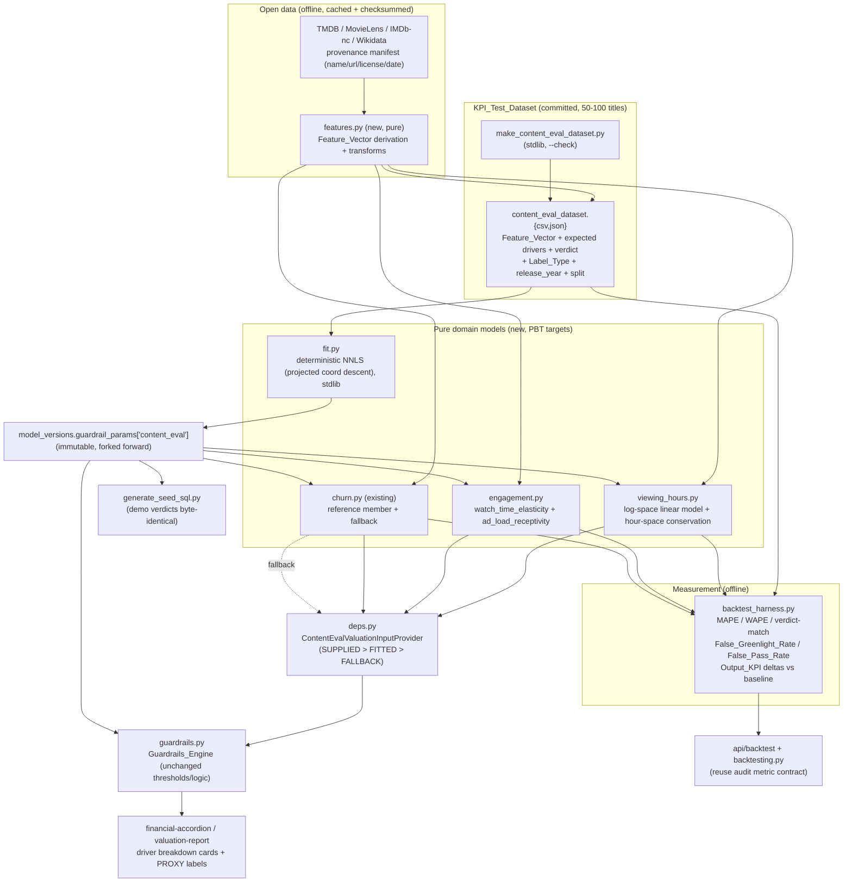

# Design Document

## Overview

The Content_Eval_System adds a data-based modeling and measurement layer to CineROI AI without altering the deterministic decision core. It expresses each `Modeled_Engagement_Driver` (`Projected_Viewing_Hours`, `Churn_Reduction_Pct`, `Watch_Time_Elasticity`, and relative ad-load receptivity) as its own pure, deterministic, versioned `Content_Eval_Model` that maps a `Feature_Vector` (derived from title fields and licensed open-data sources) to that driver, with a per-feature breakdown that conserves to the final value. It introduces a versioned, committed `KPI_Test_Dataset` (a 50-100 title labeled truth sheet), a deterministic, dependency-free `Model_Fit` procedure that learns coefficients from the dataset's temporal training split, and a `Backtest_Harness` that scores a model version over the held-out split and reports per-input error, verdict-match, directional error rates (`False_Greenlight_Rate` first), and `Output_KPI` deltas.

The design preserves every existing guarantee. The four thresholds, the recommendation logic, the governance sign-off gates, and the seeded demo verdicts are unchanged. Models produce only engine *inputs*, flowing through the existing `ValuationInputProvider` boundary; `Platform_Rates` (`LTV`, `CPM`, `Ad_Impressions` basis) stay configured, not modeled. Strict precedence `SUPPLIED > FITTED > DETERMINISTIC_FALLBACK` holds for every input, so a fitted model is never required to boot or demo, and the existing hand-tuned `Churn_Mitigation_Model` becomes both the reference member of the family and its own deterministic fallback. New parameters live under the immutable `model_versions.guardrail_params` JSONB (no migration), carried forward unchanged on calibration forks, and every valuation is stamped with the version(s) that produced it so any past decision is reproducible.

### Grounding summary (verified against the current codebase)

- `app/engines/guardrails.py`: `ValuationInputs` is a frozen dataclass carrying the separate fields `churn_reduction_pct`, `churn_reduction_value`, `ltv`, `watch_time_elasticity`, `cpm`, `ad_impressions`, plus milestone schedule and monthly margin. `_compute` runs the four checks; a `driver_fields` tuple (`ltv`, `churn_reduction_value`, `watch_time_elasticity`, `cpm`, `ad_impressions`) is already enumerated. The engine stamps `model_version_id` and writes an append-only audit entry. Thresholds: `CHURN_MITIGATION_THRESHOLD = 1.5`, LTV floor 3.2, payback 9-12.
- `app/domain/ltv.py`: `compute_ltv_to_cost(churn_reduction_value, ltv, watch_time_elasticity, cpm, ad_impressions, cost_usd)`; numerator = `(churn_reduction_value * ltv) + (watch_time_elasticity * cpm * ad_impressions)`. `churn_reduction_value` and `churn_reduction_pct` are DISTINCT fields; today `quick_evaluate._modeled_inputs` pins `churn_reduction_value = 1` and lets `ltv` carry the subscription contribution. Floats are rejected (Decimal/int/str only).
- `app/domain/churn.py`: the reference pattern - pure, additive, versioned, Decimal; `ChurnContribution` breakdown with a `bounds_adjustment` conservation entry; `resolve_churn(supplied, features, params, source)` implements SUPPLIED-wins; graceful neutral defaults for missing telemetry/genre; `DEFAULT_CHURN_MODEL_PARAMS` labeled Illustrative_Coefficients.
- `app/domain/cpvh.py`: CPVH = Cost(USD) / Projected Viewing Hours; viewing hours of 0 makes CPVH null and the check fail.
- `app/api/deps.py`: `SnapshotValuationInputProvider.get_inputs` reads the active title-version snapshot, coercing each driver (defaults when absent). This is the seam the Content_Eval_System populates.
- `app/api/quick_evaluate.py`: `_modeled_inputs` writes placeholder drivers into the snapshot; `_metadata_profile` derives `production_scale`.
- `model_versions.guardrail_params` JSONB already carries per-guardrail params and a `churn_model` sub-object; `ModelVersioningEngine.read_active()`; `calibration.py` forks copying `guardrail_params` forward (so a `content_eval` sub-object is carried forward automatically). Rows immutable.
- `app/engines/backtesting.py`: `PREDICTED_METRIC_FIELDS` maps `"churn_reduction" -> churn_reduction_pct`, `"cpvh" -> calculated_cpvh`, `"ltv_to_cost" -> ltv_to_cost_multiple`; `POST /api/v1/backtest/audit` takes `metrics:[{metric_name, actual_value}]`; MAPE excludes zero-actual metrics.
- `database/seed/generate_seed_sql.py`: stdlib-only with `--check`; builds `guardrail_params`, title snapshots, and stored projections. `sample-imports/make_*.py` are stdlib-only slate generators with `--check`, the pattern for the dataset generator.
- Tests: backend pytest + Hypothesis over pure `app/domain/*`; frontend Vitest. No external ML library (`scikit-learn`/`scipy`/`numpy`) is a backend dependency today, and the design keeps it that way.

## Architecture



### Design principles

1. **One model per driver, one shared contract.** Each `Content_Eval_Model` is an independent pure module with the same shape as `churn.py`: `*_Params` (parsed from JSONB with full fallback), `*_Features`, a `calculate_*` returning a conserving breakdown, and a `resolve_*` implementing SUPPLIED-wins. Adding a driver is adding a module, not editing the engine (R7.1).
2. **Decision core untouched.** Models write only `ValuationInputs` fields via the provider. Thresholds, recommendation, governance, and the churn non-correctable semantics are never touched (R1.4, R1.7, R8.2).
3. **Strict precedence, always a fallback.** `resolve_*` returns SUPPLIED when a valid value is present; otherwise the fitted version if active and features suffice; otherwise the deterministic/illustrative fallback. Method and reason are recorded (R1.5, R1.6, R8.3).
4. **Deterministic and dependency-free.** All model math and the `Model_Fit` solver use only `math`/`decimal` from the standard library, so results are byte-identical across OS/BLAS and the container stays slim (R4.2).
5. **Honest by construction.** `Label_Type` (OBSERVED/PROXY/SYNTHETIC) travels with every dataset row, fitted version, and reported metric; proxy accuracy is never presented as real-world accuracy (R2.6, R3.6, R6.5, R8.1).
## Components and Interfaces

### 1. Feature derivation (`app/domain/features.py`, new, pure)

A pure module that turns raw title attributes plus open-data correlates into a typed `Feature_Vector`. Every feature is a dataclass field with a documented source, transform, and domain. No I/O: it receives already-fetched raw values (open-data access and caching happen in the offline generator / an injected provider, never inside the pure model), consistent with how `churn.py` receives `Telemetry_Heat` rather than querying for it.

Feature groups (all title-level, zero PII, R2.3):
- **Intrinsic:** `asset_type`, `genre`, `content_format`, `runtime_minutes`, `is_exclusive`, `production_scale`, `talent_pedigree` (reusing existing `metadata_vectors` where present).
- **Open-data popularity/quality correlates:** normalized rating (e.g. TMDB/IMDb vote average scaled to [0,1]), log-normalized vote/popularity count, franchise/sequel flag (Wikidata), award signal. Each tagged with provenance; each with a neutral default and `assumed` flag when absent (R2.4).
- **Temporal:** `release_year` (drives the `Temporal_Split`, never used as a predictive feature to avoid trend leakage).

`normalize_*` helpers mirror `churn.normalize_genre`. The module exposes `derive_features(raw) -> FeatureVector` and is the single definition shared by the engine path, the dataset generator, and the harness, so there is one feature contract.

### 2. Viewing-hours model (`app/domain/viewing_hours.py`, new, pure) - log-space fit with hour-space conservation

This is the pointer-1 reconciliation. The model is **linear in log space** and **reported, conserved, and clamped in hour space**.

- **Fit/predict (log space):** `y_log_hat = intercept + sum_i(beta_i * x_i)` over non-negative-constrained features where monotonicity is required; prediction `H_hat = exp(y_log_hat) - 1` (inverse of `log(1 + H)`), per R4.4.
- **Breakdown in hours (conserving) - base hours + marginal-lift share.** Because `exp(sum)` is multiplicative, the breakdown uses the base-plus-marginal allocation (not a naive per-term log share, which would double-count the intercept and force a large negative adjustment):
  - Base platform hours: `H0 = exp(intercept) - 1`.
  - Total feature lift in hours: `dH = H_hat - H0`, where `H_hat = exp(intercept + L) - 1` and `L = sum_i(beta_i * x_i)` is the total non-intercept log lift.
  - Per feature: `hours_i = (beta_i * x_i / L) * dH` when `L > 0`, else `hours_i = 0`.
  - Breakdown entries are `{base_platform_hours = H0, hours_i..., rounding_or_bounds_adjustment}`.
  By construction `H0 + sum_i(hours_i) == H_hat` before quantization, so the single trailing `rounding_or_bounds_adjustment` entry (exactly like `churn.bounds_adjustment`) only ever carries a tiny +/-1-hour rounding or floor-clamp residual, never a large structural offset. When `L == 0` (no feature lift) all hours are the base term and every `hours_i == 0`. This keeps the Hypothesis conservation property identical in form to the churn model's.
- **Domain:** output clamped to a non-negative floor (viewing hours cannot be negative or zero for CPVH, so a small positive floor avoids the CPVH null/zero path, R-grounded against `cpvh.py`); clamp residual flows into the adjustment entry.
- **Params:** `ViewingHoursParams` parsed from `guardrail_params['content_eval']['viewing_hours']` with the churn-style full-fallback parse; absent/invalid -> `DEFAULT_VIEWING_HOURS_PARAMS` (illustrative).

### 3. Engagement model (`app/domain/engagement.py`, new, pure)

Models the remaining drivers that open data can inform:
- **`Watch_Time_Elasticity`:** an additive model over engagement correlates (runtime, genre bingeability, serialization), bounded to a documented domain, same breakdown/fallback shape.
- **`Ad_Load_Receptivity`:** a unit-centered multiplier (default 1.0) that **scales the configured CPM basis** rather than inventing a dollar CPM, honoring the `Platform_Rate` boundary (R1.1). The engine still multiplies by the configured `cpm`; the model only supplies the receptivity scalar.

### 4. Churn <-> LTV linkage (pointer 3)

The design makes explicit how the modeled `Churn_Reduction_Pct` flows into the LTV numerator's `churn_reduction_value`, which are separate fields today. The `Content_Eval_System` defines:

`churn_reduction_value = Base_Retained_Cohort_Value x (Churn_Reduction_Pct / 100)`

where `Base_Retained_Cohort_Value` is a configured `Platform_Rate` (subscribers-at-risk x per-subscriber value, per platform/territory). So improving the churn model propagates into LTV-to-Cost automatically **unless** a `Supplied_Value` for `churn_reduction_value` is present (SUPPLIED still wins at the field level). This is opt-in via a `link_churn_to_ltv` flag in `content_eval` params; when off, current behavior (independent `churn_reduction_value`, default pinned) is preserved so the demo verdicts do not move. The link is documented in the LTV attribution breakdown so the subscription value remains explainable.

### 5. Deterministic fitting core (`app/domain/fit.py`, new, pure) - pointer 2

A ~40-line, standard-library **non-negative least squares via projected coordinate descent** (and an IRLS wrapper for the WAPE/Log-MAE objective). Properties:
- Operates on `Decimal`/`float` with fixed iteration count and tolerance; **fixed seed, no wall-clock, no environment dependence** -> byte-identical params across platforms (R4.2), immune to BLAS drift (no numpy).
- Enforces per-coefficient non-negativity by projection after each coordinate update, preserving the monotonicity/explainability guarantees of the hand-tuned models (R4.3).
- Objective is pluggable: squared error for additive drivers; **log-space residual with WAPE** for viewing hours (R4.4).
- Convex non-negative objective over 5-8 features and 50-100 rows converges in well under the 2-second budget.
- Emits fit metrics (train + held-out test) consumed by the version record.

### 6. KPI_Test_Dataset + generator (`database/kpi_dataset/`, new)

- `content_eval_dataset.csv` + `.json`: 50-100 stratified titles (tentpole / mid-budget genre / indie drama / international co-pro / library), each row = stable id, full `Feature_Vector`, expected `Projected_Viewing_Hours` / `Churn_Reduction_Pct` / `Watch_Time_Elasticity` / `ad_load_receptivity`, expected per-guardrail outcome, expected recommendation, `Label_Type`, `release_year`, `split` (train/test by `Temporal_Split` cutoff), and a provenance note (R3.1-R3.6).
- `make_content_eval_dataset.py`: stdlib-only with `--check`, mirrors `sample-imports/make_*.py`. Reads cached open-data snapshots (checksummed) so it runs offline and reproducibly (R2.5). The five seeded demo titles are included with their current expected verdicts pinned (R3.4).
- Dataset-level metadata block: version, creation date, `Open_Data_Sources` used (name/url/license/access-date), temporal cutoff, dominant `Label_Type`; immutable once a published measurement references it (R3.5).
- A committed `PROVENANCE.md` manifest records each source's license (R2.2); IMDb is used under its non-commercial dataset license and flagged as such.

### 6b. Source connectors (`backend/app/data/connectors/`, new) - pluggable source onboarding

A thin, declarative layer that lets new Open_Data_Sources be onboarded later without touching the models, the dataset schema, or the harness (R9). It sits *upstream* of the pure `features.py`, which stays fetch-free.

- **Contract.** A `SourceConnector` protocol with four methods: `fetch()` (pull raw records from one source), `normalize(raw) -> Mapping[title_id, partial FeatureVector]` (map into the shared feature contract), `snapshot(raw) -> path+checksum` (write a committed/cached `Source_Snapshot`), and `provenance() -> {name, url, license, access_date}` (for the manifest). Connectors live in `backend/app/data/connectors/{tmdb,movielens,imdb_nc,wikidata}.py`; each is small and independently testable.
- **Registry.** `connector_registry.py` is an ordered, declarative list of enabled connectors plus, per feature, which source supplies it and the precedence when two sources overlap (R9.3). Adding a source = one registry entry + one connector module.
- **Snapshot-only reads (reproducibility gate).** All build/fit/test/measurement feature derivation reads `Source_Snapshot` bytes by checksum; a live `fetch()` only runs in an explicit `scripts/refresh_source_snapshots.py` step, never inside a build (R9.4). This preserves the offline determinism R2.5 already requires.
- **License gate.** A connector with an absent/incompatible license, or whose normalized records would carry personal data, is rejected/quarantined by a manifest validator before its data can enter the pipeline (R9.5). The `PROVENANCE.md` manifest is the single source of truth for what is allowed.
- **Label_Type carry-through.** Each connector tags the features/labels it contributes with their Label_Type, which flows into the dataset and every reported metric unchanged (R9.6).
- **Backward compatibility.** `features.py` ignores unknown feature keys, and a `Content_Eval_Version` resolves using only the features it was fitted on, so adding a new source never breaks an older fitted version (R9.7, reuses the R7.2 unknown-feature rule).

The `make_content_eval_dataset.py` generator (Component 6) consumes the registry + snapshots rather than calling sources directly, so the named sources are simply the first connector implementations of this contract.

### 7. Backtest harness (`app/engines/backtest_harness.py` + CLI, offline)

- Loads a dataset version and a `content_eval` version; runs each model over the held-out (test-split) rows using the shared `features.py`; produces per-input predictions.
- Computes per-input error: **MAPE** (reusing the backtesting convention that excludes zero-actual metrics) and **WAPE/Log-MAE** for viewing hours; **verdict-match rate**; and the asymmetric **`False_Greenlight_Rate`** (reported first, as capital-loss risk) and **`False_Pass_Rate`** (R6.1, R6.2).
- Recomputes the four `Output_KPIs` over the dataset for baseline vs candidate and reports the deltas, attributing to the single changed model (one-change-at-a-time, R6.3, R6.4).
- Labels all accuracy as proxy when the measured rows are PROXY/SYNTHETIC (R6.5). Invokable as a CLI and a pytest; reproducible from dataset version + model version alone (R6.6).
- Bridges to the existing `POST /api/v1/backtest/audit` metric contract by mapping each driver to its `PREDICTED_METRIC_FIELDS` column, so the Backtest Studio can score churn / CPVH / LTV through the same path (R6.7).

### 8. Engine wiring (`app/api/deps.py`, extended)

A `ContentEvalValuationInputProvider` wraps the existing `SnapshotValuationInputProvider`. For each driver field it applies precedence: snapshot `Supplied_Value` -> fitted `content_eval` model (when a version is active and features suffice) -> existing snapshot/placeholder fallback. It attaches the method, reason, and `Content_Eval_Version` to the inputs so the engine can stamp and the explanation can surface them. The `Guardrails_Engine` constructor and the guardrail checks are unchanged; only the provider that feeds it is swapped, matching R1.4.

**Explanation passthrough (minimal, additive).** `ValuationInputs` gains one optional field `driver_explanations: Mapping[str, Any] | None = None`, populated by the provider with each model's hour/point breakdown keyed by driver. `_jsonable_explanation` gains a 3-line passthrough: when `inputs.driver_explanations` is present it is attached under `explanation["content_eval"]`, alongside the existing `churn_model` block. This is the only touch to the engine module and it is purely additive (absent field -> identical output), so demo explanations are byte-identical when no fitted version is active. It gives `financial-accordion.tsx` and `valuation-report.tsx` direct access to the viewing-hours and engagement breakdowns.

### 9. Versioning, seed, and UI

- **Params** live under `model_versions.guardrail_params['content_eval']` (JSONB, no migration); parsed with churn-style fallback; carried forward unchanged by `calibration.py`'s existing `dict(active.guardrail_params)` fork (R5.1, R5.3).
- **Seed:** `generate_seed_sql.py` gains a `content_eval` params block but, with no fitted version active and `link_churn_to_ltv` off, every seeded projection and verdict stays byte-identical, verified by the existing seed regression tests (R5.5, R8.5).
- **UI:** the financial accordion and valuation report gain driver-breakdown cards (reusing the churn breakdown component pattern) and a visible **PROXY / illustrative** badge wherever a modeled or proxy-trained value is shown (R8.1). Decimals remain JSON strings coerced by `toNumber()`.

## Data Models

```text
content_eval (model_versions.guardrail_params['content_eval'], JSONB)
├─ version_label, fit_dataset_version, dominant_label_type   # provenance/honesty
├─ link_churn_to_ltv: bool                                   # pointer-3 toggle (default false)
├─ viewing_hours: { intercept, betas{feature->weight>=0}, floor, objective:"wape_log" }
├─ engagement:    { watch_time_elasticity:{...}, ad_load_receptivity:{...} }
└─ (churn_model stays where it is today, unchanged)

FeatureVector (frozen dataclass)        DriverResult (per model, mirrors ChurnResult)
├─ intrinsic + open-data correlates     ├─ value: Decimal
├─ release_year (split only)            ├─ method: SUPPLIED|FITTED|FALLBACK
└─ each: value, source, assumed flag    ├─ breakdown: (Contribution, ...)  # conserves
                                        ├─ version_label, label_type
KPI_Test_Dataset row                    └─ missing/assumed features
├─ title_id, FeatureVector
├─ expected: viewing_hours, churn_pct, watch_time_elasticity, ad_load_receptivity
├─ expected: per_guardrail_outcome, recommendation
└─ label_type, release_year, split, provenance
```

## Error Handling

- **Missing feature / open-data gap:** neutral default + `assumed` flag; never a hard failure and never a 0 that unfairly penalizes (R2.4), mirroring churn.
- **Invalid/absent `content_eval` params:** churn-style full fallback to illustrative defaults with `params_source = DEFAULTS`.
- **No fitted version active:** deterministic fallback; demo verdicts unchanged.
- **Fit regression:** a fitted version scoring worse than baseline on the held-out split is emitted but NOT auto-activated; the harness surfaces the regression for an explicit decision (R4.7).
- **Zero-actual metrics in MAPE:** excluded, matching existing backtesting.
- **Viewing-hours floor:** output never drops to the CPVH-null/zero path; the clamp delta is absorbed by the conservation adjustment entry.

## Correctness Properties

Formal invariants the pure models and the fit/harness must satisfy, each stated so it maps to a Hypothesis property test (mirroring the churn model's property suite).

### Property 1: Determinism

For a fixed `Feature_Vector` and `Content_Eval_Version`, `calculate_*` returns an identical `DriverResult` on every call.
**Validates: Requirements 1.2**

### Property 2: Breakdown conservation (additive models)

For churn, watch-time elasticity, and ad-load receptivity, `sum(breakdown.points) == value` exactly at the quantization precision, with any clamp/rounding residual carried by the single adjustment entry.
**Validates: Requirements 1.3**

### Property 3: Breakdown conservation (log-space viewing hours)

With hour contributions allocated by log-lift share, `sum(breakdown_hours) == Projected_Viewing_Hours` exactly at the quantization precision, including the `L == 0` base-only case and after the non-negative floor clamp.
**Validates: Requirements 1.3, 4.4**

### Property 4: Monotonicity

Increasing any feature whose coefficient is constrained non-negative, all else held constant, never decreases the predicted driver (additive) and never decreases `exp(y_log) - 1` (viewing hours, since `exp` is monotone).
**Validates: Requirements 4.3**

### Property 5: Domain safety

Every numeric feature is clamped to its documented domain before use; viewing-hours output stays above the positive floor so CPVH never hits its null/zero path.
**Validates: Requirements 1.1, 2.1**

### Property 6: Precedence

`resolve_*` yields SUPPLIED for any valid supplied value; else FITTED when a version is active and required features are present; else FALLBACK, with method and reason recorded, in that strict order.
**Validates: Requirements 1.5, 1.6, 8.3**

### Property 7: Graceful degradation

A missing feature or open-data gap uses a neutral default and is flagged `assumed`; it never raises and never contributes a penalizing zero where the domain forbids it.
**Validates: Requirements 2.4**

### Property 8: Fit reproducibility

`Model_Fit` on a fixed dataset version, feature set, and config produces byte-identical `Content_Eval_Version` parameters across runs and platforms (fixed seed, stdlib only).
**Validates: Requirements 4.2**

### Property 9: Fit structural constraints

Fitted coefficients the domain requires non-negative are non-negative, so a fitted model keeps Properties 2-4.
**Validates: Requirements 4.3**

### Property 10: No auto-regression

A fitted version scoring worse than baseline on the held-out split is never auto-activated.
**Validates: Requirements 4.7**

### Property 11: Temporal non-leakage

No row in the test split has `release_year <= cutoff`; `Model_Fit` reads only training-split rows.
**Validates: Requirements 3.3**

### Property 12: Demo invariance

With no fitted version active and `link_churn_to_ltv` off, every seeded projection, driver, and verdict is byte-identical to the pre-feature seed.
**Validates: Requirements 5.5, 8.5**

### Property 13: Honesty propagation

Any `DriverResult` or harness metric derived from PROXY/SYNTHETIC labels carries that `Label_Type` through to every surface; proxy accuracy is never labeled real-world accuracy.
**Validates: Requirements 6.5, 8.1**

### Property 14: Connector reproducibility and backward compatibility

Feature derivation reads only checksummed `Source_Snapshot` bytes (no live fetch in a build/fit/test); adding a new Source_Connector leaves every pre-existing `Content_Eval_Version`'s resolved inputs and verdicts byte-identical (older versions ignore unknown features); and a connector with an absent/incompatible license or personal data is rejected before entering the pipeline.
**Validates: Requirements 9.4, 9.5, 9.7**
## Testing Strategy

- **Property-based (Hypothesis), pure domain:** determinism; monotonicity in each non-negative feature; **breakdown conservation** (`sum(breakdown) == value`) including the log-space hour allocation; domain clamping; SUPPLIED-wins precedence; fallback when features insufficient. Matches the churn model's test depth (R8.5).
- **Fit solver:** reproducibility (byte-identical params for fixed inputs/seed across runs); non-negativity preserved; convergence within the time budget; recovers known coefficients on a synthetic fixture.
- **Harness:** correct MAPE/WAPE/verdict-match; `False_Greenlight_Rate`/`False_Pass_Rate` computed correctly on crafted fixtures; KPI deltas; PROXY labeling; reproducible from version ids.
- **Regression:** existing seed-verdict regression and the full backend/frontend suites pass unchanged with no fitted version active (R5.5, R8.5).
- **Dataset generator:** `--check` is idempotent and no-write; dataset conforms to schema and size bound; temporal split has no leakage (no test row dated <= cutoff).