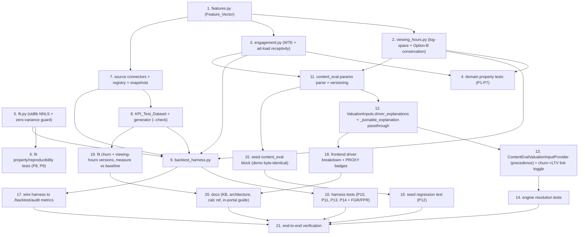

# Implementation Plan

## Overview

This plan builds the Content_Eval_System from the design. Work flows from the pure domain (fastest feedback, independent Hypothesis targets) outward to the fit solver, the pluggable source connectors, the committed KPI dataset, the offline backtest harness, engine wiring, versioning/seed, UI, and docs, ending with an end-to-end verification. Each task cites the requirements and correctness properties it satisfies and is independently buildable with no new runtime dependency (standard library only for all model/fit/harness/connector code).

"Build/verify" means run the backend suite from `backend/` with `python -m pytest -q -p no:cacheprovider` and the frontend checks from `frontend/` with `npm run typecheck`, `npx next lint --dir app --dir components`, and `npx vitest run`, as relevant.

The strict precedence `SUPPLIED > FITTED > FALLBACK`, the untouched guardrail thresholds/recommendation/governance, and byte-identical demo verdicts (no fitted version active, `link_churn_to_ltv` off) are invariants every task must preserve.

## Task Dependency Graph



```json
{
  "waves": [
    { "wave": 1, "tasks": ["1", "5"] },
    { "wave": 2, "tasks": ["2", "3", "6", "7"] },
    { "wave": 3, "tasks": ["4", "8", "11", "15"] },
    { "wave": 4, "tasks": ["9", "12", "16"] },
    { "wave": 5, "tasks": ["10", "13", "17", "18", "19"] },
    { "wave": 6, "tasks": ["14", "20"] },
    { "wave": 7, "tasks": ["21"] }
  ],
  "dependencies": {
    "1": [], "2": ["1"], "3": ["1"], "4": ["2", "3"],
    "5": [], "6": ["5"], "7": ["1"], "8": ["1", "7"],
    "9": ["2", "3", "5", "7", "8"], "10": ["9"],
    "11": ["2", "3"], "12": ["11"], "13": ["12"], "14": ["13"],
    "15": ["11"], "16": ["15"], "17": ["9"], "18": ["12"],
    "19": ["8", "9"], "20": ["18", "19"],
    "21": ["14", "16", "17", "20", "10"]
  }
}
```

## Tasks

- [x] 1. Create the pure feature-derivation module
  - Add `backend/app/domain/features.py` with a frozen `FeatureVector` dataclass (intrinsic: asset_type, genre, content_format, runtime_minutes, is_exclusive, production_scale, talent_pedigree; open-data correlates: normalized_rating, log_vote_count, franchise_flag, award_signal; temporal: release_year) and per-field `(value, source, assumed)` metadata.
  - Implement `derive_features(raw) -> FeatureVector` as a pure function (no I/O; raw values passed in), `normalize_*` helpers mirroring `churn.normalize_genre`, and neutral defaults with an `assumed` flag for every absent open-data correlate (never a penalizing zero). `release_year` is split-only and never a predictive feature. Ignore unknown feature keys so older fitted versions are unaffected.
  - Decimal/stdlib only; importable without the app framework.
  - _Requirements: 2.1, 2.3, 2.4, 7.2, 9.7; Properties 5, 7, 14_

- [x] 2. Create the viewing-hours model (log-space fit, hour-space conservation)
  - Add `backend/app/domain/viewing_hours.py` with `ViewingHoursParams` (intercept, non-negative `betas`, positive `floor`, objective tag), `DEFAULT_VIEWING_HOURS_PARAMS` (illustrative), a churn-style `parse_params` (never raises; invalid -> defaults), and `calculate_viewing_hours(features, params)`.
  - Predict in log space (`y_log = intercept + sum(beta_i*x_i)`, `H_hat = exp(y_log) - 1`). Build the hour-space breakdown with the **base-plus-marginal-lift (Option B)** allocation: `H0 = exp(intercept) - 1`; `dH = H_hat - H0`; `hours_i = (beta_i*x_i / L) * dH` when `L = sum(beta_i*x_i) > 0` else 0; entries `{base_platform_hours=H0, hours_i..., rounding_or_bounds_adjustment}`. The adjustment entry must only ever carry a tiny rounding/floor residual (NOT a structural offset) - do not use `L` as the denominator for an intercept term.
  - Clamp output to the positive `floor` so CPVH never hits its null/zero path; the clamp delta flows into the adjustment entry. Implement `resolve_viewing_hours(supplied, features, params, source)` (SUPPLIED-wins).
  - _Requirements: 1.1, 1.2, 1.3, 4.4; Properties 1, 3, 4, 5, 6_

- [x] 3. Create the engagement model (watch-time elasticity + ad-load receptivity)
  - Add `backend/app/domain/engagement.py` with additive `calculate_watch_time_elasticity` (bounded domain, conserving breakdown, churn-style params/fallback) and `calculate_ad_load_receptivity` returning a unit-centered multiplier (default 1.0) that SCALES the configured CPM basis and never emits a dollar CPM (honors the Platform_Rate boundary). Both expose `resolve_*` (SUPPLIED-wins).
  - _Requirements: 1.1, 1.2, 1.3, 1.5; Properties 1, 2, 4, 6_

- [x] 4. Property-test the domain models
  - Add `backend/tests/domain/test_viewing_hours_properties.py` and `test_engagement_properties.py` (Hypothesis, `# Feature: content-eval-model, Property N: ...`): determinism (P1), additive conservation (P2), log-space hour conservation incl. `L == 0` and post-floor-clamp (P3), monotonicity (P4), domain clamping (P5), SUPPLIED-wins precedence and fallback (P6), graceful degradation on missing features (P7).
  - Build/verify these pass before any wiring.
  - _Requirements: 8.5; Properties 1, 2, 3, 4, 5, 6, 7_

- [x] 5. Create the deterministic fit solver
  - Add `backend/app/domain/fit.py`: a standard-library non-negative least squares via projected coordinate descent, plus an IRLS wrapper for the log-space WAPE/Log-MAE objective used by viewing hours. Fixed iteration count and tolerance, fixed seed, no wall-clock/env dependence; project coefficients to >= 0 after each update.
  - Include the **zero-variance feature guard**: `denom = sum(w_n * x_nj**2)`; `if denom <= 1e-12: beta[j] = 0; continue` so a constant/sparse column never raises `ZeroDivisionError`.
  - Return fitted coefficients plus train metrics. No numpy/scipy/sklearn.
  - _Requirements: 4.1, 4.2, 4.3, 4.4; Properties 8, 9_

- [x] 6. Test the fit solver
  - Add `backend/tests/domain/test_fit.py`: byte-identical params across repeated runs/seeds (P8); non-negativity preserved (P9); recovers known coefficients on a synthetic fixture within tolerance; zero-variance column yields a 0 weight with no error; converges within the time budget.
  - _Requirements: 4.2, 4.3; Properties 8, 9_

- [x] 7. Build the pluggable source-connector layer
  - Add `backend/app/data/connectors/` with a `SourceConnector` protocol (`fetch()`, `normalize(raw) -> {title_id: partial FeatureVector}`, `snapshot(raw) -> path+checksum`, `provenance()`), a `connector_registry.py` (ordered, declarative; per-feature source + overlap precedence), and the first connector implementations (tmdb / movielens / imdb_nc / wikidata) backed by committed/cached Source_Snapshots.
  - Add `scripts/refresh_source_snapshots.py` as the ONLY place a live `fetch()` runs (out-of-build); all build/fit/test/measurement reads snapshot bytes by checksum. Add a manifest/license validator that rejects a source with an absent/incompatible license or personal data.
  - Add `backend/tests/data/test_connectors.py`: snapshot-only reads (no live fetch in tests); overlap precedence resolves and records the chosen source; license/PII rejection; adding a mock new connector leaves an existing fitted version's resolution byte-identical (P14).
  - _Requirements: 9.1, 9.2, 9.3, 9.4, 9.5, 9.6, 9.7; Property 14_

- [x] 8. Build the KPI_Test_Dataset and its generator
  - Add `database/kpi_dataset/content_eval_dataset.csv` + `.json` (50-100 stratified titles: tentpole / mid-budget genre / indie drama / international co-pro / library), each row = stable id, full FeatureVector, expected viewing_hours / churn_pct / watch_time_elasticity / ad_load_receptivity, expected per-guardrail outcome, expected recommendation, Label_Type, release_year, split. Include the 5 seeded demo titles with current expected verdicts pinned.
  - Add `database/kpi_dataset/make_content_eval_dataset.py` (stdlib-only, `--check` idempotent no-write) that consumes the Connector_Registry + checksummed Source_Snapshots (task 7) so it runs offline/reproducibly. Add dataset metadata (version, date, sources w/ license, temporal cutoff, dominant Label_Type) and a `PROVENANCE.md` recording each source's name/url/license/access-date (IMDb flagged non-commercial).
  - Apply the Temporal_Split by release-year cutoff (no random k-fold). Add a generator `--check` test and a schema/size-bound test.
  - _Requirements: 2.2, 2.5, 2.6, 3.1, 3.2, 3.3, 3.4, 3.5, 3.6, 9.2; Property 11_

- [x] 9. Build the backtest harness
  - Add `backend/app/engines/backtest_harness.py` + a CLI entry: load a dataset version and a `content_eval` version, run each model over the held-out (test-split) rows via `features.py`, and compute per-input MAPE (exclude zero-actuals) plus WAPE/Log-MAE for viewing hours, verdict-match rate, and the asymmetric `False_Greenlight_Rate` (reported first) and `False_Pass_Rate`. Recompute the four Output_KPIs for baseline vs candidate and report deltas, attributing to a single changed model.
  - Label all accuracy PROXY when measured rows are PROXY/SYNTHETIC. Reproducible from dataset version + model version alone.
  - _Requirements: 6.1, 6.2, 6.3, 6.4, 6.5, 6.6; Properties 10, 11, 13_

- [x] 10. Test the harness
  - Add `backend/tests/engines/test_backtest_harness.py`: correct MAPE/WAPE/verdict-match; FGR/FPR on crafted fixtures; KPI deltas; no-auto-activate on regression (P10); temporal non-leakage enforced (no test row <= cutoff) (P11); PROXY labeling propagated (P13); connector add leaves fitted resolution identical (P14); reproducibility from ids.
  - _Requirements: 6.1-6.6; Properties 10, 11, 13, 14_

- [x] 11. Add content_eval params parsing and versioning
  - Add `parse_content_eval_params(raw)` (churn-style full fallback) reading `model_versions.guardrail_params['content_eval']` (version_label, fit_dataset_version, dominant_label_type, `link_churn_to_ltv` default false, viewing_hours, engagement). JSONB, no migration. Confirm `calibration.py`'s `dict(active.guardrail_params)` carries `content_eval` forward unchanged; add a test asserting the fork copies it.
  - _Requirements: 5.1, 5.3_

- [x] 12. Thread driver explanations through the engine (additive only)
  - In `app/engines/guardrails.py` add `ValuationInputs.driver_explanations: Mapping[str, Any] | None = None`; in `_jsonable_explanation` add the 3-line passthrough attaching it under `explanation["content_eval"]` only when present. No guardrail check, threshold, or recommendation change; absent field -> byte-identical output.
  - Add a test asserting identical explanation JSON when the field is None, and inclusion when present.
  - _Requirements: 1.4, 5.2, 5.4, 8.2_

- [x] 13. Build the ContentEvalValuationInputProvider (precedence + churn->LTV link)
  - In `app/api/deps.py` add `ContentEvalValuationInputProvider` wrapping `SnapshotValuationInputProvider`. Per driver apply `SUPPLIED (snapshot) -> FITTED (active content_eval model, when features suffice) -> FALLBACK (snapshot/placeholder)`, recording method/reason/version and populating `driver_explanations`.
  - Implement the opt-in `link_churn_to_ltv`: when true and no supplied `churn_reduction_value`, set `churn_reduction_value = Base_Retained_Cohort_Value * (churn_reduction_pct / 100)` using the configured Platform_Rate; when false, preserve today's behavior exactly.
  - Wire it in `get_guardrails_engine`. Build/verify existing tests pass (default: no active version, link off -> unchanged).
  - _Requirements: 1.4, 1.5, 1.6, 8.3; Properties 6, 12_

- [x] 14. Engine resolution tests
  - Add `backend/tests/engines/test_content_eval_resolution.py`: identity (no active version, link off -> inputs/verdict unchanged); fitted version overrides a driver and the verdict reacts; SUPPLIED beats FITTED beats FALLBACK; `link_churn_to_ltv` propagates churn into the LTV numerator only when on and unsupplied; `driver_explanations` reaches the persisted explanation.
  - _Requirements: 1.4, 1.5, 1.6, 8.3; Properties 6, 12_

- [x] 15. Seed the content_eval params block
  - In `database/seed/generate_seed_sql.py` add a `content_eval` block to `guardrail_params` with illustrative defaults, `link_churn_to_ltv: false`, and no active fitted version. Verify `--check` stays idempotent and every seeded projection/driver/verdict is unchanged.
  - _Requirements: 5.1, 5.5, 8.5; Property 12_

- [x] 16. Seed regression test
  - Extend the seed-verdict regression test to assert the five demo titles' drivers, projections, verdicts, and explanation JSON are byte-identical before and after this feature with no fitted version active and link off.
  - _Requirements: 5.5, 8.5; Property 12_

- [x] 17. Bridge the harness to the existing backtest audit contract
  - Map each driver to its `PREDICTED_METRIC_FIELDS` column so churn / CPVH (via viewing hours) / LTV drivers can be scored through `POST /api/v1/backtest/audit`; reuse the MAPE-excludes-zero convention. Add an API test.
  - _Requirements: 6.7_

- [x] 18. Frontend driver breakdown + PROXY labeling
  - In `financial-accordion.tsx` and `studio/_components/valuation-report.tsx` render viewing-hours and engagement breakdown cards (reuse the churn breakdown component pattern), reading `explanation.content_eval`. Add a visible PROXY / illustrative badge wherever a modeled or proxy-trained value is shown. Coerce Decimals with `toNumber()`. Add Vitest coverage.
  - _Requirements: 6.5, 8.1_

- [x] 19. Fit and measure the first versions
  - Run `Model_Fit` to produce a churn `content_eval` version and a viewing-hours version from the dataset training split; run the harness on the held-out split; record MAPE/WAPE, verdict-match, FGR/FPR, and Output_KPI deltas vs the illustrative baseline. Do NOT auto-activate a version that regresses (P10); surface the comparison. Keep every reported metric labeled by Label_Type.
  - _Requirements: 4.1, 4.4, 4.5, 4.6, 4.7, 6.1, 6.2, 6.3; Properties 8, 10, 13_

- [x] 20. Documentation
  - Update the knowledge base (new section on the modeling layer, the connector layer, the dataset, and the measurement loop), the architecture & data-flow doc, the calculations reference (viewing-hours log-space formula + Option-B breakdown, churn->LTV link, FGR/FPR), and the in-portal `/guide`. Label proxy/illustrative honestly. Regenerate the NotebookLM export.
  - _Requirements: 8.1, 8.6_

- [x] 21. End-to-end verification
  - With no fitted version active and link off: full backend (pytest + Hypothesis) and frontend (typecheck/lint/vitest) suites pass and demo verdicts are byte-identical. With a fitted version active in a scratch run: a driver flows through the provider, the verdict reacts, the breakdown surfaces in the UI with a PROXY badge, and the harness reports FGR/FPR and KPI deltas. Confirm no new runtime dependency was added.
  - _Requirements: 1.4, 1.7, 5.2, 5.5, 8.4, 8.5, 8.6; Properties 1-14_

## Notes

- Order rationale: the pure domain (tasks 1-6) is verified in isolation first, so the Hypothesis properties (especially log-space hour conservation and fit reproducibility) pin the math down before any orchestration. The pluggable source-connector layer (7) sits upstream of the pure feature module and feeds both the dataset generator (8) and the harness (9); the connectors, dataset, and harness are the measurement substrate and depend only on the domain plus checksummed snapshots. Versioning/explanation (11-12) land the additive engine seams; the provider and its tests (13-14) then apply precedence and the opt-in churn->LTV link. Seed (15-16) proves demo invariance. The audit bridge (17), UI (18), and the first fit+measure run (19) are largely independent once the harness and explanation shape exist. Docs (20) follow the measured numbers, and task 21 is the single end-to-end gate.
- Hard invariants for every task: no new runtime dependency (standard library only for model/fit/harness/connector code); the four thresholds, recommendation logic, and governance gates are untouched; `SUPPLIED > FITTED > FALLBACK` precedence holds per input; and with no fitted version active and `link_churn_to_ltv` off, all demo verdicts, drivers, projections, and explanation JSON are byte-identical.
- Honesty gate: any value or metric derived from PROXY/SYNTHETIC labels must be labeled as such wherever it is surfaced; proxy accuracy is never presented as real-world accuracy.
- Source onboarding (task 7): new open-data sources are added by implementing the `SourceConnector` contract and a registry entry only; a live fetch happens solely in the out-of-build `refresh_source_snapshots.py` step, builds/tests read checksummed snapshots, unvetted/unlicensed/PII sources are rejected, and adding a source never changes an existing fitted version's resolved inputs.
- The three locked-down implementation details: (1) viewing-hours breakdown uses base-hours + marginal-lift-share (Option B), never an intercept term over the `L` denominator; (2) `fit.py` guards the zero-variance denominator; (3) driver breakdowns thread through `ValuationInputs.driver_explanations` into `explanation["content_eval"]` as a purely additive passthrough.