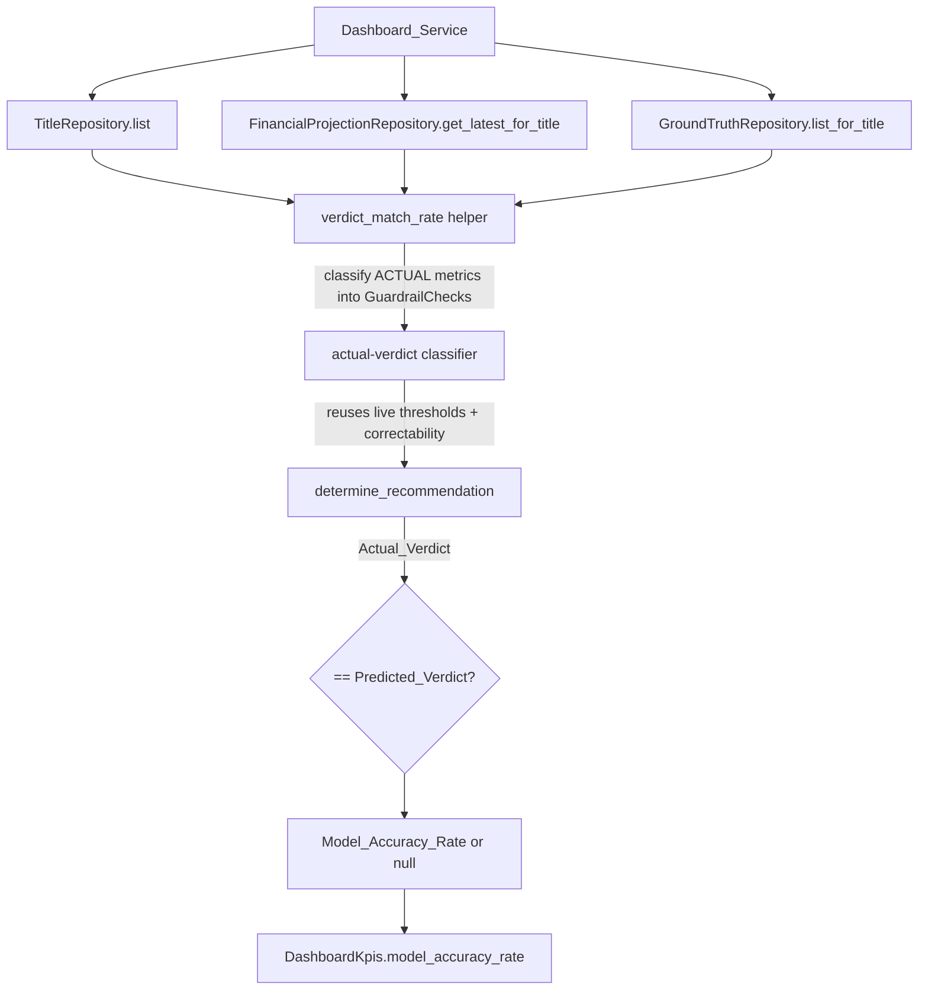

# Design Document

## Overview

This design turns three small, related enhancements into concrete, code-grounded
changes while preserving the product's demo-honesty posture (never fabricate,
zero-fill, or mislabel an accuracy number):

- **Component 1 — Dashboard verdict-match accuracy (Enhancement 1).** Replace the
  hard-coded `model_accuracy_rate=None` in `Dashboard_Service`
  (`backend/app/api/dashboard.py`) with a real `Verdict_Match_Rate`: for each
  title that has ground truth, recompute an `Actual_Verdict` from the title's
  *actual* ground-truth metric values and compare it against the stored
  `Predicted_Verdict` (`recommendation_status`). The figure is the fraction of
  `Eligible_Audited_Titles` that match, rounded to a fixed precision, and stays
  `null` when there are no eligible titles. This component also exposes the
  additive, nullable `payback_horizon_months` field on `TitleSummary` that
  Enhancement 2 needs.

- **Component 2 — Backtest Studio payback input (Enhancement 2).** Add an
  "Actual payback horizon (months)" input to the `Ground_Truth_Form`
  (`frontend/components/backtest/ground-truth-form.tsx`), threaded through the
  existing `buildMetrics`/`onSubmit` shaping exactly like the other three
  metrics (blank = omitted), with a read-only predicted payback sourced from the
  new `TitleSummary.payback_horizon_months` via `AuditableTitleOption`. No
  backend audit contract change.

- **Component 3 — Demo ground-truth seed (Enhancement 3).** Make
  `generate_seed_sql.py` emit deterministic, idempotent `historical_ground_truth`
  rows for the existing historical title "Echoes of 2019" (`title-echoes`) so a
  freshly booted demo has at least one `Eligible_Audited_Title` and the accuracy
  card shows a real (non-null) number.

### The honesty-critical nuance (resolved here)

`app.domain.recommendation.determine_recommendation` does **not** consume raw
metric values. It consumes a list of *classified* `GuardrailCheck` objects —
each carrying a `threshold`, a `passed`/`breached` flag, and a `correctable`
flag. `historical_ground_truth` stores only raw actual metric values
(`cpvh`, `ltv_to_cost`, `churn_reduction`, `payback_horizon`). The hard part of
Component 1 is bridging that gap honestly: we must classify the *actual* metric
values into checks using the **same thresholds and the same correctability rules
the live valuation path already applies**, then feed those checks to the
unchanged `determine_recommendation`. The design below specifies exactly where
those thresholds and correctability rules come from (`app.engines.guardrails`)
and reuses them rather than inventing a parallel rule.

## Architecture

### Current data flow (unchanged pieces)

```mermaid
flowchart TD
    subgraph Live valuation path (unchanged)
      GE[Guardrails_Engine.evaluate] -->|builds classified checks| DR[determine_recommendation]
      DR -->|recommendation_status| FP[(financial_projections)]
    end
    subgraph Ground truth (unchanged persistence)
      BT[Backtesting_Module.persist_ground_truth] --> GT[(historical_ground_truth)]
    end
    GET[GET /dashboard/summary] --> DS[Dashboard_Service]
    T[(titles)] --> DS
    FP --> DS
```

### New data flow (Component 1)

`Dashboard_Service` already loads every title and its latest projection to build
the KPI header and grid. We add a second, read-only pass that computes the
accuracy figure from data the handler is already positioned to read, plus the
ground-truth store:



The computation is a pure, deterministic function of persisted
(title, latest-projection, ground-truth) data. It consults no wall clock, no
random source, and no request ordering (R3.2). It introduces **no new
third-party dependency** (R5.1): it uses the Python standard library plus the
existing domain/engine modules, and runs inside the existing `async` handler
through the existing async repository layer (R5.2).

### Where it lives

A new small helper module `backend/app/domain/accuracy.py` holds the pure
classification + match logic (no I/O), keeping `determine_recommendation` and
the dashboard handler thin and keeping the logic property-testable in isolation.
The dashboard handler performs the async repository reads and delegates the
arithmetic to this helper. The helper depends only on
`app.domain.recommendation`, `app.domain.cpvh`, and the guardrail threshold
constants in `app.engines.guardrails`.

## Components and Interfaces

### Component 1 — Dashboard verdict-match accuracy

#### 1.1 Obtaining thresholds and correctability (the hard part)

Reading the live path in `app.engines.guardrails.Guardrails_Engine`, each
guardrail check is built by a dedicated helper that classifies a single metric
value against a threshold and assigns a fixed correctability. The classification
rules — which are the authoritative live-pipeline rules — are:

| Metric (ground-truth key) | Threshold source | Breach rule | `correctable` on breach |
|---|---|---|---|
| `cpvh` | `app.domain.cpvh.cpvh_ceiling(AssetType(title.asset_type))` — `0.18` Premium_Original, `0.05` Library_Filler, `None` when no ceiling (`_cpvh_check`, R4) | `cpvh_breaches(value, ceiling)` i.e. value strictly `>` ceiling | `True` (a lower cost corrects it) |
| `ltv_to_cost` | `app.domain.ltv.LTV_TO_COST_THRESHOLD` (`3.2`) (`_ltv_check`, R5) | value strictly `<` floor | `True` |
| `churn_reduction` | `app.engines.guardrails.CHURN_MITIGATION_THRESHOLD` (`1.5`) (`_churn_check`, R6) | value strictly `<` hurdle | `False` (intrinsic; cost cannot correct) |
| `payback_horizon` | `app.engines.guardrails.PAYBACK_TARGET_MAX_MONTHS` (`12`) (`_payback_check`, R7) | value strictly `>` max | `True` |

These thresholds are **the title's own applicable thresholds**: the CPVH ceiling
is derived from the title's stored `asset_type` (exactly as the live engine
derives it), and the LTV floor / churn hurdle / payback max are the same
project-wide domain constants the live `_compute` path uses when no scenario
override is present (the persisting `evaluate` path always passes
`thresholds=None`, so the standard constants are the live verdict basis). We
import the constants and ceiling function directly — no values are duplicated or
re-declared — satisfying R5.3 ("reuse the existing recommendation rule and
metric vocabulary").

For each present actual metric we build a `GuardrailCheck` with the **same
shape and the same `name`/`threshold`/`passed`/`breached`/`correctable` semantics**
the live `_X_check` helpers produce, then pass the list to the unchanged
`determine_recommendation`, which returns the `Actual_Verdict` (R1.2). We do not
recompute CPVH/LTV from raw financial inputs — the ground-truth value *is* the
realized metric value, so classification is value-vs-threshold only. This mirrors
how the seed's `_seed_explanation` already classifies the four checks from stored
metric values, confirming the rule is stable and reusable.

`shortfall_magnitude` only affects `dominant_factor` in the explanation, not the
terminal status, so the classifier sets it consistently with the live helpers
(normalized distance past threshold on a breach, else `None`) but the verdict
does not depend on it.

#### 1.2 `Eligible_Audited_Title` definition

A title is eligible when **both** hold (R2.1):

1. It has at least one ground-truth metric row in `historical_ground_truth`
   (`GroundTruthRepository.list_for_title(title_id)` returns a non-empty list),
   AND
2. The stored ground-truth metrics plus the title's own thresholds are
   sufficient to produce a **classifiable** `Actual_Verdict`.

"Classifiable" is defined precisely to avoid inferring a verdict from absent
data. `determine_recommendation`'s logic is: 0 breaches → GREENLIGHT; otherwise
breach classification decides NEGOTIATE_HARD vs PASS. A verdict is **only
trustworthy when every one of the four guardrails has a determinate check**,
because a missing guardrail could flip the verdict (e.g. an unobserved churn
value could be a non-correctable breach that forces PASS). Therefore:

- **Eligibility requires all four metrics** (`cpvh`, `ltv_to_cost`,
  `churn_reduction`, `payback_horizon`) to be present in the title's ground
  truth **and** classifiable with the title's thresholds.
- If only some of the four are present, the title is **not** eligible and is
  excluded (R2.3) — we never treat an absent metric as "passing", which would
  fabricate a cleaner verdict than the data supports.
- A title whose `asset_type` yields **no CPVH ceiling** (`cpvh_ceiling` returns
  `None`) cannot classify its CPVH check against a real ceiling; per the live
  `_cpvh_check` a null ceiling is a non-correctable breach, but since this
  reflects a missing classification basis rather than an observed outcome, such
  a title is treated as **not classifiable** and excluded (R2.3). (None of the
  seeded asset types hit this; it is specified for totality.)

Rationale for "all four": it keeps the number honest and unambiguous. A partial
basis is reported as *no basis for that title* (exclusion), never as a guessed
verdict. This is the conservative reading of R2.1/R2.3 and is recorded as a
Design Decision below.

#### 1.3 Match and rate computation

For each `Eligible_Audited_Title`:

- `Predicted_Verdict` = the title's stored `recommendation_status` on its latest
  `financial_projections` row (R1.3). A title whose latest projection has a null
  `recommendation_status` has no predicted verdict to compare against and is
  excluded (there is nothing to match).
- `Actual_Verdict` = `determine_recommendation(classified_actual_checks)[0]`.
- It is a **match** when `Actual_Verdict == Predicted_Verdict`.

Then:

- `eligible = [titles that are Eligible_Audited_Title with a non-null Predicted_Verdict]`
- If `len(eligible) == 0` → `Model_Accuracy_Rate = None` (R2.4, R9.1). We never
  emit `0.0` to mean "not yet measured" (R2.6).
- Else → `Model_Accuracy_Rate = round(matches / len(eligible), 4)`, a float in
  the closed interval `[0, 1]` where higher is better (R2.5).

Rounding is fixed at **4 decimal places** (`round(x, 4)`), matching the existing
`portfolio_risk_exposure` rounding in the same handler, so the emitted value is
stable across runs (R3.3). The function reads only persisted data and performs
no ordering-dependent reduction (sum of a boolean match set divided by a count),
so repeated requests over unchanged data return the identical value (R3.1, R3.2).

The harness dataset-level `verdict_match_rate` is **never** consulted or
substituted (R1.4, R1.5, R9.2); the harness module is untouched (R11.2).

#### 1.4 Helper interface (pure, no I/O)

```python
# backend/app/domain/accuracy.py
from decimal import Decimal

ACCURACY_DECIMAL_PLACES = 4  # documented fixed rounding (R3.3)

# The four metrics that must all be classifiable for eligibility.
REQUIRED_METRICS = ("cpvh", "ltv_to_cost", "churn_reduction", "payback_horizon")

def actual_verdict(
    asset_type: str,
    actuals: dict[str, Decimal],
) -> str | None:
    """Classify ACTUAL ground-truth metric values into GuardrailChecks using the
    live thresholds/correctability and return the recomputed recommendation, or
    None when the title is not classifiable (missing a required metric or no
    applicable CPVH ceiling)."""

def verdict_match_rate(
    pairs: list[tuple[str | None, str | None]],
) -> float | None:
    """Given (predicted_verdict, actual_verdict) pairs for titles that have
    ground truth, return the fraction that match over the eligible subset
    (both verdicts present / classifiable), rounded to ACCURACY_DECIMAL_PLACES,
    or None when the eligible subset is empty."""
```

The dashboard handler builds `actuals` from `GroundTruthRepository.list_for_title`
(collapsing to one value per metric name, newest by `recorded_at`, mirroring the
`Backtesting_Module.audit` collapse), calls `actual_verdict`, and pairs it with
the stored `recommendation_status`.

#### 1.5 Handler change (`dashboard_summary`)

The existing per-title loop is extended to also collect, for titles that have
ground truth, the `(predicted_verdict, actual_verdict)` pair. The three existing
KPIs are computed from exactly the same inputs as today and are left byte-for-byte
unchanged (R4.2, R6.4): only `model_accuracy_rate` changes from the literal
`None` to `verdict_match_rate(pairs)`. `GroundTruthRepository` is added as a
third repository alongside the existing two.

### Component 2 — Backtest Studio payback input

#### 2.1 `AUDITED_METRICS` entry

Add a fourth entry to the `AUDITED_METRICS` list in `ground-truth-form.tsx`,
and extend the `AuditedMetricKey` union with `"payback_horizon"`:

```ts
{
  key: "payback_horizon",
  metricName: "payback_horizon",
  label: "Actual payback horizon (months)",
  hint: "Realized months to recoup the acquisition cost",
}
```

Because the form already iterates `AUDITED_METRICS` to render inputs and to build
the request in `buildMetrics()`, the new metric threads through automatically:

- **Rendering** (R7.1): the `.map` over `AUDITED_METRICS` renders the labeled
  numeric input beside the existing three.
- **Submission shaping** (R7.2, R7.5): `buildMetrics()` already trims the raw
  value, skips when blank, rejects non-finite with a field-identifying message
  (`${label} must be a number.`, R7.4), and otherwise pushes
  `{ metric_name: "payback_horizon", actual_value: parsed }`. No change to the
  `POST /backtest/audit` request/response contract — the backend already lists
  `payback_horizon` in `PREDICTED_METRIC_FIELDS`.
- **Blank omission** (R7.3, R9.3): the existing `raw === "" → continue` branch
  omits payback when blank rather than sending `0`.

#### 2.2 Read-only predicted payback

`predictedFor(key)` must return the predicted payback for the
`payback_horizon` key. Unlike CPVH/churn (known only after the audit returns),
predicted payback is available on the stored projection as soon as a title is
selected, so it is sourced from the selected `AuditableTitleOption` — exactly as
the LTV branch already does:

```ts
if (key === "payback_horizon") {
  return formatPredicted(selectedTitle?.payback_horizon_months);
}
```

When absent, `formatPredicted` returns the existing `-` placeholder, matching the
form's other read-only "Predicted" fields rather than showing zero (R8.2).

#### 2.3 Threading `payback_horizon_months` through the option shape

- `TitleSummary` (frontend `frontend/lib/types.ts`): add
  `payback_horizon_months: number | null;` (it already exists on
  `FinancialProjection`-shaped types elsewhere in the file; this adds it to the
  dashboard row type). This is the frontend mirror of the new backend field
  (R8.3).
- `AuditableTitleOption` (`select-auditable-titles.ts`): add
  `payback_horizon_months: number | null;` and map it in `selectAuditableTitles`
  from `title.payback_horizon_months`, preserving input order (R8.4).
- `backtest/page.tsx`: no logic change needed — it already passes `titles` and
  the selector already carries the new field through.

### Component 3 — Demo ground-truth seed

#### 3.1 Target title and values

Seed `historical_ground_truth` for `title-echoes` ("Echoes of 2019", the one
`is_historical=True` title). Its seeded prediction is cpvh `0.1667`, ltv `3.50`,
churn `2.00`, payback `10`, verdict **GREENLIGHT** (ORIGINAL_SERIES → CPVH
ceiling `0.18`).

To make it an `Eligible_Audited_Title` whose `Actual_Verdict` is deterministically
classifiable, seed **all four** metrics with plausible actuals that all pass their
guardrails, so the recomputed `Actual_Verdict` is **GREENLIGHT — a match** with
the stored prediction. The demo card then shows a sensible non-null rate
(100% over the one eligible title at a clean boot):

| Metric | Actual value | Threshold | Classifies as | Note |
|---|---|---|---|---|
| `cpvh` | `0.1710` | `≤ 0.18` ceiling | PASS | slightly worse than predicted `0.1667`, still under ceiling |
| `ltv_to_cost` | `3.42` | `≥ 3.2` floor | PASS | modest miss vs predicted `3.50`, still clears floor |
| `churn_reduction` | `1.90` | `≥ 1.5` hurdle | PASS | realized a touch below predicted `2.00` |
| `payback_horizon` | `11` | `≤ 12` | PASS | one month longer than predicted `10` |

All four pass → 0 breaches → `determine_recommendation` returns GREENLIGHT =
`Predicted_Verdict` → **match**. The actuals are deliberately *not* equal to the
predictions (so the MAPE scorecard is also non-trivial and the data reads as real
observation, R12.4) but stay on the same side of every threshold so the verdict
is deterministically GREENLIGHT.

#### 3.2 Emission mechanics (deterministic + idempotent)

Add a new `TITLE_GROUND_TRUTH` data block and a corresponding INSERT section in
`render()`, following the established conventions:

- **Deterministic PK**: `det_uuid(f"{title_label}-gt-{metric_name}")` for the
  `ground_truth_id` (uuid5 over the fixed `_NS` namespace), matching the
  existing `det_uuid(label + '-suffix')` pattern used for every other seeded row.
  This makes the emitted SQL byte-identical on regeneration (R12.2).
- **Idempotent**: `ON CONFLICT (ground_truth_id) DO NOTHING;`, matching every
  other seed INSERT's deterministic-PK conflict clause (R12.3). Re-seeding never
  duplicates or errors.
- **Vocabulary**: metric names are drawn only from `PREDICTED_METRIC_FIELDS`
  (`cpvh`, `ltv_to_cost`, `churn_reduction`, `payback_horizon`) (R12.4).
- **FK integrity**: `title_id = det_uuid("title-echoes")`, which the titles
  INSERT already created (same deterministic id), so the
  `historical_ground_truth.title_id → titles.title_id` FK is satisfied, and the
  section is emitted after the titles INSERT.
- **Labeled**: a SQL comment marks the rows as demo/illustrative — e.g.
  `-- Demo/illustrative ground truth (NOT real production outcomes): seeds one`
  `-- Eligible_Audited_Title so the Model Accuracy card shows a real rate on a`
  `-- clean boot. Actuals are plausible vs the seeded prediction and all pass`
  `-- their guardrails, so the recomputed Actual_Verdict is GREENLIGHT (a match).`
  (R12.5).

Every other seeded entity (titles, projections, model version, exchange rates,
the five verdict-preserving churn tolerances) is left untouched (R12.6). The
generator's `--check` mode continues to guard byte-stability.

## Data Models

### New backend field: `TitleSummary.payback_horizon_months`

`backend/app/api/dashboard.py` — add to `TitleSummary`:

```python
payback_horizon_months: int | None = None
```

Populated in the handler from `projection.payback_horizon_months` (the column
already exists on `FinancialProjection`, `Integer`, nullable). It is **additive,
optional, and nullable** — no existing field is removed, renamed, or retyped, and
the `{kpis, titles}` structure is unchanged (R4.3, R4.4, R8.3). Default `None`
keeps the response shape stable for titles with no projection.

### New frontend field: `TitleSummary.payback_horizon_months`

`frontend/lib/types.ts` — add `payback_horizon_months: number | null;` to the
`TitleSummary` interface (mirrors the backend field).

### Ground-truth seed rows (Component 3)

Four rows into `historical_ground_truth`:

```
ground_truth_id = det_uuid("title-echoes-gt-cpvh"),            title_id = det_uuid("title-echoes"), metric_name='cpvh',            actual_value=0.1710
ground_truth_id = det_uuid("title-echoes-gt-ltv_to_cost"),     title_id = det_uuid("title-echoes"), metric_name='ltv_to_cost',     actual_value=3.42
ground_truth_id = det_uuid("title-echoes-gt-churn_reduction"), title_id = det_uuid("title-echoes"), metric_name='churn_reduction', actual_value=1.90
ground_truth_id = det_uuid("title-echoes-gt-payback_horizon"), title_id = det_uuid("title-echoes"), metric_name='payback_horizon', actual_value=11
```

`recorded_at` is defaulted by the column (`created_at_column`) and is not emitted,
consistent with the model and with determinism of the INSERT text.

### No schema migration

`historical_ground_truth` already exists (model + table). No Alembic migration is
needed; Component 3 only inserts rows. The new `payback_horizon_months` field is a
response-schema (Pydantic / TS) addition, not a DB column change.

## Error Handling

- **No ground truth at all (whole portfolio).** Every title returns an empty
  `list_for_title`, so `eligible` is empty and `Model_Accuracy_Rate = None`
  (R2.2, R2.4). The card renders its existing `null`-driven dash (R9.1).
- **Partial ground truth for a title.** Fewer than four metrics present → the
  title is not classifiable → excluded, never counted as a match or a miss
  (R2.3, R6.3). This is the key guard against inventing a verdict from absent
  data.
- **Null `recommendation_status` on the latest projection.** No predicted verdict
  to compare → the title contributes no pair → excluded.
- **No applicable CPVH ceiling for the asset type.** `cpvh_ceiling` returns
  `None` → CPVH check not classifiable against a real ceiling → title excluded
  (totality case; unused by current seed).
- **Null basis.** `verdict_match_rate` returns `None` (not `0.0`) whenever the
  eligible subset is empty (R2.6, R9.1).
- **Frontend payback input.** Non-numeric entry blocks submission with a
  field-identifying message via the existing `buildMetrics` validation (R7.4);
  blank entry is omitted, not zero-sent (R7.3). Absent predicted payback renders
  the `-` placeholder, not `0` (R8.2).
- **Seed re-run.** `ON CONFLICT (ground_truth_id) DO NOTHING` makes re-seeding a
  no-op for these rows (R12.3). A single shared transaction in `seed.py` means a
  failure rolls back cleanly.

## Testing Strategy

The accuracy computation is a pure function over typed inputs, so it is a strong
property-based-testing target; the seed and frontend changes are better covered
by example/integration tests (seed is declarative; the form input is UI-threading).

### Backend (pytest) — Component 1 (R6.1–R6.4)

- **Null when zero eligible titles** (R6.1): portfolio with no ground truth →
  `kpis.model_accuracy_rate is None`.
- **Known fraction** (R6.2): a fixed set of titles with known predicted and
  classifiable actual verdicts (some matching, some not) → asserts the exact
  rounded fraction (e.g. 2 of 3 → `0.6667`).
- **Insufficient ground truth excluded** (R6.3): a title with only two of four
  metrics is excluded — asserted by showing the rate equals the fraction over the
  *other* (fully-eligible) titles only, and that adding/removing the partial
  title does not change the rate (not counted as match or miss).
- **Three KPIs unchanged** (R6.4): a golden test asserting
  `active_pipeline_valuation_usd`, `avg_ltv_to_cost`, and
  `portfolio_risk_exposure` are identical before and after the enhancement
  (compare against the pre-change computed values for a fixed fixture).
- **Determinism** (R3.1): two computations over the same fixture return the
  identical value.
- **Reuse of the live classifier**: a title whose actuals reproduce a known live
  verdict (e.g. a churn breach forcing PASS because churn is non-correctable)
  yields the same `Actual_Verdict` the guardrail helpers would, confirming the
  shared thresholds/correctability.

### Backend (pytest) — Component 3 integration (R12.7)

- **Demo seed yields a non-null rate**: apply the generated seed into a test DB
  (or load the `title-echoes` title + projection + the four ground-truth rows as
  a fixture), call the dashboard handler, and assert
  `kpis.model_accuracy_rate is not None` and equals `1.0` (the one eligible title
  matches), derived from at least one `Eligible_Audited_Title`.
- **Seed byte-stability**: `generate_seed_sql.py --check` passes after
  regeneration (guards R12.2/R12.3).

### Frontend (vitest) — Component 2 (R10.1–R10.4)

- **Payback metric added** (R10.1): entering a payback value and submitting
  includes a `payback_horizon` metric with the entered value in the request.
- **Blank payback omitted** (R10.2): leaving payback blank (with another metric
  filled) omits `payback_horizon` from the request.
- **Predicted payback display** (R10.3): renders the title's
  `payback_horizon_months` when present, and the `-` placeholder when absent.
- **Non-numeric blocks submit** (R10.4): a non-numeric payback entry blocks
  submission with a message identifying the payback field.
- **Selector projection**: `selectAuditableTitles` carries
  `payback_horizon_months` through and preserves input order.

### Property-based testing configuration

Where property tests are used (Component 1), use the project's existing property
library (Hypothesis — already present under `backend/.hypothesis`), **minimum 100
iterations** per property, each tagged with a comment of the form
**Feature: dashboard-accuracy-and-payback-audit, Property N: <text>**. Do not
reimplement property testing from scratch. Component 2/3 use example and
integration tests (the UI threading and the declarative seed have no meaningful
"for all inputs" surface beyond the properties below).

## Correctness Properties

*A property is a characteristic or behavior that should hold true across all valid
executions of a system — a formal statement about what the system should do.
Properties bridge human-readable specifications and machine-verifiable guarantees.*

### Property 1: Accuracy is a fraction or null

For all portfolios (any set of titles, latest projections, and ground-truth
values), `Model_Accuracy_Rate` is either `null` or a float in the closed interval
`[0, 1]`, and it is `null` if and only if the eligible subset is empty.

**Validates: Requirements 2.4, 2.5, 2.6**

### Property 2: Eligibility excludes insufficient ground truth

For all titles, a title with no ground truth, or missing any of the four required
metrics, or lacking a classifiable actual verdict, is excluded from both the
numerator and the denominator of `Model_Accuracy_Rate` (it is counted neither as
a match nor as a miss).

**Validates: Requirements 2.1, 2.2, 2.3**

### Property 3: Accuracy equals matches over eligible

For all portfolios with a non-empty eligible subset, `Model_Accuracy_Rate`
equals `round(matches / eligible_count, 4)`, where `matches` is the number of
eligible titles whose `Actual_Verdict` equals their `Predicted_Verdict`.

**Validates: Requirements 1.1, 1.3, 2.5, 3.3**

### Property 4: Determinism

For all portfolios, computing `Model_Accuracy_Rate` twice over the same persisted
data yields the identical value (no dependence on wall clock, randomness, or
iteration/request ordering).

**Validates: Requirements 3.1, 3.2**

### Property 5: Actual verdict reuses the live recommendation rule

For all titles with all four classifiable actual metrics, the `Actual_Verdict`
equals the output of `determine_recommendation` applied to checks classified with
the title's own thresholds (asset-type CPVH ceiling, `3.2` LTV floor, `1.5` churn
hurdle, `12` payback max) and the live correctability rules (CPVH/LTV/payback
correctable, churn non-correctable).

**Validates: Requirements 1.2, 5.3**

### Property 6: Three existing KPIs are invariant

For all portfolios, enabling the accuracy figure leaves
`active_pipeline_valuation_usd`, `avg_ltv_to_cost`, and `portfolio_risk_exposure`
unchanged in value from the pre-enhancement computation.

**Validates: Requirements 4.2, 4.3, 11.3**

### Property 7: Payback metric threading

For all form states, submitting with a numeric payback value produces a request
containing exactly one `payback_horizon` metric equal to that value, and
submitting with a blank payback omits the `payback_horizon` metric entirely.

**Validates: Requirements 7.2, 7.3, 9.3**

### Property 8: Auditable option preserves order and payback

For all dashboard summaries, `selectAuditableTitles` returns, in the same input
order, the subset of titles with a non-null `recommendation_status`, each carrying
the title's `payback_horizon_months` value unchanged.

**Validates: Requirements 8.4**

### Property 9: Seed idempotence and determinism

For all numbers of re-runs, regenerating the seed produces byte-identical
`historical_ground_truth` INSERT statements, and re-applying the seed inserts no
duplicate and raises no error (`ON CONFLICT DO NOTHING` on the deterministic
`ground_truth_id`).

**Validates: Requirements 12.2, 12.3**

### Property 10: Demo seed produces a real, matching verdict

For the seeded `title-echoes` ground truth, every one of the four actual metrics
passes its guardrail, so the recomputed `Actual_Verdict` is GREENLIGHT, which
equals the seeded `Predicted_Verdict`, making the title an `Eligible_Audited_Title`
that contributes a match and yields a non-null `Model_Accuracy_Rate`.

**Validates: Requirements 12.1, 12.4, 12.7**

## Design Decisions

### D1: Recompute the Actual_Verdict, never store it

We derive `Actual_Verdict` on the fly from stored ground-truth metric values
rather than adding an "actual_recommendation" column. This is the honest choice:
the recommendation is a *function* of metric values against thresholds, and
persisting a second verdict would risk drift between the stored value and the
rule that produced it (and the rule can change with model calibration). Computing
it keeps a single source of truth — `determine_recommendation` — and guarantees
the dashboard number always reflects the current rule applied to observed
outcomes. The cost is a small per-request classification pass, which is cheap and
pure.

### D2: Reuse the live classification, do not invent a parallel rule

`determine_recommendation` needs classified checks, and the only authoritative
classifier is the live valuation path in `Guardrails_Engine` (`_cpvh_check`,
`_ltv_check`, `_churn_check`, `_payback_check`). We reuse its thresholds
(asset-type CPVH ceiling via `cpvh_ceiling`, the `3.2`/`1.5`/`12` constants) and
its fixed correctability assignments (CPVH/LTV/payback correctable, churn
non-correctable) by importing them, so the recomputed actual verdict is produced
by the same logic as the predicted verdict. Because the ground-truth values are
already realized metric outputs (not raw financial inputs), we classify
value-vs-threshold rather than re-running the CPVH/LTV formulas — this is exactly
what the seed's `_seed_explanation` already does, confirming the approach is
consistent with the codebase. This directly answers the honesty constraint in the
requirements: the "actual" verdict is scoped strictly to titles whose stored
ground truth is sufficient to classify it, and no verdict is inferred from absent
data.

### D3: Require all four metrics for eligibility

We treat a title as classifiable only when all four guardrail metrics are present
in ground truth. A partial basis could silently flip the verdict (an unobserved
churn value might be a non-correctable breach forcing PASS), so counting a partial
title would fabricate a cleaner verdict than the data supports. Excluding partial
titles keeps the number real and makes "not enough basis" explicit (exclusion,
reported as `null` when nothing qualifies) rather than guessed.

### D4: Fixed 4-dp rounding, matching the existing handler

We round to 4 decimal places to match the existing `portfolio_risk_exposure`
rounding in the same handler, keeping the handler internally consistent and the
emitted value stable across runs.

### D5: Keep scope to the three enhancements

No change to the backtest harness, MAPE arithmetic, `POST /backtest/audit`
persistence, the three existing KPIs, or unrelated endpoints (R11). Component 2
requires no backend audit-contract change because `payback_horizon` is already in
`PREDICTED_METRIC_FIELDS`. Component 3 only inserts additive, labeled rows.
