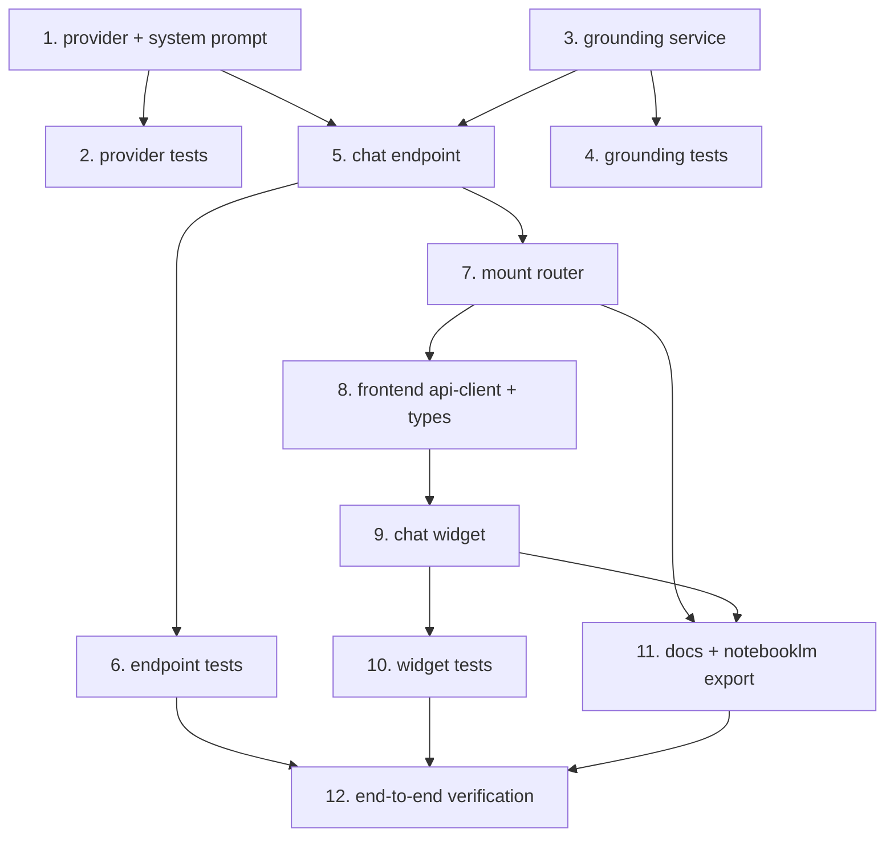

# Implementation Plan

## Overview

This plan builds the Data_Chat_Assistant from the design: a read-only, grounded chat layer with a swappable provider (shipping the no-cost Mock_Chat_Provider), a backend endpoint, a frontend floating widget, tests, and documentation. Work flows from the pure provider/grounding pieces outward to the endpoint, then the UI, then docs and a final end-to-end check. Each task cites the requirements it satisfies and is independently buildable. "Build/verify" means run the backend suite from `backend/` with `python -m pytest -q -p no:cacheprovider` and the frontend checks from `frontend/` with `npm run typecheck`, `npm run lint`, and `npx vitest run`, as relevant. No database migration is introduced.

## Task Dependency Graph



The waves below group tasks that can proceed in parallel once their dependencies are met.

```json
{
  "waves": [
    { "wave": 1, "tasks": ["1", "3"] },
    { "wave": 2, "tasks": ["2", "4", "5"] },
    { "wave": 3, "tasks": ["6", "7"] },
    { "wave": 4, "tasks": ["8"] },
    { "wave": 5, "tasks": ["9"] },
    { "wave": 6, "tasks": ["10", "11"] },
    { "wave": 7, "tasks": ["12"] }
  ],
  "dependencies": {
    "1": [],
    "2": ["1"],
    "3": [],
    "4": ["3"],
    "5": ["1", "3"],
    "6": ["5"],
    "7": ["5"],
    "8": ["7"],
    "9": ["8"],
    "10": ["9"],
    "11": ["7", "9"],
    "12": ["6", "10", "11"]
  }
}
```

## Tasks
- [ ] 1. Create the provider interface, mock provider, and system prompt
  - Add `backend/app/chat/__init__.py`, `backend/app/chat/provider.py` with the `ChatMessage` dataclass (`role`, `content`), the `ChatProvider` Protocol (`complete(messages) -> str`), the `MockChatProvider` (no network, no key; deterministic answer composed from the grounded user turn, with an explicit "I don't have that information" when the context lacks the answer), and `select_provider(settings)` defaulting to the mock.
  - Add `backend/app/chat/system_prompt.py` with `SYSTEM_PROMPT_CONTRACT` constraining the assistant to explaining platform data and redirecting override/greenlight/number-change requests to the governance controls.
  - Add a `CINEROI_CHAT_PROVIDER` setting (default empty -> mock) in the settings module.
  - _Requirements: 3.1, 3.2, 3.3, 3.4, 3.5, 3.6_

- [ ] 2. Property/unit tests for the provider and system prompt
  - Under `backend/tests/chat/`, assert `select_provider` defaults to the mock, the mock makes no network call and is deterministic for identical input, the mock emits the honest "don't know" line when context is empty, and `SYSTEM_PROMPT_CONTRACT` is non-empty and present.
  - _Requirements: 3.2, 3.3, 3.4, 3.6_

- [ ] 3. Create the GroundingService
  - Add `backend/app/chat/grounding.py` with `GroundingService` and a `GroundedContext { text, sources }` result. Implement Title_Resolution: use the explicit `title_id` when supplied; otherwise load the active title names via `TitleRepository` and select titles whose `title_name.lower()` appears as a substring of `message.lower()` (no NLP/NER dependency). Exactly one match scopes to that title; zero or multiple matches fall back to portfolio scope. When a supplied `title_id` is malformed (not a UUID) or resolves to no row, catch it and fall back to portfolio scope rather than raising a 500. Gather portfolio context (dashboard summary) and, for a title scope, the persisted scorecard (`FinancialProjectionRepository`), decision/negotiation data, and the churn breakdown from `financial_projections.explanation`. Omit confidential fields unless the actor is permitted `READ_CONFIDENTIAL` via `RBACService`. Reads only - no writes, no engine runs, no audit entries.
  - _Requirements: 1.1, 1.2, 1.3, 1.5, 2.3, 2.4_

- [ ] 4. Tests for the GroundingService
  - Under `backend/tests/chat/`, verify a known seeded title (The Ledger) yields its scorecard/decision/churn in the context plus source ids; an unknown name falls back to portfolio; a role lacking `READ_CONFIDENTIAL` never sees confidential fields; grounding performs no writes.
  - _Requirements: 1.2, 1.3, 1.5, 2.3, 2.4_

- [ ] 5. Create the chat endpoint
  - Add `backend/app/api/chat.py` with `router = APIRouter(prefix="/chat", tags=["chat"])` and `POST /chat` authorized by `Depends(require_operation(Operation.VALUATION))`. Define `ChatMessage`, `ChatRequest { message, title_id?, history? }`, `ChatResponse { answer, sources }` schemas. Reject empty/blank `message` through the standard envelope. Bound `history` to the last N turns. Build the message list (system prompt + bounded history + grounded user turn), call the provider, catch provider failures into a standard envelope without leaking internals, return `ChatResponse`. Declare the route as `@router.post("")` (empty path) so `POST /api/v1/chat` with no trailing slash hits without a 307 redirect that could drop the body. Inject the DB session via the existing `SessionDep` and construct `GroundingService(session, actor)` in the handler (or via a `get_grounding_service` dependency in `deps.py`).
  - _Requirements: 1.4, 1.6, 2.1, 2.2, 4.1, 4.2, 4.3, 4.4, 4.5, 4.6_

- [ ] 6. Tests for the chat endpoint
  - Under `backend/tests/api/`, cover: a grounded answer for a seeded title with source ids; the honest "don't know" path; an override-phrased request answered with the governance redirect (not an action) and no writes/audit entries; empty message rejected; provider failure returns an envelope without internals; unauthorized call rejected by RBAC.
  - _Requirements: 1.4, 1.6, 2.1, 2.2, 2.4, 4.2, 4.4_

- [ ] 7. Mount the chat router
  - In `backend/app/api/support_routers.py`, import `chat` and add `chat.router` to `_PREFIXED_ROUTERS` so it mounts under `/api/v1`. Verify the route appears and that `POST /api/v1/chat` (no trailing slash) resolves without a 307 redirect. Build the backend suite.
  - _Requirements: 4.1_

- [ ] 8. Frontend api-client method and types
  - In `frontend/lib/types.ts`, add `ChatTurn`, `ChatRequest`, `ChatResponse`. In `frontend/lib/api-client.ts`, add a `chat(request)` method calling `/api/chat` through the existing same-origin path. Run `npm run typecheck`.
  - _Requirements: 5.1_

- [ ] 9. Build the chat widget
  - Add `frontend/app/_components/chat-widget.tsx` (`"use client"`): a fixed-position floating action button opening an expanding panel. Mount it once as a `"use client"` component placed directly inside `<body>` in `frontend/app/layout.tsx` (next to `{children}`; the server layout stays a server component) so it persists across route transitions without unmounting or resetting local history. Maintain local Conversation_History and send only the last N trailing turns. Derive title scope from the current route and show the Context_Chip (title name + key fact, else "Portfolio Overview"). Size the panel responsively (full-width minus margins on small screens, fixed width on `sm` and up, capped by `max-h`) so it does not overflow or collide with nav on tablet/mobile. Render each assistant message's `sources` as subtle citation chips/accordion (e.g. "The Ledger Scorecard", "Portfolio Summary") so grounding is visible. Pending state disables submit and blocks duplicate submissions; errors render readably and leave the input usable. Accessible: labeled input, focus management on open, `aria-live` for answers/errors.
  - _Requirements: 1.5, 5.1, 5.2, 5.3, 5.4, 5.5, 5.6, 5.7, 5.8_

- [ ] 10. Tests for the chat widget
  - Add a Vitest + Testing Library test: sending a message renders the returned answer; an error response shows a readable message and the input stays usable; the Context_Chip reflects title vs portfolio scope.
  - _Requirements: 5.1, 5.4, 5.7_

- [ ] 11. Documentation and NotebookLM export
  - Add a "Data Chat Assistant" how-to recipe to the in-portal guide (`frontend/app/guide/page.tsx`, Features & How-To tab). Document the feature (read-only, grounded, provider-swappable, mock default) in `CineROI_AI_Complete_Knowledge_Base.md` and `CineROI_AI_Architecture_And_Data_Flow.md`. Regenerate the NotebookLM export via `scripts/notebooklm-export.ps1`.
  - _Requirements: 6.3_

- [ ] 12. End-to-end verification
  - Run the full backend suite and the frontend typecheck/lint/vitest. Rebuild the frontend (and backend if changed) container, confirm `POST /api/v1/chat` returns a grounded answer for a seeded title and the honest "don't know" for an unanswerable one, and the widget renders in the running portal. Clean up any temp files.
  - _Requirements: 6.1, 6.2, 6.3_

## Notes

- No database migration or schema change: the assistant reads existing persisted records only.
- The Read_Only_Boundary is enforced in code (grounding does no writes, the endpoint runs no engine) and asserted by tests (no audit entries, override requests redirected).
- Real Chat_Provider implementations (hosted or self-hosted) are a later increment behind the same `ChatProvider` interface; they require only a new provider class and config, not changes to the endpoint, grounding, or widget.
- Build/verify per task: backend `python -m pytest -q -p no:cacheprovider` from `backend/`; frontend `npm run typecheck`, `npm run lint`, `npx vitest run` from `frontend/`.