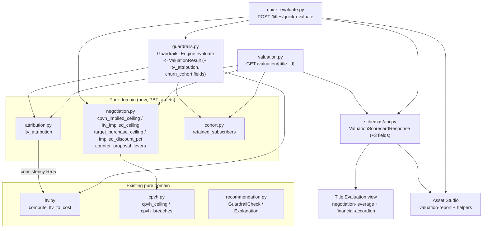

# Design Document

## Overview

Deal Decision Support adds three read-only decision aids on top of the existing `Guardrails_Engine` outputs: a **Negotiation Playbook** (target purchase ceiling, implied discount, counter-proposal levers), an **LTV-to-Cost Attribution Breakdown** (SVOD subscription value vs AVOD ad yield), and **Absolute Churn Cohort Numbers** (approximate retained subscribers). All three render on both decision surfaces that already show a scorecard: the Title Evaluation view (`frontend/app/titles/[id]/`) and the Asset Studio instant scorecard (`frontend/app/studio/`).

The feature is strictly additive. It surfaces values the engine already computes internally, extracts an existing router-local ceiling helper into a reusable pure domain module, and derives two honest figures (attribution split, retained subscribers) from values already in play. **It changes no thresholds, no guardrail math, and no recommendation logic** (R12).

The design introduces three pure domain modules so each is an independent `hypothesis` property-test target:

- `backend/app/domain/negotiation.py` — target purchase ceiling, implied discount, counter-proposal levers.
- `backend/app/domain/attribution.py` — LTV-to-Cost numerator decomposition.
- `backend/app/domain/cohort.py` — absolute retained-subscriber derivation.

The `Guardrails_Engine` is extended to carry the new values on its `ValuationResult`; the two response models (`QuickEvaluateResponse`, `ValuationScorecardResponse`) grow three new structured fields each; and the frontend grows small presentational additions plus type and coercion updates.

### Grounding summary (verified against the current codebase)

- `app/domain/ltv.py` `compute_ltv_to_cost(churn_reduction_value, ltv, watch_time_elasticity, cpm, ad_impressions, cost_usd)` is the authoritative multiple. Its numerator is `(churn_reduction_value * ltv) + (watch_time_elasticity * cpm * ad_impressions)`. The sub-components are computed inline and discarded. All inputs are `Decimal`/`int`/`str`; floats are rejected via `_as_decimal`.
- `app/domain/cpvh.py` exposes `cpvh_ceiling(asset_type)` and `cpvh_breaches(cpvh, ceiling)`.
- `app/engines/guardrails.py`: `_ltv_check` computes the multiple from territory-weighted `weighted_cpm`/`weighted_ltv` (R21.3). `ValuationResult` is a `TypedDict` carrying `calculated_cpvh`, `ltv_to_cost_multiple`, `churn_reduction_pct`, `payback_horizon_months`, `recommendation_status`, `normalized_cost_usd`, `exchange_rate_id`, `model_version_id`, `explanation`. `ValuationInputs` carries `churn_reduction_value`, `ltv`, `watch_time_elasticity`, `cpm`, `ad_impressions`, `churn_reduction_pct`, `monthly_margin`, `milestone_schedule`, `rate_date`.
- `app/api/quick_evaluate.py` has a router-local `_target_ceiling(result)` that already derives the binding ceiling from CPVH and LTV. This logic moves into `negotiation.py`.
- `app/api/valuation.py` `GET /valuation/{title_id}` builds `ValuationScorecardResponse` from the persisted `financial_projections` row; it does **not** re-run the engine, so attribution/cohort/negotiation must be reconstructed from persisted outputs there.
- `app/schemas/api.py` holds `ValuationScorecardResponse`. `app/api/quick_evaluate.py` holds `QuickEvaluateResponse`. Decimals serialize as JSON strings; the frontend coerces with `num()` (studio) / `toNumber()` (title view).
- `app/api/deps.py` `SnapshotValuationInputProvider.get_inputs` builds `ValuationInputs` from the active `title_versions` source snapshot.
- Frontend reuse targets: `frontend/app/titles/[id]/_components/negotiation-leverage.tsx` and `financial-accordion.tsx`; `frontend/app/studio/_components/valuation-report.tsx` + `helpers.ts`; types in `frontend/lib/types.ts`.
- Tests: backend pytest + hypothesis (see `backend/tests/domain/test_ltv_properties.py` for the `@settings(max_examples=...)` + `# Feature: ..., Property N: ...` convention); frontend vitest + Testing Library.

## Architecture



### Data-flow split: fresh evaluation vs persisted scorecard

Two paths produce the same three objects but from different sources:

1. **Quick-evaluate (fresh):** `engine.evaluate` runs inline. The engine computes attribution and cohort during evaluation (it has the territory-weighted CPM/LTV and the modeled inputs) and carries them on `ValuationResult`. The router passes the result through `negotiation.py` for the playbook and maps the engine's attribution/cohort fields into the response.

2. **Scorecard (persisted):** `GET /valuation/{title_id}` reads the stored `financial_projections` row and does **not** re-run the engine. Attribution sub-components and cohort size are **not** persisted on `financial_projections` today. To keep the feature additive and avoid a schema migration, the scorecard path reconstructs:
   - **Negotiation**: from the persisted `explanation` checks (which carry `computed_value`, `threshold`, `breached`, `correctable`) plus `calculated_cpvh`, `ltv_to_cost_multiple`, `normalized_cost_usd` — exactly the inputs `negotiation.py` needs.
   - **LTV attribution**: the persisted `explanation` does not carry the subscription/advertising split, so on the scorecard path `ltv_attribution` carries the **total** (reconstructed as `ltv_to_cost_multiple * normalized_cost_usd`), the normalized cost, and the multiple, with the subscription/advertising split serialized as **null** when the split is not available. (The quick-evaluate path, which has the raw inputs, carries the full split.) This honest degradation is documented and matches the existing "fields are null when the pipeline has no data" convention. R6.5's null branch covers the case where the multiple itself is absent.
   - **Churn cohort**: cohort size is reconstructed via the documented derivation in `cohort.py`'s companion `modeled_cohort_size` provider (see Data Models) from `normalized_cost_usd`; `churn_cohort` always carries the persisted `churn_reduction_pct`, and marks size/retained as a `Derived_Figure`.

This keeps `GET /valuation` free of a new engine run and free of a DB migration while still honoring the response contract. Where a value genuinely cannot be reconstructed it serializes as null (R4.5, R6.5, R8.5).

### Design decisions and rationale

- **Extract, don't duplicate.** The router-local `_target_ceiling` becomes `negotiation.target_purchase_ceiling`, so the quick-evaluate and scorecard paths share one tested implementation (R12.3: no new guardrail math — the ceiling is algebraic rearrangement of existing checks).
- **Decimal throughout.** Every new helper mirrors `ltv.py`/`cpvh.py`: `Decimal`-only inputs, floats rejected, exact arithmetic (R1.7, R5.6, R7.5).
- **Attribution reuses the engine's weighted inputs.** The engine computes attribution from the same `weighted_cpm`/`weighted_ltv` it feeds to `compute_ltv_to_cost`, so the attribution multiple equals the engine multiple by construction (R6.2, R5.5).
- **Cohort size is honestly labeled.** No real cohort column exists. The size comes from a documented, deterministic derivation and is flagged `derived: true` everywhere it surfaces (R8.4, R11.3), consistent with the existing "Derived profile (demo embedding)" labeling in the studio.
- **No migration.** All new data rides on in-memory response composition; nothing new is persisted.

## Components and Interfaces

### New module: `backend/app/domain/negotiation.py`

Pure functions; `Decimal`-only (floats rejected via a local `_as_decimal`, mirroring `ltv.py`). All monetary results are rounded to whole USD; discount to one decimal place.

```python
from decimal import Decimal
from typing import Literal, Optional, Sequence, TypedDict

GuardrailName = Literal["CPVH", "LTV_TO_COST", "CHURN_MITIGATION", "PAYBACK_HORIZON"]

class CounterProposalLever(TypedDict):
    name: GuardrailName          # the breached guardrail this lever addresses
    correctable: bool            # the breach's correctable classification
    message: str                 # ASCII-only, plain-language lever text

def cpvh_implied_ceiling(
    normalized_cost_usd: Decimal | int | str,
    computed_cpvh: Decimal | int | str,
    cpvh_ceiling: Decimal | int | str,
) -> Decimal:
    """Cost at which CPVH would sit exactly at its ceiling (R1.1).

    Returns normalized_cost_usd * (cpvh_ceiling / computed_cpvh), unrounded.
    Caller rounds via target_purchase_ceiling. Requires computed_cpvh > 0.
    """

def ltv_implied_ceiling(
    normalized_cost_usd: Decimal | int | str,
    computed_multiple: Decimal | int | str,
    ltv_threshold: Decimal | int | str,
) -> Decimal:
    """Cost at which the LTV-to-Cost multiple would sit exactly at its
    threshold (R1.2): normalized_cost_usd * (computed_multiple / ltv_threshold),
    unrounded. Requires ltv_threshold > 0.
    """

def target_purchase_ceiling(
    normalized_cost_usd: Decimal | int | str | None,
    checks: Sequence["GuardrailCheck"],
) -> Optional[Decimal]:
    """Binding (smallest) per-guardrail ceiling across breached, cost-correctable
    CPVH/LTV checks, rounded to whole USD (R1.3, R1.6).

    Returns None when cost <= 0 (R1.5) or when no cost-correctable CPVH/LTV
    guardrail is breached (R1.4). Only CPVH and LTV_TO_COST contribute a ceiling
    (they are the cost-scaling guardrails); correctable PAYBACK_HORIZON does not
    yield a closed-form cost ceiling and is addressed by a lever only.
    """

def implied_discount_pct(
    current_ask_usd: Decimal | int | str | None,
    ceiling_usd: Decimal | int | str | None,
) -> Optional[Decimal]:
    """(current_ask - ceiling) / current_ask * 100, rounded to 1 dp (R2.1, R2.4).

    Returns 0 when ceiling >= current_ask (R2.2, never negative); None when
    current_ask <= 0 or ceiling is None (R2.3).
    """

def counter_proposal_levers(
    checks: Sequence["GuardrailCheck"],
) -> list[CounterProposalLever]:
    """One lever per breached check, keyed by guardrail name and correctable
    flag (R3.1-R3.5). Empty list when no breaches (GREENLIGHT, R3.5)."""
```

`GuardrailCheck` is imported from `app.domain.recommendation` (the existing `TypedDict`). `target_purchase_ceiling` and `counter_proposal_levers` accept the `explanation["checks"]` list directly, so both router paths feed them the same structure.

#### Counter-proposal lever rule table (R3.2, R3.3, R3.4) — ASCII only

| name | correctable=true (cost/terms action) | correctable=false (non-cost structural action) |
|---|---|---|
| CPVH | "Renegotiate the acquisition cost down to the target purchase ceiling to bring cost-per-viewing-hour under its ceiling." | "Secure additional licensed windows or territories to grow projected viewing hours, since cost alone cannot bring CPVH under its ceiling." |
| LTV_TO_COST | "Negotiate a lower upfront fee or add performance step-downs to lift the LTV-to-cost multiple over its threshold." | "Restructure the deal toward revenue-share or add AVOD inventory commitments, since the multiple cannot be fixed by cost alone." |
| CHURN_MITIGATION | "Add exclusivity or holdback terms that raise the modeled churn-reduction contribution." | "Pair the title with complementary catalog or marketing support, since churn mitigation is intrinsic and not corrected by price." |
| PAYBACK_HORIZON | "Restructure the milestone payment schedule to shorten the payback horizon." | "Shorten the license term or add renewal options, since the payback horizon cannot be corrected by price alone." |

When `correctable` is `None` (unclassifiable breach), the lever uses the non-correctable (structural) message for that guardrail, treating an unclassifiable breach conservatively. A guardrail name not in the table falls back to a generic ASCII message: "Negotiate contractual terms to bring this check within its threshold."

### New module: `backend/app/domain/attribution.py`

```python
from decimal import Decimal
from typing import Optional, TypedDict

class LtvAttribution(TypedDict):
    subscription_value: Decimal       # churn_reduction_value * ltv (R5.1)
    advertising_value: Decimal        # watch_time_elasticity * cpm * ad_impressions (R5.2)
    total_modeled_value: Decimal      # subscription + advertising (R5.3)
    normalized_cost_usd: Decimal      # the divisor used for the multiple
    multiple: Decimal                 # total / cost (R5.4), == compute_ltv_to_cost (R5.5)

def ltv_attribution(
    churn_reduction_value: Decimal | int | str,
    ltv: Decimal | int | str,
    watch_time_elasticity: Decimal | int | str,
    cpm: Decimal | int | str,
    ad_impressions: Decimal | int | str,
    cost_usd: Decimal | int | str,
) -> LtvAttribution:
    """Decompose the LTV-to-Cost numerator (R5.1-R5.4).

    Computes subscription_value and advertising_value with the SAME operand order
    as compute_ltv_to_cost so the resulting multiple equals compute_ltv_to_cost
    for identical inputs (R5.5). Raises ZeroDivisionError when cost_usd == 0 and
    TypeError on float inputs (R5.6), identical to compute_ltv_to_cost.
    """
```

The accepted parameter signature is identical to `compute_ltv_to_cost`, and the two subtotal expressions are copied verbatim (`churn * ltv_d` and `elasticity * cpm_d * impressions`), guaranteeing the consistency property by construction. A unit test additionally asserts byte-for-byte agreement over generated inputs.

### New module: `backend/app/domain/cohort.py`

```python
from decimal import Decimal
from typing import Optional

def retained_subscribers(
    modeled_cohort_size: Decimal | int | str | None,
    churn_reduction_pct: Decimal | int | str | None,
) -> Optional[Decimal]:
    """Absolute retained subscribers = size * (pct / 100), rounded to a whole
    number (R7.1, R7.2).

    Returns None when modeled_cohort_size <= 0 or is None (R7.3); returns 0 when
    churn_reduction_pct <= 0 and size > 0 (R7.4). Decimal-only, floats rejected
    (R7.5).
    """

def derive_modeled_cohort_size(
    normalized_cost_usd: Decimal | int | str | None,
) -> Optional[Decimal]:
    """Documented, deterministic derivation of a modeled addressable cohort size
    from the normalized acquisition cost, used when no explicit cohort size is
    supplied (R8.1). Returns None when cost <= 0 or None.

    Derivation (labeled Derived_Figure): one modeled addressable subscriber per
    whole USD of normalized acquisition cost, i.e. floor(normalized_cost_usd).
    This is a transparent placeholder sizing, not a guardrail input; it never
    feeds the recommendation and is always flagged derived in the response and UI.
    """
```

The derivation is intentionally simple and clearly labeled; it exists only to give the absolute-cohort figure a defensible, reproducible basis without a new data source. When the `ValuationInputProvider` later supplies a real cohort size, the engine prefers it and this derivation becomes the fallback (R8.1).

### Engine extension: `backend/app/engines/guardrails.py`

`ValuationResult` gains five keys (all additive; existing keys unchanged):

```python
class ValuationResult(TypedDict):
    # ... existing keys unchanged ...
    ltv_subscription_value: Decimal | None
    ltv_advertising_value: Decimal | None
    ltv_total_modeled_value: Decimal | None
    modeled_cohort_size: Decimal | None
    retained_subscribers: Decimal | None
```

In `evaluate`, after `_ltv_check` produces `ltv_multiple` from `weighted_cpm`/`weighted_ltv`, the engine calls `attribution.ltv_attribution(...)` with the same operands (R6.2) and stores the three sub-values. Cohort size is sourced from `inputs` when present (a new optional `modeled_cohort_size` field on `ValuationInputs`, defaulting to `None`) else `cohort.derive_modeled_cohort_size(normalized.amount_usd)` (R8.1); `cohort.retained_subscribers(size, inputs.churn_reduction_pct)` yields the retained count (R8.2).

`ValuationInputs` gains one optional field (additive, defaulted):

```python
modeled_cohort_size: Decimal | None = None
```

`_projection_values` and `_audit_after` are **not** extended — the new values are response-composition only, not persisted (keeps R12.3 and avoids a migration). The existing persistence and audit behavior is byte-for-byte unchanged.

### Response schema extensions

New Pydantic sub-models added to `app/schemas/api.py` and reused by both responses:

```python
class CounterProposalLeverOut(BaseModel):
    name: str
    correctable: bool | None = None
    message: str

class LtvAttributionOut(BaseModel):
    subscription_value: Decimal | None = None
    advertising_value: Decimal | None = None
    total_modeled_value: Decimal | None = None
    normalized_cost_usd: Decimal | None = None
    multiple: Decimal | None = None

class ChurnCohortOut(BaseModel):
    churn_reduction_pct: Decimal | None = None
    modeled_cohort_size: Decimal | None = None
    retained_subscribers: Decimal | None = None
    derived: bool = True   # flags size/retained as a Derived_Figure (R8.4)
```

`ValuationScorecardResponse` (in `app/schemas/api.py`) and `QuickEvaluateResponse` (in `app/api/quick_evaluate.py`) each gain:

```python
    target_purchase_ceiling_usd: Decimal | None = None   # R4.1, R4.3, R4.5
    implied_discount_pct: Decimal | None = None           # R4.2, R4.3, R4.5
    counter_proposal_levers: list[CounterProposalLeverOut] = Field(default_factory=list)  # R4.4
    ltv_attribution: LtvAttributionOut | None = None      # R6.3, R6.5
    churn_cohort: ChurnCohortOut | None = None            # R8.3, R8.5
```

`QuickEvaluateResponse` already carries `target_purchase_ceiling_usd`; it adds the remaining four fields. Pydantic serializes every `Decimal` as a JSON string (R4.6, R6.4), matching the existing contract. Null handling: when `target_purchase_ceiling` returns `None`, both `target_purchase_ceiling_usd` and `implied_discount_pct` serialize null (R4.5); when the multiple is unavailable, `ltv_attribution` serializes null (R6.5); when no cohort size is available, `churn_cohort` still carries `churn_reduction_pct` with size/retained null (R8.5).

### Router wiring

- **`quick_evaluate.py`**: delete the local `_target_ceiling`/`c_name`/`_raw_checks` ceiling logic; import `negotiation`, `attribution` mapping from the engine result, and `cohort` fields. Build `counter_proposal_levers`, `ltv_attribution` (from `result["ltv_subscription_value"]` etc.), and `churn_cohort` (from `result["modeled_cohort_size"]`/`result["retained_subscribers"]`). `current_ask_usd` for the discount is `result["normalized_cost_usd"]` (the normalized ask).
- **`valuation.py`**: after loading the projection, reconstruct the three objects from the persisted row + `explanation` as described in Architecture, using `negotiation.target_purchase_ceiling(projection.normalized_cost_usd, explanation["checks"])`, `attribution`-total reconstruction (`multiple * cost`), and `cohort.derive_modeled_cohort_size` + `cohort.retained_subscribers`.

### Frontend components and interfaces

- **`frontend/lib/types.ts`**: add `CounterProposalLever`, `LtvAttribution`, `ChurnCohort` interfaces (decimal fields typed `number | string | null`), and extend `QuickEvaluateResponse` and `ValuationScorecard` with `target_purchase_ceiling_usd` (already present on `QuickEvaluateResponse`; add to `ValuationScorecard`), `implied_discount_pct`, `counter_proposal_levers`, `ltv_attribution`, `churn_cohort`.
- **Title Evaluation view**:
  - `negotiation-leverage.tsx` — extend to render the target ceiling (`formatUsd`) and implied discount (`formatPercent`/`formatNumber`) when present and the decision is NEGOTIATE_HARD/PASS, plus the server-provided `counter_proposal_levers` (preferring them over the current locally-derived levers, falling back to the current behavior when absent). Omit ceiling/discount for GREENLIGHT (R9.5).
  - `financial-accordion.tsx` — in the CPVH/LTV section, when `scorecard.ltv_attribution` is present, render subscription value, advertising value, total modeled value, normalized cost, and the multiple (R10.1); fall back to the plain multiple when null (R10.3). In the churn section, when `scorecard.churn_cohort.retained_subscribers` is non-null, render retained subscribers next to the percentage with a "derived/modeled" label (R11.1, R11.3); fall back to percentage only when null (R11.4).
- **Asset Studio view**:
  - `valuation-report.tsx` — the banner already shows the ceiling; add implied discount beside it, a counter-proposal levers panel (omit for GREENLIGHT, R9.5), an LTV attribution panel (R10.2, fall back when null R10.3), and retained subscribers beside churn with a derived label (R11.2, R11.3).
  - `helpers.ts` — reuse existing `num`/`usd`/`pct`/`multiple`; add a `subscribers(value)` formatter (integer with grouping, em dash when null).
- **Defensive coercion**: all new monetary/percentage values pass through `num()`/`toNumber()` before formatting, since Decimals arrive as JSON strings (R9.6, R10.4).

## Data Models

No database schema changes. New in-memory shapes only:

| Shape | Where | Fields |
|---|---|---|
| `CounterProposalLever` | `negotiation.py` TypedDict | `name`, `correctable`, `message` |
| `LtvAttribution` | `attribution.py` TypedDict | `subscription_value`, `advertising_value`, `total_modeled_value`, `normalized_cost_usd`, `multiple` |
| `ValuationResult` (extended) | `guardrails.py` | + `ltv_subscription_value`, `ltv_advertising_value`, `ltv_total_modeled_value`, `modeled_cohort_size`, `retained_subscribers` |
| `ValuationInputs` (extended) | `guardrails.py` | + `modeled_cohort_size: Decimal \| None = None` |
| `CounterProposalLeverOut` / `LtvAttributionOut` / `ChurnCohortOut` | `schemas/api.py` | response sub-models (Decimal-as-string) |

**Modeled cohort size provenance (R8.1):** preferred source is `ValuationInputs.modeled_cohort_size` (supplied by the `ValuationInputProvider` when a real figure exists). Fallback is `cohort.derive_modeled_cohort_size(normalized_cost_usd)` = `floor(normalized_cost_usd)` — a transparent one-subscriber-per-USD placeholder, always flagged `derived: true`. The derivation never influences any guardrail or recommendation.

## Correctness Properties

*A property is a characteristic or behavior that should hold true across all valid executions of a system - essentially, a formal statement about what the system should do. Properties serve as the bridge between human-readable specifications and machine-verifiable correctness guarantees.*

These properties cover the three new pure domain modules (`negotiation.py`, `attribution.py`, `cohort.py`): they are pure functions over a large `Decimal` input space with clear algebraic invariants and are cheap to run 100+ times. The response-shape wiring (R4, R6.1/6.3/6.5, R8.1/8.3/8.5) and all rendering (R9-R11) and scope-preservation (R12) requirements are verified by example/interaction tests, not PBT (see Testing Strategy). The prework analysis was consolidated to remove redundancy: formula + rounding invariants are folded per helper, the lever-cardinality property subsumes the GREENLIGHT-empty case, and the attribution sub-component properties fold into one decomposition property plus the standalone consistency property.

### Property 1: CPVH-implied ceiling is the cost that lands CPVH on its ceiling

*For any* positive normalized cost, positive computed CPVH, and positive CPVH ceiling, `cpvh_implied_ceiling` returns `normalized_cost_usd * (cpvh_ceiling / computed_cpvh)`, and that returned cost is less than or equal to the original cost if and only if the computed CPVH is at or above its ceiling (the breach direction).

**Validates: Requirements 1.1**

### Property 2: LTV-implied ceiling is the cost that lands the multiple on its threshold

*For any* positive normalized cost, positive computed multiple, and positive threshold, `ltv_implied_ceiling` returns `normalized_cost_usd * (computed_multiple / ltv_threshold)`, and recomputing the multiple at that returned cost equals the threshold (within rounding).

**Validates: Requirements 1.2**

### Property 3: Target purchase ceiling is the binding minimum, rounded, with correct null cases

*For any* positive normalized cost and *any* list of guardrail checks, `target_purchase_ceiling` returns a whole-dollar value equal to the minimum of the per-guardrail ceilings over the breached, cost-correctable CPVH/LTV checks and no greater than every such candidate; it returns null when the cost is less than or equal to zero or when no cost-correctable CPVH/LTV guardrail is breached.

**Validates: Requirements 1.3, 1.4, 1.5, 1.6**

### Property 4: Implied discount is non-negative, clamped, rounded, with correct null case

*For any* current ask and ceiling, `implied_discount_pct` returns null when the current ask is less than or equal to zero; otherwise it returns a value rounded to one decimal place that equals `(current_ask - ceiling) / current_ask * 100` when the ceiling is below the ask, equals zero when the ceiling is at or above the ask, and is never negative.

**Validates: Requirements 2.1, 2.2, 2.3, 2.4**

### Property 5: One counter-proposal lever per breached check, correctly keyed and classified

*For any* list of guardrail checks, `counter_proposal_levers` returns exactly one lever per breached check (and an empty list when none are breached), each lever's `name` is the breached check's guardrail name drawn from {CPVH, LTV_TO_COST, CHURN_MITIGATION, PAYBACK_HORIZON}, and each lever's message is the rule-table entry selected by that guardrail name and the check's correctable classification (cost/terms message when correctable is true, structural message otherwise).

**Validates: Requirements 3.1, 3.2, 3.3, 3.4, 3.5**

### Property 6: Counter-proposal lever messages are ASCII only

*For any* list of guardrail checks, every message in the levers returned by `counter_proposal_levers` contains only ASCII characters.

**Validates: Requirements 3.2, 3.3**

### Property 7: LTV attribution decomposes the numerator exactly

*For any* churn-reduction value, LTV, watch-time elasticity, CPM, ad impressions, and non-zero cost, `ltv_attribution` returns a subscription value equal to `churn_reduction_value * ltv`, an advertising value equal to `watch_time_elasticity * cpm * ad_impressions`, a total equal to their sum, and a multiple equal to that total divided by the cost.

**Validates: Requirements 5.1, 5.2, 5.3, 5.4**

### Property 8: Attribution multiple agrees with the authoritative engine multiple

*For any* churn-reduction value, LTV, watch-time elasticity, CPM, ad impressions, and non-zero cost, the multiple returned by `ltv_attribution` equals the value returned by the existing `compute_ltv_to_cost` for the identical inputs.

**Validates: Requirements 5.5**

### Property 9: Retained subscribers is a non-negative whole number with correct boundary cases

*For any* modeled cohort size and churn-reduction percentage, `retained_subscribers` returns null when the cohort size is less than or equal to zero; otherwise it returns a whole number equal to `round(modeled_cohort_size * (churn_reduction_pct / 100))` that is zero when the percentage is less than or equal to zero and never negative.

**Validates: Requirements 7.1, 7.2, 7.3, 7.4**

### Property 10: New monetary helpers reject binary-float inputs and compute exactly

*For any* float argument to `cpvh_implied_ceiling`, `ltv_implied_ceiling`, `ltv_attribution`, or `retained_subscribers`, the function raises `TypeError`; and *for any* Decimal/int/str inputs the returned values are exact `Decimal` results with no binary-floating-point representation error.

**Validates: Requirements 1.7, 5.6, 7.5**

## Error Handling

- **Division guards:** `cpvh_implied_ceiling` requires `computed_cpvh > 0`; `ltv_implied_ceiling` requires `ltv_threshold > 0`; `ltv_attribution` raises `ZeroDivisionError` on zero cost (identical to `compute_ltv_to_cost`). `target_purchase_ceiling` and `implied_discount_pct` return `None` for non-positive cost/ask rather than raising, because callers legitimately pass unvaluable titles (R1.5, R2.3).
- **Float rejection:** all new helpers reuse the `_as_decimal` guard pattern from `ltv.py`, raising `TypeError` on float (and `bool`) inputs so no binary-float error enters monetary math (R1.7, R5.6, R7.5).
- **Null propagation:** `None` cost/ask/ceiling/size flow through to `None` response fields rather than exceptions, so a GREENLIGHT or an unvaluable title serializes clean nulls (R4.5, R6.5, R8.5).
- **Scorecard reconstruction gaps:** on `GET /valuation`, when the persisted multiple is absent, `ltv_attribution` is null; when cost is non-positive, cohort size/retained are null while the churn percentage is still carried.
- **Engine robustness:** attribution/cohort computation is wrapped so a failure to derive them never blocks the core valuation — the engine already persists the four guardrail outputs independently, and these additive fields degrade to `None` on any derivation error (R12.2: recommendation unaffected).
- **Frontend:** every Decimal-as-string passes through `num()`/`toNumber()`, which return `null` for non-finite input, so a malformed value renders an em dash rather than `NaN` (R9.6, R10.4).

## Testing Strategy

### Property-based tests (hypothesis)

New files mirroring `backend/tests/domain/test_ltv_properties.py` conventions: `Decimal`-only strategies (`st.decimals(..., allow_nan=False, allow_infinity=False, places=...)`), `@settings(max_examples=200)` (≥100 required), and a `# Feature: deal-decision-support, Property N: <text>` tag comment on each test. One property-based test per correctness property:

- `backend/tests/domain/test_negotiation_properties.py` — Properties 1-6, 10 (negotiation helpers).
- `backend/tests/domain/test_attribution_properties.py` — Properties 7, 8, 10 (attribution; Property 8 generates the six inputs and asserts equality with `compute_ltv_to_cost`).
- `backend/tests/domain/test_cohort_properties.py` — Properties 9, 10 (cohort).

A property-based testing library (`hypothesis`, already in use) is used; no PBT is implemented from scratch.

### Example / unit / interaction tests

- **Backend engine (pytest):** `ValuationResult` carries attribution sub-values consistent with `ltv_to_cost_multiple` and carries cohort size/retained; cohort size falls back to the documented derivation when the provider supplies none; the recommendation status and the four thresholds are unchanged for representative titles (R6.1, R6.2, R8.1, R8.2, R12.1, R12.2).
- **Backend routers (pytest + httpx):** `quick-evaluate` and `GET /valuation/{title_id}` return the five new fields; monetary/percentage values serialize as JSON strings; null branches (GREENLIGHT → null ceiling/discount; absent multiple → null attribution; no cohort size → null size/retained with percentage retained) (R4, R6.3, R6.5, R8.3, R8.5).
- **Frontend (vitest + Testing Library):** render tests on `negotiation-leverage.tsx`, `financial-accordion.tsx`, and `valuation-report.tsx` for NEGOTIATE_HARD/PASS vs GREENLIGHT; attribution split present vs null fallback; retained subscribers with derived label vs null fallback; string-decimal coercion (R9, R10, R11).

### Scope preservation (R12)

No existing threshold constants, `determine_recommendation`, `compute_ltv_to_cost`, CPVH, churn, or payback logic is modified. `_projection_values`/`_audit_after` are untouched, so persisted scorecards and audit entries are byte-for-byte identical. The existing backend and frontend suites (hypothesis domain tests, router tests, Testing Library component tests) must stay green; the new fields default to additive values and null branches so prior assertions are unaffected.
