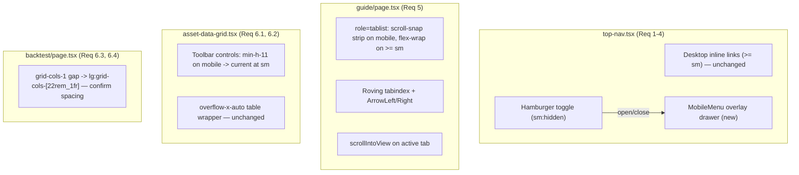

# Design Document

## Overview

This is a mobile UX-polish effort for the CineROI AI Next.js frontend (App Router,
Tailwind, dark theme). The goal is to make four already-shipping surfaces usable at
360-430px without regressing the desktop (`>= sm`, i.e. 640px+) layout or behavior.

The only piece with real interactive logic is the top navigation: today
`frontend/components/layout/top-nav.tsx` renders a logo plus four always-visible
inline links in a `justify-between` row, shortening labels to their first word on
mobile (`label.split(" ")[0]`). That still crowds at 360px and clips the right-most
link. The design replaces the mobile inline links with a **hamburger toggle plus an
overlay drawer** that floats above the sticky header on a backdrop, so opening the
menu never shifts page layout. Desktop keeps the exact inline nav it has today.

The other three surfaces are class-level responsive tweaks:

- **Guide tablist** (`frontend/app/guide/page.tsx`) becomes a horizontal
  scroll-snap strip on mobile (preserving `role="tablist"`/`role="tab"`), gains
  roving arrow-key navigation, and keeps the active tab centered via
  `scrollIntoView`. Desktop keeps its wrapped appearance (`sm:flex-wrap`).
- **Data grid toolbar** (`frontend/components/dashboard/asset-data-grid.tsx`) gets
  >= 44px tap heights on mobile that collapse to current sizes at `sm`, keeping the
  `overflow-x-auto` table wrapper.
- **Backtest panes** (`frontend/app/backtest/page.tsx`) already stack
  (`grid-cols-1 lg:grid-cols-[...]`); we confirm vertical spacing and tap heights.

Scope is bounded by Requirement 7: changes are limited to the four named components
plus a new navigation test file. No new pages, runtime dependencies, color/brand
changes, or global CSS (see Design Decisions for the no-scrollbar tradeoff).

## Architecture

The work touches four components. Only the TopNav gains new structure; the rest are
Tailwind class edits plus, for the guide, a small amount of keyboard/scroll logic.



### Component-by-component

**TopNav / AppShell (`top-nav.tsx`).** `TopNav` stays a client component
(`"use client"`, uses `usePathname`). The `LINKS` array and the desktop inline
`<nav>` are unchanged except that the inline link container is hidden below `sm`
(`hidden sm:flex`) and the per-link `sm:hidden` label-shortening spans are removed
(the mobile inline links no longer exist — the toggle replaces them). Below `sm` a
hamburger `<button>` renders (`sm:hidden`) and controls a new `MobileMenu` overlay.
`AppShell` is untouched; the overlay is a sibling inside the sticky `<header>` (or
portaled within it) so no main-content layout shifts.

**Guide tablist (`guide/page.tsx`).** The `role="tablist"` container changes from
`flex flex-wrap gap-1` to a mobile scroll-snap strip that restores wrap at `sm`.
Each tab button gains `role="tab"` (already present), `aria-selected` (already
present), roving `tabIndex`, and shares an `onKeyDown` handler for arrow keys. An
effect scrolls the active tab into view when `tab` changes.

**Data grid toolbar (`asset-data-grid.tsx`).** The toolbar `<div>` already uses
`flex flex-wrap items-center gap-3`; the search input, two `<select>`s, and the
clear button get a base `min-h-[44px]` (or `h-11`) that reverts to today's padding
at `sm` (`sm:min-h-0`). The `overflow-x-auto` table wrapper is left exactly as is.

**Backtest panes (`backtest/page.tsx`).** The split already collapses to one column
below `lg` (`grid-cols-1 gap-8 lg:grid-cols-[minmax(0,22rem)_1fr]`), satisfying the
stack + spacing requirement. We confirm the gap on mobile and ensure any interactive
controls inside the panes that this component owns meet tap sizing; no structural
change is required.

## Components and Interfaces

### MobileMenu component (new, defined inside `top-nav.tsx`)

Per Req 7.3 (changes limited to the four named components + the nav test), the
`MobileMenu` lives in `top-nav.tsx` rather than a new file. It is a presentational
overlay driven entirely by props from `TopNav`.

```ts
interface MobileMenuProps {
  /** Whether the overlay is open. */
  open: boolean;
  /** Request close (backdrop tap, Escape, or link select). */
  onClose: () => void;
  /** The four destinations, shared with the desktop inline nav. */
  links: { href: string; label: string }[];
  /** Active-route test, shared with desktop (usePathname-based). */
  isActive: (href: string) => boolean;
  /** Id of the menu region, matching the toggle's aria-controls. */
  menuId: string;
  /** Ref back to the toggle so Escape/close can restore focus. */
  toggleRef: React.RefObject<HTMLButtonElement>;
}
```

`TopNav` owns the single piece of state:

```ts
const [menuOpen, setMenuOpen] = useState(false);
const toggleRef = useRef<HTMLButtonElement>(null);
const MENU_ID = "mobile-nav-menu";
// Stable so the overlay effects (keydown, scroll-lock, resize auto-close) do not
// re-subscribe on every render.
const closeMenu = useCallback(() => setMenuOpen(false), []);
```

Toggle button (rendered `sm:hidden`):

```tsx
<button
  ref={toggleRef}
  type="button"
  aria-expanded={menuOpen}
  aria-controls={MENU_ID}
  aria-label={menuOpen ? "Close navigation menu" : "Open navigation menu"}
  onClick={() => setMenuOpen((o) => !o)}
  className="inline-flex h-11 w-11 items-center justify-center rounded-md text-slate-300 hover:bg-slate-800 hover:text-slate-100 sm:hidden"
>
  {/* hamburger icon when closed, X when open; aria-hidden */}
</button>
```

The `h-11 w-11` (44x44px) satisfies Req 2.5. `aria-expanded` tracks `menuOpen`
(Req 2.1); `aria-controls={MENU_ID}` matches the overlay region id (Req 2.2); the
`aria-label` names it as the navigation menu (Req 2.3).

### Desktop inline nav (unchanged behavior)

The existing `<nav>` becomes `hidden sm:flex` so it only renders at desktop, with
full labels (the `sm:hidden` first-word spans are deleted). The active-item classes
(`bg-emerald-500/15 text-emerald-300`) and `aria-current` are preserved verbatim
(Req 3.1, 3.3). Below `sm`, this nav does not display and the toggle takes its place
(Req 3.2 guarantees the toggle is not shown at desktop via `sm:hidden`).

### Guide tablist interface

No prop changes — `GuidePage` keeps `const [tab, setTab] = useState<TabId>(...)`.
Internally it gains:

- `tabRefs`: an array of button refs (or a ref map keyed by `TabId`) to drive
  `scrollIntoView` and focus moves.
- `onTabKeyDown(e, index)`: handles `ArrowRight`/`ArrowLeft` (and optionally
  `Home`/`End`), computing the next index with wrap-around, calling `setTab`, and
  focusing the new tab button.
- A `useEffect` on `tab` that calls `activeRef.scrollIntoView({ behavior, inline: "center", block: "nearest" })`.

## Data Models

There are no persisted or transport data models in this feature. The only runtime
state is ephemeral UI state:

- `TopNav.menuOpen: boolean` — overlay open/closed.
- `GuidePage.tab: TabId` — already present; `TabId` is the existing union
  `"overview" | "features" | "guardrails" | "calculations" | "examples" | "glossary"`.
- The shared `LINKS` array (four `{ href, label }` destinations) is reused by both
  the desktop nav and the overlay, so the destination set stays single-sourced.

## MobileMenu behavior design

### Open / close / toggle

- **Toggle opens when closed** (Req 1.3): clicking the toggle sets `menuOpen = true`;
  the overlay renders the backdrop plus a column of all four destination links.
- **Toggle closes when open** (Req 1.4): clicking again sets `menuOpen = false`.
- **Link select navigates + closes** (Req 1.5): each overlay link is a `next/link`
  `<Link>` with `onClick={onClose}`. Navigation proceeds and the overlay closes.
- **Active item** (Req 1.6): overlay links use the same `isActive(href)` test and
  the same active classes as desktop, with `aria-current="page"` on the match.

### Backdrop + layering (no layout shift)

The overlay is a fixed-position element, so it is removed from normal flow and does
not reflow the page (addresses Req 1.1 — no layout shift / clipping):

```tsx
{open && (
  <div className="sm:hidden">
    {/* Backdrop: click to dismiss (Req: tap outside closes). cursor-pointer is
        REQUIRED so iOS Safari/WebKit reliably fires the tap on this otherwise
        non-interactive div (see Edge Case: iOS backdrop dismissal). */}
    <div
      aria-hidden
      onClick={onClose}
      className="fixed inset-0 z-40 cursor-pointer bg-slate-950/90 backdrop-blur-sm motion-safe:transition-opacity"
    />
    {/* Menu region: floats below the sticky header, above the backdrop. The
        max-height + overflow-y-auto keep all four links reachable in landscape /
        short viewports where the vertical space under the h-14 bar can drop
        below the list height (see Edge Case: landscape height clamping). 100dvh
        (dynamic viewport height) accounts for the mobile browser URL bar. */}
    <div
      id={menuId}
      role="navigation"
      aria-label="Site"
      className="fixed inset-x-0 top-14 z-50 max-h-[calc(100dvh-3.5rem)] overflow-y-auto border-b border-slate-800 bg-slate-950/95 p-2 backdrop-blur motion-safe:transition-transform"
    >
      {links.map((l) => (
        <Link key={l.href} href={l.href} onClick={onClose}
          aria-current={isActive(l.href) ? "page" : undefined}
          className={cn(
            "flex min-h-[44px] items-center rounded-md px-3 text-sm font-medium",
            isActive(l.href)
              ? "bg-emerald-500/15 text-emerald-300"
              : "text-slate-300 hover:bg-slate-800 hover:text-slate-100",
          )}
        >
          {l.label}
        </Link>
      ))}
    </div>
  </div>
)}
```

**Z-index layering.** The sticky header is `z-30`. The backdrop sits at `z-40` and
the menu region at `z-50`, both above the header so the overlay floats on top rather
than pushing content (Req 1.1). `top-14` aligns the menu directly under the
`h-14` header so it reads as a dropdown from the bar.

Each overlay link is `min-h-[44px]` (Req 2.5). The whole overlay is `sm:hidden` so it
never appears on desktop (Req 3.2).

### Escape + focus management

- **On open via keyboard** (Req 2.4): a `useEffect` that runs when `open` becomes
  true moves focus to the first link in the menu region (via the menu's ref or a
  first-link ref). Moving focus into the menu makes the links keyboard-reachable.
- **Escape closes + restores focus**: a `keydown` listener (added while open)
  closes on `Escape` and returns focus to `toggleRef.current` so the user lands
  back on the control that opened the menu.
- **Backdrop/outside tap closes**: the backdrop's `onClick={onClose}`.

Focus handling is kept deliberately simple (focus first link on open; focus toggle
on Escape/close) so it is robust and assertable under jsdom, rather than a full
focus-trap loop.

### Body scroll lock + resize/orientation auto-close

While the overlay is open, lock background scroll so the page behind the backdrop
does not move. Critically, the same effect also watches the `sm` breakpoint and
**auto-closes the menu when the viewport crosses into desktop width** — otherwise a
user who opens the menu in portrait (390px) then rotates to landscape or resizes
past 640px would have the overlay visually hidden by `sm:hidden` while `menuOpen`
stays `true`, leaving `document.body.style.overflow = "hidden"` permanently locked
and the desktop page unscrollable (the Orientation / Resize scroll-lock trap):

```ts
useEffect(() => {
  if (!open) return;
  const prev = document.body.style.overflow;
  document.body.style.overflow = "hidden";

  // Auto-close when the viewport grows to the desktop breakpoint so the lock is
  // released (via this effect's cleanup) and state matches the sm:hidden overlay.
  const mq = window.matchMedia("(min-width: 640px)");
  const handleChange = (e: MediaQueryListEvent) => {
    if (e.matches) onClose();
  };
  mq.addEventListener("change", handleChange);

  return () => {
    document.body.style.overflow = prev;
    mq.removeEventListener("change", handleChange);
  };
}, [open, onClose]);
```

The cleanup restores the prior `overflow` value and removes the listener on close,
on unmount, **and** when the breakpoint handler fires `onClose` (which flips `open`
and re-runs the effect). So the lock cannot leak on route-change unmount, nor on a
rotate/resize to desktop. `onClose` must be stable (wrapped in `useCallback` in
`TopNav`) so the effect does not churn. `640px` is kept in sync with Tailwind's `sm`
breakpoint.

### Reduced motion

Any open/close transition is guarded behind `motion-safe:` (e.g.
`motion-safe:transition-opacity`, `motion-safe:transition-transform`), so users with
`prefers-reduced-motion: reduce` get an instant show/hide with no animation
(Req 2.6). No motion is introduced on the desktop path.

## Guide tablist redesign

### Scroll-snap strip (mobile) with preserved desktop wrap

Container class changes from `flex flex-wrap gap-1 ...` to:

```
mb-8 flex gap-2 overflow-x-auto scroll-smooth rounded-lg border border-slate-800
bg-slate-900/60 p-1 [scrollbar-width:none] [&::-webkit-scrollbar]:hidden
snap-x sm:flex-wrap sm:overflow-visible
```

- Mobile: a single-row horizontal strip (`flex` + `overflow-x-auto`) with
  `snap-x`; each tab is `flex-shrink-0 snap-start` so tabs keep their size and snap
  into place instead of wrapping into a clunky multi-row block (Req 5.1).
- Desktop: `sm:flex-wrap sm:overflow-visible` restores exactly today's wrapped
  appearance and behavior (Req 5.5).
- **No-scrollbar treatment:** applied inline via Tailwind arbitrary properties
  (`[scrollbar-width:none]` for Firefox and `[&::-webkit-scrollbar]:hidden` for
  WebKit/Blink) directly on the container. This keeps the strip clean **without
  adding any global CSS**, honoring Req 7.3/7.4 (see Design Decisions).

### Keep active tab visible

An effect centers the selected tab whenever `tab` changes so the active tab is never
clipped off-screen (Req 5.2). It **skips the initial mount** so the page does not
perform a jarring horizontal slide/jump on first load (the default tab is already
leftmost, so no scroll is needed); it only animates on subsequent user tab changes:

```ts
const isFirstTabEffect = useRef(true);

useEffect(() => {
  if (isFirstTabEffect.current) {
    isFirstTabEffect.current = false;
    return; // no scroll on initial render — the first tab is already in view
  }
  const el = tabRefs.current[activeIndex];
  el?.scrollIntoView({ behavior: "smooth", inline: "center", block: "nearest" });
}, [tab]);
```

### Roving tabindex + arrow keys (Req 5.4)

The current tabs are plain `onClick` buttons with no arrow-key support. We add the
standard tablist keyboard model:

- The selected tab has `tabIndex={0}`; all others `tabIndex={-1}` (roving tabindex),
  so Tab reaches the tablist as one stop and arrows move within it.
- `onKeyDown` handles `ArrowRight`/`ArrowLeft` (wrap-around), optionally `Home`/`End`;
  it calls `setTab(next)` and focuses the new tab button. `aria-selected` continues
  to reflect the selected tab.

ARIA is preserved: `role="tablist"` on the container, `role="tab"` +
`aria-selected` on each button, `role="tabpanel"` on the body (Req 5.3).

## Shared control polish (data grid + backtest)

### Data grid toolbar (Req 6.1, 6.2)

The search input, the two `<select>`s, and the clear button receive a base
`min-h-[44px]` that reverts to current sizing at `sm` (e.g. append
`min-h-[44px] sm:min-h-0` to each control's existing class string). The toolbar
already wraps (`flex flex-wrap gap-3`) so controls stack with spacing on narrow
screens. The table wrapper keeps `overflow-x-auto` unchanged so wide content scrolls
rather than clips (Req 6.2). Desktop sizing is unchanged.

### Backtest panes (Req 6.3, 6.4)

`grid grid-cols-1 gap-8 lg:grid-cols-[minmax(0,22rem)_1fr]` already stacks to one
column with `gap-8` vertical spacing below `lg` (Req 6.3) and restores the
two-column split at `lg` (Req 6.4). No structural change; this is a confirmation
plus tap-height checks on controls the page owns.

## Error Handling

- **Unmount while open (scroll-lock leak):** the scroll-lock `useEffect` returns a
  cleanup that restores `document.body.style.overflow` on unmount as well as on
  close, so a route change that unmounts `TopNav` mid-open cannot leave the body
  locked.
- **Rotate / resize to desktop while open (scroll-lock trap):** a
  `matchMedia("(min-width: 640px)")` listener inside the scroll-lock effect calls
  `onClose` when the viewport crosses into desktop width, so the overlay cannot be
  left open-but-hidden with the body scroll permanently locked. Covered by Property 5.
- **Landscape / short viewport:** the menu drawer is `max-h-[calc(100dvh-3.5rem)]
  overflow-y-auto`, so when the vertical space under the bar is small (landscape,
  URL bar visible) the links scroll within the drawer instead of being clipped
  below the screen edge.
- **iOS backdrop tap:** the backdrop carries `cursor-pointer` so Mobile Safari/WebKit
  reliably dispatches the tap-to-dismiss on the non-interactive backdrop div.
- **Guide initial-mount scroll jump:** the active-tab `scrollIntoView` effect is
  guarded by a first-mount ref so it does not fire on load (no jarring horizontal
  slide); it only animates on subsequent tab changes.
- **SSR / `"use client"` safety:** `TopNav` and `GuidePage` are already client
  components. Any `document`/`window` access (scroll lock, `scrollIntoView`,
  `keydown` listener) lives inside `useEffect`, which never runs during SSR, so no
  server render touches the DOM globals.
- **No-JS / hydration:** the server renders with `menuOpen = false` (overlay absent)
  and the desktop nav present; on mobile without JS the toggle is inert but the
  logo/home link still works. After hydration the toggle becomes interactive. The
  initial markup matches on both passes (overlay only renders when `open`), avoiding
  hydration mismatch.
- **Very long content / many tabs:** the scroll-snap strip handles an arbitrary
  number of tabs by scrolling; `scrollIntoView` keeps the active one centered. The
  guide body already scrolls with the page.
- **Focus when no menu (desktop):** on desktop the overlay and toggle are not
  rendered, so none of the open/escape/focus logic runs; focus management only
  engages on the mobile path.
- **Rapid toggle:** state is a single boolean toggled functionally
  (`setMenuOpen((o) => !o)`), so double-activation is coherent; effects key on
  `open` and clean up before re-running.

## Testing Strategy

Tests follow the existing convention (vitest + `@testing-library/react` +
`@testing-library/user-event`, `@/` alias, `render`/`screen`, role/label queries),
mirroring `frontend/components/backtest/ground-truth-form.test.tsx`. The navigation
is the only piece with interactive logic, so it gets the dedicated test file
(Req 4); the other surfaces are visual/example-level changes.

Because `TopNav` calls `usePathname`, the test mocks `next/navigation` (as the suite
does elsewhere) to control the active route. The mobile toggle is `sm:hidden`, which
is a visual-only concern in jsdom (no layout engine); the toggle and overlay are
still in the DOM and fully assertable, so tests drive them directly.

**New file: `frontend/components/layout/top-nav.test.tsx`**

- Toggle opens and closes the menu (Req 4.1): render, assert overlay links absent;
  click the toggle (`getByRole("button", { name: /open navigation menu/i })`),
  assert links present; click again, assert links gone.
- `aria-expanded` reflects state (Req 4.2): `false` initially, `true` after open,
  `false` after close.
- `aria-controls` matches the menu region id (Req 2.2): read the toggle's
  `aria-controls` and assert an element with that `id` exists when open.
- All four destinations present (Req 4.3): after opening, assert overlay links for
  Dashboard, Asset Studio, Backtest Studio, How It Works (by role `link` + name).
- Escape closes and restores focus to the toggle: open via keyboard, fire `Escape`,
  assert overlay closed and `document.activeElement` is the toggle.
- Link click closes (Req 1.5): open, click a destination link, assert overlay closed.
- Resize to desktop closes + releases the lock: open the menu, dispatch a
  `matchMedia` `change` with `matches: true` (mock `window.matchMedia`), assert the
  overlay closed and `document.body.style.overflow` restored to its prior value.
- Scroll-lock release on close: assert `document.body.style.overflow` is `"hidden"`
  while open and restored after close/unmount.
- Active item highlight (Req 1.6/3.3): with a mocked pathname, assert the matching
  overlay/desktop link carries `aria-current="page"`.

**Optional light guide test (if feasible):** a focused test that renders
`GuidePage`, focuses a tab, fires `ArrowRight`/`ArrowLeft`, and asserts
`aria-selected` moves to the adjacent tab (Req 5.4). Kept light because the guide is
otherwise static content.

Per the existing config, property-based testing is not used here (see below); these
are example/integration-level React Testing Library tests.

## Correctness Properties

Note that property-based testing is **not appropriate** for this feature. Every
requirement is either UI rendering/layout behavior (overlay open/close, responsive
class changes, tap sizing) or keyboard/ARIA interaction — there is no pure function
with a large input space over which a universal "for all inputs" statement adds value
beyond example-based assertions. Following the workflow guidance (UI rendering →
snapshot / example-based tests, not PBT), the following invariants are stated as
example-level properties the tests above enforce, rather than randomized tests.

### Property 1: Open and close symmetry

For any starting state, activating the toggle from closed opens the menu and
activating from open closes it (the toggle is its own inverse for the boolean state).

**Validates: Requirements 1.3, 1.4**

### Property 2: ARIA state fidelity

At all times, `aria-expanded` equals the open state and `aria-controls` equals the
rendered menu region's `id`.

**Validates: Requirements 2.1, 2.2**

### Property 3: Destination completeness

Whenever the overlay is open, it exposes exactly the four `LINKS` destinations — the
same set the desktop nav renders (single-sourced).

**Validates: Requirements 1.2, 4.3**

### Property 4: Focus round-trip

Opening via keyboard moves focus into the menu, and Escape returns focus to the
toggle.

**Validates: Requirements 2.4**

### Property 5: Scroll-lock conservation

`document.body.style.overflow` is restored to its pre-open value on every close,
on unmount, AND when a resize/orientation change to desktop width auto-closes the
menu, so the lock never leaks (including the rotate-to-landscape trap).

**Validates: Requirements 1.1**

### Property 6: Desktop invariance

At `>= sm`, the toggle and overlay are not displayed and the inline nav, labels, and
active styling match the current implementation.

**Validates: Requirements 3.1, 3.2, 3.3, 7.5**

## Design Decisions

### Decision 1: Overlay drawer (not an accordion) for the mobile menu

**Choice:** The mobile menu is a fixed overlay dropdown floating above the sticky
header on a `bg-slate-950/90 backdrop-blur` backdrop, layered at `z-40` (backdrop) /
`z-50` (menu) above the `z-30` header.

**Rationale:** An accordion that expands inside the header would push page content
down and shift layout every time the menu opens — jarring on a phone and at odds
with Req 1.1 (fit the viewport, no overflow/clipping). A fixed overlay is removed
from flow, so opening it never reflows the page; it reads as a clean dropdown from
the bar, supports a tap-outside-to-dismiss backdrop, and is simple to lock scroll
behind. Dismissal is covered four ways (toggle again, Escape with focus restore,
backdrop tap, link select).

### Decision 2: Scroll-snap strip (not a native select) for guide tabs

**Choice:** On mobile the guide tabs become a horizontal `overflow-x-auto` +
`snap-x` strip with `scrollIntoView` centering the active tab and roving arrow-key
navigation; desktop keeps `sm:flex-wrap`.

**Rationale:** Req 5.3 requires preserving `role="tablist"`/`role="tab"`/
`aria-selected`. Swapping to a native `<select>` would discard the tablist semantics
and the tab affordance, and would not satisfy the arrow-key requirement (Req 5.4) in
a tablist sense. A scroll-snap strip keeps all tabs reachable and selectable without
clipping the active one (Req 5.2), preserves the ARIA contract, and leaves the
desktop wrapped layout untouched (Req 5.5). Adding roving tabindex + arrow keys also
closes the existing accessibility gap (the current buttons have none).

### Decision 3: No-scrollbar via inline arbitrary variants (no global CSS)

**Choice:** Hide the strip's scrollbar using Tailwind arbitrary properties on the
container (`[scrollbar-width:none]` and `[&::-webkit-scrollbar]:hidden`) rather than
defining a global `.no-scrollbar` utility in `globals.css`.

**Rationale:** The project has no `no-scrollbar` utility today, and `globals.css`
already carries a scoped scrollbar style (`.chat-scroll`), so a global utility would
be a reasonable convention — **but** Req 7.3 limits changes to the four named
components and the nav test, and Req 7.4 forbids introducing new global additions as
part of this effort. The arbitrary-variant approach lives entirely on the guide
component's `className`, needs no new file or global rule, and is the least-invasive
option that still gives a clean strip. Tradeoff: the classes are slightly verbose and
component-local rather than reusable; that is acceptable for a single polish site and
keeps the change within scope.

### Decision 4: Production mobile edge cases hardened up front

Four real-world mobile behaviors are handled in the design rather than deferred:

1. **Scroll-lock trap on rotate/resize.** Opening the menu in portrait then rotating
   to landscape (or resizing past `sm`) would hide the overlay via `sm:hidden` while
   `menuOpen` stayed `true`, leaving `document.body.style.overflow` locked and the
   desktop page frozen. A `matchMedia("(min-width: 640px)")` listener in the
   scroll-lock effect auto-closes the menu at the desktop breakpoint, releasing the
   lock via the effect cleanup.
2. **iOS backdrop dismissal.** Mobile Safari/WebKit does not reliably fire
   click/tap on a non-interactive `<div>`; the backdrop therefore carries
   `cursor-pointer` so tap-to-dismiss works on iOS.
3. **Landscape height clamping.** In landscape the usable height under the `h-14`
   bar can drop below the four-link list height, clipping the bottom link. The
   drawer uses `max-h-[calc(100dvh-3.5rem)] overflow-y-auto` (dynamic viewport
   height, URL-bar aware) so links scroll within the drawer instead of off-screen.
4. **Guide initial-mount scroll jump.** `scrollIntoView({ behavior: "smooth" })` on
   first render would cause a jarring horizontal slide on load; a first-mount ref
   guard skips the initial scroll (the default tab is already leftmost) and only
   animates on subsequent tab changes.

### Desktop-invariance guarantee

All three decisions preserve desktop (`>= sm`, and `>= lg` for the backtest split)
exactly: the overlay and toggle are `sm:hidden`; the inline nav is restored with
`sm:flex` and full labels and its original active styling; the guide tablist restores
`sm:flex-wrap sm:overflow-visible`; the toolbar tap-height bumps revert with
`sm:min-h-0`; and the backtest grid keeps `lg:grid-cols-[minmax(0,22rem)_1fr]`. This
satisfies Req 3 and Req 7.5 — no visual or behavioral change on larger screens.
