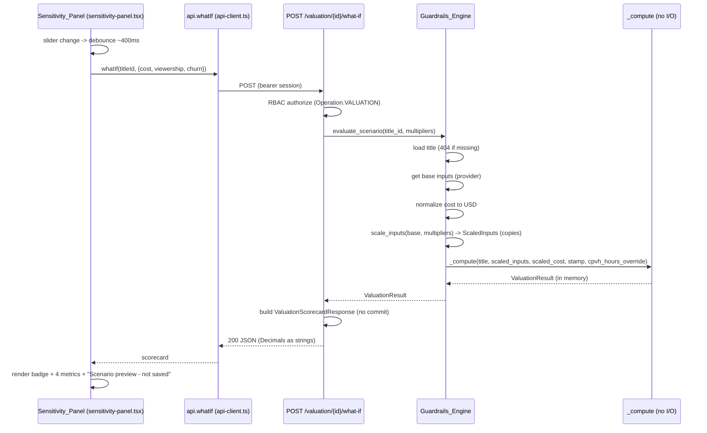

# Design Document

## Overview

This feature adds a stateless "what-if" sensitivity path on top of the existing
valuation core. Today the only way to produce a scorecard is
`Guardrails_Engine.evaluate`, which loads a title, normalizes cost to USD, runs
the four guardrail checks, determines the recommendation, and then **persists**
the projection plus an append-only audit entry. The sensitivity feature needs
exactly that computation but with two differences: (1) the modeled inputs are
scaled by bounded scenario multipliers before the checks run, and (2) nothing is
written - no projection update, no audit entry, no model-version change
(Requirements 1, 2, 5).

The central design decision is **how to reuse the compute core without
duplicating threshold or recommendation logic**. We refactor `evaluate` so its
pure compute core (currency-normalized cost -> territory weighting -> four
guardrail checks -> `determine_recommendation` -> `ValuationResult`, including
the deal-support attribution/cohort block) becomes a private method
`_compute(title, inputs, normalized, stamp)` that performs **no I/O**. The
existing `evaluate` becomes `load + normalize + stamp -> _compute -> persist +
audit`. A new `evaluate_scenario` becomes `load + normalize + stamp -> scale
inputs (on copies) -> _compute` with **no persist and no audit**.

This structure makes the two anchor invariants true *by construction*:

- **No-persistence (Requirement 2):** `evaluate_scenario` never calls `_persist`
  or `self._audit.record`, and the `/what-if` endpoint never calls
  `session.commit()`. There is no code path from the scenario route to a write.
- **Identity (Requirement 3):** with all multipliers equal to `1.0`, the scaling
  helper returns inputs equal to the originals (plus an unscaled viewing-hours
  override), so `_compute` receives the same operands `evaluate` received and
  produces the same checks and recommendation. No thresholds or recommendation
  logic are forked.

The alternative - a free-standing pure helper that re-implements the check
sequence - was rejected: it would duplicate the territory-weighting, the four
check builders, the attribution/cohort derivation, and the recommendation call,
and any future threshold change would have to be mirrored in two places. The
`_compute` extraction keeps a single source of truth.

Scaling itself is a small pure function placed in a new module
`app/domain/sensitivity.py` (`scale_inputs`) so it is directly property-testable
in isolation, consistent with the existing `app/domain/*` pure-function layout
(`cpvh.py`, `ltv.py`, `cohort.py`).

### Requirements covered

| Requirement | Where addressed |
| --- | --- |
| R1 Stateless recompute endpoint | `POST /valuation/{title_id}/what-if`, `evaluate_scenario` |
| R2 No-persistence invariant | `evaluate_scenario` (no `_persist`/`_audit`), route (no commit) |
| R3 Identity reproduces persisted result | `_compute` single source of truth + `scale_inputs` identity |
| R4 Bounded/validated multipliers | `WhatIfRequest` Field validators + `MULTIPLIER_BOUNDS` |
| R5 Scenario scaling of inputs | `scale_inputs` + scaled CPVH-hours override threaded into `_compute` |
| R6 Sensitivity panel | `sensitivity-panel.tsx` sliders |
| R7 Debounced live recompute | panel debounce + `api.whatIf` |
| R8 Non-persisted labeling | panel "Scenario preview - not saved" label |
| R9 Defensive numeric coercion | panel via `format.ts` `toNumber` |

## Architecture

### Request flow



### Layering

The feature touches four layers, each matching an existing pattern:

- **Domain (`app/domain/sensitivity.py`)** - a new pure module. `scale_inputs`
  takes the base `ValuationInputs` and the three multipliers and returns a
  `ScaledInputs` value carrying the scaled `ValuationInputs` plus a separate
  scaled viewing-hours figure (hours live on the title, not on
  `ValuationInputs`, so they are threaded alongside). No I/O, no Decimal/float
  mixing - mirrors `cpvh.py`/`ltv.py`.
- **Engine (`app/engines/guardrails.py`)** - extract `_compute`; add
  `evaluate_scenario`. `evaluate` keeps its public contract unchanged.
- **API (`app/api/valuation.py`)** - add the `/what-if` route and the
  `WhatIfRequest` model; reuse the exact `ValuationScorecardResponse`
  construction the GET path uses, but sourced from the freshly computed
  `ValuationResult` (which, like quick-evaluate, carries the full LTV
  attribution split).
- **Frontend** - `sensitivity-panel.tsx` component, `api.whatIf` client method,
  `WhatIfRequest` type, and wiring into `title-evaluation-view.tsx`.

### The CPVH scaled-hours mechanism (R5.2)

`_cpvh_check(title, cost_usd)` currently reads `title.projected_viewing_hours`
directly off the title row. The scenario must scale viewing hours **without
mutating the title** (R5.5). Rather than copy and mutate the title object, we
make the viewing-hours figure an explicit parameter of the check:

- `_cpvh_check` gains an optional `viewing_hours_override: Decimal | None`
  parameter. When `None` (the `evaluate` path), it reads
  `title.projected_viewing_hours` exactly as today - behavior unchanged. When a
  value is supplied (the scenario path), it uses that value instead.
- `scale_inputs` computes `scaled_hours = base_hours * viewership_multiplier`
  and `_compute` receives it as `cpvh_hours_override`, passing it straight to
  `_cpvh_check`. The title object is never written.

This keeps the title immutable, keeps the zero/None-hours handling (R4.5) in one
place, and makes the identity case trivially equal (`override = base_hours * 1`).

## Components and Interfaces

### Domain: `app/domain/sensitivity.py` (new)

```python
from dataclasses import dataclass
from decimal import Decimal
from app.engines.guardrails import ValuationInputs  # or a shared types module

# Inclusive multiplier bounds; every bound includes 1.0 (R4.4).
MULTIPLIER_MIN: Decimal = Decimal("0.5")
MULTIPLIER_MAX: Decimal = Decimal("2.0")

@dataclass(frozen=True)
class ScaledInputs:
    """The result of applying scenario multipliers to a title's base inputs.

    Carries the scaled ValuationInputs plus the scaled projected viewing hours
    (hours live on the title, not on ValuationInputs, so they travel separately).
    """
    inputs: ValuationInputs
    viewing_hours: Decimal | None  # scaled; None when the title has no hours

def scale_inputs(
    base: ValuationInputs,
    base_viewing_hours: Decimal | None,
    *,
    cost_multiplier: Decimal,
    viewership_multiplier: Decimal,
    churn_multiplier: Decimal,
) -> ScaledInputs:
    """Return a scaled COPY of base; never mutate base (R5.5).

    Scaling model (R5.1-R5.4):
      * ad_impressions      *= viewership_multiplier   (R5.3, raises ad LTV value)
      * churn_reduction_pct *= churn_multiplier         (R5.4, churn guardrail)
      * viewing_hours       *= viewership_multiplier    (R5.2, lowers CPVH)
    Cost (R5.1) is NOT scaled here: cost normalization to USD happens in the
    engine; the engine scales the already-normalized USD amount by
    cost_multiplier before _compute. Keeping cost scaling in the engine avoids
    re-plumbing currency normalization through the pure helper.
    """
```

**Decision - what `scale_inputs` scales vs what the engine scales.** Cost (R5.1)
is scaled in the engine, on the already-normalized USD amount, because
normalization (`_normalize_cost`) is async I/O that lives in the engine. The
remaining three scalings (viewing hours, ad impressions, churn pct) are pure
field arithmetic and live in `scale_inputs` so the directional/identity
properties are testable without touching the engine. This split is justified: it
keeps the pure helper genuinely pure (no exchange-rate lookup) while still
centralizing the three input-field scalings for property testing.

### Engine: `app/engines/guardrails.py`

Extract the compute core and add the scenario entry point. The signatures:

```python
def _compute(
    self,
    title: Any,
    inputs: ValuationInputs,
    normalized: NormalizedCost,
    exchange_rate_id: uuid.UUID | None,
    stamp: uuid.UUID,
    weighting: TerritoryWeights,
    *,
    cpvh_hours_override: Decimal | None = None,
) -> ValuationResult:
    """Pure compute core shared by evaluate and evaluate_scenario (no I/O).

    Runs the four guardrail checks, determine_recommendation, and the deal-support
    attribution/cohort block, returning a ValuationResult. Performs NO persistence
    and NO audit. Identical math for both callers (R3.3, R3.4).
    """

async def evaluate(self, title_id, model_version_id=None, *, actor=None) -> ValuationResult:
    # load title (404) -> get_inputs -> _normalize_cost -> stamp -> territory_weighting
    # -> _compute(...) -> _persist -> audit.record -> return   (UNCHANGED behavior)

async def evaluate_scenario(
    self,
    title_id: uuid.UUID,
    *,
    cost_multiplier: Decimal,
    viewership_multiplier: Decimal,
    churn_multiplier: Decimal,
) -> ValuationResult:
    """Recompute a scorecard over scaled inputs WITHOUT persisting (R1, R2).

    load title (404 if missing, R1.3) -> get_inputs -> _normalize_cost
    -> stamp (active version; read-only, R2.3) -> territory_weighting
    -> scaled_cost = normalized.amount_usd * cost_multiplier (R5.1)
    -> scaled = scale_inputs(inputs, title.projected_viewing_hours, ...)
    -> _compute(title, scaled.inputs, NormalizedCost(scaled_cost...), ...,
                cpvh_hours_override=scaled.viewing_hours)
    Returns the ValuationResult; NEVER calls _persist or self._audit (R2.2, R2.4).
    """
```

Notes:

- `evaluate`'s existing body is reorganized only to call `_compute`; the ordered
  comments and all check builders move inside `_compute` verbatim, so the
  persisting path's observable behavior and the existing 249-test suite are
  unaffected.
- `evaluate_scenario` resolves the model-version stamp via
  `self._versioning.stamp()` for completeness of the `ValuationResult` shape, but
  **does not** write it anywhere (R2.3). Resolving the active version is a
  read-only lookup.
- The scaled cost is wrapped in a `NormalizedCost` (reusing the same dataclass)
  so `_compute` is agnostic to whether cost was scaled. `exchange_rate_id` from
  the real normalization is passed through unchanged (it is never persisted on
  the scenario path).

### API: `app/api/valuation.py`

```python
class WhatIfRequest(BaseModel):
    """Bounded scenario multipliers for POST /valuation/{title_id}/what-if (R4)."""
    cost_multiplier: Decimal = Field(..., gt=Decimal("0"), ge=Decimal("0.5"), le=Decimal("2.0"))
    viewership_multiplier: Decimal = Field(..., gt=Decimal("0"), ge=Decimal("0.5"), le=Decimal("2.0"))
    churn_multiplier: Decimal = Field(default=Decimal("1.0"), gt=Decimal("0"), ge=Decimal("0.5"), le=Decimal("2.0"))

@router.post(
    "/{title_id}/what-if",
    response_model=ValuationScorecardResponse,
    dependencies=[Depends(require_operation(Operation.VALUATION))],
    summary="Recompute a scorecard over scenario multipliers without persisting (R1, R2).",
)
async def what_if_valuation(
    title_id: uuid.UUID,
    body: WhatIfRequest,
    actor: CurrentUser,
    session: SessionDep,
    engine: GuardrailsEngineDep,
) -> ValuationScorecardResponse:
    result = await engine.evaluate_scenario(
        title_id,
        cost_multiplier=body.cost_multiplier,
        viewership_multiplier=body.viewership_multiplier,
        churn_multiplier=body.churn_multiplier,
    )
    # Build ValuationScorecardResponse the SAME way the GET path does, but from the
    # fresh ValuationResult (which carries the full LTV attribution split, like
    # quick-evaluate). Explicitly NO session.commit() (R2).
    ...
```

Decisions:

- **RBAC:** reuses `Operation.VALUATION`, the same operation guarding
  `GET /valuation/{title_id}` (R1 is a valuation read).
- **404:** `evaluate_scenario` raises `TitleNotFoundError` (already mapped to
  `404 TITLE_NOT_FOUND` by the error envelope) when the title is missing (R1.3).
- **Validation errors:** `WhatIfRequest` Field validators reject non-positive
  (`gt=0`, R4.1) and out-of-bounds (`ge/le`, R4.2) values; FastAPI returns a
  `422` validation response and the handler never runs, so no Scorecard is
  returned (R4.1, R4.2).
- **Decimal serialization (R1.4):** `ValuationScorecardResponse` already
  serializes its `Decimal` fields as JSON strings via Pydantic, matching the GET
  path.
- **Deal-support reconstruction (R1.2):** because the scenario re-runs the
  engine, the full attribution split (`ltv_subscription_value`,
  `ltv_advertising_value`, `ltv_total_modeled_value`, cohort) is present in
  `result`, so the response is built like `quick_evaluate` (subscription/
  advertising values populated) rather than the GET path's reconstructed-from-
  persistence version (which nulls the split). Negotiation levers and ceiling
  use `negotiation.*` over `result["explanation"]["checks"]`, identically.

### Frontend: `sensitivity-panel.tsx` (new)

Location: `frontend/app/titles/[id]/_components/sensitivity-panel.tsx`.

```tsx
"use client";
export interface SensitivityPanelProps { titleId: string; }

export function SensitivityPanel({ titleId }: SensitivityPanelProps) {
  // three multipliers, all initialized to 1.0 (R6.4)
  // sliders: cost %, viewership bear/base/bull, churn % (R6.1), range = MULTIPLIER_BOUNDS (R6.3)
  // on change -> debounce ~400ms (R7.1) -> api.whatIf(titleId, multipliers) (R7.2)
  // on response -> RecommendationBadge + four metrics via format.ts toNumber (R7.3, R9.1)
  //   - metric that fails toNumber -> placeholder, keep rendering others (R9.2)
  // always render "Scenario preview - not saved" (ASCII only) (R8.1, R8.2)
  // container has `no-print` so it is excluded from the Greenlight Memo print
}
```

Behavior details:

- **Sliders (R6.1, R6.3, R6.4):** three `<input type="range">` controls. Cost and
  churn are percentage sliders over `[0.5, 2.0]` step `0.05`; viewership is a
  three-stop bear/base/bull control mapping to `{0.5, 1.0, 2.0}` (bear/base/bull)
  within the same bounds. All start at `1.0` (R6.4). Min/max come from a shared
  `MULTIPLIER_BOUNDS` constant mirrored in `lib/types.ts` (R6.3).
- **Debounce (R7.1, R7.2):** a `useEffect` + `setTimeout(~400ms)` keyed on the
  three multiplier values; the pending timer is cleared on each change so the
  request fires only after the quiet interval. An in-flight request is tracked so
  a newer response supersedes an older one (last-write-wins by request id).
- **Rendering (R7.3):** on response, update the `RecommendationBadge` status and
  the four metric cells (CPVH, LTV multiple, churn %, payback months).
- **Coercion (R9):** every metric is passed through `format.ts` `toNumber`
  before formatting; a value that cannot be coerced to a finite number renders a
  placeholder ("-") while the other metrics still render (R9.2).
- **Label (R8):** the panel always shows the ASCII text
  `Scenario preview - not saved`.
- **Print exclusion:** the panel root carries the existing `no-print` class so it
  does not appear in `window.print()` / the Greenlight Memo PDF.

Wiring into `title-evaluation-view.tsx`: render `<SensitivityPanel titleId={titleId} />`
inside the `state.status === "ready"` grid (e.g. a full-width `lg:col-span-2`
block), so it appears only once a persisted scorecard has loaded.

### Frontend client + types

`lib/api-client.ts` gains:

```ts
whatIf(titleId: string, body: WhatIfRequest, options?: RequestOptions) {
  return apiFetch<ValuationScorecard>(`/valuation/${titleId}/what-if`, {
    method: "POST", body, ...options,
  });
}
```

`lib/types.ts` gains:

```ts
export interface WhatIfRequest {
  cost_multiplier: number;
  viewership_multiplier: number;
  churn_multiplier?: number; // optional; backend defaults to 1.0 (R1.5)
}
export const MULTIPLIER_BOUNDS = { min: 0.5, max: 2.0 } as const;
```

The response reuses the existing `ValuationScorecard` type (same shape as GET),
so no new response type is needed.

## Data Models

No database schema changes. The feature introduces only in-memory types:

- `ScaledInputs` (domain) - `{ inputs: ValuationInputs, viewing_hours: Decimal | None }`.
- `WhatIfRequest` (API) - `{ cost_multiplier, viewership_multiplier, churn_multiplier? }`
  all `Decimal`, each bounded `[0.5, 2.0]` with `gt=0`; `churn_multiplier`
  defaults to `1.0` (R1.5).
- Reused unchanged: `ValuationInputs`, `NormalizedCost`, `TerritoryWeights`,
  `ValuationResult` (engine), `ValuationScorecardResponse` and its nested
  deal-support models (API), `ValuationScorecard` / `WhatIfRequest` (frontend).

`MULTIPLIER_BOUNDS` is defined once per layer: `MULTIPLIER_MIN`/`MULTIPLIER_MAX`
in `app/domain/sensitivity.py` (consumed by the `WhatIfRequest` Field validators
so the API and the pure layer agree), and the mirrored `MULTIPLIER_BOUNDS`
constant in `lib/types.ts` for the slider ranges. All bounds are inclusive and
include `1.0` (R4.4).

## Correctness Properties

*A property is a characteristic or behavior that should hold true across all valid executions of a system-essentially, a formal statement about what the system should do. Properties serve as the bridge between human-readable specifications and machine-verifiable correctness guarantees.*

These properties use property-based testing because the compute core and the scaling
helper are pure functions over structured numeric inputs: the identity,
directional, and immutability guarantees are universal statements over a large
input space (any valid `ValuationInputs`, any in-bounds multipliers). The UI
behaviors (sliders, debounce, label, coercion-to-placeholder) and the
no-persistence / field-presence contracts are deterministic or absence-of-effect
checks, so they are specified as example / edge-case tests in the Testing
Strategy rather than properties.

The following properties are the deduplicated set from the prework reflection.

### Property 1: Identity scenario reproduces the persisted scorecard

*For any* title and any valid `ValuationInputs`, evaluating the Identity_Scenario
(`cost_multiplier = viewership_multiplier = churn_multiplier = 1.0`) through
`evaluate_scenario` SHALL produce the same Recommendation_Status and the same
four Guardrail_Metrics (CPVH, LTV-to-cost multiple, churn-reduction percentage,
payback-horizon months) as the un-scaled compute core produces for the same
title and inputs.

**Validates: Requirements 3.1, 3.2, 3.3, 3.4**

### Property 2: Scaling applies each multiplier to its target field exactly

*For any* base `ValuationInputs`, any base viewing-hours value, and any in-bounds
multipliers, `scale_inputs` SHALL return scaled values where
`scaled.churn_reduction_pct == base.churn_reduction_pct * churn_multiplier`,
`scaled.ad_impressions == base.ad_impressions * viewership_multiplier`, and
`scaled.viewing_hours == base_viewing_hours * viewership_multiplier` (and the
base viewing-hours of `None` yields `None`).

**Validates: Requirements 5.2, 5.3, 5.4**

### Property 3: Scaling never mutates the base inputs

*For any* base `ValuationInputs` and any in-bounds multipliers, calling
`scale_inputs` SHALL leave every field of the original base inputs equal to its
value before the call (the base object captured by the title snapshot is
unchanged after a Scorecard is computed).

**Validates: Requirements 5.5**

### Property 4: Cost multiplier moves CPVH and the LTV multiple in the modeled direction

*For any* title and valid inputs that yield a computable CPVH and a non-zero
cost, for any two cost multipliers `m1 <= m2` within bounds (viewership and churn
held fixed), the recomputed CPVH SHALL be non-decreasing in the cost multiplier
and the recomputed LTV-to-cost multiple SHALL be non-increasing in the cost
multiplier.

**Validates: Requirements 5.1**

### Property 5: Viewership multiplier moves CPVH down and the LTV multiple up

*For any* title and valid inputs that yield a computable CPVH, for any two
viewership multipliers `m1 <= m2` within bounds (cost and churn held fixed), the
recomputed CPVH SHALL be non-increasing in the viewership multiplier (hours grow
in the denominator) and the recomputed LTV-to-cost multiple SHALL be
non-decreasing in the viewership multiplier (the advertising term grows).

**Validates: Requirements 5.2, 5.3**

### Property 6: Multipliers are accepted exactly within their bounds

*For any* multiplier value, the `WhatIfRequest` validation SHALL accept the value
if and only if it is greater than zero and lies within the inclusive bounds
`[0.5, 2.0]`; a value outside those bounds SHALL be rejected and yield no
Scorecard, and the bounds SHALL include `1.0`.

**Validates: Requirements 4.1, 4.2, 4.3, 4.4**

## Error Handling

- **Unknown title (R1.3):** `evaluate_scenario` raises `TitleNotFoundError` (the
  same type `evaluate` raises), which the existing error envelope maps to
  `404 TITLE_NOT_FOUND`. No Scorecard is returned.
- **Invalid multipliers (R4.1, R4.2):** rejected by `WhatIfRequest` Field
  validators (`gt=0`, `ge=0.5`, `le=2.0`) before the handler runs; FastAPI
  returns a `422` validation response through the envelope. No Scorecard is
  returned.
- **Missing exchange rate:** a non-USD title with no available rate raises
  `ExchangeRateUnavailableError` from `_normalize_cost` (reused unchanged),
  mapped to `422 EXCHANGE_RATE_UNAVAILABLE`. Nothing is persisted (there is
  nothing to persist on this path anyway).
- **Degenerate compute inputs:** the existing `_compute` already handles
  zero/None viewing hours (R4.5 -> CPVH null, check failed), zero cost (LTV
  attribution degrades to `None` without blocking the core), and unclassifiable
  payback (PASS + flag). The scenario path inherits all of this; a scaled hours
  value of zero (viewership `* 0` is impossible since multipliers are `>= 0.5`,
  but a base of zero stays zero) flows through the same guard.
- **No-persistence on error:** because `evaluate_scenario` performs no writes on
  any path, an error cannot leave a partial write; the no-persistence invariant
  (R2) holds even when the request fails.
- **Frontend request failure:** a failed `api.whatIf` call surfaces an inline
  error in the panel and leaves the last successful preview (and the persisted
  scorecard elsewhere on the page) intact; it never blocks the rest of the view.
- **Frontend non-finite metric (R9.2):** a metric that `toNumber` cannot coerce
  to a finite number renders a placeholder while the remaining metrics render.

## Testing Strategy

The suite follows the repo's dual approach: property-based tests for the pure
compute core and scaling helper, example/edge-case tests for API contracts, side
effects, and UI behavior. The current suites must stay green: the backend suite
(currently 249 collected; the feature's baseline reference is 183 pre-existing
tests) and the full frontend vitest suite.

### Property-based tests (backend, Hypothesis)

The repo already uses Hypothesis (see `backend/.hypothesis`). Each property runs
a minimum of 100 iterations and is tagged with a comment referencing the design
property.

- **Property 1 (identity)** - generate a title + `ValuationInputs`; assert
  `evaluate_scenario(1.0, 1.0, 1.0)` yields the same recommendation and four
  metrics as the un-scaled `_compute` (equivalently `evaluate`'s result) for the
  same inputs, using in-memory fakes for repositories/audit.
  Tag: `Feature: what-if-sensitivity, Property 1: Identity scenario reproduces the persisted scorecard`.
- **Property 2 (field scaling)** - generate base inputs + multipliers; assert
  each scaled field equals base field times its multiplier.
  Tag: `Feature: what-if-sensitivity, Property 2: Scaling applies each multiplier to its target field exactly`.
- **Property 3 (immutability)** - deep-copy base before `scale_inputs`; assert
  base is field-wise unchanged after.
  Tag: `Feature: what-if-sensitivity, Property 3: Scaling never mutates the base inputs`.
- **Property 4 (cost monotonicity)** - generate inputs + `m1 <= m2`; assert CPVH
  non-decreasing and LTV multiple non-increasing in the cost multiplier.
  Tag: `Feature: what-if-sensitivity, Property 4: Cost multiplier moves CPVH and the LTV multiple in the modeled direction`.
- **Property 5 (viewership monotonicity)** - generate inputs + `m1 <= m2`; assert
  CPVH non-increasing and LTV multiple non-decreasing in the viewership
  multiplier.
  Tag: `Feature: what-if-sensitivity, Property 5: Viewership multiplier moves CPVH down and the LTV multiple up`.
- **Property 6 (bounds)** - generate arbitrary values; assert `WhatIfRequest`
  accepts iff `0 < value` and `0.5 <= value <= 2.0`; assert `1.0` is accepted.
  Tag: `Feature: what-if-sensitivity, Property 6: Multipliers are accepted exactly within their bounds`.

PBT library: Hypothesis (already a dependency); properties are **not**
implemented from scratch. Each correctness property maps to a **single**
property-based test.

### Example / integration tests (backend, pytest)

- **R1.1/R1.2** - known title + valid multipliers -> `200` with recommendation +
  all four metrics + deal-support fields populated.
- **R1.3** - unknown title id -> `404 TITLE_NOT_FOUND`, no scorecard.
- **R1.4** - a Decimal field (e.g. `ltv_to_cost_multiple`) is serialized as a
  JSON string.
- **R1.5** - body omitting `churn_multiplier` yields the same result as
  `churn_multiplier = 1.0`.
- **R2.1 (no projection write)** - capture the stored projection (values +
  `row_version`) before, POST what-if, assert the row is unchanged.
- **R2.2 (no audit entry)** - assert the audit-entry count is unchanged before
  vs after a what-if call.
- **R2.3 (no stamp change)** - assert `projection.model_version_id` unchanged.
- **R2.4 (engine makes no persist/audit calls)** - engine-level test with a spy
  audit service and a projection-repo spy; assert `evaluate_scenario` triggers
  zero persist and zero audit calls.
- **R4.1/R4.4 (boundaries)** - `0` and negative multipliers -> `422`; exact
  bounds `0.5`, `1.0`, `2.0` accepted; `0.49`/`2.01` rejected.
- **RBAC** - a role denied `Operation.VALUATION` receives `403` (parity with
  `GET /valuation`).

### Frontend tests (vitest + Testing Library)

- **R6.1** - three sliders (cost %, viewership bear/base/bull, churn %) render
  with accessible labels.
- **R6.2/R8.2** - the panel's visible strings and the preview label are
  ASCII-only.
- **R6.3** - slider `min`/`max` equal `MULTIPLIER_BOUNDS` (0.5 / 2.0).
- **R6.4** - initial slider values are `1.0`.
- **R7.1/R7.2 (debounce)** - with fake timers, several rapid changes within the
  interval collapse to a single `api.whatIf` call after ~400ms carrying the
  latest multipliers.
- **R7.3** - a mocked response updates the `RecommendationBadge` status and the
  four metric values.
- **R8.1** - the label `Scenario preview - not saved` is present when a scorecard
  is shown.
- **R9.1** - string-encoded metric values render as formatted numbers (coerced
  via `format.ts` `toNumber`).
- **R9.2** - a non-coercible metric renders a placeholder while the other three
  metrics still render.
- **Print exclusion** - the panel root carries `no-print` so it is excluded from
  the Greenlight Memo print.

### Unit-test balance

Unit/example tests stay focused on specific contracts, side-effect absence, and
UI behavior; the property tests carry the broad input coverage for the pure math.
No standalone test-only epics - tests are sub-tasks under their implementation
tasks in the plan.
