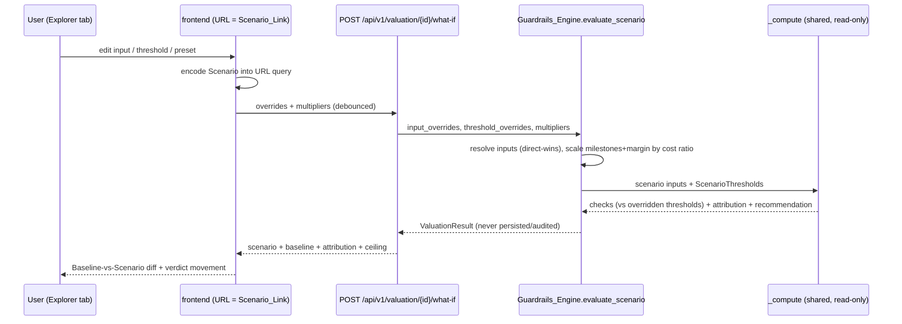

# Design Document

## Overview

The WhatIf_Explorer upgrades the existing stateless what-if path into a first-class, read-only deal-modeling sandbox. It lets a user directly set deal anchors (cost, viewing hours), SVOD/AVOD revenue drivers, the churn percentage, and the four guardrail thresholds, then recomputes the recommendation and shows it Baseline-versus-Scenario with a plain-language diff. Nothing is persisted, audited, or versioned.

The central design decision is a **minimal, surgical extension of the shared compute core**. Today `Guardrails_Engine._compute(...)` and its four check methods hard-code the thresholds as module constants (`LTV_TO_COST_THRESHOLD`, `CHURN_MITIGATION_THRESHOLD`, `PAYBACK_TARGET_MAX_MONTHS`, and `cpvh_ceiling(asset_type)`). We give those methods **optional threshold-override parameters that default to the current constants**. The persisting `evaluate` path passes nothing, so it is byte-for-byte unchanged and the saved verdict is provably unaffected; only the scenario path passes overrides. This keeps the core guarantee intact: the official scorecard and the standard yardsticks never move.

## Architecture

### Component placement

- `backend/app/engines/guardrails.py`:
  - Extend `evaluate_scenario(...)` with two optional keyword args: `input_overrides: ScenarioInputOverrides | None` and `threshold_overrides: ScenarioThresholdOverrides | None`. It resolves overrides over the base inputs (direct-wins precedence over multipliers), scales milestones + margin with the resolved cost, and threads threshold overrides into `_compute`.
  - Add a frozen `ScenarioThresholds` carrier (ltv_floor, churn_hurdle, payback_max_months, cpvh_ceiling) built from overrides-or-constants.
  - `_compute(...)` gains an optional `thresholds: ScenarioThresholds | None = None`; when `None` it uses the module constants exactly as today. It passes the resolved thresholds into `_cpvh_check`, `_ltv_check`, `_churn_check`, and (via `_payback_check`) the payback max.
  - The four check methods gain optional threshold params defaulting to the current constants, so classification, normalized shortfall, and the stored `threshold` field all reflect the in-force (possibly overridden) yardstick (R2.3).
- `backend/app/domain/sensitivity.py`: `scale_inputs(...)` already scales cost/viewership/churn; extend the engine (not the pure function) to also scale `milestone_schedule` amounts and `monthly_margin` by the cost ratio so payback stays coherent (R1.7). A small pure helper `scale_milestones(schedule, ratio)` is added here for testability.
- `backend/app/api/valuation.py`: extend `WhatIfRequest` with optional `input_overrides` and `threshold_overrides`; the handler passes them through and composes the response (Scenario checks + baseline block + attribution split + negotiation ceiling).
- `backend/app/schemas/api.py`: add `ScenarioInputOverrides`, `ScenarioThresholdOverrides`, and extend the what-if response with a `baseline` block and `negotiation_ceiling_usd`.
- `frontend/app/titles/[id]/_components/`: a new `whatif-explorer.tsx` (the two-panel surface) replacing the inline `sensitivity-panel` usage inside a new tabbed container `title-tabs.tsx` (Scorecard | What-If Explorer). The explorer reads/writes the Scenario to the URL query (Scenario_Link).
- `frontend/lib/`: extend `WhatIfRequest`/response types with the override and baseline shapes; add a `chat`-style `whatIf` call already exists, extended with the new optional fields.

### Request flow



### Override resolution and precedence (R1.6)

For each dimension the engine resolves a single effective value:
- **cost:** `input_overrides.cost_usd` if present, else `base_cost * cost_multiplier`.
- **viewing hours:** `input_overrides.projected_viewing_hours` if present, else `base_hours * viewership_multiplier`.
- **churn %:** `input_overrides.churn_reduction_pct` if present, else `base_churn_pct * churn_multiplier`.
- **revenue drivers (ltv, churn_reduction_value, cpm, ad_impressions, watch_time_elasticity):** the override replaces the base input value directly; these have no multiplier.
A direct override always wins; the matching multiplier is ignored for that dimension.

**Currency alignment (non-USD titles).** `cost_usd` is, by definition, a USD figure, so on a non-USD title (e.g. an INR or EUR acquisition) it MUST NOT be re-normalized through the exchange rate - it replaces `normalized.amount_usd` directly. The cost ratio for milestone/margin scaling is always computed in USD: `ratio = scenario_cost_usd / baseline.normalized_cost_usd`. Milestone disbursements are stored in native currency, but scaling them by this *proportional* ratio is currency-consistent (a 20% USD reduction is a 20% native reduction), so the payback walk - which runs entirely in native amounts against the margin - stays correct without any FX conversion of the schedule. The `cost_multiplier` path already behaves this way (it scales the normalized USD amount); the direct `cost_usd` override simply sets the USD numerator and derives the same ratio.

### Milestone + margin scaling (R1.7)

Let `ratio = scenario_cost_usd / baseline.normalized_cost_usd` (see currency note below). Before `_payback_check` runs in the scenario path, the engine replaces `inputs.milestone_schedule` with `scale_milestones(schedule, ratio)` and scales `monthly_margin` by `ratio` as well, so a cheaper deal pays smaller milestones against a proportionally smaller margin and the payback walk stays coherent.

`scale_milestones` is a pure helper that short-circuits the identity case and quantizes each scaled amount to 2 decimal places (half-up) so no float fractions enter the payback walk:

```
def scale_milestones(schedule, ratio):
    if ratio == Decimal("1"):
        return schedule
    return [
        {**item, "amount": (Decimal(str(item["amount"])) * ratio).quantize(_Q, ROUND_HALF_UP)}
        for item in schedule
    ]
```

When no cost change is applied, `ratio == 1` and the schedule/margin are returned untouched (today's behavior preserved exactly).

### Target Deal preset + ceiling (R3.4, R4.4)

The what-if response exposes `negotiation_ceiling_usd` computed from the Baseline checks via the existing `app/domain/negotiation.py` `target_purchase_ceiling(cost, checks)`. The frontend's Target Deal preset sets `cost_usd` to that ceiling. When the ceiling is null/zero or the title is already GREENLIGHT (no correctable breach), the preset button is disabled with an explanatory tooltip - the frontend derives this from the Baseline recommendation and the ceiling value, so no title is ever set to a cost that still fails.

## Components and Interfaces

### `ScenarioInputOverrides` (schema)

Optional fields, each validated to its R1.8 range: `cost_usd`, `projected_viewing_hours`, `churn_reduction_pct`, `ltv`, `churn_reduction_value`, `cpm`, `ad_impressions`, `watch_time_elasticity`. Absent = use Baseline. Non-numeric / non-finite / out-of-range -> 422 standard envelope.

### `ScenarioThresholdOverrides` (schema)

Optional fields, each validated to its R1.8 range: `cpvh_ceiling_override`, `ltv_hurdle_override`, `churn_hurdle_override`, `payback_max_months_override`. Absent = use the standard constant for that guardrail.

### Extended `evaluate_scenario`

Signature gains `input_overrides` and `threshold_overrides`. It builds the effective inputs (precedence), the scaled milestone schedule and margin, and a `ScenarioThresholds` carrier, then calls the shared `_compute` with `thresholds=...`. It still NEVER calls `_persist` or the audit service and stamps the active version read-only (unchanged guarantee).

### Check-method threshold parameters

- `_cpvh_check(title, cost, hours_override, *, ceiling=None)` - `ceiling` defaults to `cpvh_ceiling(asset_type)`.
- `_ltv_check(..., *, floor=LTV_TO_COST_THRESHOLD)`.
- `_churn_check(pct, *, hurdle=CHURN_MITIGATION_THRESHOLD)`.
- `_payback_check(title, inputs, *, max_months=PAYBACK_TARGET_MAX_MONTHS)`.
Each uses its parameter for the breach test, the `threshold` field on the emitted `GuardrailCheck`, and the normalized shortfall denominator - so a relaxed hurdle re-classifies and re-selects the dominant factor automatically (R2.3). Defaults preserve the persisting path exactly.

### Frontend surface

- `title-tabs.tsx`: a tab strip (Scorecard | What-If Explorer) on the title page; the Scorecard tab renders today's panels, the Explorer tab renders `whatif-explorer.tsx`. Tabs are URL-driven (`?tab=what-if`) so the Scenario_Link lands directly on the explorer.
- `whatif-explorer.tsx`: two columns - left = grouped controls (Deal anchors / Revenue drivers / Guardrail thresholds), each field pre-filled with Baseline and showing it inline, per-field + global reset, three preset buttons; right = live verdict with Baseline-vs-Scenario rows per guardrail, the SVOD/AVOD split both sides, a verdict-movement callout, and the plain-language Scenario_Diff summary. A persistent "exploration sandbox - not saved" banner sits on top; the whole surface carries `no-print`.
- Scenario_Link: the explorer serializes its state to the URL query (debounced) and hydrates from it on load; a "Copy scenario link" button copies the current URL. Serialization is **sparse** - only fields that deviate from Baseline are written (e.g. `?tab=what-if&cost_usd=7500000&cpm=32.0`), so untouched fields are omitted. This keeps links short and, critically, avoids baking stale Baseline values into a shared link: an omitted field always resolves to the *current* Baseline when the link is reopened. On hydration, each query value is parsed and range-checked; a `NaN`, malformed, or out-of-range value is discarded and that field falls back to Baseline (never a hard error).

## Data Models

No database changes. Transport/in-memory models only:

- `ScenarioInputOverrides { cost_usd?, projected_viewing_hours?, churn_reduction_pct?, ltv?, churn_reduction_value?, cpm?, ad_impressions?, watch_time_elasticity? }`
- `ScenarioThresholdOverrides { cpvh_ceiling_override?, ltv_hurdle_override?, churn_hurdle_override?, payback_max_months_override? }`
- `ScenarioThresholds { ltv_floor, churn_hurdle, payback_max_months, cpvh_ceiling }` - internal carrier, overrides-or-constants.
- What-if response: a new `WhatIfResponse` that **inherits from `ValuationScorecardResponse`**, so every existing top-level field (recommendation_status, checks, explanation, the Scenario attribution via the existing `ltv_attribution` block) rides along unchanged and no current caller breaks. It adds two fields: a `baseline: BaselineSummary` block (the Baseline recommendation, the four `GuardrailCheckOut` checks, the thresholds in force at 100%, and the Baseline SVOD/AVOD split) and `negotiation_ceiling_usd: Decimal | None`. `BaselineSummary` reuses the existing `GuardrailCheckOut` shape. The `/what-if` endpoint changes its `response_model` from `ValuationScorecardResponse` to `WhatIfResponse` (a superset, so additive and backward-compatible).

All reads reuse existing persisted records; the explorer writes nothing.

## Error Handling

- Out-of-range / non-numeric override -> `422 VALIDATION_FAILED` via pydantic field validators on the override schemas (R1.8, R4.6).
- Missing title -> `404 TITLE_NOT_FOUND` (unchanged).
- Missing exchange rate for a non-USD cost -> existing `ExchangeRateUnavailableError` (unchanged; the latest-rate fallback already applies).
- The frontend ignores stale responses via a monotonically increasing request id (as the current panel already does), shows a pending indicator, and renders a readable error with the input left usable.

## Testing Strategy

Backend (pytest + Hypothesis where pure):
- Untouched scenario (no overrides, all multipliers 1.0) reproduces the Baseline verdict and checks exactly.
- An Input_Override (e.g. cost_usd down) changes a correctable guardrail outcome; a `churn_reduction_pct` override flips the churn check.
- A Threshold_Override (e.g. ltv_hurdle 3.2 -> 2.5) re-classifies the LTV check and re-selects the dominant factor; shortfall is computed against the overridden threshold.
- Direct-wins precedence: cost_usd present with cost_multiplier != 1 uses cost_usd.
- Milestone scaling: a cost override scales milestones + margin so payback stays coherent (pure `scale_milestones` property: sum scales linearly; ratio 1 is identity).
- Read_Only_Sandbox: evaluate_scenario with overrides performs no persist and no audit (fakes assert zero writes).
- Attribution split reflects overrides; negotiation ceiling is exposed.
- Invalid overrides are rejected by the schema (422), engine never sees them.

Frontend (Vitest + Testing Library):
- Editing an input recomputes and renders Baseline-vs-Scenario; a verdict flip shows the movement callout.
- Reset (per-field and global) returns to Baseline.
- The sandbox banner is present; the surface carries `no-print`.
- Target Deal preset disabled with tooltip for an already-GREENLIGHT title.
- Scenario_Link round-trips: state -> URL -> reload -> same state.

## Correctness Properties

These invariants map to the Testing Strategy and the acceptance criteria.

### Property 1: Baseline fidelity

With no Input_Overrides, no Threshold_Overrides, and all multipliers at 1.0, the Scenario recommendation and all four checks equal the saved Baseline exactly.

**Validates: Requirements 1.3**

### Property 2: Persisting path unchanged

The persisting `evaluate` path passes no threshold parameters, so `_compute` and the check methods use the module constants, producing identical output to before this feature (no saved verdict moves).

**Validates: Requirements 1.4**

### Property 3: Read-only sandbox

`evaluate_scenario` with any overrides performs no persistent write and no audit-log entry.

**Validates: Requirements 1.4, 4.2**

### Property 4: Direct-override precedence

When both a direct Input_Override and its Macro_Multiplier are supplied for a dimension, the resolved effective value equals the direct override; the multiplier is ignored.

**Validates: Requirements 1.6**

### Property 5: Milestone coherence

Scaling cost by a ratio scales every milestone disbursement and the monthly margin by the same ratio before payback; a ratio of 1 is the identity (schedule and margin unchanged).

**Validates: Requirements 1.7**

### Property 6: Threshold-relative classification

Pass/breach, normalized shortfall, and the dominant factor are computed against the in-force (possibly overridden) thresholds, not the Baseline constants.

**Validates: Requirements 2.3**

### Property 7: Range validation

An override that is non-numeric, non-finite, or outside its R1.8 range is rejected with a validation envelope and never reaches the compute core.

**Validates: Requirements 1.8, 4.6**

### Property 8: Attribution recompute

The returned SVOD/AVOD split equals `ltv_attribution` evaluated on the resolved Scenario inputs, so tweaking CPM / impressions / LTV shifts the reported revenue mix.

**Validates: Requirements 2.2, 4.3**

### Property 9: Scenario link round-trip (sparse + resilient)

Encoding the active Scenario to the URL query writes only fields that deviate from Baseline and decoding restores the identical set of overrides and multipliers (no server state). An omitted field resolves to the current Baseline, and a malformed/out-of-range query value is discarded in favor of Baseline rather than raising.

**Validates: Requirements 3.6**

### Property 10: Target Deal viability

The Target Deal preset is offered only when a correctable negotiation ceiling exists; an already-GREENLIGHT title or a structural (non-correctable churn) PASS disables it with an explanation.

**Validates: Requirements 3.4**

### Property 11: USD cost override is currency-neutral

On a non-USD title, a direct `cost_usd` override sets the normalized USD cost directly (no FX re-normalization), and the milestone/margin ratio is `scenario_cost_usd / baseline.normalized_cost_usd`, so the native-currency payback walk scales proportionally and stays correct.

**Validates: Requirements 1.1, 1.7**