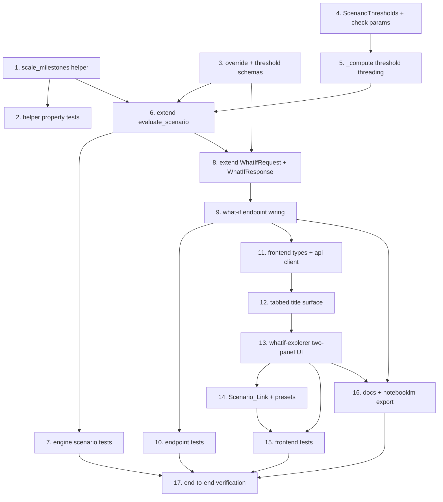

# Implementation Plan

## Overview

This plan builds the WhatIf_Explorer from the design: a read-only deal-modeling sandbox that lets a user directly set deal anchors, SVOD/AVOD drivers, the churn percentage, and the four guardrail thresholds, and see the verdict recompute live Baseline-versus-Scenario, persisting nothing. Work flows core-first and under test: the pure milestone helper and override/threshold schemas, then the surgical compute-core parameterization and the extended scenario path, then the endpoint, then the tabbed frontend surface, then Scenario_Link + presets, then docs and a final end-to-end check. The persisting `evaluate` path MUST stay byte-for-byte unchanged (it passes no threshold overrides). "Build/verify" means run the backend suite from `backend/` with `python -m pytest -q -p no:cacheprovider` and the frontend checks from `frontend/` with `npm run typecheck`, `npm run lint`, and `npx vitest run`, as relevant. No database migration is introduced.

## Task Dependency Graph



The waves below group tasks that can proceed in parallel once their dependencies are met.

```json
{
  "waves": [
    { "wave": 1, "tasks": ["1", "3", "4"] },
    { "wave": 2, "tasks": ["2", "5"] },
    { "wave": 3, "tasks": ["6"] },
    { "wave": 4, "tasks": ["7", "8"] },
    { "wave": 5, "tasks": ["9"] },
    { "wave": 6, "tasks": ["10", "11"] },
    { "wave": 7, "tasks": ["12"] },
    { "wave": 8, "tasks": ["13"] },
    { "wave": 9, "tasks": ["14", "16"] },
    { "wave": 10, "tasks": ["15"] },
    { "wave": 11, "tasks": ["17"] }
  ],
  "dependencies": {
    "1": [],
    "2": ["1"],
    "3": [],
    "4": [],
    "5": ["4"],
    "6": ["1", "3", "5"],
    "7": ["6"],
    "8": ["3", "6"],
    "9": ["8"],
    "10": ["9"],
    "11": ["9"],
    "12": ["11"],
    "13": ["12"],
    "14": ["13"],
    "15": ["13", "14"],
    "16": ["9", "13"],
    "17": ["7", "10", "15", "16"]
  }
}
```

## Tasks
- [ ] 1. Add the pure `scale_milestones` helper
  - In `backend/app/domain/sensitivity.py`, add `scale_milestones(schedule, ratio) -> list[dict]`: identity short-circuit when `ratio == Decimal("1")`; otherwise return each item with `amount` multiplied by `ratio` and quantized to `_Q = Decimal("0.01")` using `ROUND_HALF_UP`. Pure, Decimal-only, no I/O.
  - _Requirements: 1.7_

- [ ] 2. Property tests for `scale_milestones`
  - Under `backend/tests/domain/`, assert: ratio 1 returns the schedule unchanged; the summed scaled amount equals the summed base amount times ratio (within 0.01 x item count); each amount is quantized to 2 dp; non-amount keys are preserved.
  - _Requirements: 1.7_

- [ ] 3. Add the override and threshold request schemas
  - In `backend/app/schemas/api.py`, add `ScenarioInputOverrides` (optional `cost_usd`, `projected_viewing_hours`, `churn_reduction_pct`, `ltv`, `churn_reduction_value`, `cpm`, `ad_impressions`, `watch_time_elasticity`) and `ScenarioThresholdOverrides` (optional `cpvh_ceiling_override`, `ltv_hurdle_override`, `churn_hurdle_override`, `payback_max_months_override`). Add pydantic field validators enforcing the exact R1.8 ranges; reject non-finite values. Absent field = None.
  - _Requirements: 1.1, 1.2, 1.8, 4.6_

- [ ] 4. Add `ScenarioThresholds` carrier and optional threshold params on the check methods
  - In `backend/app/engines/guardrails.py`, add a frozen `ScenarioThresholds` dataclass (`ltv_floor`, `churn_hurdle`, `payback_max_months`, `cpvh_ceiling`). Give the four check methods optional keyword threshold params defaulting to today's constants: `_cpvh_check(..., *, ceiling=None)` (None -> `cpvh_ceiling(asset_type)`), `_ltv_check(..., *, floor=LTV_TO_COST_THRESHOLD)`, `_churn_check(pct, *, hurdle=CHURN_MITIGATION_THRESHOLD)`, `_payback_check(..., *, max_months=PAYBACK_TARGET_MAX_MONTHS)`. Each uses its param for the breach test, the emitted `threshold` field, and the normalized-shortfall denominator. Defaults preserve current behavior exactly.
  - _Requirements: 1.2, 2.3_

- [ ] 5. Thread optional thresholds through `_compute`
  - Add `thresholds: ScenarioThresholds | None = None` to `_compute`. When None, use the module constants (unchanged). When present, pass its fields to the four check methods. No other behavior changes; `_compute` still does no I/O.
  - _Requirements: 1.4, 2.3_

- [ ] 6. Extend `evaluate_scenario` with overrides, precedence, milestone/margin scaling
  - Add optional `input_overrides: ScenarioInputOverrides | None` and `threshold_overrides: ScenarioThresholdOverrides | None`. Resolve effective inputs with direct-wins precedence over multipliers (cost_usd/viewership hours/churn_pct, and direct revenue drivers). Compute `ratio = scenario_cost_usd / baseline.normalized_cost_usd`; a direct `cost_usd` on a non-USD title replaces `normalized.amount_usd` WITHOUT FX re-normalization. Before payback, replace `inputs.milestone_schedule` with `scale_milestones(schedule, ratio)` and scale `monthly_margin` by `ratio`. Build `ScenarioThresholds` from overrides-or-constants and pass to `_compute(thresholds=...)`. Still NEVER persist and NEVER audit; stamp active version read-only.
  - _Requirements: 1.1, 1.3, 1.4, 1.5, 1.6, 1.7, 2.3_

- [ ] 7. Engine scenario tests
  - Under `backend/tests/engines/`, cover: untouched scenario reproduces the Baseline verdict/checks; an input override (cost_usd down, churn_reduction_pct) changes a guardrail outcome; a threshold override re-classifies a check and re-selects the dominant factor with shortfall vs the overridden threshold; direct-wins precedence; milestone+margin coherence; a non-USD `cost_usd` override is currency-neutral (Property 11); and the read-only guarantee (fakes assert zero persist/audit calls). Property-test the pure pieces where practical.
  - _Requirements: 1.3, 1.4, 1.6, 1.7, 2.3_

- [ ] 8. Extend `WhatIfRequest` and add `WhatIfResponse`
  - In `backend/app/api/valuation.py` (or `schemas/api.py` as fits), add optional `input_overrides` and `threshold_overrides` to `WhatIfRequest` (multipliers stay, backward-compatible). Add `BaselineSummary` (recommendation, four `GuardrailCheckOut`, thresholds in force, SVOD/AVOD split) and `WhatIfResponse(ValuationScorecardResponse)` adding `baseline: BaselineSummary` and `negotiation_ceiling_usd: Decimal | None`. The response is a superset of the current one.
  - _Requirements: 4.1, 4.3, 4.4_

- [ ] 9. Wire the what-if endpoint
  - Update `POST /api/v1/valuation/{title_id}/what-if`: `response_model=WhatIfResponse`; pass `input_overrides`/`threshold_overrides` to `evaluate_scenario`; compute the Baseline block by evaluating the scenario at identity (no overrides, multipliers 1.0) once, and the Scenario block from the overrides; expose `negotiation_ceiling_usd` via `target_purchase_ceiling(baseline_cost, baseline_checks)`; include the Scenario attribution split. Read-only, no audit. 404 for missing title; 422 for invalid overrides (schema-enforced).
  - _Requirements: 4.1, 4.2, 4.3, 4.4, 4.5, 4.6_

- [ ] 10. Endpoint tests
  - Under `backend/tests/api/`, cover: identity request returns baseline == scenario; override request returns differing scenario with the baseline block intact; invalid override -> 422; missing title -> 404; `negotiation_ceiling_usd` present; no persistence/audit. Pin the engine via the existing test doubles.
  - _Requirements: 4.1, 4.2, 4.3, 4.4, 4.6_

- [ ] 11. Frontend types + api client
  - In `frontend/lib/types.ts`, extend `WhatIfRequest` with optional `input_overrides`/`threshold_overrides`, and add `WhatIfResponse` (scorecard + `baseline` + `negotiation_ceiling_usd`). In `frontend/lib/api-client.ts`, extend `whatIf(...)` to pass the new fields and return `WhatIfResponse`. Run `npm run typecheck`.
  - _Requirements: 4.1, 4.3_

- [ ] 12. Tabbed title surface
  - Add `frontend/app/titles/[id]/_components/title-tabs.tsx`: a tab strip (Scorecard | What-If Explorer) on the title page, URL-driven via `?tab=what-if`. The Scorecard tab renders today's panels; the Explorer tab renders the explorer (task 13). Keep the existing deep-dive content intact under the Scorecard tab.
  - _Requirements: 3.1_

- [ ] 13. Build the What-If Explorer two-panel UI
  - Add `frontend/app/titles/[id]/_components/whatif-explorer.tsx` (`"use client"`): left column grouped controls (Deal anchors / Revenue drivers / Guardrail thresholds), each field pre-filled with Baseline and showing it inline, per-field + global reset; right column live verdict with Baseline-vs-Scenario rows per guardrail (value, threshold, pass/breach each side), the SVOD/AVOD split both sides, a verdict-movement callout when the recommendation flips, and a plain-language Scenario_Diff summary. A persistent "exploration sandbox - not saved" banner on top; the whole surface carries `no-print`. Debounced recompute with stale-response guarding and a pending indicator. Accessible (labeled controls, focus handling, aria-live for the verdict).
  - _Requirements: 2.1, 2.2, 2.3, 2.4, 2.5, 2.6, 2.7, 3.2, 3.3, 3.5_

- [ ] 14. Scenario_Link + presets
  - Serialize the active Scenario to the URL query **sparsely** (only fields deviating from Baseline; omitted = current Baseline), debounced, and hydrate from the query on load, discarding NaN/malformed/out-of-range values in favor of Baseline. Add a "Copy scenario link" button. Add the three preset buttons - Bear Case, Bull Case, Target Deal - with Target Deal setting `cost_usd` to `negotiation_ceiling_usd` and disabled with an explanatory tooltip when there is no viable ceiling (already GREENLIGHT or structural PASS).
  - _Requirements: 3.4, 3.6_

- [ ] 15. Frontend tests
  - Vitest + Testing Library: editing an input recomputes and renders Baseline-vs-Scenario; a verdict flip shows the movement callout; per-field and global reset return to Baseline; the sandbox banner is present; Target Deal preset disabled with tooltip for an already-GREENLIGHT title; Scenario_Link round-trips (state -> URL -> reload -> same state).
  - _Requirements: 2.1, 2.4, 2.6, 3.4, 3.6_

- [ ] 16. Documentation and NotebookLM export
  - Add a "What-If Explorer" how-to recipe to the in-portal guide (`frontend/app/guide/page.tsx`, Features & How-To). Document the explorer (read-only sandbox, direct overrides, threshold overrides, presets, shareable links, nothing saved) in `CineROI_AI_Complete_Knowledge_Base.md` and `CineROI_AI_Architecture_And_Data_Flow.md`. Regenerate the NotebookLM export via `scripts/notebooklm-export.ps1`.
  - _Requirements: 5.3_

- [ ] 17. End-to-end verification
  - Run the full backend suite and the frontend typecheck/lint/vitest. Rebuild the backend and frontend containers; confirm `POST /api/v1/valuation/{id}/what-if` returns baseline==scenario at identity and a moved verdict under an override, that nothing is persisted (the saved scorecard is unchanged after exploring), and the Explorer tab renders with a working Scenario_Link in the running portal. Clean up any temp files.
  - _Requirements: 5.1, 5.2, 5.3_

## Notes

- No database migration or schema change: the explorer reads existing records and persists nothing.
- The core guarantee is enforced in code (persisting `evaluate` passes no threshold overrides; `evaluate_scenario` never persists/audits) and asserted by tests (Property 1 Baseline fidelity, Property 2 persisting path unchanged, Property 3 read-only sandbox).
- Saving per-title supplied inputs (Mode B) and versioned threshold policy changes (Mode C) remain out of scope for this spec; this is the ephemeral "explore anything" surface only.
- Build/verify per task: backend `python -m pytest -q -p no:cacheprovider` from `backend/`; frontend `npm run typecheck`, `npm run lint`, `npx vitest run` from `frontend/`.