# CineROI AI - Architecture and End-to-End Data Flow (Executive Guide)

> A plain-language, picture-first walkthrough of how the whole platform is built and how
> data moves through it - from a deal landing on a buyer's desk to a greenlight decision,
> an audit trail, and self-calibration. Written for executives first; engineers will find
> the component names and endpoints accurate. Companion documents:
> **CineROI_AI_Complete_Knowledge_Base.md** (what every feature does and the demo numbers)
> and **CineROI_AI_Calculations_Reference.md** (the exact formula behind every number).

---

## 1. The 30-Second Picture

CineROI AI is a **credit check for content deals**. A buyer gives it a title and a price;
it returns one of three answers - **GREENLIGHT** (buy it), **NEGOTIATE HARD** (there is a
lower price that works), or **PASS** (walk away) - with the evidence behind the answer.

Think of it as an assembly line with four stations:

1. **Intake** - a title enters (typed in, uploaded as a slate, or parsed from a pitch PDF).
2. **Understand** - the system profiles the title (semantic "Narrative DNA", pedigree,
   production scale, market signals).
3. **Decide** - a deterministic engine runs four money checks and returns a verdict with a
   full explanation.
4. **Govern and learn** - big deals need dual sign-off, every action is logged immutably,
   and the model backtests itself against real outcomes and recalibrates when it drifts.

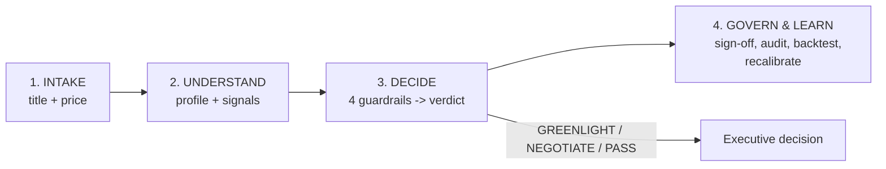

Everything else in this document is detail on those four stations and the plumbing that
carries data between them.

---

## 2. The System at a Glance (What Runs Where)

The platform ships as a **Docker Compose** stack - six cooperating services on one network.
You bring the whole thing up with one command; nothing external is required to run the demo.

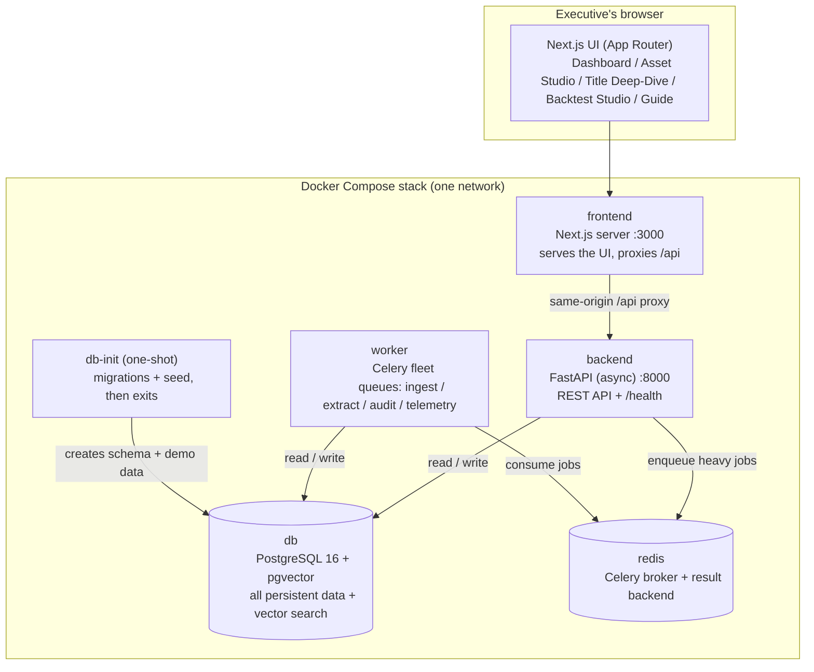

**Who does what, in one line each:**

| Service    | Plain-language role |
|------------|---------------------|
| **frontend** | The screens executives use. Also quietly forwards API calls so the whole app lives behind one web address. |
| **backend**  | The brain's front door: validates requests, runs instant valuations, enforces permissions, writes the audit log. |
| **worker**   | The back office: does the slow work (bulk uploads, profiling, backtests, market polling) without making anyone wait. |
| **db**       | The system of record: every title, valuation, model version, approval, and audit entry - plus the vector search for look-alike titles. |
| **redis**    | The conveyor belt between the front door and the back office (the job queue). |
| **db-init**  | Runs once on first boot to build the database and load demo data, then stops. |

**Fast vs slow, by design:** anything a human waits on (opening a page, valuing one title,
a what-if slider) runs **synchronously** in the backend and returns in well under a second.
Anything heavy (a 1,000-title slate, deep profiling, a backtest, polling external markets)
is handed to the **worker** so the UI never blocks.

---

## 3. The Four Stations in Detail

### Station 1 - Intake: how a title enters

There are three doors in, all landing in the same place (a title record plus an immutable
"source snapshot" of exactly what was submitted):

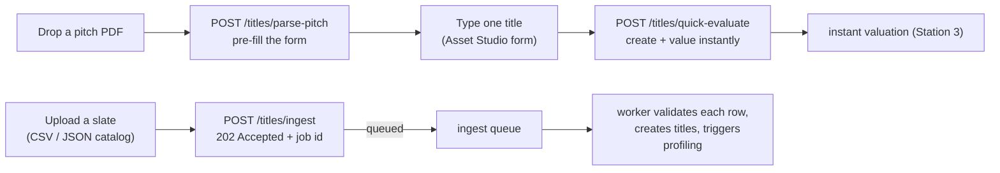

- **One title (Asset Studio):** the buyer types the deal (name, asset type, cost and
  currency, synopsis, genre, content format, territories, pedigree, exclusivity, optional
  viewing hours with a unit). It is created and valued in a single synchronous call.
- **A whole slate:** a CSV/JSON catalog is accepted immediately (HTTP 202 with a job id)
  and processed row-by-row in the background; the response later carries an accepted/
  rejected summary with a reason per rejected row. Replays with the same idempotency key
  return the original result - no duplicates.
- **A pitch PDF:** dropped on the form, parsed best-effort to pre-fill title/synopsis/
  genre/budget for review. Nothing is auto-submitted.

Every intake path captures the acquisition cost, native currency, territories, and the
business facts the decision needs. The raw submission is stored as an encrypted-at-rest
**source snapshot** so the exact inputs behind any decision can always be recovered.

### Station 2 - Understand: profiling the title

Once a title exists, the system builds its profile. In the background the **feature
extraction** engine produces a **metadata vector**: a 1536-dimension "Narrative DNA"
embedding plus affective-tone tags, a talent-pedigree score, and a production-scale score.
That embedding powers two look-alike features via PostgreSQL's **pgvector** cosine search:
the **Top-3 historical comps** (titles most similar to this one) and subscriber-cohort
audience-fit matching.

In parallel, **market telemetry** (social sentiment, chart velocity, licensing inflation)
is polled per genre and territory and cached, so valuations reflect current market heat.

> Demo-mode honesty: in demo mode the Narrative DNA embedding and a few modeled financial
> drivers are deterministic placeholders, so the full stack runs on a laptop with no
> external AI or data vendors. The decision math, governance, audit, backtesting, and
> persistence are the real engine.

### Station 3 - Decide: the Guardrails Engine (the core)

This is the heart of the platform. For a title and its price, the **Guardrails Engine**:

1. **Normalizes the cost to US dollars first**, using a dated exchange rate, so every deal
   is compared on one axis. A missing rate rejects the valuation before anything is saved.
2. **Weights value by territory** using the cached market telemetry.
3. **Runs four quantitative guardrails** (each with a computed value, a threshold, and a
   pass/breach result):
   - **CPVH** - cost per viewing hour (is it cheap enough per hour watched?).
   - **LTV-to-Cost** - dollars of modeled value returned per dollar spent.
   - **Churn Mitigation** - does owning this title keep subscribers from cancelling?
   - **Payback Horizon** - how fast does it pay for itself?
4. **Produces a verdict** by a fixed rule: zero breaches -> GREENLIGHT; one or more
   breaches but all are price-fixable -> NEGOTIATE HARD; any breach that no price can fix
   (a churn miss) -> PASS. It also names the dominant factor and, for a NEGOTIATE HARD, a
   concrete target purchase price.
5. **Persists** the full scorecard, **stamps** it with the active model version (so the
   decision is reproducible forever), and **writes an audit entry**.

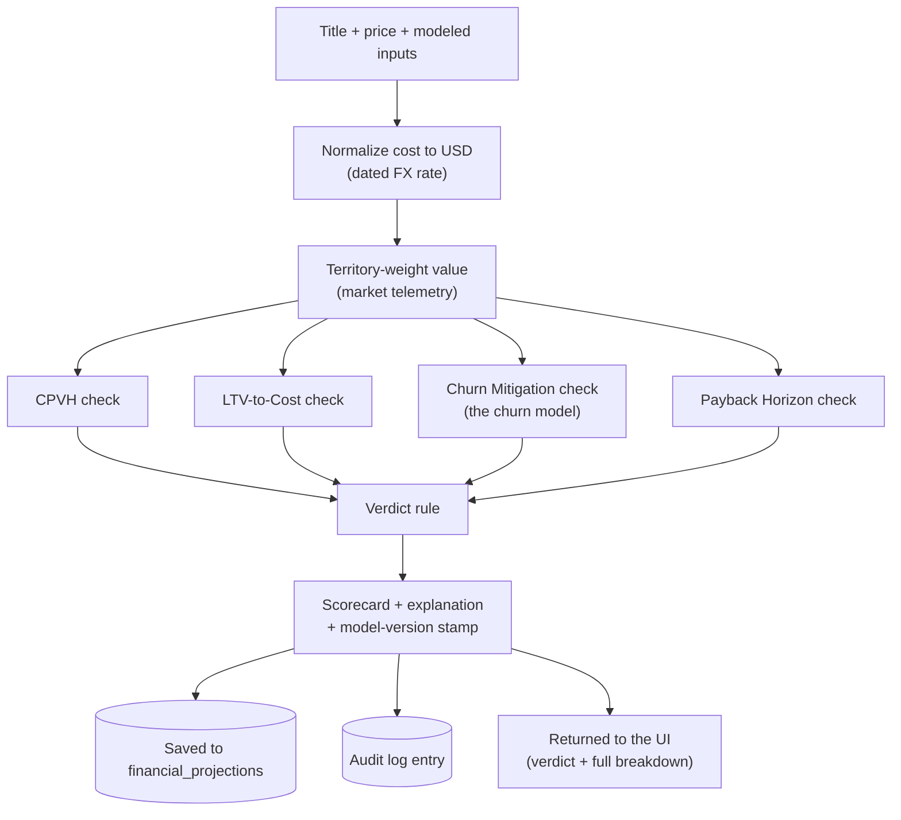

The churn check is itself a transparent model (see Section 5) - the one place the platform
turned a hard-coded number into an explained, feature-driven calculation.

### Station 4 - Govern and learn

- **Dual sign-off:** a GREENLIGHT above the high-budget threshold (USD 25M) requires both
  CCO and CFO approval before it is final. Role-based access control gates who can do what.
- **Immutable audit log:** every state-changing action (valuation, override, sign-off,
  calibration) is appended, never edited.
- **Immutable model versions:** the coefficients and thresholds live in a versioned record.
  Calibration never edits a version in place - it **forks a new one** and flips which is
  active, so every past decision can be reproduced from its stamped version.
- **Backtest and recalibrate:** analysts enter real observed outcomes (ground truth) for
  historical titles; the system computes prediction error (MAPE) and, when error exceeds
  the threshold, forks a recalibrated model version.

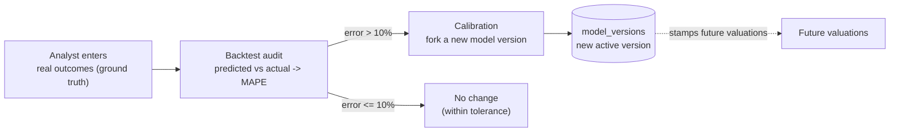

---

## 4. Two End-to-End Journeys (Follow the Data)

### Journey A - "Value one title now" (synchronous, sub-second)

The Asset Studio instant path. Nothing is queued; the buyer gets a full scorecard back in
one request.

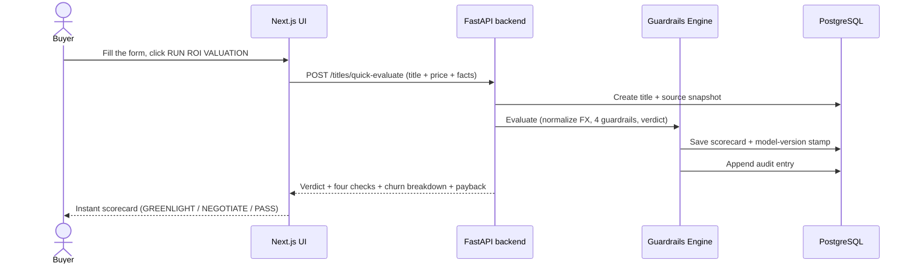

A **what-if** on the title page follows the same engine but writes nothing: it recomputes
the verdict under cost/viewership/churn sliders and returns a preview (an all-100% scenario
reproduces the saved result).

### Journey B - "Ingest a whole slate" (asynchronous, non-blocking)

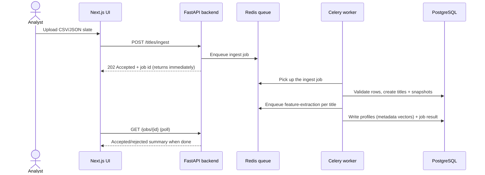

The same worker fleet also runs **backtest audits** (the audit queue) and **telemetry
polling** (the telemetry queue), each retried on failure with a dead-letter path.

---

## 5. Spotlight: the Churn Mitigation Model (from hard-coded to explained)

Churn was once a hard-coded number - the one guardrail a reviewer could not interrogate.
It is now a **transparent, additive, versioned model**: every point of the churn figure is
traceable to a specific feature, and a buyer can still override it with a known value.

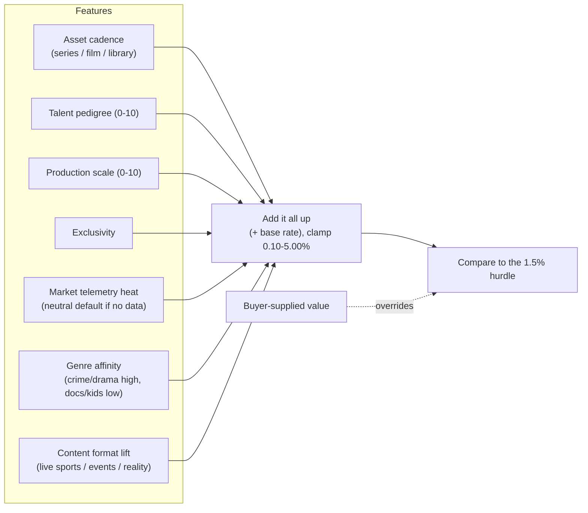

Three design choices that matter to a non-technical reader:

- **A data gap never scores as zero.** If a title has no market-telemetry reading, or a
  genre/format the demo never saw, the model uses a **neutral default** instead of 0, so a
  missing data point doesn't unfairly force a PASS. The breakdown labels these as
  "neutral", not "unavailable".
- **Content format captures OTT reality.** A live cricket match or an awards show is far
  stickier than a one-and-done film, but the basic asset types can't express that. A
  separate **Content Format** signal adds that retention credit (live sports highest), so a
  marquee live event is no longer scored like library filler.
- **Supplied wins, borderline is flagged.** A number typed by a buyer is used exactly. Any
  churn figure within 0.05% of the 1.5% line raises a borderline note (it never silently
  changes the verdict).

The coefficients are **illustrative**, tuned so the five demo titles keep their verdicts;
they are not fitted to real subscriber data. Exact weights and worked examples live in the
Calculations Reference.

---

## 6. The Backend Internals (for the technically curious)

The backend is layered so the decision math is pure and testable, and all I/O lives at the
edges.

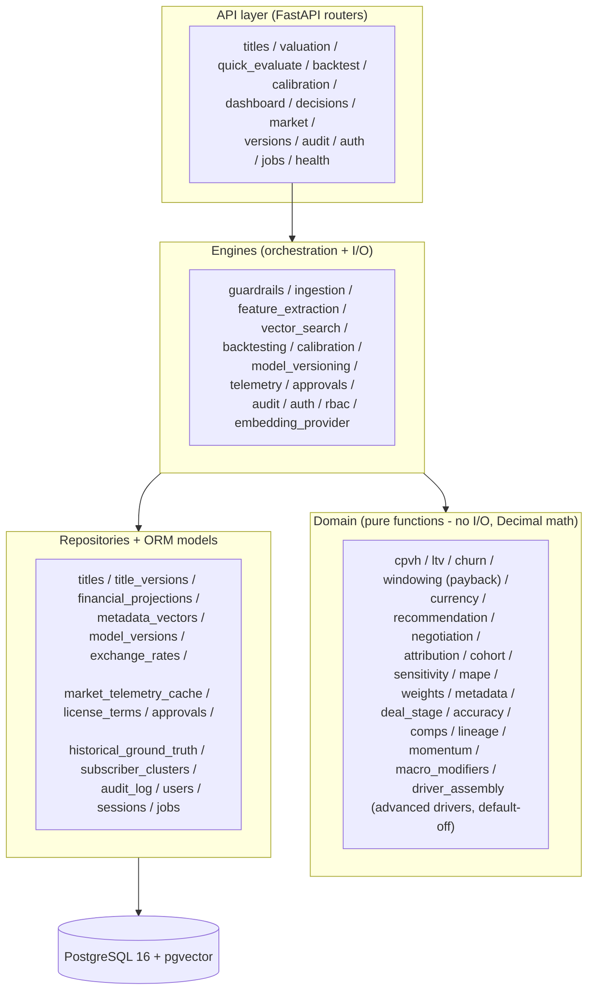

- **Routers** validate the request envelope and enforce auth/role checks; they own the
  database transaction for a request.
- **Engines** compose the pure domain functions with repository reads/writes - the
  Guardrails Engine is the headline one.
- **Domain** is pure, deterministic, Decimal-precision math with no database access, which
  is why it can be exhaustively property-tested (the churn model, CPVH, LTV, payback, the
  verdict rule, MAPE, and calibration weights are all here).
- **Repositories/models** are the only place that touches the database.

**The async plumbing:** four Celery queues - `ingest`, `extract`, `audit`, `telemetry` -
carry the heavy work; Redis is the broker and result store; jobs retry on failure and have
a dead-letter path; terminal states fire webhooks.

---

## 7. The Data Model (what is stored, in business terms)

| Record | What it holds |
|--------|---------------|
| **titles** | The deal: name, asset type, cost, native currency, territories, genre. |
| **title_versions** | An immutable snapshot of exactly what was submitted (encrypted at rest). |
| **metadata_vectors** | The title's profile: 1536-dim Narrative DNA, affective tone, pedigree, production scale. |
| **financial_projections** | The saved scorecard: the four computed values, the verdict, the explanation JSON (incl. the churn breakdown), and the model-version stamp. |
| **model_versions** | The immutable coefficients + thresholds (incl. the churn model params); calibration forks new ones. |
| **exchange_rates** | Dated FX rates used to normalize every cost to USD. |
| **market_telemetry_cache** | Social sentiment / chart velocity / licensing inflation by genre + territory. |
| **license_terms** | Duration, exclusivity, windowing, holdbacks, milestone schedule (encrypted at rest). |
| **approval_workflows / approval_actions** | The dual-sign-off gate and who approved what. |
| **historical_ground_truth** | Real observed outcomes used to backtest and recalibrate. |
| **subscriber_clusters** | Cohort preference vectors for audience-fit matching. |
| **audit_log** | Append-only record of every state-changing action. |
| **users / sessions / jobs** | Identity + roles, login sessions, and async job tracking. |

**Reproducibility promise:** because every valuation is stamped with its model version, and
versions and the audit log are immutable, any past decision can be reconstructed exactly -
the inputs (source snapshot), the parameters (stamped version), and the result (projection).

---

## 7b. The Chat Assistant (read-only, grounded)

A floating chat assistant is available on every page. It answers two kinds of question -
data questions (a title's verdict, guardrail checks, churn, the portfolio) and how-to/concept
questions (how to upload a slate, what CPVH means) - and is designed so a generative model can
never contaminate the deterministic decision core.

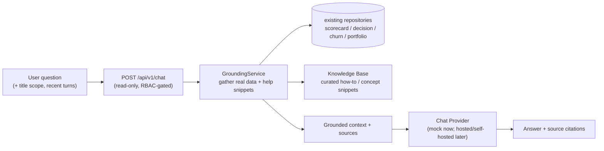

How the risks are neutralized:

- **Read-only:** the endpoint runs no engine and writes nothing - no verdict, number, or
  audit entry is produced by the assistant. The engine stays the sole source of every value.
- **Grounded or honest:** answers come only from the retrieved context (real records plus
  curated help snippets); with nothing relevant retrieved, the assistant says it does not know.
- **Confidential-safe:** grounding omits confidential fields for roles without clearance, so
  the model never receives what the user could not see.
- **Governance redirect:** any ask to override, greenlight, or change a number is redirected
  to the audited controls on the title page.
- **Swappable model:** a single `ChatProvider` interface selected by `CINEROI_CHAT_PROVIDER`.
  The shipped default is a zero-cost, no-key, deterministic **mock** (grounded answers composed
  from the retrieved context), so the whole flow runs in CI and demos without external calls.
  A local **Ollama** provider is also included (`CINEROI_CHAT_PROVIDER=ollama`,
  `CINEROI_CHAT_OLLAMA_MODEL`) that keeps data on the host - useful where a real LLM is wanted
  without third-party egress; note local CPU inference can be slow, and on a provider timeout
  the endpoint returns a clean envelope and the widget offers a retry. Hosted providers can be
  added behind the same interface without touching the endpoint, grounding, or widget.
- **Guided follow-ups:** every answer returns up to three suggested next questions the UI shows
  as one-click chips; they are question-aware, so clicking one never repeats what was just asked
  and the conversation keeps advancing.

---

## 7c. The What-If Explorer (read-only deal sandbox)

A title-page tab lets analysts model a deal by setting exact inputs and even the guardrail
thresholds, recomputing the verdict live against the saved Baseline. It reuses the existing
stateless `evaluate_scenario` path with a surgical extension: the four check methods and the
shared `_compute` take optional threshold parameters that default to the module constants, so
the persisting `evaluate` path is byte-for-byte unchanged and no saved verdict can regress.

- **Read-only:** persists nothing, no audit entry, no model-version fork; the official
  scorecard and the standard thresholds never move.
- **Direct-wins precedence:** a direct value (cost, hours, churn %) supersedes the coarse
  multiplier; a cost change scales milestones + monthly margin by the USD ratio so payback
  stays coherent, and a USD cost override on a non-USD title carries no FX distortion.
- **Baseline-vs-Scenario:** the response returns both the Scenario and a Baseline block plus
  the negotiation ceiling, so the UI shows exactly what moved and offers a Target Deal preset.
- **Shareable, stored nowhere:** the scenario is encoded sparsely in the URL; excluded from
  the Greenlight Memo.

---

## 7d. The Content Evaluation Modeling & Measurement Layer (where models produce the engine's inputs)

Section 5 showed how one input - churn - went from a hard-coded number to an explained,
versioned model. This section shows where that pattern generalizes to the other engine
inputs, and where the data plumbing and the measurement loop sit. The crucial thing to see
is that this layer feeds the engine's *inputs* through the existing provider boundary; the
Guardrails Engine, the thresholds, and the verdict rule are **unchanged**.

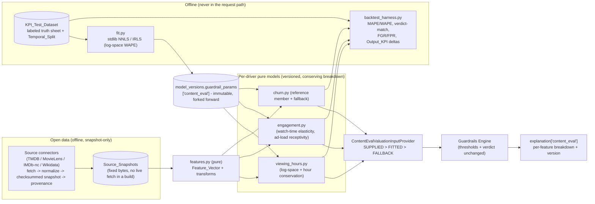

**Where each piece sits (left to right):**

- **Open-data connectors are snapshot-only and offline.** Each `Source_Connector` fetches,
  normalizes into the shared feature contract, writes a checksummed `Source_Snapshot`, and
  registers its license. A live fetch happens *only* in an explicit, out-of-build
  snapshot-refresh step - never in a build, fit, test, or a request. A declarative
  `Connector_Registry` records which source supplies each feature and the overlap precedence,
  so a new source is one registry entry plus one connector.
- **`features.py` is pure.** It turns already-fetched raw values into a typed, PII-free
  `Feature_Vector`, with a neutral default + `assumed` flag for any missing feature. It is the
  single feature definition shared by the request path, the dataset generator, and the harness.
- **Per-driver pure models sit behind the provider.** `viewing_hours.py`, `engagement.py`,
  and the existing `churn.py` each map the Feature_Vector to one driver with a conserving
  breakdown. They are pure, deterministic, Decimal, and live in the same domain layer as CPVH
  and LTV (Section 6) - so they are exhaustively property-testable.
- **The provider applies strict precedence, then the engine runs unchanged.** The
  `ContentEvalValuationInputProvider` wraps the existing snapshot provider and resolves each
  input `SUPPLIED > FITTED > FALLBACK`, recording the method, reason, and version. The result
  flows through the untouched `ValuationInputProvider` boundary into the Guardrails Engine, and
  the per-feature breakdown is attached additively under `explanation['content_eval']` (absent
  field -> byte-identical explanation, so demo output does not move).

**The offline fit and harness (never in the request path):**

- **`fit.py`** is a standard-library non-negative least squares (projected coordinate descent)
  with an IRLS wrapper for the log-space WAPE objective used by viewing hours. Fixed seed, no
  wall-clock or environment dependence, no numpy/scipy - so fitted parameters are
  byte-identical across platforms.
- **`backtest_harness.py`** scores a model version over the held-out split of the
  `KPI_Test_Dataset` and reports MAPE/WAPE, verdict-match, the asymmetric
  `False_Greenlight_Rate` (first) and `False_Pass_Rate`, and the Output_KPI deltas vs a
  baseline - all labeled PROXY when the measured rows are PROXY/SYNTHETIC.

**How it threads through versioning:** fitted parameters are written under
`model_versions.guardrail_params['content_eval']` inside the existing immutable model-version
lineage, carried forward unchanged on a calibration fork, and stamped on every valuation they
produce. With **no fitted version active** (the default) and the churn->LTV link off, every
driver, projection, and verdict is byte-identical to before this layer existed. A fitted
version that regresses on the held-out split is surfaced, never auto-activated. Every modeled
or proxy-trained value shown in the UI carries a **PROXY / illustrative** badge - the reported
accuracy is proxy accuracy, never real-world accuracy.

---

## 7e. Advanced Content-Eval Drivers (optional, flag-gated, default-off)

A further-optional layer sits on top of 7d: four independent drivers that each refine one of
the engine''s inputs when explicitly switched on. They are wired through the **same provider
boundary** as the content-eval models, so the Guardrails Engine, the thresholds, and the
verdict rule remain unchanged.

- **Driver A - Comps_Engine:** retrieves budget-band comparable historical titles (same
  asset type, Narrative_DNA cosine nearest-neighbours within a normalized-USD band of +/-35%
  of the query cost, never widened) and anchors the base viewing hours and base churn to the
  comp-set medians (`H_comps` / `C_comps`) instead of the model intercept.
- **Driver B - Lineage_Decay:** a one-sided franchise-floor on hours plus an additive churn
  loyalty credit for sequels, derived from the parent title''s performance.
- **Driver C - Momentum_Telemetry:** a stage-gated trailer / social / search buzz multiplier
  (bounded 1.00-1.50) that degrades to a neutral 1.00 on an unproduced stage, a stale reading
  (older than 14 days), or an unavailable source.
- **Driver D - Macro_Modifiers:** four market multipliers (source-IP provenance, release-window
  halo, calendar seasonality, vernacular TAM) multiplied into the hour prediction, each
  clamped to a documented band.

**The inertness guarantee.** Each driver has its own kill-switch
(`CINEROI_ENABLE_COMPS / _LINEAGE / _MOMENTUM / _MACRO_MODIFIERS`), all **false by default**.
With every flag off - the shipped state - the flag-gated provider short-circuits before any
driver runs and returns the inputs untouched, so inputs, per-driver breakdown, explanation,
and verdict are **byte-identical** to 7d (a demo-invariance guard test pins this across the
five seeded titles). A log-space assembler (`driver_assembly.py`) composes the enabled drivers
into a conserving, signed per-driver breakdown, and each driver''s illustrative coefficients
ride in `model_versions.guardrail_params` alongside the churn / content-eval blocks. Migration
`0005` adds the nine neutral-default driver columns to `titles`; the coefficients are
**illustrative, not fitted to real data**.

---

## 8. Trust, Security, and Honesty

- **Deterministic and explainable:** the same inputs always yield the same verdict, and
  every verdict shows its working (checks, computed vs threshold, dominant factor, churn
  breakdown, target price).
- **Governed:** role-based access control on sensitive actions; dual executive sign-off on
  large greenlights.
- **Auditable:** an append-only log of every change, with the model version attached.
- **Confidential at rest:** source snapshots and deal terms are encrypted.
- **Honest in demo:** the AI embedding and a few financial drivers are deterministic
  placeholders in demo mode; the decision, governance, audit, and backtest logic are real.
- **Honest in the modeling layer:** the Content Evaluation models (Section 7d) ship with
  illustrative/PROXY coefficients, no fitted version is active by default, and any accuracy
  reported by the harness is proxy accuracy on open-data/synthetic labels - never real-world
  accuracy. Every modeled value shown in the UI carries a PROXY / illustrative badge.
- **Verified:** the pure decision math is covered by property-based tests; the five demo
  titles have a locked regression on their verdicts; the frontend has component tests; a
  deployment smoke test proves the whole stack boots healthy.

---

## 9. One-Page Flow Recap

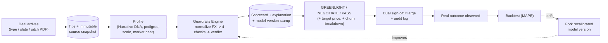

From deal to decision to audit to self-correction - one loop, fully explainable, fully
reproducible.