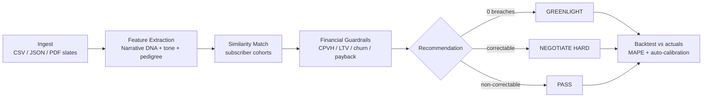
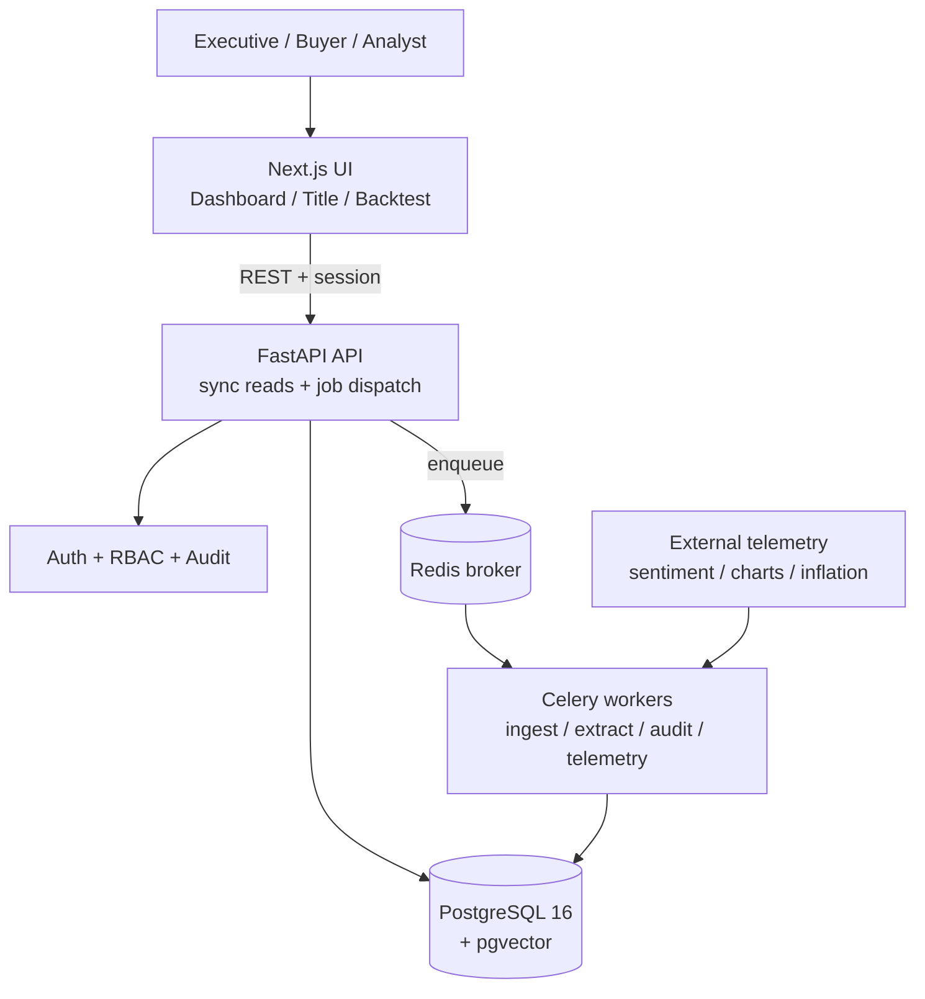

# CineROI AI - Platform Overview

**Internal decision-support platform for OTT content acquisition.** It turns
multi-format content submissions into a defensible GREENLIGHT / NEGOTIATE HARD /
PASS recommendation, backed by quantitative financial guardrails, historical
backtesting, and executive governance.

---

## The problem it solves

Streaming programming teams decide which titles to acquire or greenlight under
large, risky budgets. CineROI AI replaces gut-feel and scattered spreadsheets
with a consistent, auditable pipeline: ingest a slate of candidate titles, score
each against the same financial guardrails, and surface a clear recommendation
with the reasoning behind it - then prove the model stays accurate over time.

## End-to-end flow



## The four guardrails (the core asset)

| Guardrail | Measures | Threshold |
|---|---|---|
| **CPVH** | Cost per viewing hour | <= 0.18 USD premium / 0.05 USD library |
| **LTV-to-Cost** | Long-term value vs cost | >= 3.2x over 12-24 months |
| **Churn Mitigation** | Monthly churn reduction | >= 1.5% |
| **Payback Horizon** | Months to positive margin | 9-12 months |

Zero breaches -> GREENLIGHT. All breaches fixable by renegotiating cost ->
NEGOTIATE HARD. Any unfixable breach -> PASS. Every verdict ships with a
structured explanation (computed vs threshold, shortfall, dominant factor).

## Architecture at a glance



- **Frontend** - Next.js App Router + TypeScript, Tailwind, Shadcn UI, Recharts.
- **Backend** - FastAPI (async), layered as pure `domain` functions -> `engines`
  -> `repositories` -> `api`.
- **Async** - Celery workers for heavy work; the API never blocks on long jobs.
- **Data** - PostgreSQL 16 + pgvector for 1536-dim similarity search.

**Design principles:** deterministic financial math as the testable core;
append-only immutability (model versions, audit log, title versions) for
reproducibility and compliance; all money normalized to USD before any
comparison.

## Three executive views

1. **Command Dashboard** (`/dashboard`) - portfolio KPIs + sortable asset grid
   with recommendation badges.
2. **Title Evaluation** (`/titles/[id]`) - metadata radar, financial breakdown,
   negotiation leverage, and the full explanation of the recommendation.
3. **Backtest Studio** (`/backtest`) - predicted-vs-actual variance, one-click
   recalibration, and high-budget sign-off.

## Governance, security, reliability

- **SSO** (OIDC/SAML), identity-bound sessions, 30-min idle expiry.
- **RBAC** - one role per user; confidential data scoped by role and territory.
- **Executive sign-off** - GREENLIGHTs over $25M need both CCO and CFO approval.
- **Append-only audit log** with full before/after lineage (DB-enforced).
- **Encryption at rest** for scripts, deal terms, and PII; configurable retention.
- **Resilient async** - job lifecycle, idempotent webhooks, dead-letter queue +
  re-dispatch, 15-minute SLA alerts.

## Engineering quality

| Dimension | Status |
|---|---|
| Backend tests (pytest + Hypothesis property tests) | 167 passing |
| Frontend tests (Vitest + RTL) | 98 passing |
| Deployment smoke test (full Docker stack + /health) | 5 passing |
| Formal correctness properties on the financial core | 40, 100+ cases each |
| CI (backend + frontend + Docker smoke on every push) | GitHub Actions |

40 property-based tests exhaustively exercise the financial math; integration
tests run against a real PostgreSQL + pgvector; a smoke test proves the whole
stack boots healthy.

## Run it

```powershell
./scripts/demo-up.ps1     # builds, waits for health, prints URLs
```
Dashboard at http://localhost:3000/dashboard. Stop with `./scripts/demo-down.ps1`.
Full walkthrough in `docs/DEMO.md`; production rollout in `docs/PRODUCTION.md`.

## Production readiness

Application code is complete and verified. A `docker-compose.prod.yml` adds an
Nginx TLS proxy, host/CORS hardening, and a startup guard that refuses to boot
with insecure defaults. Three integrations need your credentials at rollout:
the real embedding model, the SSO audience, and managed Postgres/Redis - all
abstracted behind clean wiring points and documented in `docs/PRODUCTION.md`.

> One honest note: in demo mode the "Narrative DNA" embedding is a deterministic
> placeholder (not a semantic model) so the stack runs with zero external
> dependencies. All financial math, guardrails, backtesting, and governance are
> genuine working logic. Swapping in a real embedding model is a one-file change.